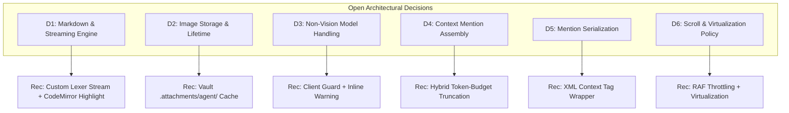
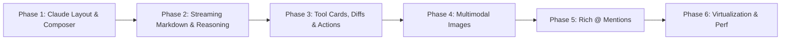

# AI Chat UI Overhaul Feature Plan (Claude-Style Experience)

**Target**: Overhaul the DaVinci Notes AI Chat interface (`davinci://agent`) to match the elegance, ergonomics, and responsiveness of Claude's conversational web UI, built strictly within DaVinci's Obsidian-flat design system (dark-first, borders-not-shadows, no glassmorphism/gradients, SCSS + CUBE CSS, Radix UI primitives, Phosphor icons, and `@app/design-system`).

In strict alignment with `AGENTS.md`, `DECISIONS.md`, and `PERFORMANCE.md`:
- **Lightweight & Fast**: Lazy-loaded bundle boundary (0 KB cost on startup); virtualization for long conversations; streaming throttling to 60fps; memoized message bubbles.
- **Obsidian-Flat Aesthetics**: Editorial, typography-driven, subtle borders for depth, no Tailwind, no raw hex/px outside `@app/design-tokens`.
- **Local-First & Direct-to-Provider**: Multimodal vision support across local (Ollama) and cloud (Gemini, OpenRouter) with strict privacy boundaries and zero owned backend.
- **Concurrency & Storage Discipline**: All SQLite operations strictly follow `withDbLock`; zero long-running transactions; non-destructive attachments and conversation serialization.

---

## 1. Current-State Report of the Existing Chat UI

An in-depth inspection of the current AI agent implementation revealed the following architecture and limitations:

### 1.1 Existing Components & Layout (`apps/desktop/src/components/AgentView/`)
- **Container (`AgentView.tsx`)**: Split layout containing `AgentHeader`, a scrollable `.agent-view__messages` list, an inline `AgentDiffViewer` (when tools propose file mutations), and `AgentChatInput` fixed at the bottom.
- **Message List & Bubbles (`AgentMessageBubble.tsx`)**:
  - Differentiates `user` vs `assistant` messages.
  - User messages render in a right-aligned bubble (`max-width: 80%`).
  - Assistant messages render as plain text via `AgentMarkdownContent.tsx`.
  - Tool calls render as `<details className="agent-tool-card">` with basic JSON arguments and success/error badges.
  - **Missing**: No collapsible reasoning/thinking (`<think>`) blocks, no citations/sources section for web search results, no per-message actions (copy, edit, retry, regenerate), and no image rendering.
- **Markdown Renderer (`AgentMarkdownContent.tsx`)**:
  - A hand-rolled line-by-line regex parser (`content.split('\n')`).
  - Supports only H1-H3, bullet lists, inline bold/italic/code, and `[[wikilinks]]`.
  - **Severe Limitations**: Completely breaks on nested lists, numbered lists, blockquotes, markdown tables, external links `[text](url)`, syntax-highlighted code blocks, and math. Code blocks lack language tags and copy buttons.
- **Composer / Input Dock (`AgentChatInput.tsx`)**:
  - Standard `<textarea>` with fixed initial rows and rudimentary overflow.
  - Controls footer: `+` Capabilities Popover, Ask-for-Approval / Auto-apply toggle, Model/Agent selector dropdown, Web Search toggle, and Submit button.
  - **Missing**: True auto-growing textarea (clamped to max height), drag-and-drop zone, paste listener for images, image thumbnail previews, and token count indicator.
- **Context Mentions (`AgentMentionMenu.tsx` & `useAgentMention.ts`)**:
  - Listens for `@query` in the textarea and displays matching note and folder paths.
  - **Severe Limitations**: On selection, it simply pastes literal text `@path/to/note.md ` into the textarea string. It does **not** create structured context chips, does not read file contents into the prompt, does not calculate token sizes, and does not support folder-level context extraction.
- **Conversations Drawer (`AgentConversationsDrawer.tsx` & `useAgentConversations.ts`)**:
  - Right drawer listing past conversations grouped by project, backed by SQLite `settings` table (`key = "davinci_agent_conversations"`).
  - Works well for switching chats, but lacks search and export.

### 1.2 State Management & Provider Communication
- **Execution Hook (`useAgentExecution.ts`)**:
  - Manages `messages: ChatMessageItem[]`, `stagedChanges: StagedChangeItem[]`, and `isStreaming: boolean`.
  - Orchestrates execution through `runAgentStepLoop.ts` (`@app/ai-agent`) and `createConfiguredProvider` (`@app/ai-runtime`).
  - Also supports autonomous external CLI agents (`agy`, `claude`, `codex`, `opencode`) via loopback Tauri process spawning (`useCliAgentExecution.ts`).
- **Streaming Pipeline (`agentStepLoop.ts` & `sseStream.ts`)**:
  - Providers yield Server-Sent Events (`ChatStreamChunk`).
  - In `useAgentExecution.ts`, `onAssistantChunk` calls `setMessages` on **every single character or token received**.
  - **Critical Performance Defect**: Every chunk creates a new array reference for `messages`, triggering a full re-render of `AgentView` and every child `AgentMessageBubble`.
  - **Critical Scroll Defect**: In `AgentView.tsx`:
    ```tsx
    useEffect(() => {
      messagesEndRef.current?.scrollIntoView?.({ behavior: "smooth" });
    }, [messages]);
    ```
    This smooth-scrolls unconditionally on every token chunk. If a user tries to scroll up while the assistant is writing, the viewport forcibly jerks them back to the bottom ("scroll hijacking").
- **Message Data Model (`agentTypes.ts` vs `packages/ai-api/AIProvider.ts`)**:
  - `ChatMessageItem` is strictly text-based (`content: string`).
  - Neither `ChatMessageItem` nor `ChatMessage` in `@app/ai-api` supports multimodal image attachments, reasoning content, or structured mentions.

---

## 2. Open Decisions & Architecture Tradeoffs

Below are the architectural decision points requiring explicit alignment before implementation. Each includes tradeoffs and our recommendation.



### Decision D1: Markdown & Streaming Renderer Architecture
- **Context**: The current hand-rolled parser in `AgentMarkdownContent.tsx` is inadequate for technical chat, but mounting a full CodeMirror 6 `MarkdownView` per message bubble creates 50+ editor instances with severe memory overhead and DOM bloat.
- **Options**:
  1. *Mount CodeMirror `MarkdownView` for every message*: 100% Obsidian parity; however, CM6 instances take ~1.5 MB RAM each, struggle with 60fps streaming text insertion, and break standard text selection across messages.
  2. *Add heavy external React markdown parser (`react-markdown` + `remark-gfm` + `rehype-highlight`)*: Familiar, but adds ~85 KB min+gzip to the bundle and re-parses AST on every token update.
  3. *(Recommended)* *Custom Streaming Block Lexer + Token Cache (`AgentMarkdownStream.tsx`)*: Lightweight block tokenizer (~4 KB, 0 dependencies). Breaks text into stable block units (Paragraph, CodeBlock, Table, List, Blockquote, ThinkBlock, MathBlock). Terminal blocks are cached and memoized; only the active tail block re-parses during streaming. Syntax highlighting in code blocks reuses `@lezer/highlight` already bundled in `@app/editor`.
- **Tradeoff Summary**: Option 3 adds 0 KB new npm dependencies, delivers instant 60fps streaming with zero layout jumps, and allows embedding copy buttons and collapsible wrappers cleanly.

### Decision D2: Attached Image Storage Format & Lifetime
- **Context**: Users can attach images via paste, file picker, or drag-and-drop. Images need to be displayed in chat history, sent to multimodal LLMs, and preserved across app reboots.
- **Options**:
  1. *Store as raw base64 data URIs inside SQLite conversation JSON*: Easy to serialize, but balloons SQLite database size by megabytes, slowing down query locks (`withDbLock`) and note search indexing.
  2. *Store in OS temporary directory (`/tmp` or app cache)*: Clean, but macOS/Windows OS cleaners periodically wipe temp folders, resulting in broken image icons in older conversations.
  3. *(Recommended)* *Store in Vault Attachments Subfolder (`<vault>/.attachments/agent/`)*: Reuses `@app/attachments` (`writeAttachment`). Generates deterministic content-addressed names (`img_<hash>.png`). SQLite only stores relative vault paths (`.attachments/agent/img_abc123.png`).
- **Tradeoff Summary**: Option 3 keeps SQLite slim, integrates with vault backups and sync (Syncthing/Drive), avoids temp-file data loss, and reuses our existing attachment pipeline.

### Decision D3: Vision-Capability Handling & Model Limitations
- **Context**: Users may select models without vision capabilities (e.g. `gemma3`, `llama3.2-text`, `deepseek-r1`) or with vision (e.g. `gemini-2.0-flash`, `gpt-4o`, `llava`, `qwen-vl`).
- **Options**:
  1. *Allow image attachment anytime; fail at request time with provider error*: Poor UX; user waits for timeout only to get an obscure HTTP 400.
  2. *Strict model allowlist in frontend*: High maintenance; new models released weekly on OpenRouter/Ollama break or stay blocked.
  3. *(Recommended)* *Capability Detection + Soft Warning & Strip*:
     - Query provider model metadata or known vision capability tags (`vision: true` on catalog; default to true for Gemini and OpenRouter `gpt-4*`/`claude-3*`/`gemini*`).
     - If non-vision model is selected: the attach button displays a subtle warning badge ("Selected model does not support images"); if images are already staged, composer displays a prompt: "Remove images or switch to a vision model (e.g. Gemini 2.0 Flash)".

### Decision D4: `@` Context Mention Assembly & Token Budgeting
- **Context**: Mentioning notes or folders must inject vault content into the model prompt without blowing context windows or sending hundreds of megabytes over the wire.
- **Options**:
  1. *Lazy reference only (tell LLM the path and rely on `read_note` tool)*: Saves prompt tokens upfront, but wastes an entire roundtrip turn just for the agent to call `read_note`.
  2. *Dumb full-file dump of everything mentioned*: A single mentioned folder with 50 notes will exceed token limits and cause rate-limiting or huge API billing.
  3. *(Recommended)* *Hierarchical Token-Budgeted Injection*:
     - **Individual Notes**: Full text injected if under 24,000 tokens (~96 KB). If larger: inject frontmatter, first 500 lines, and line count warning.
     - **Folders**: Inject directory tree outline (paths, sizes) + contents of up to the top 5 most recently modified notes in that folder, up to a strict 32,000 token sub-budget. If over budget: summarize folder structure and instruct agent to use `read_note` for deeper files.
     - **`@current`**: Quick shortcut to bind the active note open in the editor.

### Decision D5: Mention Chip Serialization in Conversation History
- **Context**: In the composer, mentions look like rich interactive pill chips. When stored in SQLite and sent to the LLM, they must serialize cleanly.
- **Options**:
  1. *Convert to plain text `@path/to/note.md` in message content*: Loses semantic distinction between typing the character `@` and explicitly attaching a file.
  2. *Store separate metadata array on `ChatMessageItem`*: `mentions: { path: string; type: "file" | "folder" }[]`. The prompt assembler injects them into an explicit XML context wrapper:
     ```xml
     <context_attachments>
       <file path="Work/Spec.md">
         ...content...
       </file>
     </context_attachments>
     ```
- **Tradeoff Summary**: Option 2 is strictly recommended. Keeps user message text clean, separates user intent from injected background context, and aligns with standard Claude/OpenAI context formatting.

### Decision D6: Scroll Architecture & Viewport Stickiness
- **Context**: Chat UIs require rock-solid scrolling: auto-scroll to bottom as new tokens arrive, but **never** hijack scroll if the user scrolled up to read earlier history.
- **Options**:
  1. *`scrollIntoView({ behavior: 'smooth' })` on every update*: Current implementation; completely broken during rapid streaming.
  2. *(Recommended)* *Pin-to-Bottom Sentinel + Scroll State Tracker (`useChatScroll.ts`)*:
     - Listen to viewport `scroll` events with 50ms throttle.
     - If distance from bottom is `< 40px`, set `isAtBottom = true`.
     - During streaming: if `isAtBottom === true`, update `scrollTop = scrollHeight` synchronously inside `requestAnimationFrame` (instant, no smooth lag).
     - If user scrolls up (`distanceFromBottom > 40px`), freeze auto-scroll and display a floating **"Jump to latest ↓"** pill button with unread counter.

---

## 3. Phased Implementation Plan



### Phase 1: Claude-Style Layout, Auto-Growing Composer & Scroll Sentinel

- **Goal**: Transform the layout into a centered, comfortable column (`max-width: 48rem`), user bubbles vs assistant plain flow, auto-growing composer with keyboard shortcuts, and zero scroll hijacking.
- **Files/Packages Touched**:
  - `apps/desktop/src/components/AgentView/AgentView.tsx` (layout structure & scroll container)
  - `apps/desktop/src/components/AgentView/AgentView.scss` (CUBE CSS rules, max-width column, responsive margins)
  - `apps/desktop/src/components/AgentView/AgentChatInput.tsx` (auto-growing textarea up to 200px, send/stop button)
  - `apps/desktop/src/components/AgentView/useChatScroll.ts` [NEW] (stick-to-bottom logic, jump-to-latest indicator)
  - `apps/desktop/src/components/AgentView/AgentScrollBottomBtn.tsx` [NEW] (floating jump button)
- **New Dependencies**: None (0 KB).
- **Adversarial Verification Steps**:
  1. Paste 10 lines of text into composer: textarea auto-expands smoothly up to max height (200px) then reveals internal scrollbar without layout jank.
  2. Press `Enter` (without Shift): sends message; press `Shift+Enter`: inserts newline.
  3. Start streaming a 500-word response: while at bottom, viewport sticks smoothly to bottom.
  4. While streaming, scroll up 200px: auto-scroll immediately stops; "Jump to latest ↓" button appears.
  5. Click "Jump to latest ↓": viewport instantly returns to bottom and resumes sticking.
- **Rollback Note**: Revert `AgentView.tsx`, `AgentView.scss`, and `AgentChatInput.tsx` to restore previous fixed-dock layout.

---

### Phase 2: High-Performance Streaming Markdown, Code Blocks & Reasoning

- **Goal**: Replace the primitive regex parser with a high-performance streaming block lexer, copyable code blocks with language tags, collapsible `<think>`/reasoning blocks, and citations cards.
- **Files/Packages Touched**:
  - `apps/desktop/src/components/AgentView/AgentMarkdownContent.tsx` (replace with streaming block lexer)
  - `apps/desktop/src/components/AgentView/AgentCodeBlock.tsx` [NEW] (pre/code block with copy button, syntax highlight via `@lezer/highlight`)
  - `apps/desktop/src/components/AgentView/AgentReasoningBlock.tsx` [NEW] (collapsible "Thinking..." block with elapsed time)
  - `apps/desktop/src/components/AgentView/AgentCitationsList.tsx` [NEW] (grounded web search domain pills)
  - `apps/desktop/src/components/AgentView/agentMarkdownParser.ts` [NEW] (pure, unit-tested block tokenizer)
  - `apps/desktop/src/components/AgentView/AgentView.scss` (typography, code block chrome, thinking animation)
- **New Dependencies**: None. Reuses existing `@lezer/highlight` from `@app/editor` (0 KB).
- **Adversarial Verification Steps**:
  1. Stream a response containing `<think>Analyzing vault index...</think> Here is the answer`: reasoning block displays collapsed by default with an active spinner while thinking, then says "Thought for 2s"; answer flows below it.
  2. Stream a TypeScript code block: syntax is highlighted cleanly; clicking "Copy" changes icon to checkmark for 2s and copies code without line numbers.
  3. Stream a table, nested list, and blockquote: renders valid HTML elements without raw markdown artifacts.
  4. Stream 1,000 tokens rapidly: CPU usage remains low (<10%), no UI freezing.
- **Rollback Note**: Delete new helper files and restore original `AgentMarkdownContent.tsx`.

---

### Phase 3: Collapsible Tool Cards, Diff Links & Message Actions

- **Goal**: Redesign tool-call cards into sleek collapsible action rows, link staged changes directly to diffs, and provide per-message actions (Copy, Edit, Retry, Regenerate).
- **Files/Packages Touched**:
  - `apps/desktop/src/components/AgentView/AgentMessageBubble.tsx` (hover action toolbar, tool cards)
  - `apps/desktop/src/components/AgentView/AgentMessageActions.tsx` [NEW] (Copy, Edit prompt, Regenerate, Delete)
  - `apps/desktop/src/components/AgentView/AgentToolCard.tsx` [NEW] (sleek status card: running spinner, success, error)
  - `apps/desktop/src/components/AgentView/AgentDiffViewer.tsx` (styling alignment with message column)
  - `apps/desktop/src/components/AgentView/useAgentExecution.ts` (implement retry/edit flow)
  - `apps/desktop/src/components/AgentView/AgentView.scss`
- **New Dependencies**: None (0 KB).
- **Adversarial Verification Steps**:
  1. Trigger tool `create_note`: tool card displays clean pill "Created note `Projects/Roadmap.md`" with an interactive "View Diff" link.
  2. Click "Copy" on assistant message: markdown is copied to OS clipboard.
  3. Click "Edit" on user message: message enters inline edit mode in composer; submitting truncates subsequent conversation turns and regenerates.
  4. Click "Regenerate" on assistant message: clears that turn and streams a new response.
- **Rollback Note**: Revert `AgentMessageBubble.tsx` and `useAgentExecution.ts`.

---

### Phase 4: Multimodal Image Attachments & Vision Pipeline

- **Goal**: Full image attachment support via paperclip button, file drag-and-drop, and clipboard paste, with composer thumbnail previews, click-to-zoom modal, vault caching, and vision model formatting.
- **Files/Packages Touched**:
  - `packages/ai-api/AIProvider.ts` (extend `ChatMessage` to support multimodal parts)
  - `packages/ai-runtime/geminiTransport.ts` (map base64 images to `inlineData`)
  - `packages/ai-runtime/cloudTransport.ts` (map images to OpenAI `image_url` data URIs)
  - `packages/ai-runtime/ollamaTransport.ts` (map base64 images to Ollama `images` array)
  - `apps/desktop/src/components/AgentView/agentTypes.ts` (add `attachments: ChatAttachment[]` to `ChatMessageItem`)
  - `apps/desktop/src/components/AgentView/AgentChatInput.tsx` (drop zone, paste handler, attachment chips)
  - `apps/desktop/src/components/AgentView/AgentImageThumbnail.tsx` [NEW] (thumb chip with remove 'x')
  - `apps/desktop/src/components/AgentView/AgentImageViewerModal.tsx` [NEW] (click-to-zoom modal using Radix Dialog)
  - `apps/desktop/src/components/AgentView/imageAttachmentUtils.ts` [NEW] (client compression, MIME check, vault caching)
- **New Dependencies**: None (0 KB). Reuses existing canvas image utilities and Radix Dialog.
- **Adversarial Verification Steps**:
  1. Paste screenshot (`Cmd+V`) from clipboard into composer: thumbnail appears with filename `pasted-<timestamp>.png` and remove button.
  2. Drag and drop 3 images onto chat input: all 3 appear as thumbnail chips.
  3. Send message with image to Gemini / OpenRouter: request payload includes valid image bytes; model answers questions about the image.
  4. Switch to non-vision model (e.g. `gemma3`): composer displays clear warning that model cannot parse images.
  5. Click image in message history: opens fullscreen preview modal; `Escape` closes it.
- **Rollback Note**: Revert `AIProvider.ts` back to text-only `ChatMessage` and remove `AgentImageThumbnail.tsx`.

---

### Phase 5: Rich Context Mentions Pipeline (`@note` & `@folder`)

- **Goal**: Turn `@` typing into an intelligent context injection system with rich picker UI, interactive chips in the composer, token budgeting, folder tree summarization, and `@current` binding.
- **Files/Packages Touched**:
  - `apps/desktop/src/components/AgentView/useAgentMention.ts` (structured mention tracking: range, id, type)
  - `apps/desktop/src/components/AgentView/AgentMentionMenu.tsx` (fuzzy search via `fuzzysort`, keyboard navigation, folder badges)
  - `apps/desktop/src/components/AgentView/AgentMentionChip.tsx` [NEW] (composer chips: note vs folder icon, remove button)
  - `apps/desktop/src/components/AgentView/agentContextAssembler.ts` [NEW] (reads note content via `inspectionBackend`, token capping, folder trees)
  - `apps/desktop/src/components/AgentView/useAgentExecution.ts` (inject context envelope into LLM prompt)
- **New Dependencies**: None. `fuzzysort` is already installed in `apps/desktop` (0 KB).
- **Adversarial Verification Steps**:
  1. Type `@` in composer: popup opens instantly listing recent notes and folders.
  2. Type `@cur`: top result is `@current` (active note in editor); selecting it attaches active note chip.
  3. Mention a 100 KB note: context assembler truncates to 24,000 tokens with an explicit note in the context header; model answers accurately without blowing context limits.
  4. Mention a folder with 40 notes: context assembler generates directory outline + top 5 modified files; no rate-limit errors.
  5. Remove chip with backspace or 'x': mention is completely decoupled from prompt text.
- **Rollback Note**: Revert `AgentChatInput.tsx` to text-only mention string replacement.

---

### Phase 6: Performance Hardening, Virtualization & Token Audit

- **Goal**: Virtualize long conversation lists (`@tanstack/react-virtual`), memoize message bubble components (`React.memo`), throttle streaming chunk state dispatches to animation frames, and verify strict zero bundle regression.
- **Files/Packages Touched**:
  - `apps/desktop/src/components/AgentView/AgentView.tsx` (integrate `useVirtualizer` for message list)
  - `apps/desktop/src/components/AgentView/AgentMessageBubble.tsx` (wrap in `React.memo` with custom comparator)
  - `apps/desktop/src/components/AgentView/useAgentExecution.ts` (batch streaming token state updates with `requestAnimationFrame`)
  - `apps/desktop/src/components/AgentView/AgentView.scss` (virtualized list container styling)
- **New Dependencies**: None. `@tanstack/react-virtual` is already installed in `apps/desktop` (0 KB).
- **Adversarial Verification Steps**:
  1. Load a conversation with 150 messages: DOM contains only ~12-15 rendered message nodes at any time; scroll is smooth 60fps.
  2. Stream a 2,000-token response in a 50-message conversation: only the active assistant message bubble re-renders; earlier messages stay untouched.
  3. Run `pnpm run check:bundle-size`: bundle size change is <= 2 KB.
  4. Run `pnpm run check:public-tokens`: 0 new token violations.
- **Rollback Note**: Revert virtualization back to standard `.map()` list.

---

## 4. Risk Assessment & Mitigations

| Risk | Impact | Likelihood | Mitigation |
|---|---|---|---|
| **Scroll Jitter / Fighting during Fast Streaming** | High | High | Implement `useChatScroll` with explicit `isAtBottom` hysteresis (Phase 1). Never use `scrollIntoView({ behavior: 'smooth' })` during stream. |
| **Token Context Overflow with Folder Mentions** | High | Medium | Hard budget caps in `agentContextAssembler.ts` (Phase 5): 24K token cap per file, 32K token cap per folder. |
| **Memory Leak from Large Base64 Images** | Medium | Medium | Store images as files in `.attachments/agent/` and load via standard asset URLs; revoke object URLs immediately after staging (Phase 4). |
| **Re-render Bottleneck on Rapid Token Streaming** | High | High | Throttle `onAssistantChunk` via `requestAnimationFrame` and memoize `AgentMessageBubble` (Phase 2 & 6). |
| **Code Mirror Heavy Overhead in Chat List** | High | Low | Avoid embedding CodeMirror instances in message bubbles; use lightweight stream lexer with Lezer token styling (Phase 2). |

---

## 5. Phase Execution Prompts

### Phase 1 Prompt: Claude-Style Layout, Composer & Scroll Architecture
```text
Task: Implement Phase 1 of ai-chat-ui-feature-plan.md (Claude-Style Layout, Composer & Scroll Sentinel).

Read AGENTS.md, DECISIONS.md, PROGRESS.md, and PERFORMANCE.md first.
Review ADR-0007, ADR-0038, and ADR-0224 before touching styles.

Scope:
1. Redesign AgentView.tsx and AgentView.scss to use a centered, comfortable column layout (max-width: 48rem / 768px).
2. Style user messages as subtle, right-aligned rounded bubbles and assistant messages as natural flowing text.
3. Build an auto-growing composer textarea in AgentChatInput.tsx (min-height: 48px, max-height: 200px) with Enter-to-send and Shift+Enter newline.
4. Implement useChatScroll.ts and AgentScrollBottomBtn.tsx: stick-to-bottom during streaming when at bottom, freeze scroll when user scrolls up, and show a "Jump to latest ↓" button.
5. Provide a quiet, elegant empty state (AgentStarterPrompts.tsx) with Claude-like prompt cards.

Constraints:
- 0 KB new dependencies.
- No Tailwind. Use SCSS + tokens from @app/design-tokens.
- Soft cap 200 lines, hard cap 250 lines per file.
- Single concern = one commit.

Verify:
- Auto-expanding textarea up to 200px then internal scroll.
- Streaming text sticks to bottom without smooth-scroll lag.
- Scrolling up stops auto-scroll and displays "Jump to latest ↓".
```

### Phase 2 Prompt: High-Performance Streaming Markdown, Code Blocks & Reasoning
```text
Task: Implement Phase 2 of ai-chat-ui-feature-plan.md (Streaming Markdown, Code Blocks & Reasoning).

Read AGENTS.md, DECISIONS.md, PROGRESS.md, and PERFORMANCE.md first.
Review packages/editor/theme/ and @lezer/highlight usage.

Scope:
1. Replace AgentMarkdownContent.tsx with agentMarkdownParser.ts and AgentMarkdownStream.tsx (stream-safe block tokenizer).
2. Implement AgentCodeBlock.tsx with copy button, syntax highlight styling via @lezer/highlight, and language badge.
3. Implement AgentReasoningBlock.tsx for collapsible <think> / reasoning sections with animated thinking state and elapsed timer.
4. Implement AgentCitationsList.tsx for web search grounded source pills.
5. Memoize block rendering so past blocks do not re-render as new tokens stream.

Constraints:
- 0 KB new dependencies.
- Strict 250-line file cap.
- Dark-first Obsidian flat styling (borders not shadows).

Verify:
- Code blocks copy correctly with feedback icon.
- <think> tags render as clean collapsible accordion.
- Rapid token generation (1,000 tokens) causes no UI freeze or dropped frames.
```

### Phase 3 Prompt: Collapsible Tool Cards, Diff Links & Message Actions
```text
Task: Implement Phase 3 of ai-chat-ui-feature-plan.md (Tool Cards, Diff Links & Message Actions).

Read AGENTS.md, DECISIONS.md, PROGRESS.md, and PERFORMANCE.md first.
Review AgentDiffViewer.tsx and AgentMessageBubble.tsx.

Scope:
1. Build AgentToolCard.tsx: sleek collapsible row with status icon (spinner while running, green check, amber warning), clean summary, and full arguments.
2. Link file modification tool calls directly to AgentDiffViewer.
3. Build AgentMessageActions.tsx with hover toolbar on message bubbles: Copy markdown, Edit prompt (user turns), and Retry/Regenerate (assistant turns).
4. Update useAgentExecution.ts to support edit-and-resubmit and turn regeneration.

Constraints:
- 0 KB new dependencies.
- Colocate styles and types.
- Strict file length limits.

Verify:
- Tool cards expand and collapse smoothly.
- Edit message populates composer, truncates forward history, and resubmits.
- Regenerate clears assistant turn and triggers fresh stream.
```

### Phase 4 Prompt: Multimodal Image Attachments & Vision Pipeline
```text
Task: Implement Phase 4 of ai-chat-ui-feature-plan.md (Multimodal Images & Vision Pipeline).

Read AGENTS.md, DECISIONS.md, PROGRESS.md, and PERFORMANCE.md first.
Review packages/ai-api/AIProvider.ts, packages/attachments/, and Radix Dialog.

Scope:
1. Extend ChatMessage in packages/ai-api/AIProvider.ts to support image attachments (base64/data URI).
2. Update geminiTransport.ts, cloudTransport.ts, and ollamaTransport.ts to format images for their respective APIs.
3. In AgentChatInput.tsx, add image attachment via paperclip button, drag-and-drop zone, and clipboard paste.
4. Implement AgentImageThumbnail.tsx with remove 'x' button in composer.
5. Implement AgentImageViewerModal.tsx for click-to-zoom image viewer in message history.
6. Handle non-vision models gracefully with clear UI warning.

Constraints:
- Cache images in vault under .attachments/agent/ (no ballooning SQLite with huge base64 strings).
- 0 KB new dependencies.

Verify:
- Pasting image from clipboard stages thumbnail.
- Drag-and-drop stages files.
- Sending image to Gemini/OpenRouter yields vision-grounded answer.
- Non-vision model shows disabled warning.
```

### Phase 5 Prompt: Rich Context Mentions Pipeline (@note & @folder)
```text
Task: Implement Phase 5 of ai-chat-ui-feature-plan.md (Rich Context Mentions Pipeline).

Read AGENTS.md, DECISIONS.md, PROGRESS.md, and PERFORMANCE.md first.
Review useAgentMention.ts, AgentMentionMenu.tsx, and fuzzysort.

Scope:
1. Upgrade useAgentMention.ts to support interactive mention chips in AgentChatInput.tsx.
2. Implement AgentMentionChip.tsx (file vs folder icon, truncated name, remove button).
3. Support @current shortcut to bind active open note.
4. Build agentContextAssembler.ts to read file contents, enforce strict token caps (24K tokens per file, 32K per folder), and generate folder tree outlines.
5. Inject context into LLM prompt via clean XML envelope (<context_attachments>).

Constraints:
- Follow sqlite-concurrency-requirement: all db queries use withDbLock.
- 0 KB new dependencies (fuzzysort is already installed).

Verify:
- Typing @ opens fuzzy menu; selecting note renders chip in composer.
- Mentioning large file truncates safely with explicit warning.
- Folder mention includes directory outline and top files without exceeding context budget.
```

### Phase 6 Prompt: Performance Hardening, Virtualization & Token Audit
```text
Task: Implement Phase 6 of ai-chat-ui-feature-plan.md (Virtualization & Performance Hardening).

Read AGENTS.md, DECISIONS.md, PROGRESS.md, and PERFORMANCE.md first.
Review @tanstack/react-virtual and check-bundle-size.mjs.

Scope:
1. Virtualize message list in AgentView.tsx using @tanstack/react-virtual.
2. Wrap AgentMessageBubble in React.memo with custom props comparator.
3. Throttle streaming token dispatches in useAgentExecution.ts to requestAnimationFrame.
4. Run check:bundle-size and check:public-tokens to ensure 0 regression.

Constraints:
- 0 KB new dependencies (@tanstack/react-virtual already installed).
- Verify bundle growth <= 2 KB.
- 0 token violations.

Verify:
- 150-message conversation scrolls at solid 60fps with only visible DOM nodes mounted.
- Memory usage during long streaming sessions stays flat.
- Automated tests pass across all packages.
```

---

## 6. Definition of Done Checklist

- [ ] **Visual Parity**: Centered comfortable column (`max-width: 48rem`), subtle user bubbles, plain flowing assistant text, quiet empty state with Claude-style prompt suggestions.
- [ ] **Auto-Growing Composer**: Starts at 48px, expands up to 200px, handles `Enter` (send) and `Shift+Enter` (newline).
- [ ] **Streaming Markdown**: Fast block lexer rendering markdown, copyable code blocks with language badges, collapsible `<think>` blocks, and citations cards.
- [ ] **Rock-Solid Scrolling**: Automatic scroll to bottom while streaming if already at bottom; freezes scroll when user scrolls up; "Jump to latest ↓" button with smooth return.
- [ ] **Multimodal Vision**: Attach images via button, drag-and-drop, and paste; stored in `.attachments/agent/`; sent correctly to Gemini, OpenRouter, and Ollama; click-to-zoom modal; graceful non-vision model fallback.
- [ ] **Context Mentions**: Typing `@` offers fuzzy file/folder selection and `@current`; renders as chips; injects token-budgeted content (capped at 24K tokens/file, 32K/folder).
- [ ] **Message Actions**: Copy markdown, Edit prompt, and Regenerate response on message hover.
- [ ] **Performance & Bundle**: Virtualized message list with `@tanstack/react-virtual`; zero new dependencies (0 KB); bundle check passes; all files <= 250 lines.
