# Bookmarks Feature & Phased Implementation Plan

Target: Provide a fast, polished, local-first Bookmarks system for DaVinci Notes. Users can bookmark any vault note from the editor, file tree, command palette, or hotkey (`Mod+D`), and view/manage all bookmarked notes in a dedicated Bookmarks tab accessed via the icon rail or tab bar.

In alignment with `AGENTS.md`, `DECISIONS.md`, and `PERFORMANCE.md`, Bookmarks are **local-first, sync-transparent, lightweight, and zero-dependency**: storage lives in `.davinci/bookmarks.json` inside the vault, syncing cleanly across Google Drive and Syncthing to mobile with no backend. The view is lazy-loaded, lists are virtualized above 200 items, and derived previews come from the existing index without per-row disk reads.

---

## 1. Goals and Non-Goals

### 1.1 Goals
- **Single Source of Truth in Vault**: Store bookmarks in `<vault>/.davinci/bookmarks.json`. Syncs naturally with existing file sync; zero SQLite migration churn.
- **Robust Identity & Lifecycle**: Track vault-relative paths with `addedAt` timestamp. In-app note renames, folder renames, H1 ↔ filename sync, and external watcher renames cleanly remap bookmarks. Deletions mark bookmarks as `missing` rather than silently discarding them.
- **Merge-Safe Concurrency**: Union-by-path merge with latest `addedAt` resolving conflicts when external edits arrive. Atomic disk writes via temp-file and rename.
- **Omnipresent Add/Remove Access**: Shared `useBookmarks()` hook powering editor header toggle, file tree context menu, file tree row glyph, command palette commands, and `Mod+D` hotkey.
- **Polished Obsidian-Style Page**: Dark-first, flat, borders-not-shadows aesthetic, Phosphor icons, CUBE CSS with tokens. Filtering, sorting (Recently added, Name A-Z, Last modified), content preview snippets, keyboard navigation, and virtualization (>200 items).
- **Tab Integration**: Single dedicated tab (`davinci://bookmarks`), active icon rail indicator, and session restore across app restarts.

### 1.2 Non-Goals (Deferred to Future Iterations)
- Nested bookmark folders/groups or custom bookmark tags.
- Bookmarking headings, block references, or saved searches.
- Mobile UI implementation (data schema is shared and sync-compatible, but mobile UI is sequenced separately).
- Drag-and-drop manual reordering of bookmarks.

---

## 2. Architecture & Architectural Decisions (ADR-0210)

```mermaid
flowchart TD
    subgraph StorageLayer[".davinci/bookmarks.json (Source of Truth)"]
        DiskFile[".davinci/bookmarks.json"] <-->|Atomic write / load| BookmarkStore["useBookmarkStore (Zustand)"]
        BookmarkStore <-->|Union-by-path merge| WatcherReconcile["Watcher / Sync Reconciliation"]
    end

    subgraph EntryPoints["Add / Remove Entry Points"]
        EditorHeader["Editor Note Header '...' Menu"] -->|useBookmarks| BookmarkStore
        FileTreeContext["File Tree Context Menu"] -->|useBookmarks| BookmarkStore
        CommandPalette["Command Palette (Mod+D)"] -->|useBookmarks| BookmarkStore
        FileTreeGlyph["File Tree Row Glyph"] <-->|useBookmarks| BookmarkStore
    end

    subgraph LifecycleHooks["Lifecycle Alignment"]
        RenameNote["renameNoteInVault"] -->|remapPath| BookmarkStore
        RenameFolder["renameFolderInVault"] -->|remapFolder| BookmarkStore
        H1Sync["H1 <-> filename sync"] -->|renameNoteInVault| BookmarkStore
        DeleteNote["deleteNoteInVault / Watcher removed"] -->|markMissing| BookmarkStore
    end

    subgraph Presentation["Bookmarks Page (Tab: davinci://bookmarks)"]
        IconRail["IconRail (BookmarkSimple)"] -->|open / focus| BookmarksTab["AppTabs (davinci://bookmarks)"]
        BookmarksTab --> LazyView["Lazy-Loaded BookmarksView"]
        LazyView --> DerivedData["Title, Muted Path, Preview Snippet (from SQLite index / cache)"]
    end
```



### 2.1 Storage Schema
```json
{
  "version": 1,
  "bookmarks": [
    {
      "path": "Notes/Architecture.md",
      "addedAt": 1729851234000
    }
  ]
}
```

### 2.2 Concurrency & Merge Safety
- **Merge Logic**: When incoming changes arrive for `.davinci/bookmarks.json`, compute `mergeBookmarkSets(local, remote)`:
  - If a path exists in both, the item with `Math.max(local.addedAt, remote.addedAt)` is preserved (preserving `missing: true` if currently marked missing).
  - If a path exists in only one set, it is preserved.
  - No last-write-wins file clobbering.
- **Atomic Writes**: Programs write through `withVaultWatchSuppressed` and `writeNote`, which writes to `.<stem>.tmp.<pid>` and atomically replaces the file.
- **Debounced Save**: Writes are batched/debounced at 400ms with synchronous flush on vault switch, tab close, or window unload.

---

## 3. Implementation Phases

### Phase 1: Data Layer (Storage, Store, Parsing, Merging, Atomic Write)
- **Goal**: Implement the pure storage parser/serializer, set-by-path merge engine, in-memory Zustand store slice, and atomic persistence.
- **Files Touched**:
  - `apps/desktop/src/bookmarks/bookmarkTypes.ts` [NEW]
  - `apps/desktop/src/bookmarks/bookmarkStorage.ts` [NEW]
  - `apps/desktop/src/bookmarks/bookmarkStore.ts` [NEW]
  - `apps/desktop/src/bookmarks/bookmarkStorage.test.ts` [NEW]
  - `apps/desktop/src/bookmarks/index.ts` [NEW]
- **Assumptions**:
  - `.davinci/` directory is created if missing; `readNote` and `writeNote` operate safely on `.davinci/bookmarks.json`.
  - Corrupt JSON falls back safely without destroying existing bookmarks on disk.
- **Adversarial Verification Steps**:
  1. *Empty & Corrupted File Test*: Construct tests passing `""`, `"{ corrupt"`, and `{ "version": 99 }`. Verify parser returns safe empty bookmark set `{ version: 1, bookmarks: [] }` without throwing.
  2. *Concurrent Edit Merge Test*: Construct two divergent sets A (`[note1 @ t1, note2 @ t3]`) and B (`[note2 @ t4, note3 @ t2]`). Assert merged result contains `note1`, `note2 (addedAt: t4)`, and `note3`.
  3. *Atomic Persistence Test*: Verify that saving writes valid formatted JSON to `.davinci/bookmarks.json` and suppresses watcher loops.

---

### Phase 2: Lifecycle Management (Rename, Move, Delete, External Changes)
- **Goal**: Integrate bookmarks with note renames, folder renames, note deletions, H1 ↔ filename sync, and file watcher events.
- **Files Touched**:
  - `apps/desktop/src/vault/renameNoteInVault.ts` [MODIFY]
  - `apps/desktop/src/vault/renameFolderInVault.ts` [MODIFY]
  - `apps/desktop/src/vault/deleteNoteInVault.ts` [MODIFY]
  - `apps/desktop/src/vault/deleteFolderInVault.ts` [MODIFY]
  - `apps/desktop/src/vault/useVaultWatcherSubscription.ts` [MODIFY]
  - `apps/desktop/src/bookmarks/bookmarkLifecycle.test.ts` [NEW]
- **Assumptions**:
  - Renaming updates the path while preserving the original `addedAt` timestamp.
  - Deleting a file or folder marks items as `missing: true` rather than deleting them from `bookmarks.json`.
  - Re-creating or restoring a missing note clears the `missing` flag.
- **Adversarial Verification Steps**:
  1. *Nested Folder Rename Test*: Bookmark `folderA/sub/note1.md` and `folderA/note2.md`. Rename `folderA` to `folderB`. Verify bookmarks update directly to `folderB/sub/note1.md` and `folderB/note2.md`.
  2. *H1 ↔ Filename Sync Loop Test*: Change `# Old Title` to `# New Title`. Verify note renames to `New Title.md`, bookmark remaps cleanly, and 0 recurring write triggers or infinite loops occur.
  3. *Delete & Restore Test*: Delete `bookmarked.md`. Verify bookmark persists with `missing: true`. Restore `bookmarked.md`. Verify `missing` becomes false.

---

### Phase 3: Add/Remove UI & Global Hook
- **Goal**: Implement unified `useBookmarks` hook and expose bookmark actions across Editor header, FileTree context menu, FileTree rows, and Command Palette (`Mod+D`).
- **Files Touched**:
  - `apps/desktop/src/bookmarks/useBookmarks.ts` [NEW]
  - `apps/desktop/src/components/EditorArea/EditorArea.tsx` [MODIFY]
  - `apps/desktop/src/components/FileTree/FileTreeContextMenu.tsx` [MODIFY]
  - `apps/desktop/src/components/FileTree/FileTreeRow.tsx` [MODIFY]
  - `apps/desktop/src/components/FileTree/FileTree.tsx` [MODIFY]
  - `apps/desktop/src/components/CommandPalette/buildPaletteCommands.ts` [MODIFY]
  - `apps/desktop/src/components/CommandPalette/executePaletteCommand.ts` [MODIFY]
  - `apps/desktop/src/components/CommandPalette/CommandPalette.tsx` [MODIFY]
  - `apps/desktop/src/bookmarks/useBookmarks.test.ts` [NEW]
- **Assumptions**:
  - Hotkey `Mod+D` (Cmd+D on macOS, Ctrl+D on Windows/Linux) toggles bookmark for the active note.
  - File tree displays a discreet `BookmarkSimple` glyph when a note is bookmarked.
- **Adversarial Verification Steps**:
  1. *Hook State Consistency*: Toggle bookmark via hook from editor; verify file tree row glyph immediately appears and context menu reflects "Remove bookmark".
  2. *Context Menu Action*: Right-click note in file tree, click "Bookmark note", verify file is added to `.davinci/bookmarks.json`.
  3. *Command Palette & Hotkey*: Dispatch `Mod+D` with active note; verify note toggles bookmark state.

---

### Phase 4: Bookmarks Page UI & Tab Integration
- **Goal**: Build the dedicated Bookmarks view matching Obsidian design rules (borders not shadows, dark-first tokens, Phosphor icons, CUBE CSS).
- **Files Touched**:
  - `apps/desktop/src/components/BookmarksView/BookmarksView.tsx` [NEW]
  - `apps/desktop/src/components/BookmarksView/BookmarksHeader.tsx` [NEW]
  - `apps/desktop/src/components/BookmarksView/BookmarkRow.tsx` [NEW]
  - `apps/desktop/src/components/BookmarksView/useBookmarkKeyboardNav.ts` [NEW]
  - `apps/desktop/src/components/BookmarksView/BookmarksView.module.scss` [NEW]
  - `apps/desktop/src/components/BookmarksView/BookmarksView.stories.tsx` [NEW]
  - `apps/desktop/src/components/BookmarksView/BookmarksView.test.tsx` [NEW]
  - `apps/desktop/src/components/BookmarksView/index.ts` [NEW]
  - `apps/desktop/src/components/IconRail/IconRail.tsx` [MODIFY]
  - `apps/desktop/src/components/AppTabs/AppTabs.tsx` [MODIFY]
  - `apps/desktop/src/App.tsx` [MODIFY]
- **UI Specification Requirements**:
  - **Icon Rail**: `BookmarkSimple` icon, active/filled when `activeNotePath === "davinci://bookmarks"`. Clicking opens or activates the tab.
  - **Header**: Title "Bookmarks" with count badge, search filter input (`/` shortcut), sort dropdown (Recently added, Name A-Z, Last modified).
  - **Row**: File icon (or custom emoji icon from `treeIconStorage`), title, muted folder path, 1-2 line content preview snippet from index/cache, added date, hover action to remove.
  - **Interactions**: Click opens note in active leaf, Cmd/Ctrl-click or middle-click opens in a new tab.
  - **States**: Friendly empty state with guide, dimmed row with warning badge and "Remove" for missing notes, no-results state for search filter.
  - **Keyboard Navigation**: Up/Down to navigate, Enter to open, Delete/Backspace to remove, `/` to focus filter input.
  - **Virtualization**: Activates `@tanstack/react-virtual` above 200 items.
- **Adversarial Verification Steps**:
  1. *Filter & Sort Correctness*: Add 5 bookmarks with varied names and dates. Test sort by Name A-Z, Recently added, and Last modified. Type filter query; assert instant filtering and empty state if no match.
  2. *Keyboard Interaction*: Navigate with ArrowDown/ArrowUp, press Enter, verify target note opens. Press Delete, verify bookmark is removed. Press `/`, verify search input gains focus.
  3. *Missing State Handling*: Verify deleted file shows dimmed styling, warning icon, and can be removed via row button.

---

### Phase 5: Polish, Session Restore, Performance & Closeout
- **Goal**: Enforce single-tab uniqueness, session persistence across restarts, high-scale virtualization benchmark (1,000 bookmarks), theme token verification, and documentation.
- **Files Touched**:
  - `apps/desktop/src/vault/vaultSwitchOrchestrator.ts` [MODIFY]
  - `apps/desktop/src/bookmarks/bookmarksBenchmark.test.ts` [NEW]
  - `PROGRESS.md` [MODIFY]
  - `docs/HISTORY.md` [MODIFY]
- **Verification Steps**:
  1. *Single Tab Invariant*: Click Bookmarks icon in Icon Rail repeatedly; assert exactly 1 Bookmarks tab exists in `openNotes`.
  2. *Session Restore*: Leave Bookmarks tab open; simulate app restart / vault switch; assert Bookmarks tab restores cleanly.
  3. *1,000 Bookmarks Performance*: Run benchmark test with 1,000 items. Assert parse time < 5ms, filter/sort < 10ms, virtualization maintains < 50 DOM nodes rendered.
  4. *Theme Token Audit*: Stylelint and visual check verifying zero raw hex/px values; proper contrast in both Dark and Light themes.
