# Bookmarks Feature & Phased Implementation Plan

Target: Provide a fast, polished, local-first Bookmarks system for DaVinci Notes. Users can bookmark any vault note from the editor, file tree, command palette, or hotkey (`Mod+D`), and view/manage all bookmarked notes in a dedicated Bookmarks tab accessed via the icon rail or tab bar.

In alignment with `AGENTS.md`, `DECISIONS.md`, and `PERFORMANCE.md`, Bookmarks are **local-first, sync-transparent, lightweight, and zero-dependency**: storage lives in `.davinci/bookmarks.json` inside the vault, syncing cleanly across Google Drive and Syncthing to mobile with no backend. The view is lazy-loaded, lists are virtualized above 200 items, and derived previews come from the existing index without per-row disk reads.

---

## 1. Goals and Non-Goals

### 1.1 Goals
- **Single Source of Truth in Vault**: Store bookmarks in `<vault>/.davinci/bookmarks.json`. Syncs naturally with existing file sync; zero SQLite migration churn.
- **Robust Identity & Lifecycle**: Track vault-relative paths with `addedAt` timestamp. In-app note renames, folder renames, H1 ↔ filename sync, and external watcher renames cleanly remap bookmarks. Deletions mark bookmarks as `missing` rather than silently discarding them.
- **Merge-Safe Concurrency**: Union-by-path merge with latest `addedAt` resolving conflicts when external edits arrive. Atomic disk writes via temp-file and rename.
- **Omnipresent Add/Remove Access**: Shared `useBookmarks()` hook powering editor header toggle, file tree context menu, file tree row glyph, command palette commands, and `Mod+D` hotkey.
- **Polished Obsidian-Style Page**: Dark-first, flat, borders-not-shadows aesthetic, Phosphor icons, CUBE CSS with tokens. Filtering, sorting (Recently added, Name A-Z, Last modified), content preview snippets, keyboard navigation, and virtualization (>200 items).
- **Tab Integration**: Single dedicated tab (`davinci://bookmarks`), active icon rail indicator, and session restore across app restarts.

### 1.2 Non-Goals (Deferred to Future Iterations)
- Nested bookmark folders/groups or custom bookmark tags.
- Bookmarking headings, block references, or saved searches.
- Mobile UI implementation (data schema is shared and sync-compatible, but mobile UI is sequenced separately).
- Drag-and-drop manual reordering of bookmarks.

---

## 2. Architecture & Architectural Decisions (ADR-0210)

```mermaid
flowchart TD
    subgraph StorageLayer[".davinci/bookmarks.json (Source of Truth)"]
        DiskFile[".davinci/bookmarks.json"] <-->|Atomic write / load| BookmarkStore["useBookmarkStore (Zustand)"]
        BookmarkStore <-->|Union-by-path merge| WatcherReconcile["Watcher / Sync Reconciliation"]
    end

    subgraph EntryPoints["Add / Remove Entry Points"]
        EditorHeader["Editor Note Header '...' Menu"] -->|useBookmarks| BookmarkStore
        FileTreeContext["File Tree Context Menu"] -->|useBookmarks| BookmarkStore
        CommandPalette["Command Palette (Mod+D)"] -->|useBookmarks| BookmarkStore
        FileTreeGlyph["File Tree Row Glyph"] <-->|useBookmarks| BookmarkStore
    end

    subgraph LifecycleHooks["Lifecycle Alignment"]
        RenameNote["renameNoteInVault"] -->|remapPath| BookmarkStore
        RenameFolder["renameFolderInVault"] -->|remapFolder| BookmarkStore
        H1Sync["H1 <-> filename sync"] -->|renameNoteInVault| BookmarkStore
        DeleteNote["deleteNoteInVault / Watcher removed"] -->|markMissing| BookmarkStore
    end

    subgraph Presentation["Bookmarks Page (Tab: davinci://bookmarks)"]
        IconRail["IconRail (BookmarkSimple)"] -->|open / focus| BookmarksTab["AppTabs (davinci://bookmarks)"]
        BookmarksTab --> LazyView["Lazy-Loaded BookmarksView"]
        LazyView --> DerivedData["Title, Muted Path, Preview Snippet (from SQLite index / cache)"]
    end
```



### 2.1 Storage Schema
```json
{
  "version": 1,
  "bookmarks": [
    {
      "path": "Notes/Architecture.md",
      "addedAt": 1729851234000
    }
  ]
}
```

### 2.2 Concurrency & Merge Safety
- **Merge Logic**: When incoming changes arrive for `.davinci/bookmarks.json`, compute `mergeBookmarkSets(local, remote)`:
  - If a path exists in both, the item with `Math.max(local.addedAt, remote.addedAt)` is preserved (preserving `missing: true` if currently marked missing).
  - If a path exists in only one set, it is preserved.
  - No last-write-wins file clobbering.
- **Atomic Writes**: Programs write through `withVaultWatchSuppressed` and `writeNote`, which writes to `.<stem>.tmp.<pid>` and atomically replaces the file.
- **Debounced Save**: Writes are batched/debounced at 400ms with synchronous flush on vault switch, tab close, or window unload.

---

## 3. Implementation Phases

### Phase 1: Data Layer (Storage, Store, Parsing, Merging, Atomic Write) [COMPLETED - 5223f2f]
- **Goal**: Implement the pure storage parser/serializer, set-by-path merge engine, in-memory Zustand store slice, and atomic persistence.
- **Files Touched**:
  - `apps/desktop/src/bookmarks/bookmarkTypes.ts` [NEW]
  - `apps/desktop/src/bookmarks/bookmarkStorage.ts` [NEW]
  - `apps/desktop/src/bookmarks/bookmarkStore.ts` [NEW]
  - `apps/desktop/src/bookmarks/bookmarkStorage.test.ts` [NEW]
  - `apps/desktop/src/bookmarks/bookmarkStore.test.ts` [NEW]
  - `apps/desktop/src/bookmarks/index.ts` [NEW]
- **Assumptions**:
  - `.davinci/` directory is created if missing; `readNote` and `writeNote` operate safely on `.davinci/bookmarks.json`.
  - Corrupt JSON falls back safely without destroying existing bookmarks on disk.
- **Verification Results**:
  - 13/13 unit tests passed in `bookmarkStorage.test.ts` (empty/corrupted/missing files, schema versioning, set-by-path merge).
  - 5/5 unit tests passed in `bookmarkStore.test.ts` (add, remove, toggle, remapPath, debounced disk writes).

---

### Phase 2: Lifecycle Management (Rename, Move, Delete, External Changes) [COMPLETED - 327eaf1]
- **Goal**: Integrate bookmarks with note renames, folder renames, note deletions, H1 ↔ filename sync, and file watcher events.
- **Files Touched**:
  - `apps/desktop/src/vault/renameNoteInVault.ts` [MODIFY]
  - `apps/desktop/src/vault/renameFolderInVault.ts` [MODIFY]
  - `apps/desktop/src/vault/deleteNoteInVault.ts` [MODIFY]
  - `apps/desktop/src/vault/deleteFolderInVault.ts` [MODIFY]
  - `apps/desktop/src/vault/useVaultWatcherSubscription.ts` [MODIFY]
  - `apps/desktop/src/bookmarks/bookmarkLifecycle.test.ts` [NEW]
- **Assumptions**:
  - Renaming updates the path while preserving the original `addedAt` timestamp.
  - Deleting a file or folder marks items as `missing: true` rather than deleting them from `bookmarks.json`.
  - Re-creating or restoring a missing note clears the `missing` flag.
- **Verification Results**:
  - 5/5 tests passed in `bookmarkLifecycle.test.ts`:
    1. Single file rename remaps path preserving `addedAt`.
    2. Nested folder rename updates all contained note paths.
    3. Note deletion sets `missing: true` without dropping the entry.
    4. Folder deletion sets `missing: true` on all contained notes.
    5. Note re-creation clears the `missing: true` flag.

---

### Phase 3: Add/Remove UI & Global Hook [COMPLETED - 2e8abf2]
- **Goal**: Implement unified `useBookmarks` hook and expose bookmark actions across Editor header, FileTree context menu, FileTree rows, and Command Palette (`Mod+D`).
- **Files Touched**:
  - `apps/desktop/src/bookmarks/useBookmarks.ts` [NEW]
  - `apps/desktop/src/components/EditorArea/EditorArea.tsx` [MODIFY]
  - `apps/desktop/src/components/FileTree/FileTreeContextMenu.tsx` [MODIFY]
  - `apps/desktop/src/components/FileTree/FileTreeRow.tsx` [MODIFY]
  - `apps/desktop/src/components/FileTree/FileTreeList.tsx` [MODIFY]
  - `apps/desktop/src/components/FileTree/FileTreeOverlays.tsx` [MODIFY]
  - `apps/desktop/src/components/CommandPalette/buildPaletteCommands.ts` [MODIFY]
  - `apps/desktop/src/components/CommandPalette/executePaletteCommand.ts` [MODIFY]
  - `apps/desktop/src/components/CommandPalette/CommandPalette.tsx` [MODIFY]
  - `apps/desktop/src/state/createNoteNavigationActions.ts` [MODIFY]
  - `apps/desktop/src/App.tsx` [MODIFY]
  - `apps/desktop/src/bookmarks/useBookmarks.test.ts` [NEW]
- **Assumptions**:
  - Hotkey `Mod+D` (Cmd+D on macOS, Ctrl+D on Windows/Linux) toggles bookmark for the active note.
  - File tree displays a discreet `BookmarkSimple` glyph when a note is bookmarked.
- **Verification Results**:
  - 3/3 tests passed in `useBookmarks.test.ts`:
    1. Returns correct initial bookmark status.
    2. Toggles bookmark state for note.
    3. Returns sorted bookmarks by addedAt.
  - Command palette registration verified: "Bookmark current note" (`Mod+D`) and "Open Bookmarks" commands.

---

### Phase 4: Bookmarks Page UI & Tab Integration [COMPLETED - 2c94cf4]
- **Goal**: Build the dedicated Bookmarks view matching Obsidian design rules (borders not shadows, dark-first tokens, Phosphor icons, CUBE CSS).
- **Files Touched**:
  - `apps/desktop/src/components/BookmarksView/BookmarksView.tsx` [NEW]
  - `apps/desktop/src/components/BookmarksView/BookmarksHeader.tsx` [NEW]
  - `apps/desktop/src/components/BookmarksView/BookmarkRow.tsx` [NEW]
  - `apps/desktop/src/components/BookmarksView/useBookmarkKeyboardNav.ts` [NEW]
  - `apps/desktop/src/components/BookmarksView/BookmarksView.module.scss` [NEW]
  - `apps/desktop/src/components/BookmarksView/BookmarksView.stories.tsx` [NEW]
  - `apps/desktop/src/components/BookmarksView/BookmarksView.test.tsx` [NEW]
  - `apps/desktop/src/components/BookmarksView/index.ts` [NEW]
  - `apps/desktop/src/components/IconRail/IconRail.tsx` [MODIFY]
  - `apps/desktop/src/components/AppSidebar/AppSidebar.tsx` [MODIFY]
  - `apps/desktop/src/components/AppTabs/AppTabs.tsx` [MODIFY]
  - `apps/desktop/src/App.tsx` [MODIFY]
- **Verification Results**:
  - 8/8 tests passed in `BookmarksView.test.tsx`:
    1. Renders empty state when no bookmarks exist.
    2. Renders list of bookmarks with title, path, and date.
    3. Filters bookmarks by search query.
    4. Shows empty filter state when no search results match.
    5. Sorts bookmarks by Name A-Z.
    6. Calls onSelectNote when row is clicked.
    7. Calls onSelectNote with newTab when Cmd-clicked.
    8. Calls onRemoveBookmark when remove button is clicked.
  - Storybook stories created with variants: Default, Empty, Filtered, WithMissingNotes, HighVolume.

---

### Phase 5: Polish, Session Restore, Performance & Closeout [COMPLETED - 03b052d]
- **Goal**: Enforce single-tab uniqueness, session persistence across restarts, high-scale virtualization benchmark (1,000 bookmarks), theme token verification, and documentation.
- **Files Touched**:
  - `apps/desktop/src/vault/vaultSwitchOrchestrator.ts` [MODIFY]
  - `apps/desktop/src/vault/vaultSwitchOrchestrator.test.ts` [MODIFY]
  - `apps/desktop/src/bookmarks/bookmarkStorage.ts` [MODIFY]
  - `apps/desktop/src/bookmarks/bookmarksBenchmark.test.ts` [NEW]
  - `PROGRESS.md` [MODIFY]
  - `docs/HISTORY.md` [MODIFY]
- **Verification Results**:
  - 4/4 benchmark tests passed in `bookmarksBenchmark.test.ts`:
    1. Parses 1,000 bookmarks in < 5ms (actual: 1.1ms).
    2. Serializes 1,000 bookmarks in < 5ms (actual: 1.4ms).
    3. Filters and sorts 1,000 bookmarks in < 5ms (actual: 0.9ms).
    4. Merges two sets of 1,000 bookmarks in < 5ms (actual: 0.8ms).
  - 6/6 tests passed in `vaultSwitchOrchestrator.test.ts` including session restore of `davinci://bookmarks`.
  - Zero new runtime npm dependencies added. Total 44/44 vitest suite tests passing. Web bundle build successful (`pnpm --filter @app/desktop build:web`).
