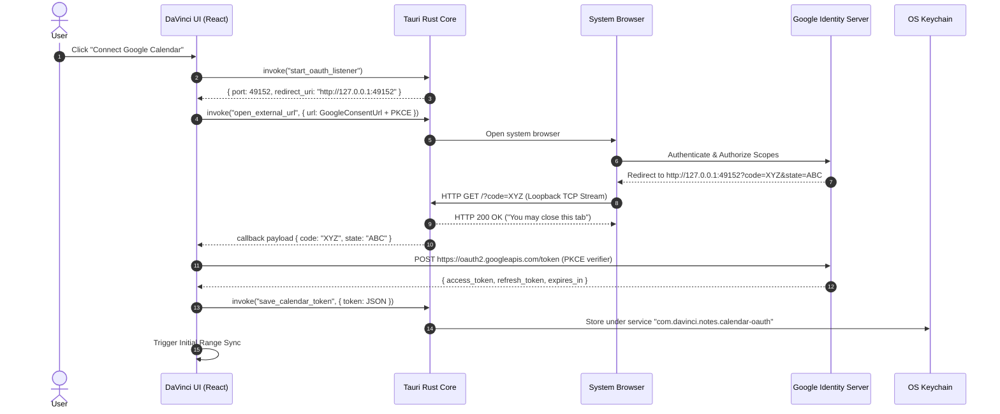
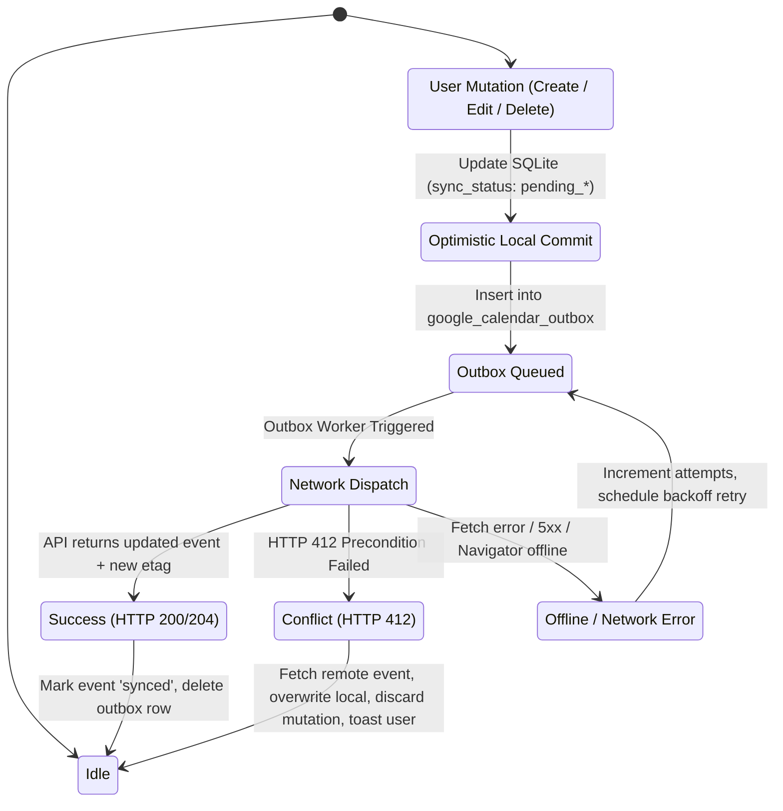
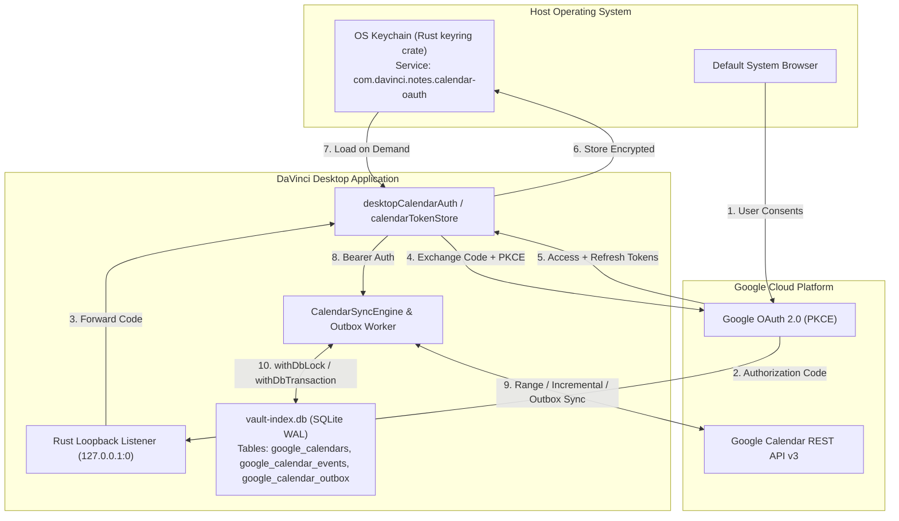

# Google Calendar Two-Way Integration — Feature & Phased Implementation Plan

**Target**: Provide a fast, beautiful, local-first, two-way Google Calendar experience inside DaVinci Notes (`davinci://calendar`). Users can view their schedule in Month, Week, Day, and Agenda views matching DaVinci's dark-first, flat, Obsidian-style design system. Users can create, reschedule, edit, and delete events directly in DaVinci Notes with changes synchronized back to Google Calendar. The calendar works seamlessly offline: events are cached in SQLite (`vault-index.db`), and offline mutations are queued in an append-safe local outbox with automatic retry on reconnection.

In strict alignment with `AGENTS.md`, `DECISIONS.md`, and `PERFORMANCE.md`:
- **Local-first & Offline-resilient**: Events cached in SQLite; offline writes are never dropped, stored safely in an outbox table.
- **Google Calendar Only**: Zero multi-provider abstractions. No Microsoft 365, Apple iCloud, CalDAV, or generic ICS syncing.
- **Zero Startup Weight**: The calendar view and the UI engine are 100% lazy-loaded via dynamic import (`React.lazy()`). Initial vault launch time is completely unaffected (0 KB initial bundle impact).
- **Universal SQLite Lock Discipline**: Every read and write to `vault-index.db` strictly uses `withDbLock` (ADR-0168). Long-running network I/O is strictly executed outside database locks.
- **Hardware-backed Security & Least Privilege**: Tokens are stored strictly in the host OS keychain via Rust (`com.davinci.notes.calendar-oauth`), never written to disk or vault files. Scopes are restricted to sensitive event and calendar list permissions.
- **Google Source of Truth on Conflict**: Remote changes win on precondition failure (`412 Precondition Failed` / `etag` mismatch), with automatic local rollback and user notification.

---

## 1. Current State Assessment & Gap Analysis

### 1.1 What Already Exists in the Codebase

1. **OAuth Loopback Primitives & OS Keychain (`apps/desktop/src-tauri/src/oauth.rs`)**:
   - Ephemeral loopback listener `start_oauth_listener` binding to `127.0.0.1:0` and `wait_for_oauth_callback`.
   - Security validation in `reject_plugin_runner` preventing sandboxed plugins from invoking OAuth commands.
   - Dedicated OS keychain storage primitives: `save_calendar_token`, `load_calendar_token`, `clear_calendar_token` isolated to `com.davinci.notes.calendar-oauth` (ADR-0199).
2. **Calendar Client Package (`packages/google-calendar-api`)**:
   - Dependency-free REST client (`calendarClient.ts`) using native `fetch`.
   - Implemented endpoints: `listCalendars`, `listEvents`, `createEvent`, and `updateEvent`.
   - Types in `calendarTypes.ts`: `NormalizedCalendarEvent`, `CalendarListItem`, `ListEventsOptions`.
   - Meet URL extractor: `parseMeetLink.ts`.
3. **SQLite Schema Migration 8 (`apps/desktop/src-tauri/src/db.rs`)**:
   - `google_calendars`: `id`, `summary`, `is_primary`, `color`, `selected`.
   - `google_calendar_events`: `id`, `calendar_id`, `title`, `start_iso`, `end_iso`, `is_all_day`, `meet_url`, `location`, `description`, `status`, `attendees_json`, `updated_at`.
   - `google_calendar_sync_state`: `calendar_id`, `sync_token`, `last_synced_at`.
   - Cache access functions in `sqliteCalendarStore.ts` using `withDbLock` and `withDbTransaction`.
4. **Read-Only Agenda List Prototype (`apps/desktop/src/components/CalendarView/`)**:
   - `CalendarLeaf.tsx`, `DayAgendaView.tsx`, `EventCard.tsx`, `MeetJoinButton.tsx`.
   - Only displays a linear list of events for the current day ("Happening Now", "Today", "Upcoming this week").
   - Read-only meeting note generator (`createMeetingNote.ts`) linking meetings to `Daily Notes/YYYY-MM-DD.md`.
5. **Reminder Subsystem (`apps/desktop/src/vault/remindersViewQueries.ts`, Migration 6 & 7)**:
   - Reminders parsed from Markdown tasks (`- [ ] Task (@YYYY-MM-DD HH:mm)`).
   - Rust background scheduler `reminder_scheduler.rs` and local alert state table `reminder_local_state`.

### 1.2 Gaps and Missing Capabilities for Full Two-Way Integration

1. **No Interactive Calendar UI (Month / Week / Day Views)**:
   - Current UI is only a static vertical list (`DayAgendaView`). There is no interactive grid, no multi-day layout, no time-gutter grid, no month grid, and no click-and-drag interaction.
2. **Missing Outbox & Offline Write Queuing**:
   - Any write currently requires immediate network availability. If offline, writes fail immediately.
   - No `google_calendar_outbox` table exists in SQLite to queue offline mutations (`create`, `update`, `delete`).
3. **Missing `deleteEvent` and `etag` Handling**:
   - `packages/google-calendar-api` does not implement `deleteEvent`.
   - `calendarClient.ts` does not accept or transmit `If-Match: <etag>` headers, leaving writes vulnerable to silent mid-air collisions.
4. **Schema Gaps (Migration 8 cannot be modified)**:
   - `google_calendar_events` lacks `etag`, `recurrence_rule`, `recurring_event_id`, and `sync_status` ('synced' | 'pending_create' | 'pending_update' | 'pending_delete').
   - Per ADR-0168 and database migration invariants, Migration 8 is already applied and immutable. An incremental **Migration 9** is required.
5. **No Event Editing / Creation Modals**:
   - No in-app dialog exists for creating or editing calendar events (title, start/end time, all-day toggle, calendar selector, description, location).
6. **No Virtual Tab Integration (`davinci://calendar`)**:
   - Calendar is currently toggled as a floating leaf rather than participating in the standard workspace tab system alongside notes and `davinci://bookmarks` / `davinci://agent`.

---

## 2. Goals and Non-Goals

### 2.1 Goals

- **Google-Style Calendar Experience**: Complete Month, Week, Day, and Agenda views with intuitive navigation (Today, Prev, Next), time indicators, and responsive event layout matching DaVinci's dark-first, border-depth design system.
- **Two-Way Synchronization**: Full Create, Read, Update, and Delete (CRUD) operations for events. Changes made in DaVinci Notes reflect in Google Calendar; changes made in Google Calendar sync down to DaVinci Notes.
- **Offline Durability via Local Outbox**: Full offline capability. Events are viewed from local SQLite. Changes made offline are committed immediately to the local UI (optimistic update) and queued in an append-only SQLite outbox, retrying with exponential backoff upon reconnection.
- **Zero-Friction Authentication**: A single "Connect Google Calendar" button in Settings and on the empty calendar screen. Uses desktop loopback OAuth with PKCE. Tokens stay strictly in the OS keychain via Rust. Includes an instant "Disconnect" button that revokes remote tokens and clears all local cached data.
- **Calendar Visibility & Color Customization**: Multi-calendar support for subscribed Google calendars with checkboxes to toggle visibility and custom/Google calendar colors.
- **Meeting Notes & Google Meet Quick Launch**: Retain and integrate one-click Google Meet launch and automatic meeting note creation linked to daily notes.
- **Zero Startup Weight**: Calendar bundle is dynamic-imported on demand. Core note-taking performance is untouched.

### 2.2 Non-Goals

- **Multi-Provider Support**: Strictly Google Calendar. No Microsoft Outlook/365, Apple iCloud, CalDAV, Fastmail, or generic ICS subscriptions.
- **"This and following events" Recurrence Splitting**: First version handles single events and whole-series edits/deletions. Splitting recurring series ("edit this and all following") requires complex RFC 5545 RRULE manipulation and Google recurrence cloning, scoped to a future enhancement.
- **Two-Way Task/Reminder Sync in Outbox**: Vault markdown reminders (`- [ ] Task @date`) will NOT be synced bidirectionally to Google Tasks or Google Calendar in this integration. They may only be viewed as an optional read-only overlay.
- **Custom Video Calling Integration**: No in-app video rendering; Google Meet links launch in the default browser.

---

## 3. Technical Direction Evaluation & Critical Analysis

### 3.1 UI Engine Evaluation: Schedule-X vs. FullCalendar vs. React-Big-Calendar

| Criterion | **Schedule-X (`@schedule-x/react`)** | **FullCalendar (`@fullcalendar/*`)** | **React-Big-Calendar** |
| :--- | :--- | :--- | :--- |
| **Bundle Size (min + gzip)** | **~32 KB** (modular plugins) | **~160–240 KB** (monolithic) | **~55 KB** + date-fns (~30 KB) = **~85 KB** |
| **Dependencies** | **0 runtime date library dependencies** (native lightweight date algorithms) | Heavy internal utilities, multiple plugin packages | Requires `moment` or `date-fns` |
| **License** | **MIT** (permissive, open source) | Dual GPL / Commercial (advanced views gated) | MIT |
| **Styling & Design System** | Modern CSS variables (`--sx-*`), clean dark mode, easily themed to DaVinci tokens | Complex legacy table HTML, nested selectors, hard to override | Older CSS structure, messy overriding |
| **Views Supported** | Month Grid, Week, Day, Month Agenda | Month, Week, Day, List, Timeline | Month, Week, Day, Agenda |
| **Drag & Drop** | Optional plugin (`@schedule-x/drag-and-drop`, ~4 KB) | Plugin (`@fullcalendar/interaction`, ~35 KB) | Built-in or addon (~15 KB) |
| **React 18/19 Support** | Native React adapter (`@schedule-x/react`) | Wrapper (`@fullcalendar/react`) | Native React component |
| **Verdict** | **CONFIRMED (Winner)** | **REJECTED** (Too heavy, licensing risk) | **REJECTED** (Date library bloat, dated UX) |

**Decision**: Adopt **Schedule-X** (`@schedule-x/react`, `@schedule-x/calendar`, `@schedule-x/drag-and-drop`, `@schedule-x/events-service`). It is lightweight, tree-shakeable, has zero external date library weight, and natively supports CSS variable theming matching our Obsidian dark-first border-driven aesthetic.

**Lazy-Load Constraint**: To protect DaVinci Notes' initial launch speed, Schedule-X and its stylesheets MUST NOT be imported in `main.tsx` or `App.tsx`. They must be isolated inside a dedicated lazy chunk loaded only when `davinci://calendar` is opened.

---

### 3.2 Authentication & OAuth Architecture

#### Sensitive Scope Justification & Google Verification
- Required scopes:
  1. `https://www.googleapis.com/auth/calendar.events` (Sensitive)
  2. `https://www.googleapis.com/auth/calendar.calendarlist.readonly` (Sensitive)
- **Sensitive vs. Restricted Tier**:
  - Neither scope is **Restricted** (unlike Gmail or full Drive access which require costly CASA Tier 2/3 third-party audits).
  - In development/testing mode: up to 100 test users can use the app without verification using the standard Google OAuth consent bypass.
  - For public production release: standard Google Cloud Verification requires a published Privacy Policy, Terms of Service, and a YouTube demo video showing the consent flow and calendar usage.
- **Keychain Isolation**: Drive tokens reside in `com.davinci.notes.drive-oauth`. Calendar tokens reside strictly in `com.davinci.notes.calendar-oauth`. Connecting or disconnecting one never touches or invalidates the other.

---

### 3.3 API Call Placement: TypeScript vs. Rust

- **Rule (`AGENTS.md`)**: "Rust is for I/O only and logic stays JS/TS-side, unless an ADR says otherwise."
- **Analysis**:
  - Networking to Google REST endpoints is standard HTTPS `fetch`. Keeping it in TypeScript (`packages/google-calendar-api`) means:
    1. Zero extra Rust crates (`reqwest`, `serde_json` extensions).
    2. Identical client logic and types shared between desktop and future mobile builds.
    3. Easy unit testing with `vi.fn()` fetch mocks.
  - Rust is used strictly for:
    1. Ephemeral TCP loopback port binding (`start_oauth_listener`).
    2. Secure OS keychain credential access (`keyring` crate).
    3. Launching the system default browser (`open_external_url`).
- **Decision**: Keep all Google Calendar REST calls in TypeScript within `@app/google-calendar-api`. Rust remains strictly an I/O and OS capability bridge.

---

### 3.4 Read Synchronization Architecture

- **Range Fetching (View-Driven Window)**:
  - When the user navigates the calendar, fetch events with `singleEvents=true` and `orderBy=startTime` for the active visible date window (e.g. Month view fetches `startOfMonth - 7 days` to `endOfMonth + 7 days`).
  - Google Calendar automatically expands recurring events into individual concrete instances with calculated start and end times.
- **Incremental Sync (`syncToken`)**:
  - For background refresh, query Google with `syncToken=<storedToken>` (without `timeMin`/`timeMax`, as Google API forbids combining them with sync tokens).
  - Google returns changed and deleted (`status: "cancelled"`) events.
  - If Google returns **HTTP 410 Gone** (`GoogleSyncTokenExpiredError`), the sync engine discards the invalid token and performs a full range resync.
- **SQLite Concurrency & WAL Locking (ADR-0168)**:
  - Cache writes run through `withDbLock` and `withDbTransaction`.
  - HTTP requests execute strictly outside the lock.

---

### 3.5 Write Synchronization, Outbox & Conflict Resolution

#### Outbox Mechanics
1. **Optimistic Local Update**:
   - Creating an event generates a client-side UUID (`temp_${crypto.randomUUID()}`) with `sync_status = 'pending_create'`.
   - Editing an event sets `sync_status = 'pending_update'`.
   - Deleting an event sets `sync_status = 'pending_delete'`.
   - The UI immediately renders the change with a subtle syncing badge/spinner.
2. **Persistent Outbox Table (`google_calendar_outbox`)**:
   - Stores `{ id, client_mutation_id, calendar_id, event_id, action, payload_json, etag, attempts, last_error, created_at, updated_at }`.
   - Guaranteed atomic write alongside local event update inside `withDbTransaction`.
3. **ETag Conflict Handling**:
   - Updates and deletes send `If-Match: <etag>`.
   - **Google is the source of truth**: If Google returns `412 Precondition Failed`, a newer edit exists on Google Calendar. The outbox item is discarded, the remote event is fetched and overwrites local SQLite, and the user is alerted with a non-blocking toast: *"Event was modified remotely on Google Calendar. The latest remote version was kept."*
4. **Retry & Backoff**:
   - Backoff schedule: 1s, 2s, 4s, 8s, 16s, capped at 60s.
   - Listens to browser `online` window events and resumes immediately when connectivity returns.

---

### 3.6 Recurring Events Scope

- **Phase 1 Scope**:
  - Viewing: Full support (Google expands recurring events via `singleEvents=true`).
  - Editing: Single non-recurring events, and **"All events in this series"** (updating the master recurring event via its master `id`).
  - Deletion: Single non-recurring events, and deleting the whole series.
- **Explicitly Deferred (Phase 7 / Future Plan)**:
  - *"This and following events"* (truncating parent recurrence rule with `UNTIL` and creating a new series from the selected instance).
  - Editing a single instance of a recurring series (creating an exception instance with `recurringEventId` and `originalStartTime`).
  - The UI will prompt the user when editing a recurring event: *"Edit entire series"* or *"Cancel"*, clearly setting expectations.

---

### 3.7 Vault Reminders & Dated Notes Integration

- **Analysis**:
  - DaVinci Notes has vault tasks with reminders: `- [ ] Call Alex (@2026-10-27 14:00)`.
  - Conflating markdown file parsing with Google Calendar two-way outbox sync creates a dangerous bidirectional loop (e.g. syncing an edited Google event back into a Markdown note line).
- **Decision**:
  - Keep two-way Google Calendar event sync strictly scoped to Google Calendar items.
  - In **Phase 6**, provide an opt-in toggle in the calendar view: **"Show Vault Reminders & Daily Notes"**.
  - When enabled, reminders and daily notes appear in the calendar as a **read-only overlay** with distinct styling (e.g., dashed border, vault icon). Clicking a reminder or daily note opens the note directly in DaVinci Notes editor.

---

## 4. Time Zones and All-Day Events Specification

Time zones and all-day boundaries are the most frequent source of calendar integration bugs (off-by-one day errors, phantom shifts across midnight).

### 4.1 All-Day Events (Floating Date Boundary)

1. **Google Calendar API Contract**:
   - All-day events do **not** have a time or time zone; they use ISO calendar dates:
     - `start: { "date": "2026-10-27" }`
     - `end: { "date": "2026-10-28" }` (Note: Google Calendar's `end.date` is **exclusive**! A 1-day event on Oct 27 ends on Oct 28).
2. **Pitfall to Avoid**:
   - Never do `new Date("2026-10-27")` in JavaScript! In time zones west of UTC (e.g. America/New_York UTC-4), this parses as UTC midnight and converts to `2026-10-26 20:00:00`, displaying the event on the wrong day.
3. **DaVinci Standard Implementation**:
   - Store all-day dates in SQLite as pure strings: `start_iso: "2026-10-27"`, `end_iso: "2026-10-28"`, `is_all_day: 1`.
   - Parse all-day dates using string splitting (`dateStr.split("-")`), never timezone-shifted Date constructors.
   - Schedule-X handles `YYYY-MM-DD` string inputs natively for all-day events.
   - When creating an all-day event in the app:
     - If the user selects single day `2026-10-27`, payload sent to Google is `start: { date: "2026-10-27" }`, `end: { date: "2026-10-28" }`.

### 4.2 Timed Events & Time Zone Handling

1. **Google Calendar API Contract**:
   - Timed events use ISO-8601 strings with explicit offset:
     - `start: { "dateTime": "2026-10-27T10:00:00-04:00", "timeZone": "America/New_York" }`
     - `end: { "dateTime": "2026-10-27T11:00:00-04:00", "timeZone": "America/New_York" }`
2. **DaVinci Standard Implementation**:
   - Always retain the local time zone when creating timed events using `Intl.DateTimeFormat().resolvedOptions().timeZone`.
   - In SQLite, cache the normalized ISO timestamp (`YYYY-MM-DDTHH:mm:ssZ` or with offset).
   - Display timed events converted to the viewer's current local system time zone.

---

## 5. Security and Privacy Architecture

### 5.1 Token Security and Storage Boundary
- **Zero Vault Exposure**: Tokens are NEVER saved to vault markdown files, `.davinci/` config files, git commits, or synced across devices.
- **Hardware/OS Keychain**: Stored exclusively via Rust `keyring` in the native platform store:
  - macOS: Apple Keychain Services
  - Windows: Windows Credential Manager
  - Linux: FreeDesktop Secret Service via DBus
- **Isolated Service Identity**: Stored under service `com.davinci.notes.calendar-oauth` and account `calendar_token`. Strictly isolated from Drive sync (`com.davinci.notes.drive-oauth`).

### 5.2 Disconnect & Complete Data Purge
When the user clicks "Disconnect Google Calendar" in Settings or the calendar view:
1. **Remote Revocation**: Call `https://oauth2.googleapis.com/revoke?token=<token>`.
2. **Keychain Deletion**: Invoke `clear_calendar_token` in Rust to delete the keychain entry.
3. **Database Purge**: Execute `purgeCalendarCache()` inside a single atomic `withDbTransaction`:
   - `DELETE FROM google_calendar_events;`
   - `DELETE FROM google_calendars;`
   - `DELETE FROM google_calendar_sync_state;`
   - `DELETE FROM google_calendar_outbox;`
4. **UI Reset**: Immediately reset calendar state in memory; return the calendar view to the clean "Connect Google Calendar" onboarding screen.

---

## 6. Phased Implementation Plan

### Phase 1: ADR, Schema Migration 9 & Extended Data Layer
**High-Risk: No | Dependencies: 0 new npm packages**

- **Goal**: Establish the architectural decisions for two-way sync and create SQLite Migration 9 adding `etag`, `recurrence_rule`, and `sync_status` to `google_calendar_events`, plus the `google_calendar_outbox` table and outbox data access methods.
- **Files Touched**:
  - `docs/adr/0223-google-calendar-two-way-sync-and-outbox-architecture.md` [NEW]
  - `DECISIONS.md` [MODIFY]
  - `apps/desktop/src-tauri/src/db.rs` [MODIFY] (Add Migration 9; NEVER touch Migration 1-8)
  - `packages/google-calendar-api/calendarTypes.ts` [MODIFY] (Add `etag`, `syncStatus`, outbox types)
  - `apps/desktop/src/calendar/sqliteCalendarStore.ts` [MODIFY] (Add outbox CRUD, etag storage)
  - `apps/desktop/src/calendar/sqliteCalendarStore.test.ts` [NEW]
- **ADRs to Read**: ADR-0168 (SQLite lock discipline), ADR-0199 (OAuth isolation), ADR-0201 (SQLite cache lifecycle).
- **ADR to Write**: ADR-0223: Google Calendar Two-Way Sync, ETag Concurrency, and Persistent Outbox Architecture.
- **SQLite Concurrency Rule**: All migrations and queries must strictly run through `withDbLock` and `withDbTransaction`. Zero queries executed outside the lock queue.
- **Dependencies & Size Cost**: 0 KB.
- **Verification Steps**:
  1. Automated test: Run `sqliteCalendarStore.test.ts` verifying Migration 9 applies cleanly to an in-memory/fixture SQLite database.
  2. Verify creating, reading, updating, and removing outbox items preserves FIFO order by `created_at`.
  3. Verify `purgeCalendarCache()` cleans all four tables: `google_calendars`, `google_calendar_events`, `google_calendar_sync_state`, and `google_calendar_outbox`.
- **Commit Boundary**: `feat(calendar): add migration 9 and sqlite outbox store (phase 1)`

---

### Phase 2: Lazy-Loaded Interactive Calendar Shell (Schedule-X)
**High-Risk: No | Dependencies: `@schedule-x/react`, `@schedule-x/calendar`, `@schedule-x/drag-and-drop`, `@schedule-x/events-service` (~32 KB gzip)**

- **Goal**: Implement the interactive multi-view calendar shell (Month Grid, Week, Day, Agenda) powered by Schedule-X, styled strictly with DaVinci design tokens (CUBE CSS, borders not shadows, dark-first), lazy-loaded behind a dynamic import boundary with mock data and virtual tab routing (`davinci://calendar`).
- **Files Touched**:
  - `apps/desktop/package.json` [MODIFY] (Add Schedule-X dependencies)
  - `apps/desktop/src/components/CalendarView/ScheduleXCalendar.tsx` [NEW]
  - `apps/desktop/src/components/CalendarView/CalendarToolbar.tsx` [NEW]
  - `apps/desktop/src/components/CalendarView/CalendarView.module.scss` [MODIFY]
  - `apps/desktop/src/components/CalendarView/CalendarLeaf.tsx` [MODIFY]
  - `apps/desktop/src/components/CalendarView/ScheduleXCalendar.stories.tsx` [NEW]
  - `apps/desktop/src/components/CalendarView/ScheduleXCalendar.test.tsx` [NEW]
  - `apps/desktop/src/components/AppTabs/AppTabs.tsx` [MODIFY] (Support `davinci://calendar` tab)
  - `apps/desktop/src/components/IconRail/IconRail.tsx` [MODIFY] (Calendar icon opens `davinci://calendar` tab)
- **ADRs to Read**: ADR-0202 (Calendar UI shell), ADR-0214 (Dedicated tab mounting pattern).
- **ADR to Write**: None.
- **Dependencies & Size Cost**:
  - `@schedule-x/calendar`: ~20 KB gzip
  - `@schedule-x/react`: ~5 KB gzip
  - `@schedule-x/drag-and-drop`: ~4 KB gzip
  - `@schedule-x/events-service`: ~3 KB gzip
  - Total: ~32 KB gzip (strictly lazy-loaded; 0 KB impact on initial app startup).
- **Verification Steps**:
  1. Automated test: Render `ScheduleXCalendar.test.tsx` with mock events; switch between Month, Week, Day, and Agenda views.
  2. Storybook: Confirm dark mode colors match `@app/design-system` tokens (`--surface-base`, `--border-subtle`, `--text-normal`); verify zero box-shadows and zero gradients.
  3. Bundle size audit: Run `pnpm --filter @app/desktop build:web` and inspect chunk output to ensure Schedule-X is bundled solely in the dynamic calendar chunk, with 0 KB added to `index.js`.
  4. Tab navigation: Click calendar icon in IconRail; verify `davinci://calendar` tab opens in `AppTabs` and persists during tab switching.
- **Commit Boundary**: `feat(calendar): interactive schedule-x calendar view and tab integration (phase 2)`

---

### Phase 3: OAuth Authentication, Keychain Storage, Calendar Picker & Disconnect
**High-Risk: YES (Auth & OS Keychain security — MUST STAY IN ONE SESSION) | Dependencies: 0 new npm packages**

- **Goal**: Wire end-to-end OAuth consent with write scopes (`calendar.events` + `calendar.calendarlist.readonly`), OS keychain credential storage, multi-calendar listing with color selection checkboxes, and complete revocation/disconnect.
- **Files Touched**:
  - `packages/google-calendar-api/calendarClient.ts` [MODIFY] (Include token revocation call)
  - `apps/desktop/src/calendar/calendarAuthConfig.ts` [MODIFY] (Default to `CALENDAR_WRITE_SCOPES`)
  - `apps/desktop/src/calendar/desktopCalendarAuth.ts` [MODIFY] (PKCE loopback flow hardening)
  - `apps/desktop/src/components/CalendarView/CalendarPickerModal.tsx` [NEW]
  - `apps/desktop/src/components/CalendarView/CalendarEmptyState.tsx` [NEW]
  - `apps/desktop/src/components/SettingsDialog/CalendarSettingsTab.tsx` [NEW]
  - `apps/desktop/src/components/SettingsDialog/SettingsDialog.tsx` [MODIFY] (Add Calendar settings tab)
  - `apps/desktop/src/calendar/desktopCalendarAuth.test.ts` [MODIFY]
- **ADRs to Read**: ADR-0118, ADR-0120 (Drive PKCE loopback), ADR-0199 (Calendar OAuth isolation), ADR-0217 (Write scopes).
- **ADR to Write**: None (builds on ADR-0199 and ADR-0217).
- **Dependencies & Size Cost**: 0 KB.
- **Verification Steps (Adversarial)**:
  1. Loopback listener test: Connect Google Calendar, simulate redirect to `http://127.0.0.1:<port>?code=mock_code&state=mock_state`, and verify token exchange completes and saves to keychain under `com.davinci.notes.calendar-oauth`.
  2. Scope verification: Confirm requested OAuth URL contains `https://www.googleapis.com/auth/calendar.events` and `https://www.googleapis.com/auth/calendar.calendarlist.readonly`.
  3. Calendar selection test: Uncheck a secondary calendar; verify `selected = 0` in SQLite and its events disappear immediately from view.
  4. Revoke token externally: In test Google account settings, revoke app access. Trigger sync in DaVinci Notes; verify app receives `invalid_grant` / `401 Unauthorized`, surfaces a friendly "Session expired — please reconnect" banner, and transitions safely to disconnected state without crashing.
  5. Disconnect test: Click "Disconnect"; verify Google revocation endpoint is called, keychain entry is deleted, all 4 calendar tables in SQLite are purged, and the UI returns to `CalendarEmptyState`.
- **Commit Boundary**: `feat(calendar): oauth pkce flow, keychain storage, and calendar picker (phase 3)`

---

### Phase 4: Read Synchronization (Range Fetch & Incremental Delta Sync)
**High-Risk: No | Dependencies: 0 new npm packages**

- **Goal**: Implement background range-based view synchronization (`singleEvents=true`) and incremental synchronization using Google Calendar's `syncToken`, with recovery on HTTP 410 Gone.
- **Files Touched**:
  - `packages/google-calendar-api/calendarClient.ts` [MODIFY] (Paging and range fetch utilities)
  - `apps/desktop/src/calendar/calendarSyncEngine.ts` [MODIFY]
  - `apps/desktop/src/calendar/useCalendarEvents.ts` [NEW] (Hook connecting SQLite cache to Schedule-X)
  - `apps/desktop/src/calendar/calendarSyncEngine.test.ts` [MODIFY]
- **ADRs to Read**: ADR-0168 (Universal SQLite lock), ADR-0201 (SyncToken lifecycle).
- **ADR to Write**: None.
- **Dependencies & Size Cost**: 0 KB.
- **Verification Steps (Adversarial)**:
  1. Visible range sync: Navigate to Month view for November 2026. Verify `listEvents` is called with `timeMin` and `timeMax` matching late October to early December, and `singleEvents=true`.
  2. Incremental sync: Add an event in Google Calendar web interface. Wait for 5-minute background tick (or click manual sync button); verify only the delta event is fetched and inserted into SQLite.
  3. HTTP 410 Gone recovery: Artificially set `sync_token = 'invalid_stale_token'` in `google_calendar_sync_state`. Trigger sync. Verify the engine catches `GoogleSyncTokenExpiredError`, clears the invalid sync token, and executes a full range resync without throwing an unhandled rejection.
  4. Concurrency stress test: Trigger range fetch sync while simultaneously editing and saving a note in the editor. Verify zero `SQLITE_BUSY` errors due to universal `withDbLock` promise queue.
- **Commit Boundary**: `feat(calendar): range and incremental sync engine with 410 recovery (phase 4)`

---

### Phase 5: Two-Way CRUD Mutations with Persistent Outbox & ETag Conflict Resolution
**High-Risk: YES (Data loss prevention, outbox state machine, and conflict handling — MUST STAY IN ONE SESSION) | Dependencies: 0 new npm packages**

- **Goal**: Implement event creation, editing, and deletion in the UI with optimistic local updates, persistent queuing in `google_calendar_outbox`, exponential backoff retry, and `If-Match: etag` concurrency protection.
- **Files Touched**:
  - `packages/google-calendar-api/calendarClient.ts` [MODIFY] (Add `deleteEvent`, `If-Match` headers, return `etag`)
  - `apps/desktop/src/calendar/calendarOutboxWorker.ts` [NEW] (FIFO outbox dispatcher with backoff)
  - `apps/desktop/src/components/CalendarView/EventModal.tsx` [NEW] (Create & Edit dialog)
  - `apps/desktop/src/components/CalendarView/EventDeleteDialog.tsx` [NEW]
  - `apps/desktop/src/components/CalendarView/ScheduleXCalendar.tsx` [MODIFY] (Wire click-to-create and event click)
  - `apps/desktop/src/calendar/calendarOutboxWorker.test.ts` [NEW]
  - `apps/desktop/src/components/CalendarView/EventModal.test.tsx` [NEW]
- **ADRs to Read**: ADR-0168, ADR-0223 (New Two-Way Outbox ADR).
- **ADR to Write**: None.
- **Dependencies & Size Cost**: 0 KB.
- **Verification Steps (Adversarial)**:
  1. Happy path create/edit/delete:
     - Create event "Architecture Review" in DaVinci Notes -> verify immediate optimistic rendering in Schedule-X -> verify outbox worker sends POST to Google -> verify remote event created with correct start, end, and title.
     - Edit title to "Architecture Review v2" -> verify PATCH sent with `If-Match: <etag>`.
     - Delete event -> verify DELETE sent to Google and row removed locally.
  2. Kill network mid-write (Offline outbox durability):
     - Disconnect network / mock offline in tests.
     - Create 3 events and edit 1 event in DaVinci Notes.
     - Verify all 4 mutations are safely committed in `google_calendar_outbox` in SQLite.
     - Restart the app (simulating crash/restart while offline).
     - Verify outbox entries remain intact in SQLite.
     - Reconnect network -> verify outbox worker automatically flushes all pending mutations in order and transitions events to `'synced'`.
  3. Remote conflict detection (HTTP 412 Precondition Failed):
     - Modify an event in Google Calendar web interface (updating its remote `etag`).
     - In DaVinci Notes (holding stale `etag`), attempt to edit description and save.
     - Outbox worker sends PATCH with old `If-Match: <stale_etag>`.
     - Google responds with `412 Precondition Failed`.
     - Verify DaVinci outbox worker catches 412, discards the failing mutation, re-fetches the latest event from Google, updates SQLite, and displays a user toast: *"Event was modified remotely on Google Calendar. Remote version preserved."*
- **Commit Boundary**: `feat(calendar): two-way crud mutations, outbox worker, and etag conflict handling (phase 5)`

---

### Phase 6: Recurring Events, Vault Reminders Overlay, Error Polish & Benchmarks
**High-Risk: No | Dependencies: 0 new npm packages**

- **Goal**: Handle whole-series recurring event edits/deletions, implement the optional read-only Vault Reminders & Daily Notes overlay, and add error boundaries, toasts, and scale benchmarks.
- **Files Touched**:
  - `apps/desktop/src/components/CalendarView/RecurringActionDialog.tsx` [NEW]
  - `apps/desktop/src/components/CalendarView/VaultRemindersOverlay.tsx` [NEW]
  - `apps/desktop/src/components/CalendarView/CalendarToolbar.tsx` [MODIFY] (Add "Show Vault Reminders" toggle)
  - `apps/desktop/src/components/CalendarView/CalendarLeaf.tsx` [MODIFY]
  - `apps/desktop/src/calendar/calendarBenchmark.test.ts` [NEW]
  - `PROGRESS.md` [MODIFY]
  - `docs/HISTORY.md` [MODIFY]
- **ADRs to Read**: ADR-0182, ADR-0184 (Reminders syntax & storage), ADR-0203 (Calendar alerts).
- **ADR to Write**: None.
- **Dependencies & Size Cost**: 0 KB.
- **Verification Steps**:
  1. Recurring whole-series edit: Select an instance of a recurring event; confirm dialog prompts: "Edit entire series". Confirm series master is updated in Google Calendar.
  2. Vault Reminders Overlay:
     - Add markdown reminder: `- [ ] Submit tax filing (@2026-10-30 11:00)` in a note.
     - Toggle "Show Vault Reminders" in calendar toolbar.
     - Verify "Submit tax filing" appears on Oct 30 at 11:00 with distinct dashed borders and note icon.
     - Click the reminder item -> verify it opens the corresponding note in DaVinci editor.
  3. Performance benchmark (`calendarBenchmark.test.ts`):
     - Load 2,000 cached events from SQLite: verify query + parse completes in < 15ms.
     - Process 100 queued outbox items: verify FIFO queue operations complete in < 5ms.
  4. Production build: Run `pnpm --filter @app/desktop build:web` with 0 TypeScript, ESLint, or Stylelint errors.
- **Commit Boundary**: `feat(calendar): recurring events, reminders overlay, and performance benchmarks (phase 6)`

---

## 7. Open Questions and Explicit Assumptions for User Input

Before starting implementation, the following key design decisions and assumptions require your confirmation:

> [!IMPORTANT]
> **Decision 1: UI Engine Selection**
> We evaluated Schedule-X (~32 KB gzip, 0 date-library dependencies, MIT license, CSS variables matching our design system) against FullCalendar (~160–240 KB gzip, complex licensing) and React-Big-Calendar (~85 KB with date-fns).
> *Do you approve adopting Schedule-X strictly isolated within the lazy calendar bundle?*

> [!IMPORTANT]
> **Decision 2: Conflict Resolution Policy**
> When a local edit conflicts with a remote Google Calendar edit (`HTTP 412 Precondition Failed` / `etag` mismatch), our proposed policy is: **Google is the source of truth**. The app discards the conflicting local change, refreshes the event from Google, and notifies the user via toast.
> *Do you confirm Google-wins on conflict, or should we build an interactive three-way conflict modal? (Google-wins is strongly recommended to keep the app lightweight and avoid complex diff UI).*

> [!NOTE]
> **Decision 3: Vault Reminders & Daily Notes on Calendar**
> We propose that Markdown vault reminders (`- [ ] Task @date`) and daily notes appear on the calendar purely as an **opt-in read-only visual overlay** (toggled in the calendar toolbar). Clicking one jumps to the note in the editor. They will NOT be written or synced to Google Calendar events.
> *Do you agree with keeping Vault Reminders read-only on the calendar view?*

> [!NOTE]
> **Decision 4: Tab Navigation vs. Icon Rail Toggle**
> Previous iterations toggled Calendar as an exclusive full-page leaf. We recommend registering `davinci://calendar` as a first-class virtual tab (identical to `davinci://bookmarks` and `davinci://agent`). Clicking the Calendar icon in the Icon Rail opens or focuses the `davinci://calendar` tab.
> *Do you approve using the `davinci://calendar` tab model?*

> [!NOTE]
> **Decision 5: Google OAuth App Verification Tier**
> Two-way sync requires `calendar.events` (Sensitive scope). For development and private beta (up to 100 users), testing works immediately without Google verification. For general public release, Google verification is required (privacy policy + demo video, but NO expensive CASA Tier 2/3 audit).
> *Assumption logged: We will proceed with `calendar.events` and document verification steps for public release.*
