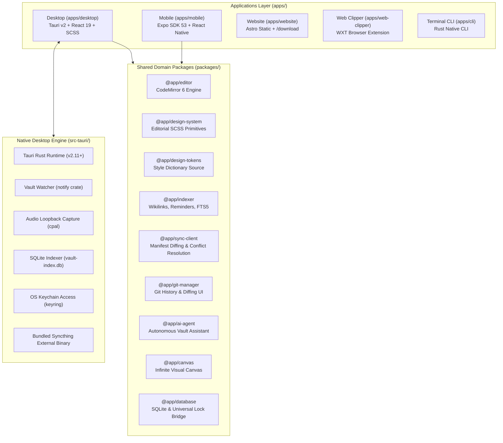

# Architecture Specifications & Technical Standards

This directory contains the foundational technical specifications, architectural blueprints, and coding standards for DaVinci Notes (Sophia).

---

## System Architecture Overview

---

## Architectural Specifications Index

| Specification | Document | Scope & Focus |
|---|---|---|
| **Desktop Stack Architecture** | [`stack-architecture.md`](stack-architecture.md) | Tauri v2 shell, React 19 architecture, Rust I/O boundary, SQLite lock discipline, and state management. |
| **Mobile Architecture** | [`mobile-architecture.md`](mobile-architecture.md) | Expo SDK 53, React Native architecture, sandboxed storage, NativeWind, and DOM components. |
| **Design System & Tokens** | [`design-system.md`](design-system.md) | Editorial Swiss-influenced typography, zero-shadows rule, token contracts, and SCSS module patterns. |
| **Coding Conventions** | [`conventions.md`](conventions.md) | File size caps (<250 lines), single-responsibility rule, TypeScript strictness, and anti-dumping standards. |
| **Git & PR Workflow** | [`git-workflow.md`](git-workflow.md) | Branching strategy, conventional commits (`commitlint`), pull request checklists, and release gating. |
| **Visual Wireframes** | [`wireframe.md`](wireframe.md) | Component wireframes, sidebar rails, tabs, layout dimensions, and editor canvas layouts. |
