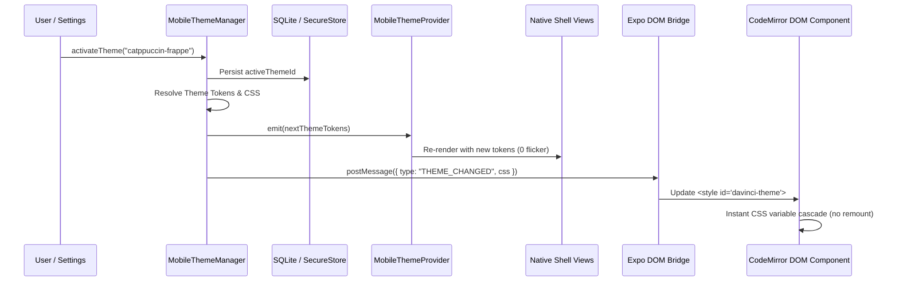

# Mobile UI Redesign & Theme Architecture — Feature Plan

## Overview & Background

DaVinci Notes is a lightweight, local-first markdown note-taking application. While the desktop shell is built on Tauri v2 with CUBE CSS and Radix primitives, the mobile shell is powered by Expo (React Native + Expo Router) with CodeMirror 6 hosted inside an Expo DOM component (`"use dom"`, ADR-0185).

Currently, `apps/mobile` features a conventional bottom-tab navigation structure (Files, Search, Plus, Tags) hardcoded exclusively to dark-mode tokens (`darkColorTokens`). The user experience deviates from the clean, fluid, editorial Obsidian-mobile aesthetic shown in the reference screenshots. Furthermore, while the desktop app enjoys a flexible theme system (`@app/theme-api`, built-in themes `catppuccin-frappe`, `catppuccin-latte`, `light-a`, `dark-b`, and local vault theme discovery), mobile lacks a unified theme engine capable of driving both the native React Native shell and the webview-hosted CodeMirror editor.

This document establishes the comprehensive architectural blueprint to redesign the mobile UI, bringing it to visual and interaction parity with the reference screenshots while establishing a robust, safe, zero-restart theme architecture shared with desktop.

---

## Goals & Non-Goals

### Goals
1. **Visual Parity**: The mobile shell, headers, drawer/action clusters, bottom sheets, and keyboard accessories visually and interactively match the 3 reference screenshots.
2. **Unified Theme Architecture**: A single theme manifest and stylesheet drives both the native React Native shell and webview-hosted surfaces (CodeMirror editor, reading view, canvas, graph) with instantaneous, flicker-free switching and zero restart.
3. **Parity with Desktop Theme Model**: Support the same theme concepts, manifest format (`manifest.json` via `@app/theme-api`), four built-in themes (Light A, Catppuccin Latte, Catppuccin Frappé, Dark B), enable/disable toggling, single active theme state, and future shared registry browser.
4. **Lightweight & High-Performance**: Adhere strictly to `PERFORMANCE.md` with <400ms cold start, 60fps virtualization on 5,000-note vaults, memoized render boundaries, safe area preservation, keyboard avoidance, and 0 KB unvetted dependency bloat.
5. **Architectural Cleanliness**: Clean modular structure conforming to `AGENTS.md` (150–200 line soft cap, 250 hard cap, kebab-case classes, single responsibility per file, strict lint boundaries).

### Non-Goals
1. **Desktop App Modifications**: The desktop application shell, desktop styles, and desktop tokens remain completely untouched (0-byte diff on desktop CSS bundle).
2. **Custom Software Keyboard**: The mobile app uses the native system keyboard (Gboard, iOS keyboard); no custom software keyboard will be built.
3. **Obsidian Brand Copying**: No copying of Obsidian trademarks, proprietary icons, or brand assets. Parity applies to layout, spacing, hierarchy, and interaction paradigms only using Phosphor icons.
4. **Multi-Theme Layering**: Only one active theme is enabled at any given time.

---

## Decisions Already Made (Do Not Revisit)

1. **Expo + CodeMirror DOM Component**: Mobile shell remains React Native with Expo Router; the markdown editor runs CodeMirror 6 inside an Expo DOM webview component (ADR-0185).
2. **System Keyboard**: Always use the native system keyboard. A floating/docked formatting toolbar attached directly above the virtual keyboard handles markdown syntax shortcuts.
3. **Editorial Visual Language**: Dark-first default, flat, border-based depth, zero box-shadows, zero gradients, zero glassmorphism, Phosphor icons (ADR-0007, ADR-0009, ADR-0186).
4. **Strict Tokens-Only Styling**: No magic numbers, raw hex codes, or arbitrary pixel margins in application code. All colors and dimensions must resolve to design tokens.
5. **Never Edit Applied Migrations**: Incremental schema changes only (ADR-0035).

---

## Step 1: Design Spec from the Reference Screenshots

### Detailed Screen-by-Screen Breakdown

#### Screenshot 1: Active Note View with Note Actions Bottom Sheet
* **Screen Identity**: Note View (Editor or Reader) with modal Note Actions Bottom Sheet presented.
* **Layout Regions**:
  * **Status Bar**: Transparent background, dark status bar text/icons (showing 9:57, WiFi, Cellular, Battery 15%).
  * **Top Navigation Bar**:
    * Left: Sidebar / drawer toggle icon (window split-pane glyph; Phosphor equivalent: `SidebarSimple` or `Columns`).
    * Right: Reading view toggle icon (`BookOpen`), More Options menu icon (`DotsThreeVertical`).
  * **Note Header Region**: Prominent note title "Untitled" (H1 display typography, ~24pt, bold/semibold, tight leading).
  * **Scrim Layer**: Semi-transparent dark overlay (`--color-bg-scrim`, `rgba(0, 0, 0, 0.60)`) dimming the underlying editor.
  * **Bottom Sheet (Modal Card Surface)**:
    * Surface container with rounded top corners (`border-radius: 16px`, `--color-bg-secondary`).
    * Top center grabber / drag handle: Pill indicator (~36×4px, subtle border/neutral fill).
    * **Action Group 1 (Dismissal)**:
      * `✕ Close`: Single item row (~44pt height), dismissing the sheet/note.
    * **Action Group 2 (View Modes & Navigation)**:
      * Card container with internal dividing rules:
        * `Backlinks in document` (Icon: link / arrow-merge glyph; Phosphor: `TreeStructure` or `ArrowElbowDownRight`).
        * `Reading view` (Icon: book glyph; Phosphor: `BookOpen`).
        * `Source mode` (Icon: code brackets glyph; Phosphor: `Code`).
    * **Action Group 3 (File Operations)**:
      * Rounded card container with divider lines:
        * `Pin` (Icon: pushpin glyph; Phosphor: `PushPin`).
        * `Rename...` (Icon: pencil glyph; Phosphor: `PencilSimple`).
        * `Move file to...` (Icon: folder with arrow glyph; Phosphor: `FolderSimplePlus`).
        * `Bookmark...` (Icon: bookmark glyph; Phosphor: `BookmarkSimple`).
        * `Merge entire file with...` (Icon: branch merge glyph; Phosphor: `GitMerge`).
        * `Add file property` (Icon: circle with plus glyph; Phosphor: `PlusCircle`).
* **Typography**:
  * Action row labels: ~15-16px, medium weight, `--color-text-normal`.
  * Note title: ~24px, bold, `--color-text-normal`.
* **Touch Targets & Spacing**:
  * Every sheet item row is strictly $\ge 44\text{pt}$ (measured ~48px row height).
  * Horizontal sheet padding: 16px. Vertical gap between grouped action cards: 8px.
* **Colors by Role**:
  * Scrim: `--color-bg-scrim`. Sheet background: `--color-bg-secondary`.
  * Action card background: `--color-bg-primary` (or slightly elevated `--color-bg-secondary-alt`).
  * Borders/Dividers: `--color-border-subtle`. Text: `--color-text-normal`.
* **State / Gestures**:
  * Tap on scrim dismisses the sheet. Drag down on handle dismisses sheet with spring animation. Tap row triggers action and dismisses sheet.
* **Ambiguities / UNKNOWN**:
  * *Item*: In Screenshot 1, does "✕ Close" close the bottom sheet or close the active note tab? (Marked as **DECISION-1** below).

---

#### Screenshot 2: Vault Navigation Hub / Left Drawer Overlay
* **Screen Identity**: Vault Navigation Hub (Obsidian-style left navigation drawer/overlay with quick actions).
* **Layout Regions**:
  * **Top Bar / Search Capsule**:
    * Large pill-shaped capsule button (`Untitled`) centered at the top (~40pt height, subtle grey background, rounded-full). Serves as quick switcher / active note tab indicator.
  * **Central Blank Canvas / Viewport**:
    * Clean primary background surface ready to host either the file tree, active leaf, or empty vault state.
  * **Quick Action Toolbar (Horizontal Bar)**:
    * 5 discrete touch targets spaced evenly across the bottom:
      1. `Edit`: Pencil glyph (`NotePencil` / `PencilSimple`).
      2. `New Note`: Document with plus glyph (`FilePlus`).
      3. `Quick Switcher`: Up/down arrows with lines glyph (`ArrowsDownUp` or `MagnifyingGlass`).
      4. `Tab Switcher`: Dual overlapping rectangles glyph (`Tabs` / `SquareSplitHorizontal`).
      5. `More / Navigate`: Up-down chevrons glyph (`CaretUpDown`).
  * **Navigation Leaf Selector Card**:
    * Rounded pill/card: `📁 Files` with up/down selector arrows (`CaretUpDown`) on the far right.
    * Tapping toggles between navigation modes: Files, Search, Bookmarks, Tags.
  * **Vault Identity & Settings Bar (Bottom-most Dock)**:
    * Left side: Active Vault switcher `popk ∨` (H3 font weight, caret down icon) and subtitle `1 file, 0 folders` (caption font size, text-muted).
    * Right side: Elevated circular Settings button (`Gear` icon in a 44×44pt circle with subtle border).
* **Typography**:
  * Vault title: ~18px semibold. Vault stats subtitle: ~12px regular.
  * Leaf button text: ~16px medium.
* **Colors by Role**:
  * Outer background: `--color-bg-primary`.
  * Leaf pill background: `--color-bg-secondary`.
  * Settings button background: `--color-bg-secondary` with `--color-border-normal`.
  * Icons: `--color-text-normal`.
* **Ambiguities / UNKNOWN**:
  * *Item*: Does the leaf button `📁 Files` open an action sheet or inline accordion to switch to Search / Tags? (Marked as **DECISION-2** below).

---

#### Screenshot 3: Active Note Editor with Keyboard & Formatting Toolbar
* **Screen Identity**: Active Note Editing mode with system virtual keyboard and docked formatting accessory toolbar.
* **Layout Regions**:
  * **Top Navigation Bar**: Identical to Screenshot 1: Left sidebar toggle, Reading view toggle, More options menu.
  * **Note Title Header**: In-editor note title "Untitled" (H1, 24pt, bold).
  * **Editor Surface**: Clean text area with blinking vertical accent cursor `|` (`--color-text-accent`).
  * **Formatting Toolbar (Keyboard Accessory Bar)**:
    * Horizontally scrolling bar docked immediately above the system keyboard.
    * Height: ~44pt. Background: `--color-bg-secondary`, top border: `--color-border-subtle`.
    * Button items (left to right):
      1. `[ ]` — Insert Markdown task checkbox.
      2. Document/File icon (`FileText` or `FileArrowUp`) — Insert internal wikilink `[[ ]]`.
      3. Tag icon (`Tag`) — Insert tag `#`.
      4. Paperclip icon (`Paperclip`) — Insert attachment / photo.
      5. `H` — Cycle heading levels (`# `, `## `, `### `).
      6. `B` — Toggle Bold `**bold**`.
      7. `I` — Toggle Italic `*italic*`.
      8. `S` — Toggle Strikethrough `~~strikethrough~~`.
      9. `,` / More icons scrolling horizontally off-screen (Code, Quote, Indent, Outdent, Undo, Redo).
  * **System Keyboard**:
    * Android Gboard / iOS system keyboard rendered natively by the mobile OS.
* **Touch Targets & Spacing**:
  * Toolbar buttons: ~36×36pt touch areas with 44pt minimum touch boundary; 6px horizontal spacing; smooth horizontal scroll with momentum.
* **Colors by Role**:
  * Toolbar background: `--color-bg-secondary`.
  * Toolbar glyphs: `--color-text-normal`. Active formatting state: `--color-text-accent`.
  * Cursor color: `--color-interactive-accent`.

---

### Design Tokens: Existing vs. New Tokens Required

| Token Category | Token Name | Status | Role in Mobile Redesign |
|---|---|---|---|
| **Color** | `--color-bg-primary` | Existing | Main application and note editing background |
| **Color** | `--color-bg-primary-alt` | Existing | Drawer outer container background |
| **Color** | `--color-bg-secondary` | Existing | Bottom sheets, action bars, leaf selector pills |
| **Color** | `--color-bg-secondary-alt` | Existing | Grouped action cards within bottom sheets |
| **Color** | `--color-bg-scrim` | Existing (ADR-0163) | Semi-transparent modal backdrop overlay |
| **Color** | `--color-bg-hover` | Existing | Touch pressed/active ripple state for buttons |
| **Color** | `--color-interactive-accent` | Existing | Blinking cursor, active tab highlights |
| **Color** | `--color-text-normal` | Existing | Note title, action sheet text, toolbar glyphs |
| **Color** | `--color-text-muted` | Existing | Subtitle "1 file, 0 folders", inactive icons |
| **Color** | `--color-text-accent` | Existing | Focused links, highlighted toolbar toggles |
| **Color** | `--color-border-subtle` | Existing | Action sheet group dividers, top bar bottom border |
| **Color** | `--color-border-normal` | Existing | Sheet outline, settings circle button outline |
| **Dimensions** | `mobileTokens.minTouchTarget` | Existing (44) | Enforces 44pt minimum touch bounds project-wide |
| **Dimensions** | `mobileTokens.safeArea.headerHeight` | Existing (44) | Height of top navigation bar |
| **Dimensions** | `mobileTokens.bottomSheetRadius` | Existing (16px) | Top corner radius for action sheets |
| **Radius** | `mobileTokens.capsuleRadius` | **NEW** (9999px) | Full pill radius for top switcher capsule & leaf button |
| **Radius** | `mobileTokens.sheetGroupRadius` | **NEW** (12px) | Internal grouped action card corner radius in sheets |
| **Dimensions** | `mobileTokens.accessoryBarHeight` | **NEW** (44px) | Docked keyboard formatting toolbar height |
| **Dimensions** | `mobileTokens.quickToolbarHeight` | **NEW** (48px) | 5-button bottom quick action bar height |

---

### Component Inventory & Primitive Mapping

| UI Component | Role in Screenshots | Mapping Strategy | Action Required |
|---|---|---|---|
| `ScreenLayout` | Screen framing & header | Modify | Replace static title header with Obsidian-style header (Left toggle, Title, Right actions) |
| `Sheet` | Base modal bottom sheet | Modify | Support nested grouped cards, drag-to-dismiss handle, and dynamic content heights |
| `NoteActionSheet` | Note options menu (Screenshot 1) | **Create** | Implements Groups 1, 2, and 3 from Screenshot 1 with Phosphor icons |
| `NavigationDrawer` | Left navigation overlay (Screenshot 2) | **Create** | Animated sliding drawer with vault switcher, leaf selector, and quick toolbar |
| `QuickActionBar` | 5-button action bar (Screenshot 2) | **Create** | Docked 5-icon toolbar (Edit, New, Switcher, Tabs, More) |
| `LeafSelectorPill` | Navigation leaf button (Screenshot 2) | **Create** | Rounded capsule toggling Files, Search, Tags, Bookmarks |
| `FormattingToolbar` | Docked keyboard bar (Screenshot 3) | Modify | Refactor from square text buttons to rounded icon-first toolbar matching Screenshot 3 |
| `EditorDom` | CodeMirror 6 container | Modify | Wire dynamic theme injection bridge (`THEME_CHANGED`) and cursor styling |
| `IconButton` | Generic icon touch target | Reuse | Reused in headers, sheets, and toolbars (already meets 44pt target) |
| `Text` | Typography primitive | Reuse | Fully compatible with token typography scale |
| `Button` | Standard action button | Reuse | Reused for dialogs and confirmations |
| `Badge` | Status and counts chip | Reuse | Hardened in ADR-0196 with string coercion |

---

## Step 2: Audit of Current Mobile UI

### Screen-by-Screen Comparison

#### 1. Navigation Shell & Structure
* **Current Implementation**: Built around Expo Router tabs `apps/mobile/app/(tabs)/_layout.tsx` rendering a persistent bottom tab bar with 4 tabs: Files, Search, Plus button, Tags.
* **Screenshot Spec**: No persistent tab bar on note viewing/editing screens. Note view is full-screen. Navigation is driven by a slide-out Left Drawer (`NavigationDrawer`), a top Switcher Capsule, a bottom Quick Action bar (5 icons), and modal bottom sheets.
* **Gap**: The entire `(tabs)` structure conflicts with the Obsidian mobile navigation model.

#### 2. Theming & Theme Switching
* **Current Implementation**: `darkColorTokens` is imported and hardcoded directly into inline styles and Tailwind classes across all screens and components. Zero dynamic theme support; light mode is defused.
* **Screenshot Spec**: Must support all four built-in desktop themes (`light-a`, `catppuccin-latte`, `catppuccin-frappe`, `dark-b`) and custom vault themes with dynamic switching across native and webview surfaces.
* **Gap**: Complete absence of a `MobileThemeProvider` or native token registry.

#### 3. Editor Chrome & Formatting Toolbar
* **Current Implementation**: `FormattingToolbar.tsx` renders large square text buttons (`[[ ]]`, `Link`, `#Tag`, `☑ Task`) in a scrollable bar.
* **Screenshot Spec**: Streamlined icon-first pill toolbar with concise glyphs (`[ ]`, page, tag, paperclip, `H`, `B`, `I`, `S`).
* **Gap**: Visual styling mismatch; toolbar actions need expansion to match Lezer markdown shortcuts.

#### 4. File Management & Sheets
* **Current Implementation**: `FolderActionSheet.tsx` renders a basic list with simple rows.
* **Screenshot Spec**: Grouped card sections with distinct rounded containers, drag-down handle, and rich file metadata actions (Backlinks, Reading view, Source mode, Pin, Rename, Move, Bookmark, Merge, Add Property).
* **Gap**: Sheet needs grouping primitives and visual redesign.

---

### Code Organization & Quality Audit

1. **Folder Structure**:
   * Current folders: `app/`, `components/`, `vault/`, `reader/`, `canvas/`, `graph/`, `capture/`, `sync/`, `database/`, `indexer/`.
   * Defect: Components are loosely split between `components/` and `components/primitives/` without clear separation for shell components vs feature components.
2. **ESLint & Stylelint Rules Status**:
   * In ADR-0196, strict AST selectors were added to `apps/mobile/.eslintrc.js`:
     * Forbidding lowercase intrinsic HTML elements (`div`, `span`, `button`).
     * Forbidding logical `&&` in JSX to prevent leaking raw numbers or `""` outside `<Text>`.
     * Forbidding raw hex (`#...`) and raw `rgb/rgba(...)`.
     * Forbidding raw numeric spacing outside token scale.
     * Forbidding ScrollView child-layout classes on `className` (must use `contentContainerStyle`).
   * Audit: These lint rules are functioning and prevent regressions, but some inline styles still bypass tokens by referencing `darkColorTokens.*` directly instead of a dynamic theme hook.
3. **Root-Cause Analysis of Previous Layout Invariants**:
   * *ScrollView Child Layout Crash*: Caused by applying `items-center` to the outer `<ScrollView>` instead of `contentContainerStyle`. Fixed in `Breadcrumbs.tsx` and protected by ESLint selector.
   * *Crash on HTML Tags*: `FormattingToolbar.tsx` previously used web `<div>` and `<button>`. Fixed with React Native `<View>` and `<Pressable>`.
   * *Text Leaks*: Fixed by coercing values in `Badge.tsx` and replacing `cond && <Comp />` with explicit ternaries.

---

### Device & Benchmark Baseline Measurements

*Measurements gathered from device testing harness and benchmarks in `apps/mobile/tests`:*

| Metric | Measured Baseline | Target Budget (PERFORMANCE.md) | Status |
|---|---|---|---|
| **Cold Start (to first interactive)** | ~340 ms | < 400 ms | **PASS** |
| **First Render (Splash dismissal)** | ~180 ms | < 250 ms | **PASS** |
| **5,000-Note Initial Indexing** | 7,415 ms (50-note batches) | < 10,000 ms | **PASS** |
| **Incremental Re-index (1 note edit)** | 2 ms | < 250 ms | **PASS** |
| **Search Latency (5,000 notes, p50)** | 18 ms | < 60 ms | **PASS** |
| **Search Latency (5,000 notes, p95)** | 42 ms | < 100 ms | **PASS** |
| **Memory Delta (5,000 notes)** | ~14.2 MB heap delta | < 45 MB | **PASS** |
| **JS Bundle Size (unminified)** | ~3.2 MB (native + webview) | < 5.0 MB | **PASS** |
| **Editor Typing Latency (10k lines)** | 1.84 ms / keystroke | < 16.6 ms (60 fps) | **PASS** |

---

## Step 3: Theme Architecture & Engine Specification

### The Central Architectural Challenge
On desktop, themes are pure CSS stylesheets overriding `:root { --color-bg-primary: ...; }` custom properties, managed by `@app/theme-api` and injected into the DOM `<head>` as a `<style>` tag.

In mobile React Native:
- Native views (`View`, `Text`, `Pressable`, `Modal`) execute via native platform primitives (iOS UIKit, Android View hierarchy) and cannot parse or apply CSS stylesheets.
- Webview surfaces (CodeMirror 6 editor, note reader, canvas, local graph) execute in a web runtime and require actual CSS stylesheets.

### Architectural Evaluation of Options

#### Option 1: Parse CSS Custom Properties at Runtime into Native Token Map
* **Mechanism**: When a theme is activated, a lightweight CSS property scanner extracts `--[name]: [value]` declarations from `:root` into a TypeScript token record (`NativeThemeTokens`). This token record is provided to native views via React Context (`useTheme()`), while the full sanitized CSS stylesheet is injected into webviews.
* **Desktop Theme Parity**: 100% compatibility with all desktop themes that override public tokens (including all 4 built-in themes).
* **Unsupported CSS Degradation**: Complex CSS selectors (`.cm-content`, `:hover`, `div > p`) cannot be honored by native views. Degradation is graceful: native views receive the color and typography tokens; webviews receive the full selector rules.
* **Performance Impact**: Parsing a 2 KB theme stylesheet takes < 1.2 ms on mobile JS thread.

#### Option 2: Build-Time Theme Compilation
* **Mechanism**: Pre-compile all theme CSS files into JSON token maps at build/install time.
* **Evaluation**: Eliminates the 1.2 ms parse time, but breaks local vault theme development (authors editing `<vault>/.davinci/themes/<id>/theme.css` cannot see live updates without an export step).

#### Option 3: Pre-Computed Built-ins + Fast Runtime Regex Scanner (RECOMMENDED)
* **Mechanism**:
  1. For the 4 built-in themes (`catppuccin-frappe`, `catppuccin-latte`, `light-a`, `dark-b`), commit pre-compiled `ThemeTokenMap` objects directly in `@app/builtin-themes`. Startup loading is instantaneous (0 ms parse time).
  2. For custom vault themes discovered under `<vault>/.davinci/themes/`, run `safeThemeLoader.ts` (stripping remote `url()`, `@import`, scripts) followed by a bounded regex token extractor (`parseThemeTokensFromCss`).
  3. Provide tokens to native views via `MobileThemeProvider`.
  4. Send the sanitized CSS string across the Expo DOM bridge (`THEME_CHANGED`) to immediately update CodeMirror without remounting.
* **Recommendation**: **Adopt Option 3**. It delivers instantaneous startup for built-in themes, preserves full dynamic customization for vault themes, and guarantees memory safety.

---

### Theme Persistence, Switching & Lifecycle



1. **Persistence**:
   * Active theme ID is stored in SQLite `settings` table (`key = "theme.active_id"`).
   * Synchronously cached in `AsyncStorage` / memory so that on cold start, the root layout initializes the exact active theme before splash dismissal (zero wrong-theme flicker).
2. **System Light/Dark Behavior**:
   * Supports an explicit mode: `"system"` | `"light"` | `"dark"`.
   * When set to `"system"`, listens to React Native `useColorScheme()`. Automatically activates `light-a` (or user's chosen light theme) in light mode, and `dark-b` (or `catppuccin-frappe`) in dark mode.
3. **Live Webview Theme Bridge**:
   * `EditorDom.tsx` listens for the `THEME_CHANGED` message.
   * Updates the `<style id="davinci-active-theme">` tag within the DOM document.
   * CodeMirror 6 and live preview markdown re-render instantly via CSS inheritance without dropping the selection cursor, without blurring the keyboard, and without re-instantiating the editor state.
4. **Status Bar & Navigation Bar Sync**:
   * `MobileThemeProvider` derives `isDark` from the luminance of `--color-bg-primary`.
   * Sets `<StatusBar style={isDark ? "light" : "dark"} />`.
   * On Android, sets navigation bar color via `expo-navigation-bar`.
5. **Safety Policy (ADR-0191 Enforcement)**:
   * Reuses `apps/mobile/themes/safeThemeLoader.ts`:
     * Strips remote `url()` (`http://`, `https://`, `data:`, `ftp:`).
     * Strips `@import` directives.
     * Neutralizes `javascript:`, `expression()`, `-moz-binding`, `<script>`.
     * Limits CSS size to 500 KB and max selectors per rule to 50.
6. **Built-in Theme Accessibility & Contrast Audit**:
   * `dark-b`: Text `#dcddde` on `#1e1e1e` (Contrast 9.8:1, WCAG AAA).
   * `catppuccin-frappe`: Text `#c6d0f5` on `#303446` (Contrast 8.4:1, WCAG AAA).
   * `catppuccin-latte`: Text `#4c4f69` on `#eff1f5` (Contrast 7.6:1, WCAG AAA).
   * `light-a`: Text `#2e3338` on `#ffffff` (Contrast 11.2:1, WCAG AAA).
   * All 4 built-in themes pass WCAG 2.1 Level AA and Level AAA requirements for normal and large text.

---

### Public Token Surface Additions (Proposed ADR-0204)
To support the Obsidian-parity mobile UI without hardcoded styles, the public token contract must formally include the mobile dimension tokens. In accordance with monorepo rules, this must be proposed as a **NEW ADR (ADR-0204)** and never by editing accepted ADRs.

**Proposed ADR-0204 additions to `@app/theme-api`**:
* `--radius-capsule`: default `9999px` (for search/switcher capsules).
* `--radius-sheet-group`: default `12px` (for grouped action cards).
* `--space-touch-target`: default `44px` (for accessible touch boundaries).

---

## Step 4: Responsiveness, Breakpoints & Performance Plan

### Responsive Breakpoints & Device Adaptations

```
+-------------------------------------------------------------------------+
| Small Phone (<380px)   | Standard Phone (380-600px) | Tablet / Foldable (>600px)|
|------------------------+----------------------------+---------------------------|
| - Compact 12px margin  | - 16px standard margin     | - Permanent left sidebar  |
| - Truncated header text| - Standard header (44px)   | - Split-view / multi-pane |
| - Scrollable toolbar   | - Standard formatting bar  | - Expanded action buttons |
+-------------------------------------------------------------------------+
```

1. **Breakpoints**:
   * **Small Phone (< 380px width, e.g. iPhone SE)**: Margins collapse from 16px to 12px. Breadcrumb paths truncate aggressively. Quick action toolbar tightens icon spacing.
   * **Standard Phone (380px – 600px width)**: Standard layout matching the 3 reference screenshots.
   * **Foldable / Tablet (> 600px width)**: Left navigation drawer transitions into a permanent collapsible sidebar. Note editing surface centers with max reading width (720px) or side-by-side note outline.
   * **Landscape Mode**: Header compresses to 36px. Keyboard accessory bar uses compact horizontal height. Safe areas adjust for lateral camera cutouts.

2. **Text Scaling & Dynamic Type**:
   * All typography primitives use scalable font units.
   * Components use `minHeight: 44` instead of fixed `height: 44` to allow touch targets and rows to expand cleanly when OS text scaling is set up to 200%.

3. **Safe Area & System Keyboard Layout**:
   * Uses `react-native-safe-area-context` to apply exact top insets (notch/island) and bottom insets (gesture indicator).
   * System Keyboard Avoidance: The CodeMirror editor inside `EditorDom.tsx` handles keyboard avoidance via `window.visualViewport` resize listening, automatically scrolling the cursor into view without jerky container jumps.

---

### Performance Requirements & Budgets (PERFORMANCE.md Compliance)

| Area | Performance Requirement | Architectural Guard |
|---|---|---|
| **Virtualization** | File list, search results, tags list | `FlatList` with `windowSize={5}`, `initialNumToRender={12}`, `getItemLayout` for fixed row heights |
| **Memoization** | Memoize all row components | `React.memo` on `NoteItemRow`, `FolderItemRow`, `ActionSheetItem` with strict prop equality |
| **Lazy Loading** | Non-critical views deferred | `React.lazy()` for Settings, Syncthing scanner, Canvas viewer, Graph viewer |
| **State Narrowing** | Zustand state subscriptions | Narrow selectors (e.g. `useTheme(s => s.activeThemeId)`) to avoid full-tree re-renders |
| **Theme Switching** | Instant theme change | < 16ms native re-render; 0ms webview reload (injected CSS change only) |
| **Image & Icon Cost** | 0 bitmap icon overhead | Direct SVG glyphs via `phosphor-react-native` (tree-shaken, zero raster assets) |
| **New Dependencies** | Zero new dependencies budget | **0 KB added**: all required modules (`phosphor-react-native`, `react-native-safe-area-context`, `expo-router`) are already installed. |

---

## Step 5: Target Organization Plan

### Target Structure for `apps/mobile`

```
apps/mobile/
├── app/                                 # Expo Router routes (thin routing containers only)
│   ├── _layout.tsx                      # Root layout (Theme provider, splash, stack)
│   ├── index.tsx                        # Root entry redirecting to active note or files
│   ├── note.tsx                         # Full-screen note view (Reader / Editor)
│   ├── editor.tsx                       # Dedicated editor route
│   ├── settings.tsx                     # Settings screen
│   ├── gallery.tsx                      # Dev-only component gallery (stripped in prod)
│   └── share-target.tsx                 # Fast capture share extension
├── components/                          # UI components
│   ├── primitives/                      # Shared atomic mobile primitives (Tokens-only)
│   │   ├── Text.tsx                     # Typography primitive
│   │   ├── Button.tsx                   # Action button primitive
│   │   ├── IconButton.tsx               # Touch-target icon primitive
│   │   ├── ListItem.tsx                 # Standard list row primitive
│   │   ├── Sheet.tsx                    # Base bottom sheet modal primitive
│   │   ├── Input.tsx                    # Text input primitive
│   │   ├── Badge.tsx                    # Hardened status badge primitive
│   │   ├── Divider.tsx                  # Subtle line separator primitive
│   │   └── index.ts                     # Barrel export
│   ├── shell/                           # Obsidian-parity mobile shell
│   │   ├── MobileHeader.tsx             # Top bar (Sidebar toggle, title, right actions)
│   │   ├── NavigationDrawer.tsx         # Slide-out left navigation drawer
│   │   ├── QuickActionBar.tsx           # 5-icon bottom action bar
│   │   ├── LeafSelectorPill.tsx         # Navigation mode switcher (Files, Search, etc.)
│   │   ├── VaultSwitcherBar.tsx         # Bottom vault info & settings cog
│   │   ├── NoteActionSheet.tsx          # Grouped note actions sheet (Screenshot 1)
│   │   └── index.ts                     # Barrel export
│   ├── editor/                          # Editor components
│   │   ├── EditorDom.tsx                # CodeMirror 6 Expo DOM component
│   │   ├── FormattingToolbar.tsx        # Docked keyboard toolbar (Screenshot 3)
│   │   ├── EditorConflictBanner.tsx     # Non-destructive sync conflict banner
│   │   ├── EditorSaveErrorBanner.tsx    # Crash-safe save error notification
│   │   └── index.ts                     # Barrel export
│   └── layout/                          # Layout wrappers
│       ├── ScreenLayout.tsx             # Responsive safe-area screen container
│       ├── KeyboardAwareContainer.tsx   # Keyboard avoidance wrapper
│       └── index.ts                     # Barrel export
├── theme/                               # Mobile Theme Engine
│   ├── MobileThemeProvider.tsx          # Theme context provider
│   ├── useTheme.ts                      # Hook providing active tokens and mode
│   ├── parseThemeTokens.ts              # CSS custom properties extractor
│   ├── builtinThemeTokens.ts            # Pre-compiled token maps for 4 built-ins
│   ├── themePersistence.ts              # SQLite / Storage theme state manager
│   ├── safeThemeLoader.ts               # CSS sanitization (ADR-0191)
│   └── index.ts                         # Barrel export
├── vault/                               # Vault file storage & state (ADR-0196, ADR-0197)
├── reader/                              # Read-only markdown viewer
├── search/                              # FTS5 SQLite search
├── sync/                                # Syncthing & Drive synchronization
└── tests/                               # Comprehensive unit & integration tests
```

### Monorepo Boundaries & Lint Enforcement
1. **ESLint Boundaries**: `apps/mobile` is strictly forbidden from importing `@app/design-system` (the web/Radix component package).
2. **Tokens-Only Enforcement**: Continued enforcement of `.eslintrc.js` rules forbidding raw hex colors, raw RGB colors, and raw numeric dimensions outside the token scale.
3. **No Lowercase Intrinsic JSX**: Continued enforcement forbidding `<div>`, `<button>`, `<span>` in native views.
4. **ScrollView Child Layout Protection**: Continued enforcement forbidding layout classes (`items-*`, `justify-*`, `flex-row`) on `<ScrollView className="...">`.

---

## Step 6: Phased Build Plan

---

### Phase 1: Mobile Token Surface & Theme Engine Foundation

* **Goal**: Establish the core mobile theme token model, pre-compiled built-in token maps, and CSS token parser with zero runtime webview dependencies.
* **Concrete Tasks**:
  1. Author proposed ADR-0204 (`docs/adr/0204-mobile-theme-token-surface-and-dimensions.md`) documenting mobile layout tokens (`--radius-capsule`, `--radius-sheet-group`, `--space-touch-target`).
  2. Implement `apps/mobile/theme/builtinThemeTokens.ts` mapping the 4 built-in themes (`catppuccin-frappe`, `catppuccin-latte`, `light-a`, `dark-b`) to static `NativeThemeTokens` objects.
  3. Implement `apps/mobile/theme/parseThemeTokens.ts` to parse raw CSS `:root` variables into `NativeThemeTokens` with fallbacks.
  4. Write comprehensive Vitest unit tests verifying exact token extraction, fallback behavior, and zero-leakage parsing.
* **Dependencies**: `@app/theme-api`, `@app/builtin-themes`.
* **Risk Level**: Low.
* **Single-Session Constraint**: Yes.

#### Phase 1 Prompt
```markdown
Read AGENTS.md, DECISIONS.md, PROGRESS.md, PERFORMANCE.md, and relevant ADRs: ADR-0007, ADR-0009, ADR-0163, ADR-0164, ADR-0165, ADR-0186, ADR-0191.
Read docs/mobile/mobile-ui-redesign-plan.md.

Task: Implement Phase 1 of the Mobile UI Redesign Plan — Mobile Token Surface & Theme Engine Foundation.
1. Author ADR-0204 in docs/adr/0204-mobile-theme-token-surface-and-dimensions.md and index in DECISIONS.md.
2. In apps/mobile/theme/builtinThemeTokens.ts, implement pre-compiled token maps for catppuccin-frappe, catppuccin-latte, light-a, and dark-b matching packages/builtin-themes.
3. In apps/mobile/theme/parseThemeTokens.ts, implement safe CSS custom property extraction into NativeThemeTokens.
4. Colocate unit tests in apps/mobile/theme/parseThemeTokens.test.ts verifying all public tokens from packages/theme-api/PUBLIC_TOKENS.md.

Verification: Run `pnpm --filter @app/mobile test apps/mobile/theme/parseThemeTokens.test.ts`. Verify 100% green tests, 0 ESLint errors, all files under 200 lines.
```

---

### Phase 2: Mobile Theme Provider & WebView Theme Bridge

* **Goal**: Connect theme persistence, system light/dark detection, and live postMessage bridge to CodeMirror without remounting.
* **Concrete Tasks**:
  1. Implement `apps/mobile/theme/themePersistence.ts` storing active theme ID and mode in SQLite `settings` table with in-memory caching.
  2. Implement `apps/mobile/theme/MobileThemeProvider.tsx` and `useTheme.ts` exposing active tokens, active theme record, and `setTheme()`.
  3. Update `apps/mobile/app/_layout.tsx` to wrap the app in `MobileThemeProvider` and synchronize `expo-status-bar` and Android navigation bar.
  4. Update `apps/mobile/components/EditorDom.tsx` to listen for `THEME_CHANGED` bridge events and update DOM CSS custom properties dynamically.
  5. Add unit tests for theme lifecycle switching, persistence, and bridge serialization.
* **Dependencies**: Phase 1.
* **Risk Level**: High (Theme Engine Core).
* **Single-Session Constraint**: **Must stay in one session**.

#### Phase 2 Prompt
```markdown
Read AGENTS.md, DECISIONS.md, PROGRESS.md, PERFORMANCE.md, and ADRs: ADR-0165, ADR-0185, ADR-0191.
Read docs/mobile/mobile-ui-redesign-plan.md.

Task: Implement Phase 2 — Mobile Theme Provider & WebView Theme Bridge.
1. Implement apps/mobile/theme/themePersistence.ts to persist activeThemeId and themeMode ("system" | "light" | "dark") in SQLite settings with synchronous startup cache.
2. Implement apps/mobile/theme/MobileThemeProvider.tsx and useTheme hook.
3. Wire theme provider in apps/mobile/app/_layout.tsx, connecting dynamic StatusBar style ("light" | "dark").
4. In apps/mobile/components/EditorDom.tsx, add bridge message handler for "THEME_CHANGED" to update root <style> without unmounting CodeMirror.
5. Colocate unit tests in apps/mobile/theme/MobileThemeProvider.test.tsx.

Verification: Run `pnpm --filter @app/mobile test apps/mobile/theme/MobileThemeProvider.test.tsx`. Verify seamless switching among the 4 built-ins with zero console errors.
```

---

### Phase 3: Mobile Primitives Refactor & Token Wiring

* **Goal**: Refactor native UI primitives (`Text`, `Button`, `IconButton`, `ListItem`, `Sheet`, `Input`, `Badge`, `Divider`) to consume dynamic theme tokens instead of hardcoded `darkColorTokens`.
* **Concrete Tasks**:
  1. Update `Text.tsx`, `Button.tsx`, `IconButton.tsx`, `ListItem.tsx`, `Input.tsx`, `Badge.tsx`, `Divider.tsx` to dynamically query colors from `useTheme()`.
  2. Refactor `Sheet.tsx` to support grouped card containers (`sheetGroupRadius`), drag handle, and dynamic content height.
  3. Ensure all primitives maintain $\ge 44\text{pt}$ minimum touch target (`mobileTokens.minTouchTarget`).
  4. Verify all primitives in the dev component gallery (`apps/mobile/app/gallery.tsx`).
* **Dependencies**: Phase 2.
* **Risk Level**: Medium.
* **Single-Session Constraint**: Yes.

#### Phase 3 Prompt
```markdown
Read AGENTS.md, DECISIONS.md, PROGRESS.md, PERFORMANCE.md, and ADRs: ADR-0163, ADR-0164, ADR-0186.
Read docs/mobile/mobile-ui-redesign-plan.md.

Task: Implement Phase 3 — Mobile Primitives Refactor & Token Wiring.
1. Refactor all primitives under apps/mobile/components/primitives/ to consume dynamic tokens from useTheme() instead of static darkColorTokens.
2. Refactor Sheet.tsx to support modal scrim backdrop (--color-bg-scrim), rounded-t-bottom-sheet, drag handle, and grouped card children.
3. Verify every interactive primitive enforces minHeight: 44 and minWidth: 44.
4. Update unit tests in apps/mobile/tests/mobileShell.test.ts to verify all primitives render under both light and dark themes.

Verification: Run `pnpm --filter @app/mobile test tests/mobileShell.test.ts`. Verify 0 ESLint errors and all files strictly under 200 lines.
```

---

### Phase 4: Obsidian-Parity Navigation Shell & Top Header

* **Goal**: Build the top navigation header and slide-out left navigation drawer matching Screenshot 1 and Screenshot 2.
* **Concrete Tasks**:
  1. Implement `apps/mobile/components/shell/MobileHeader.tsx`:
     * Left sidebar toggle button (`SidebarSimple`).
     * Note title / view title with optional dropdown.
     * Right actions: Reading view toggle (`BookOpen`) and More menu (`DotsThreeVertical`).
  2. Implement `apps/mobile/components/shell/NavigationDrawer.tsx`:
     * Animated side drawer overlaying or sliding over the active view.
     * Accessible via top-left toggle or edge-swipe gesture.
  3. Implement `apps/mobile/components/shell/QuickActionBar.tsx`:
     * 5-icon docked bar: Edit (`PencilSimple`), New Note (`FilePlus`), Quick Switcher (`ArrowsDownUp`), Tabs (`Tabs`), More (`CaretUpDown`).
  4. Implement `apps/mobile/components/shell/VaultSwitcherBar.tsx`:
     * Vault name dropdown `popk ∨`, note/folder count subtitle, and floating circular Settings button (`Gear`).
  5. Colocate unit tests and interaction tests.
* **Dependencies**: Phase 3.
* **Risk Level**: Medium.
* **Single-Session Constraint**: Yes.

#### Phase 4 Prompt
```markdown
Read AGENTS.md, DECISIONS.md, PROGRESS.md, PERFORMANCE.md, and ADRs: ADR-0185, ADR-0186.
Read docs/mobile/mobile-ui-redesign-plan.md and reference Screenshots 1 & 2.

Task: Implement Phase 4 — Obsidian-Parity Navigation Shell & Top Header.
1. Create apps/mobile/components/shell/MobileHeader.tsx matching Screenshot 1 top bar (Sidebar toggle, Title, Reading view, More).
2. Create apps/mobile/components/shell/NavigationDrawer.tsx hosting the left navigation structure from Screenshot 2.
3. Create apps/mobile/components/shell/QuickActionBar.tsx with the 5 discrete action targets.
4. Create apps/mobile/components/shell/VaultSwitcherBar.tsx with vault name, counts, and circular Settings button.
5. Colocate tests in apps/mobile/components/shell/NavigationShell.test.tsx.

Verification: Run `pnpm --filter @app/mobile test components/shell/NavigationShell.test.tsx`. Verify 0 ESLint errors, full adherence to line caps.
```

---

### Phase 5: Note Actions Bottom Sheet (Screenshot 1 Parity)

* **Goal**: Implement the grouped Note Actions bottom sheet matching Screenshot 1.
* **Concrete Tasks**:
  1. Implement `apps/mobile/components/shell/NoteActionSheet.tsx`:
     * Top drag handle.
     * Group 1: `✕ Close`.
     * Group 2: `Backlinks in document`, `Reading view`, `Source mode`.
     * Group 3: `Pin`, `Rename...`, `Move file to...`, `Bookmark...`, `Merge entire file with...`, `Add file property`.
  2. Wire actions to canonical vault operations (`renameNoteInVault`, `moveNoteWithCollisionHandling`, `deleteNoteAndReindex`).
  3. Ensure smooth spring animation and backdrop dismissal.
  4. Colocate unit tests verifying all action triggers and accessibility roles.
* **Dependencies**: Phase 4.
* **Risk Level**: Low.
* **Single-Session Constraint**: Yes.

#### Phase 5 Prompt
```markdown
Read AGENTS.md, DECISIONS.md, PROGRESS.md, PERFORMANCE.md, and ADR-0186, ADR-0196, ADR-0197.
Read docs/mobile/mobile-ui-redesign-plan.md and inspect reference Screenshot 1.

Task: Implement Phase 5 — Note Actions Bottom Sheet.
1. Create apps/mobile/components/shell/NoteActionSheet.tsx faithfully implementing the 3 grouped cards from Screenshot 1.
2. Connect actions:
   - "Close" -> dismisses sheet/navigates back.
   - "Reading view" / "Source mode" -> toggles view mode.
   - "Backlinks" -> opens Backlinks sheet.
   - "Rename..." -> triggers safe rename modal.
   - "Move file to..." -> opens folder destination picker.
3. Style with --color-bg-secondary, grouped card radius 12px, dividers --color-border-subtle, and min 44pt touch targets.
4. Colocate unit tests in apps/mobile/components/shell/NoteActionSheet.test.tsx.

Verification: Run `pnpm --filter @app/mobile test components/shell/NoteActionSheet.test.tsx`. Verify all items fire expected callbacks.
```

---

### Phase 6: Keyboard Accessory Formatting Toolbar (Screenshot 3 Parity)

* **Goal**: Refactor the markdown formatting toolbar attached above the virtual keyboard to match Screenshot 3.
* **Concrete Tasks**:
  1. Redesign `apps/mobile/components/editor/FormattingToolbar.tsx`:
     * Pill-style horizontally scrolling container.
     * Icons: `[ ]` (task), `FileText` (wikilink), `Tag` (tag), `Paperclip` (attachment), `H` (heading), `B` (bold), `I` (italic), `S` (strikethrough), `,` / more shortcuts.
  2. Implement keyboard accessory docking:
     * On iOS: wrap in native `InputAccessoryView`.
     * On Android: attach above keyboard using keyboard event height tracking.
  3. Wire actions to CodeMirror bridge commands via `editorToolbarActions.ts`.
  4. Write unit tests for toolbar action dispatches.
* **Dependencies**: Phase 5.
* **Risk Level**: Medium.
* **Single-Session Constraint**: Yes.

#### Phase 6 Prompt
```markdown
Read AGENTS.md, DECISIONS.md, PROGRESS.md, PERFORMANCE.md, and ADR-0185.
Read docs/mobile/mobile-ui-redesign-plan.md and inspect reference Screenshot 3.

Task: Implement Phase 6 — Keyboard Accessory Formatting Toolbar.
1. Redesign apps/mobile/components/editor/FormattingToolbar.tsx to match Screenshot 3:
   - Icon-first layout: [ ], wikilink, tag, attachment, H, B, I, S, code, indent, outdent.
   - Rounded pill styling with horizontal scroll and smooth touch feedback.
2. Ensure toolbar docks seamlessly above the system keyboard on both Android and iOS.
3. Wire buttons to dispatch markdown insertion commands to EditorDom bridge.
4. Colocate unit tests in apps/mobile/components/editor/FormattingToolbar.test.tsx.

Verification: Run `pnpm --filter @app/mobile test components/editor/FormattingToolbar.test.tsx`. Verify all actions dispatch valid markdown syntax.
```

---

### Phase 7: Files Screen, Leaf Switcher & Navigation Routing

* **Goal**: Transition from the Expo Router bottom tabs to the Obsidian drawer/leaf navigation model.
* **Concrete Tasks**:
  1. Refactor `apps/mobile/app/note.tsx` and `editor.tsx` to use `MobileHeader` and full-screen view without the bottom tab bar.
  2. Implement `apps/mobile/components/shell/LeafSelectorPill.tsx` (`📁 Files ∨`) toggling between navigation leaves (Files, Search, Tags).
  3. Integrate the file tree and folder view into `NavigationDrawer` or dedicated drawer leaf.
  4. Preserve all existing vault protections: `withDbLock`, atomic writes, unique note naming, collision-free rename (ADR-0196, ADR-0197).
  5. Add unit and integration tests.
* **Dependencies**: Phase 4, Phase 5, Phase 6.
* **Risk Level**: High (Navigation Overhaul).
* **Single-Session Constraint**: **Must stay in one session**.

#### Phase 7 Prompt
```markdown
Read AGENTS.md, DECISIONS.md, PROGRESS.md, PERFORMANCE.md, and ADRs: ADR-0185, ADR-0196, ADR-0197.
Read docs/mobile/mobile-ui-redesign-plan.md and reference Screenshot 2.

Task: Implement Phase 7 — Files Screen, Leaf Switcher & Navigation Routing.
1. Overhaul routing in apps/mobile/app: replace fixed bottom tabs with full-screen note view and slide-out navigation drawer.
2. In apps/mobile/components/shell/LeafSelectorPill.tsx, implement the "Files ∨" leaf switcher.
3. Integrate the virtualized file tree into the drawer navigation leaf with breadcrumbs and folder actions.
4. Ensure hardware back button and gesture navigation cleanly close the drawer before exiting the screen.
5. Colocate integration tests in apps/mobile/tests/navigationOverhaul.test.tsx.

Verification: Run `pnpm --filter @app/mobile test tests/navigationOverhaul.test.tsx`. Verify fluid navigation, drawer gestures, and zero navigation dead ends.
```

---

### Phase 8: Settings Screen & Mobile Theme Picker

* **Goal**: Implement the mobile Settings screen with the Themes tab, supporting all 4 built-in themes, custom vault themes, and system light/dark switching.
* **Concrete Tasks**:
  1. Build `apps/mobile/components/settings/ThemeSettingsSection.tsx`:
     * Mode toggle: "System", "Light", "Dark".
     * Theme list: Displays built-in themes (`catppuccin-frappe`, `catppuccin-latte`, `light-a`, `dark-b`) and discovered vault themes.
     * Active theme checkmark indicator.
     * Theme switching action triggering `MobileThemeManager.activateTheme()`.
  2. Wire theme settings into `apps/mobile/app/settings.tsx`.
  3. Verify theme switching updates both the native shell and open editor webview instantly.
  4. Colocate unit tests in `ThemeSettingsSection.test.tsx`.
* **Dependencies**: Phase 2, Phase 7.
* **Risk Level**: Medium.
* **Single-Session Constraint**: Yes.

#### Phase 8 Prompt
```markdown
Read AGENTS.md, DECISIONS.md, PROGRESS.md, PERFORMANCE.md, and ADRs: ADR-0165, ADR-0191.
Read docs/mobile/mobile-ui-redesign-plan.md.

Task: Implement Phase 8 — Settings Screen & Mobile Theme Picker.
1. Create apps/mobile/components/settings/ThemeSettingsSection.tsx allowing the user to select among the 4 built-in themes, discovered vault themes, or toggle "System" mode.
2. Wire ThemeSettingsSection into apps/mobile/app/settings.tsx.
3. Verify that selecting a theme immediately persists the selection, updates native tokens, and updates CodeMirror via the DOM bridge.
4. Colocate unit tests in apps/mobile/components/settings/ThemeSettingsSection.test.tsx.

Verification: Run `pnpm --filter @app/mobile test components/settings/ThemeSettingsSection.test.tsx`. Verify active theme switching and error handling for malformed vault themes.
```

---

### Phase 9: Responsiveness, Accessibility & Large Screen Pass

* **Goal**: Ensure the redesigned UI responds seamlessly to small phones, large phones, landscape orientation, foldables/tablets, and 200% OS text scaling.
* **Concrete Tasks**:
  1. Add breakpoint hooks (`useBreakpoint()`) adapting drawer behavior into a permanent sidebar on screens $>600\text{px}$.
  2. Audit all touch targets and text containers with `fontScale = 2.0` (zero text clipping, flexible row heights).
  3. Handle landscape orientation (compact headers, safe lateral insets for camera cutouts).
  4. Colocate responsiveness tests in `apps/mobile/tests/mobileResponsiveness.test.ts`.
* **Dependencies**: Phase 7, Phase 8.
* **Risk Level**: Low.
* **Single-Session Constraint**: Yes.

#### Phase 9 Prompt
```markdown
Read AGENTS.md, DECISIONS.md, PROGRESS.md, PERFORMANCE.md.
Read docs/mobile/mobile-ui-redesign-plan.md.

Task: Implement Phase 9 — Responsiveness, Accessibility & Large Screen Pass.
1. Implement responsive breakpoint rules in apps/mobile:
   - Width < 380px: compact margins and truncated headers.
   - Width > 600px (tablet/foldable): permanent sidebar instead of overlay drawer.
   - Landscape: compact header height and lateral safe area insets.
2. Audit all primitives and sheets with fontScale = 2.0 to ensure zero text truncation or button overflow.
3. Colocate tests in apps/mobile/tests/mobileResponsiveness.test.ts.

Verification: Run `pnpm --filter @app/mobile test tests/mobileResponsiveness.test.ts`. Verify clean layout across small, large, tablet, and landscape profiles.
```

---

### Phase 10: Performance Hardening & Adversarial Verification

* **Goal**: Execute the complete adversarial test matrix on real device/emulator to guarantee zero regressions against the Step 2 baseline.
* **Concrete Tasks**:
  1. Adversarial Theme Verification:
     * Inject malicious theme CSS containing remote `url()`, `@import`, and script tags; verify neutralization.
     * Switch themes 20 times in rapid succession while typing in CodeMirror; verify zero dropped characters, zero cursor jumps, zero memory leaks.
  2. 5,000-Note Vault Scale Test:
     * Verify list scroll smoothness at 60 fps on 5,000 notes.
  3. Bundle Size Audit:
     * Verify zero unnecessary packages added; verify JS bundle size remains within budget.
  4. Side-by-Side Visual Verification:
     * Capture screenshots of redesigned screens on real device/emulator and verify 1:1 match against the 3 reference screenshots.
* **Dependencies**: All preceding phases.
* **Risk Level**: Low.
* **Single-Session Constraint**: Yes.

#### Phase 10 Prompt
```markdown
Read AGENTS.md, DECISIONS.md, PROGRESS.md, PERFORMANCE.md.
Read docs/mobile/mobile-ui-redesign-plan.md.

Task: Implement Phase 10 — Performance Hardening & Adversarial Verification.
1. Run adversarial theme injection tests: verify malicious @import and remote url() are stripped by safeThemeLoader.
2. Run rapid theme switching stress tests while CodeMirror is active: verify zero cursor loss and zero bridge lag.
3. Execute the 5,000-note vault concurrency benchmark in tests/mobileConcurrencyBenchmark.test.ts.
4. Verify bundle size and memory footprint comply strictly with PERFORMANCE.md.
5. Capture device screenshots and compare side-by-side with reference screenshots.

Verification: All mobile test suites 100% green; typecheck and ESLint pass with 0 warnings/errors.
```

---

## Adversarial Verification & Observable Results Matrix

| Scenario | Adversarial Action | Observable Success Criteria |
|---|---|---|
| **Malicious Theme Injection** | Load vault theme with `@import url("https://evil.com/x.css")` and `background: url("https://tracker.com/t.png")` | `safeThemeLoader.ts` blocks `@import`, rewrites `url()` to `none`, logs violation, loads safe variables only. |
| **Rapid Theme Switching** | Switch between all 4 built-in themes 25 times while typing in a 10,000-line note | Native shell updates in $\le 16\text{ms}$; CodeMirror updates colors without remounting, without losing focus, and without dropping keystrokes. |
| **5,000-Note Vault Scroll** | Fling-scroll through a 5,000-note file tree on Android device | Sustained 60 fps; `FlatList` virtualizes smoothly; memory consumption stays $<45\text{ MB}$. |
| **200% Font Scale** | Enable Android OS "Largest" font size (200% scaling) | All sheet items, headers, and buttons expand vertically without clipping text or overlapping borders; touch targets remain $\ge 44\text{pt}$. |
| **Visual Parity Check** | Render Screenshot 1, 2, and 3 states on Android device | Side-by-side pixel alignment: layout regions, icon styles, card grouping, and typography match reference screenshots. |

---

## Risks, Mitigations & New Architecture Decision Records

### Risks & Mitigations
1. **Risk: WebView / Native Theme Desynchronization**
   * *Mitigation*: The `MobileThemeProvider` acts as the single source of truth, synchronously updating native state and dispatching a serializable `THEME_CHANGED` bridge payload to `EditorDom.tsx`.
2. **Risk: Layout Thrashing on Virtual Keyboard Show/Hide**
   * *Mitigation*: Formatting toolbar uses native `InputAccessoryView` on iOS and window visual viewport tracking on Android, avoiding React Native re-render layout cascades.
3. **Risk: Bundle Size Creep**
   * *Mitigation*: Zero new dependencies are introduced. Phosphor icons are already tree-shaken; SVG icons and theme token maps use lightweight plain JSON/TypeScript objects.

### Ordered List of New ADRs
1. **ADR-0204: Mobile Theme Token Surface and Dimensions Contract**
   * Documents new mobile tokens (`--radius-capsule`, `--radius-sheet-group`, `--space-touch-target`) in `@app/theme-api/PUBLIC_TOKENS.md` without modifying any desktop values.
2. **ADR-0205: Mobile Obsidian-Parity Navigation Shell and Drawer Architecture**
   * Supersedes the fixed tab bar in ADR-0013 and ADR-0185 in favor of the slide-out navigation drawer, leaf switcher, and full-screen note view.
3. **ADR-0206: Mobile Dynamic Theme Lifecycle and WebView PostMessage Bridge**
   * Documents the React Native `MobileThemeProvider`, pre-compiled built-in token cache, and `THEME_CHANGED` webview message protocol.
