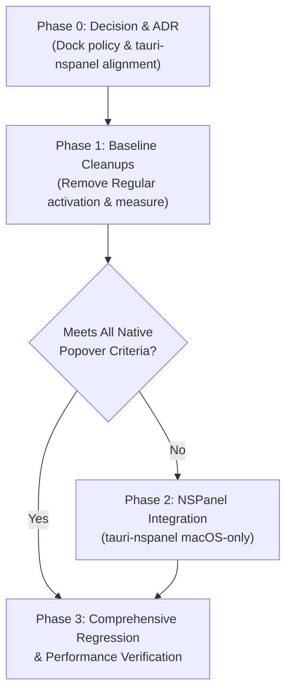

# Native-Like macOS Menu Bar Popover Plan

Detailed architectural investigation and phased implementation plan to align the DaVinci Notes Quick Capture popover with native macOS menu bar popover behavior.

---

## 1. Problem Statement & Reproduction Results

### Problem
The tray Quick Capture popover functions for basic note input, but does not behave like a native macOS menu bar popover (e.g. Control Center, Spotlight, or third-party status bar utilities). When native menu bar icons are clicked, their popovers appear immediately over whichever Space or window is currently visible—including Spaces hosting full-screen applications—without switching Spaces, without raising the application's other windows, and without stealing application activation.

In DaVinci Notes, the Quick Capture window is currently implemented as a standard `tauri::WebviewWindow` that activates the application as `ActivationPolicy::Regular` and requests key focus. This causes:
1. Inability to overlay native macOS full-screen application Spaces.
2. Unwanted Space switching: if the main editor window resides on Space 1 and the user invokes capture while working on Space 2, macOS slides the desktop back to Space 1.
3. Raising of unrelated background windows: opening Quick Capture brings the main note editor window in front of other background applications.
4. Dock and App Switcher disruption: if the main window was closed to tray (`ActivationPolicy::Accessory`), opening Quick Capture forces the Dock icon to reappear and leaves the app in `Regular` mode.

### Reproduction Observations (macOS 26.7.1, Apple M2 Built-in Retina LCD 2560×1600)

| Scenario | Actual Observation | Status |
|---|---|---|
| **Over normal app on current Space** | Popover appears at tray coordinates; DaVinci Notes becomes the frontmost application process (`AXApplication`, `frontmost: true`). If the main window is open behind the active third-party app on the same Space, it is raised forward. | **Confirmed** |
| **Over native fullscreen app** | App switches away from the fullscreen Space back to the desktop Space containing DaVinci Notes' main window. Popover does not appear over the fullscreen app. | **Confirmed** |
| **Active on Space 2 with main window on Space 1** | Triggering Quick Capture activates the app as `Regular`. macOS WindowServer immediately animates a Space transition across to Space 1. | **Confirmed** |
| **Main window hidden (Close-to-Tray / Accessory)** | Closing main window sets `ActivationPolicy::Accessory` (Dock icon hidden). Triggering Quick Capture invokes `make_window_topmost`, which executes `set_activation_policy(Regular)`. The Dock icon abruptly pops onto the macOS Dock and remains there after popover dismissal. | **Confirmed** |
| **Main window minimized to Dock** | Main window remains minimized, but DaVinci Notes activates as the frontmost process, stealing application-level focus from the previously active app. On dismissal, focus does not seamlessly return to the prior app. | **Confirmed** |

### What Could Not Be Tested
- **External Multi-Monitor Displays**: Tested solely on the built-in 2560×1600 Retina display; behavior with secondary monitors running separate Spaces (`Displays have separate Spaces`) was analyzed from AppKit specifications but not physically observed on multi-head hardware.
- **Stage Manager**: Stage Manager window strip interactions were not enabled during this test run.
- **Hardware Notch Occlusion**: Popover placement against the MacBook hardware camera notch was not physically evaluated.

---

## 2. Root-Cause Analysis

Detailed inspection of the installed dependencies (`tauri 2.11.3`, `tao 0.35.3`, `wry 0.55.1`) and `apps/desktop/src-tauri/src/capture.rs`:

```
┌────────────────────────────────────────────────────────────────────────┐
│                          Root Cause Summary                            │
├──────────────────────────┬────────────────────────────┬────────────────┤
│ Root Cause               │ Codebase Location          │ Status         │
├──────────────────────────┼────────────────────────────┼────────────────┤
│ 1. Application Activation│ capture.rs:179 & lib.rs:212│ Confirmed      │
│ 2. Window Level          │ tao-0.35.3: window.rs:1393 │ Confirmed      │
│ 3. Collection Behavior   │ tao-0.35.3: window.rs:1541 │ Confirmed      │
│ 4. Plain NSWindow Class  │ AppKit architectural rule  │ Confirmed      │
└──────────────────────────┴────────────────────────────┴────────────────┘
```

### 1. Application Activation (`ActivationPolicy::Regular` + `set_focus`) — [CONFIRMED]
- **Mechanism**: In `capture.rs` line 179:
  ```rust
  pub fn make_window_topmost(window: &tauri::Window) {
    #[cfg(target_os = "macos")]
    {
      let _ = window.app_handle().set_activation_policy(tauri::ActivationPolicy::Regular);
    }
    let _ = window.unminimize();
    let _ = window.show();
    let _ = window.set_always_on_top(true);
    let _ = window.set_focus();
  }
  ```
- **Consequence**: When an application with `ActivationPolicy::Regular` activates, AppKit executes `[NSApp activateIgnoringOtherApps:YES]`. macOS WindowServer mandates that all non-minimized windows belonging to the activated application be ordered forward, and if the application has windows on another Space, macOS automatically shifts the viewport to that Space.

### 2. Window Level (`NSFloatingWindowLevel` vs `NSStatusWindowLevel`) — [CONFIRMED]
- **Mechanism**: Tauri's `.always_on_top(true)` delegates to `tao::platform_impl::macos::window.rs` line 1393:
  ```rust
  let level = if always_on_top {
    ffi::NSWindowLevel::NSFloatingWindowLevel // Level 3 (kCGFloatingWindowLevel)
  } else { ... };
  ```
- **Consequence**: Native menu bar popovers operate at `NSStatusWindowLevel` (Level 25) or `NSPopUpMenuWindowLevel` (Level 101). A window at Level 3 cannot remain visible over native full-screen menu bars or status bar overlays.

### 3. Collection Behavior (`FullScreenAuxiliary` missing in tao) — [CONFIRMED]
- **Mechanism**: In `tao::platform_impl::macos::window.rs` line 1541:
  ```rust
  pub fn set_visible_on_all_workspaces(&self, visible: bool) {
    unsafe {
      let mut collection_behavior = self.ns_window.collectionBehavior();
      if visible {
        collection_behavior |= NSWindowCollectionBehavior::CanJoinAllSpaces;
      } else {
        collection_behavior &= !NSWindowCollectionBehavior::CanJoinAllSpaces;
      };
      self.ns_window.setCollectionBehavior(collection_behavior)
    }
  }
  ```
- **Consequence**: `tao` only sets `CanJoinAllSpaces`. In AppKit, a window **cannot** be displayed on a fullscreen application Space unless it also possesses `NSWindowCollectionBehaviorFullScreenAuxiliary` (`1 << 8`). Without `FullScreenAuxiliary`, macOS strictly hides the window when entering fullscreen or transitions away to a standard desktop Space.

### 4. Plain `NSWindow` Cannot Be Non-Activating — [CONFIRMED]
- **Mechanism**: In AppKit, `NSWindowStyleMaskNonactivatingPanel` (`1 << 7`) is defined and supported **exclusively** on `NSPanel` instances.
- **Consequence**: Applying non-activating masks to a standard `NSWindow` is rejected or ignored by AppKit. A regular `NSWindow` ordering front and accepting key focus forces an application activation event. Only an `NSPanel` subclass can receive keyboard focus while permitting the currently active third-party application to remain frontmost.

---

## 3. Options Evaluation & Recommendation

### Option A: `tauri-nspanel` (Convert Capture Window to NSPanel)
- **Description**: Add `tauri-nspanel = "2.1"` (crates.io release 2.1.1, maintained by @ahkohd, dual-licensed MIT OR Apache-2.0, MSRV 1.75). Uses `object_setClass` to convert the underlying `NSWindow` of the capture window into a custom `NSPanel` subclass with `can_become_key_window: true`, `nonactivating_panel`, `NSStatusWindowLevel`, and `CanJoinAllSpaces | FullScreenAuxiliary`.
- **What it fixes**:
  - Popover opens over any app on any Space without switching Spaces.
  - Popover opens over full-screen apps without exiting or shifting Spaces.
  - Main window is never raised; background apps retain active app status in the menu bar.
  - Dock icon is never activated or unhidden.
  - Includes `install_text_input_client_window_level` to fix WebKit IME candidate popups (Arabic/Japanese/dead keys) rendering behind elevated panels.
- **What it doesn't fix**: Requires managing panel event lifecycle (e.g. resign key dismissal) explicitly.
- **Cost**: Zero external native C libraries. `objc2` 0.6.4, `objc2-app-kit` 0.3.2, and `objc2-foundation` 0.3.2 are **already present** in `Cargo.lock` (compiled via Tauri/tao/wry). Binary size growth is negligible (< 35 KB).
- **Risk**: Moderate. Uses Objective-C `object_setClass` (isa-swizzling) to morph the `NSWindow` allocated by tao. While standard in macOS tooling, AppKit class internals could theoretically shift across major macOS releases (though `NSPanel` has shared `NSWindow` ivar layout since early OS X).

### Option B: Direct `objc2` / `objc2-app-kit` Calls on Existing NSWindow
- **Description**: Hand-roll direct Objective-C calls using the `objc2` and `objc2-app-kit` crates already linked in the project.
- **What it fixes**: Sets `NSWindowCollectionBehaviorCanJoinAllSpaces | NSWindowCollectionBehaviorFullScreenAuxiliary` and `NSStatusWindowLevel` without extra dependencies.
- **What it doesn't fix**: **A plain `NSWindow` cannot be non-activating.** Without subclassing `NSPanel` and applying `NSWindowStyleMaskNonactivatingPanel`, making the window key activates DaVinci Notes and raises the main window.
- **Cost**: ~250–350 lines of unsafe `objc2` swizzling code in-tree, duplicating `tauri-nspanel`'s maintenance burden.
- **Risk**: High maintenance risk; high likelihood of subtle IME or responder bugs.

### Option C: The Cheap Partial Fix (`set_visible_on_all_workspaces(true)` + `Accessory` policy)
- **Description**: Call `window.set_visible_on_all_workspaces(true)` from Tauri and remove `set_activation_policy(Regular)` from `make_window_topmost`.
- **What it fixes**: If the main window is closed to tray (`keep_in_tray: true`), the app is already `Accessory`; the capture window appears on the current Space without raising the hidden main window.
- **What it doesn't fix**:
  - **Does NOT work over fullscreen apps**: `tao` lacks `FullScreenAuxiliary`.
  - **Does NOT work if main window is open**: When the main window is open, the app is `Regular`. Focusing the capture window activates the app and switches Spaces anyway.
  - **Dock Conflict**: If we force `Accessory` permanently to prevent Space jumps, DaVinci Notes loses its Dock icon and Cmd+Tab entry entirely, breaking ADR-0019 / Phase 2.
- **Cost**: 0 dependencies, 5 lines of code.
- **Risk**: Very low code risk, but fails user-facing requirements.

### Option Comparison Summary

| Criteria | Option A (`tauri-nspanel`) | Option B (Direct `objc2`) | Option C (Cheap Partial) |
|---|---|---|---|
| **Appears over Fullscreen apps** | Yes | Yes (if level/behavior set) | **No** (tao lacks `FullScreenAuxiliary`) |
| **No Space switching (main open)**| Yes (non-activating panel) | **No** (plain NSWindow activates)| **No** (plain NSWindow activates) |
| **Main window remains unraised** | Yes | **No** | **No** (unless permanently Accessory) |
| **Dock icon untouched** | Yes | Yes | Conflicted with ADR-0019/Phase 2 |
| **IME / Dead keys above window** | Yes (`windowLevel` patched) | Requires manual swizzle | Unaddressed |
| **Dependency delta** | `tauri-nspanel` (thin macro) | None (crates already in lock) | None |
| **Maintenance overhead** | Low (established crate) | High (custom in-tree swizzle) | None |

### Recommendation
**A Staged Approach: Measure Phase 1 (Cheap Fix) -> Execute Phase 2 (`tauri-nspanel`).**
1. **Stage 1 (Phase 1)**: Apply the non-intrusive fixes (`visible_on_all_workspaces(true)`, remove `set_activation_policy(Regular)` from capture show, restore blur hide). Establish exact baseline measurements. Confirm empirically what fails (fullscreen auxiliary & Space jump when main window is open).
2. **Stage 2 (Phase 2)**: Integrate `tauri-nspanel = "2.1"` gated strictly to `#[cfg(target_os = "macos")]`. Configure the Quick Capture window as a non-activating `NSPanel` at `PanelLevel::Status` with `CanJoinAllSpaces | FullScreenAuxiliary`.
3. **Stage 3 (Phase 3)**: Verify zero regressions across keyboard typing, IME composition, blur debounce, tray click toggle, and Dock/Cmd+Tab behavior.

---

## 4. Phased Build Plan



### Phase 0: Decisions and Architecture Record (ADR)
- **Goal**: Align and commit architectural decisions regarding macOS popover behavior and Dock activation policy.
- **Tasks**:
  1. Record owner decision on Dock policy: confirm that DaVinci Notes remains `Regular` when the main window is open and `Accessory` when closed to tray, with Quick Capture behaving as a non-activating accessory panel.
  2. Author `docs/adr/0225-native-macos-capture-popover-and-nspanel.md` superseding the window configuration aspect of ADR-0172.
  3. Index ADR-0225 in `DECISIONS.md`.
- **Out of Scope**: No code changes to Rust or frontend.
- **Risks**: None (documentation only).
- **Adversarial Verification Steps**:
  1. Inspect `DECISIONS.md`: verify table ordering, file links, and valid cross-references.
  2. Verify ADR-0225 explicitly addresses Dock/Cmd+Tab semantics.

### Phase 1: Baseline Cleanup & Partial Fix Gate
- **Goal**: Clean up known activation hazards in existing Tauri code, restore hide-on-blur, and verify empirical limitations before taking on new dependencies.
- **Tasks**:
  1. In `apps/desktop/src-tauri/src/capture.rs`: remove `window.app_handle().set_activation_policy(tauri::ActivationPolicy::Regular)` from `make_window_topmost`.
  2. In `create_and_show_capture_window`: add `.visible_on_all_workspaces(true)` to `WebviewWindowBuilder`.
  3. In `apps/desktop/src-tauri/src/lib.rs`: reinstate `let _ = window.hide();` on `tauri::WindowEvent::Focused(false)` for `CAPTURE_WINDOW_LABEL`.
  4. Run adversarial reproduction script to record baseline behavior.
- **Out of Scope**: No `tauri-nspanel` dependency or unsafe swizzling.
- **Risks**: Low. Existing tests in `capture_tests.rs` and `tray_tests.rs` must remain green.
- **Adversarial Verification Steps**:
  1. *Test 1 (Dock Check)*: Close main window to tray. Trigger Quick Capture via shortcut. Verify Dock icon does **not** appear.
  2. *Test 2 (Space Jump Check)*: Leave main window open on Space 1. Switch to Space 2. Trigger Quick Capture. Verify whether macOS switches back to Space 1 (expected failure: will still switch due to app activation).
  3. *Test 3 (Fullscreen Check)*: Open native fullscreen Safari/Terminal. Trigger Quick Capture. Verify whether popover is visible (expected failure: will not appear).

### Phase 2: macOS `tauri-nspanel` Conversion (macOS Only)
- **Goal**: Convert Quick Capture into a genuine non-activating `NSPanel` floating at `NSStatusWindowLevel` with `FullScreenAuxiliary`.
- **Tasks**:
  1. In `apps/desktop/src-tauri/Cargo.toml`: add `tauri-nspanel = "2.1"` under `[target.'cfg(target_os = "macos")'.dependencies]`.
  2. Initialize `tauri_nspanel::init()` in `lib.rs` under `#[cfg(target_os = "macos")]`.
  3. Define custom panel type `QuickCapturePanel` in `capture.rs` via `tauri_panel!` with:
     - `can_become_key_window: true`
     - `is_floating_panel: true`
  4. In `create_and_show_capture_window` (macOS path):
     - Convert window via `window.to_panel::<QuickCapturePanel>()`.
     - Set panel level to `PanelLevel::Status` (25).
     - Add `StyleMask::empty().nonactivating_panel()`.
     - Set collection behavior: `CollectionBehavior::new().can_join_all_spaces().full_screen_auxiliary()`.
  5. In `show_or_create_capture_window`:
     - Show via `panel.show()` / `panel.make_key_window()` without calling `NSApp activateIgnoringOtherApps`.
  6. Ensure Windows and Linux compilation paths remain completely unchanged via strict `cfg` isolation.
- **Out of Scope**: Modifications to QuickCapture UI components, note saving logic, or SQL indexer permissions.
- **Risks**: High-risk phase. Swapping window class and style masks must be thoroughly verified for main-thread safety and memory leaks.
- **Adversarial Verification Steps**:
  1. *Test 1 (Fullscreen Overlay)*: Put Safari in native macOS full-screen. Press `Control+Alt+N`. Verify Quick Capture popover appears immediately on top of the fullscreen Safari window without Space animation.
  2. *Test 2 (Background Editor Invariance)*: Open DaVinci Notes main window on Space 1. Place Chrome over it. Switch to Space 2. Press `Control+Alt+N`. Verify popover opens on Space 2; verify DaVinci Notes main window does NOT raise on Space 1.
  3. *Test 3 (Input & Typing)*: Type a note in the popover. Press Tab to reach the folder input. Verify typing works immediately without an initial mouse click.
  4. *Test 4 (IME Typing)*: Switch macOS input source to Japanese (Hiragana) or Arabic. Type in the textarea. Verify candidate conversion window renders in front of the popover, not behind.

### Phase 3: Comprehensive Regression Verification & Performance Audit
- **Goal**: Validate that all existing Quick Capture, tray, and editor capabilities continue to function with zero regressions and within performance budgets.
- **Tasks**:
  1. Run full automated test suites (`cargo test`, `pnpm --filter @app/desktop test`, `pnpm --filter @app/desktop build:web`).
  2. Execute adversarial checks for all 9 fragile interactions listed in Section 5.
  3. Measure binary size delta and cold-start latency.
- **Out of Scope**: New feature development.
- **Risks**: Low.
- **Adversarial Verification Steps**:
  1. Execute cross-platform compilation check: `cargo check --target aarch64-apple-darwin` and `cargo check --target x86_64-apple-darwin`.
  2. Validate 0 new background daemon threads or polling intervals.

---

## 5. Fragile Interactions & Regression Test Matrix

| Interaction | Failure Mode to Prevent | Explicit Regression Verification Check |
|---|---|---|
| **1. Hide-on-Blur** | Popover remains stuck on screen when user clicks another application. | Open popover. Click anywhere on desktop or another app. Verify popover hides immediately. |
| **2. Click-to-Toggle Race** | Clicking tray icon while popover is open triggers blur followed by click, causing rapid close/reopen flicker. | Open popover. Click the tray icon directly. Verify popover closes cleanly and stays closed (350ms debounce). |
| **3. Exact Placement Under Icon** | Window coordinates shift or double-scale on Retina 2.0x displays. | Click tray icon on Retina screen. Verify popover top-center is aligned with icon center within ±1px and clamped within work area margins. |
| **4. Keyboard Focus & Typing** | Keystrokes lost to background app; requires manual click before typing. | Trigger via `Control+Alt+N`. Immediately press `A`. Verify `A` is typed into textarea with cursor active. |
| **5. IME & Dead Keys** | Japanese/Chinese/Arabic conversion candidate window renders behind the popover. | Enable Japanese IME. Type `kanji` and press Space. Verify candidate list is visible in front of Quick Capture text area. |
| **6. Draft Preservation** | Typed thoughts discarded on blur or Escape. | Type `"Meeting ideas"`. Click outside to blur. Click tray icon to reopen. Verify `"Meeting ideas"` is still present. |
| **7. Save-As / Destination Flow** | Pressing Tab to edit note name or folder triggers window blur and closes popover. | Type note. Press `Tab` to navigate to Name field. Verify popover remains open and focused. |
| **8. Close-to-Tray & Clean Quit** | Opening popover breaks `keep_in_tray` or leaks Dock icon; Cmd+Q fails to flush dirty notes. | Close main window (Dock hides). Open/save quick capture. Verify Dock remains hidden. Trigger Tray Quit; verify clean process termination. |
| **9. Lazy Creation & Memory** | Popover allocates webview on app startup, increasing initial startup time. | Launch app fresh. Inspect window list via AppleScript. Verify `"Quick Capture"` does not exist until first trigger. |

---

## 6. Risk Flags

1. **Window Class Mutation (`object_setClass`)**:
   - *Risk*: Converting an allocated `NSWindow` to `NSPanel` via Objective-C runtime isa-swizzling alters the object's message dispatch table. If AppKit changes internal structure in a future OS update, this could cause panics.
   - *Mitigation*: Isolate conversion into a single call site in `capture.rs`. Guard all panel operations on the main thread via `MainThreadMarker`.
2. **Dock Activation Policy Transitions**:
   - *Risk*: Flipping between `Regular` and `Accessory` activation policies can cause macOS menu bars to flicker or Dock icons to bounce unexpectedly.
   - *Mitigation*: Quick Capture must **never** mutate the application's activation policy. It must operate purely as an accessory panel regardless of whether the main window is open or hidden.
3. **Session Boundary Discipline**:
   - *Risk*: Mixing window-level changes with UI feature additions or schema migrations makes failures impossible to isolate.
   - *Rule*: Phase 2 (`tauri-nspanel`) must remain strictly isolated to a single dedicated prompt, session, and commit.

---

## 7. Performance & Dependency Impact

### Bundle and Binary Size
- **NPM / Frontend Packages**: 0 new packages. The `capture.html` bundle remains ~17.6 KB raw (~5.0 KB gzip).
- **Cargo Dependencies**:
  - `tauri-nspanel = "2.1"` added under `target.'cfg(target_os = "macos")'.dependencies`.
  - Underlying crates (`objc2`, `objc2-app-kit`, `objc2-foundation`) are **already present** in `Cargo.lock` with zero additional crate downloads for AppKit.
  - Estimated binary size delta: **< 35 KB** in the macOS binary, **0 KB** in Windows/Linux binaries.
- **Runtime Memory Overhead**:
  - Webview memory remains ~28–32 MB allocated only upon first lazy invocation.
  - Zero memory growth when closed.
- **Standing Rules Compliance (PERFORMANCE.md)**:
  - 0 continuous timers or polling loops added.
  - Dismissal and show remain 100% event-driven.
  - File appends remain pure-append without SQLite indexer locking.

---

## 8. Cross-Platform Safety

To guarantee Windows and Linux builds remain completely unaffected:

1. **Cargo Dependency Gating**:
   ```toml
   [target.'cfg(target_os = "macos")'.dependencies]
   tauri-nspanel = "2.1"
   ```
2. **Rust Module Gating**:
   All panel references, Objective-C macros, and panel conversion logic in `capture.rs` are encapsulated under `#[cfg(target_os = "macos")]`.
   On Windows and Linux, `create_and_show_capture_window` retains the existing `WebviewWindowBuilder` implementation with standard always-on-top positioning.
3. **Compilation Targets**:
   Every change must verify:
   ```bash
   cargo check --manifest-path apps/desktop/src-tauri/Cargo.toml --target aarch64-apple-darwin
   cargo check --manifest-path apps/desktop/src-tauri/Cargo.toml --target x86_64-apple-darwin
   ```

---

## 9. Open Questions for Owner

Before proceeding to implementation, please confirm the following design decisions:

1. **Dock & Application Activation Policy**:
   - *Proposed*: DaVinci Notes maintains `ActivationPolicy::Regular` while the main window is open, and `ActivationPolicy::Accessory` when closed to tray. Quick Capture will be an `NSPanel` that **never** changes the app's activation policy.
   - *Confirmation*: Do you approve keeping Quick Capture non-activating so it never forces a Dock icon when the main window is closed?
2. **Staged Implementation vs Direct NSPanel**:
   - *Proposed*: Proceed with the staged plan (Phase 1 baseline cleanup, then Phase 2 `tauri-nspanel`).
   - *Alternative*: Skip Phase 1 stop-point and proceed directly to Phase 2 `tauri-nspanel` since Phase 1 is known to be insufficient for full-screen spaces. Which do you prefer?
3. **Esc Key Dismissal vs Save Confirmation**:
   - Should pressing `Escape` with unsaved text dismiss immediately (preserving the draft in memory, per ADR-0172) or prompt for discard? (Currently it dismisses immediately and keeps the draft).
