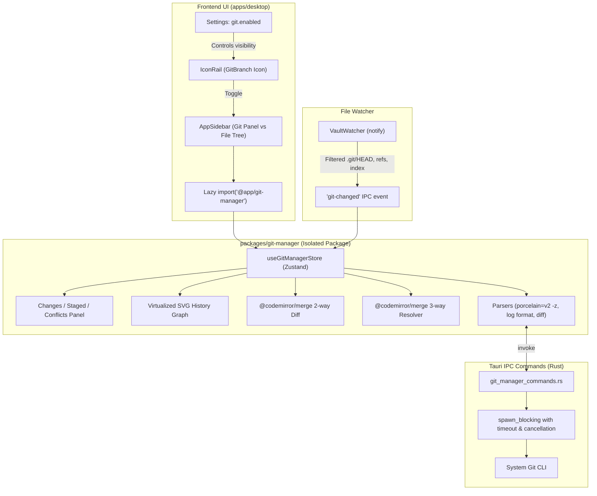

# Git Manager — Feature & Phased Implementation Plan

Target: Build a comprehensive, lightweight Git Manager page for Sophia/DaVinci Notes: a VS Code / Cursor-style source control UI opened from a new icon-rail icon. Enables stage/unstage, commit, amend, diff, history graph, branch switching, fetch/pull/push, and conflict resolution against main/upstream. Opt-in via a Settings toggle (`git.enabled`).

This builds ON the existing git-versioning work (ADR-0152, ADR-0153, ADR-0154, ADR-0155). It reuses the backend, commands, credential model, and security policies. It does NOT build a second git backend.

---

## 1. Decisions to Lock (ADR-0232 through ADR-0236)

The following 5 decisions are locked as architecture decisions. None is picked silently.

| # | Topic | Recommendation | Reason & Trade-Off |
|---|---|---|---|
| **D1** | **Git Backend** | **Reuse system `git` (ADR-0152)** via Rust `std::process::Command` in `spawn_blocking`, commands cancellable with timeouts (30s network, 5s local), never on UI thread. | `git2-rs` was already measured at +630 KiB static native binary bloat in ADR-0152. System `git` adds 0 KB to the binary. *Question for user:* If a user lacks `git` on PATH, Sophia guides them to install it; bundled portable git is rejected due to 30-50 MB bundle penalty. |
| **D2** | **Diff & Conflict Rendering** | **`@codemirror/merge`**, lazy-loaded inside `packages/git-manager`. | Official CodeMirror 6 extension (~18 KB gzip). Integrates seamlessly with our existing CM6 editor themes, token styling, and line decorations. Far lighter than Monaco or external web diff tools. |
| **D3** | **History Graph** | **Custom lightweight SVG lane renderer**, virtualized via `@tanstack/react-virtual`. | Zero new graph dependencies. Reuses `@tanstack/react-virtual` already used in `FileTree` (ADR-0028). Deterministic lane assignment algorithm computes fork/merge lines in <10ms for 500 commits. |
| **D4** | **Activation & Lazy Boundary** | **Setting `git.enabled` (default `false`)**. Rail icon + `packages/git-manager` chunk load dynamically ONLY when enabled AND vault is a git repository. | Initial desktop bundle delta is strictly 0 KB. Zero git child processes spawned when disabled or panel closed. Status poll pauses when panel hidden. |
| **D5** | **Authentication & Keyring** | **HTTPS + PAT in OS Keychain (ADR-0155)** under service `com.davinci.notes.git-remote`. | Universal across GitHub, GitLab, Bitbucket, Gitea. Reuses existing `keyring::Entry` and `GIT_ASKPASS` script adapter from `git_remote.rs` and `git_auth.rs`. No secrets in SQLite, git config, or plaintext. |

---

## 2. Architecture & Subsystem Boundaries

### 2.1 Rust Command Layer (`src-tauri/src/git_manager_commands.rs`)
- Thin, typed commands returning raw stdout or structured DTOs.
- All Git operations run inside `tauri::async_runtime::spawn_blocking`.
- Operations acquire `GIT_OPERATION_LOCK` mutex (from `git.rs`) when mutating index/working tree.
- Timeouts: Local commands timeout after 5,000 ms; network operations (fetch/push/pull) timeout after 30,000 ms with kill-on-drop process handling.
- Environment variables: `GIT_TERMINAL_PROMPT=0`, `LC_ALL=C` for consistent parsing, and `GIT_ASKPASS` with credentials from OS keychain for remote commands.

### 2.2 `packages/git-manager` Monorepo Package
- Independent workspace package under `packages/git-manager`.
- Zero dependency on `apps/desktop` (strictly conforms to `eslint-plugin-boundaries`).
- Only dependencies: `@app/core-types`, `@app/design-tokens`, `@app/design-system`, `@codemirror/merge`, `@codemirror/state`, `@codemirror/view`, `@tanstack/react-virtual`, `zustand`.
- Parsers:
  - `parsePorcelainV2(raw: string)`: parses `git status --porcelain=v2 -z` into `{ staged, unstaged, untracked, unmerged }` handling NUL separators for Unicode/emoji/spaces.
  - `parseGitLog(raw: string)`: parses `git log` with `%H%x1f%P%x1f%an%x1f%ae%x1f%at%x1f%s%x1f%D` into typed commit nodes for lane graph rendering.
  - `parseDiffHunks(raw: string)`: parses unified diff into file hunks for hunk-level stage/unstage.

### 2.3 Status Refresh & Watcher Strategy
- Vault watcher (`watcher.rs`) watches the vault root recursively.
- To prevent heavy git churn from thrashing the note indexer, `watcher.rs` filters `.git` files:
  - Ignores `.git/objects`, `.git/logs`, `.git/hooks`.
  - Captures changes strictly to `.git/HEAD`, `.git/index`, `.git/refs/**`.
  - Emits a distinct `git-changed` event to the webview debounced at 200 ms.
- Git Manager listens to `git-changed` and invalidates status only when the Git panel is active/visible.
- When Git panel is hidden, watcher events are accumulated into a `dirty` flag and status is fetched on next reopen.

### 2.4 Database State Policy
- Git status, history, diffs, branches, and staging are ephemeral or read directly from Git.
- No Git working tree state is stored in `vault-index.db`.
- Only persistent configuration (`git.enabled`, remote URL, branch tracking preferences) lives in `settings` table via `withDbLock` and `withDbTransaction`.

---

## 3. UI Layout & Design System

### 3.1 Primary Navigation & App Shell
- **Icon Rail**: Phosphor `GitBranch` icon positioned below Bookmarks/Files. Active state highlights when Git Manager is open.
- **Left Panel Replacement**: Clicking `GitBranch` replaces the File Tree panel inside `AppSidebar` with the Git Manager Sidebar (`GitSidebarPanel`). Clicking `Files` restores the File Tree. Both preserve scroll state.
- **Collapsible Sidebar**: Respects `data-collapsed` state and sidebar width resizing.

### 3.2 Git Sidebar Sections (Obsidian/VS Code Parity)
1. **Header Toolbar**: Branch switcher dropdown (with create/checkout search), Fetch, Pull, Push buttons with ahead/behind badges (`↑2 ↓1`), and Refresh button.
2. **Commit Box**:
   - Multi-line commit message `<textarea>` with placeholder (`Commit message (Enter to commit, Shift+Enter for newline)`).
   - Primary `Commit` button + Radix dropdown (`Commit & Push`, `Commit (Amend)`, `Commit & Sync`).
3. **Staged Changes Accordion**:
   - Header with count badge and `Unstage All` action.
   - List of staged files with status glyph (`M`, `A`, `D`, `R`, `C`), filename, relative directory, and row actions (`Unstage`, `Discard`).
4. **Changes (Unstaged) Accordion**:
   - Header with count badge, `Stage All`, and `Discard All` actions.
   - List of changed/untracked files with status glyph and row actions (`Stage`, `Discard`).
5. **Merge Conflicts Accordion** (visible only during merge conflict):
   - Status badge `Merge in progress` with `Abort Merge` button.
   - List of conflicted files (`UU`, `AA`, `UD`, `DU`) with `Resolve in Editor` action.
6. **History Graph Accordion**:
   - Virtualized commit history list.
   - SVG lane diagram showing branch topologies, merges, tags, and HEAD pointer.
   - Selecting a commit opens Commit Details in the main editor area.

### 3.3 Main Area Views (Center Pane)
- **Diff Mode**: Replaces editor with `@codemirror/merge` two-pane diff (working copy vs HEAD, or staged vs HEAD). Includes inline hunk staging buttons (`Stage Hunk`, `Revert Hunk`).
- **Conflict Resolver Mode**: 3-pane merge view: Ours (left), Result (editable center), Theirs (right) with quick action chips (`Accept Current`, `Accept Incoming`, `Accept Both`).
- **Commit Details Mode**: Commit metadata (author, hash, date, message) and list of files changed in that commit with clickable diff inspect.

### 3.4 Styling & Design Tokens
- Strict CUBE CSS with CSS modules or BEM (`.git-manager`, `.git-status-row`, etc.).
- Semantic status colors using public tokens from ADR-0164:
  - Added / Untracked: `--color-border-status-success` (`A`, `?`)
  - Modified: `--color-border-status-warning` (`M`)
  - Deleted: `--color-border-status-error` (`D`)
  - Conflict: `--color-border-status-error` (`U` / `!`)
  - Renamed / Copied: `--color-border-status-accent` (`R`, `C`)
- Depth achieved through 1px solid borders (`var(--color-border-default)`), never box-shadows.

---

## 4. Implementation Phases (0 through 9)

### Phase 0: Verification Audit (Read-Only)
- Inventory existing Git versioning implementation (`git.rs`, `git_remote.rs`, `git_auth.rs`, `git_history.rs`).
- Adversarial test suite in scratch vault:
  1. Non-repo vault behavior.
  2. `git init` repo behavior.
  3. Push/pull against local bare repository.
  4. Git missing from `PATH` simulation.
  5. Add/modify/delete/rename outside app.
  6. Forced merge conflict.
  7. Interaction with `vault-index.db` and attachments.
  8. Repo inside synced folder warning check.
- Measure baseline `git status` and `git log -n 500` latency on a 5,000-note vault fixture.
- Output: Gap table and GO / NO-GO decision.

### Phase 1: Settings Toggle, Repo Detection, Lazy Boundary & Rail Icon
- Add `git.enabled` setting in `GeneralSettingsTab` or `VersionControlSettingsTab`.
- Rust command `check_git_status` (verifies `git` binary present and vault is a git repository).
- Dynamic import boundary for `@app/git-manager`.
- IconRail button (`GitBranch`) visible only when `git.enabled` is `true`.
- Empty state: "Not a Git Repository" with 1-click `Initialize Repository` button.

### Phase 2: Status Engine & Changes List UI
- Rust command `git_status_porcelain` running `git status --porcelain=v2 -z`.
- Robust parser for Porcelain v2 handling NUL delimiters, file renames, untracked, and unstaged files.
- Watcher integration: hook into `watcher.rs` debounced `.git` ref changes.
- `useGitManagerStore` Zustand store.
- Changes UI: collapsible Staged, Changes, and Untracked file lists with status badges (`M`, `A`, `D`, `U`, `R`).

### Phase 3: Stage, Unstage, Discard, Commit & Amend
- Rust commands: `git_stage_paths`, `git_unstage_paths`, `git_discard_paths`, `git_commit`.
- Support staging single files, multi-selected files, and "Stage All".
- Destructive discard confirmation dialog (`"Discard changes in N files? This cannot be undone."`).
- Commit input form with keyboard shortcut (`Mod+Enter` to commit).
- Amend toggle to amend previous commit message and tree.
- Dropdown actions: `Commit & Push`, `Commit & Sync`.

### Phase 4: Diff Viewer & Hunk-Level Staging
- Integrate `@codemirror/merge` in `packages/git-manager`.
- Rust command `git_diff_file` and `git_diff_hunks`.
- Side-by-side or unified diff view in main workspace leaf.
- Hunk staging: `git apply --cached` to stage specific hunks.

### Phase 5: History Graph, Commit Detail & File History
- Rust command `git_log_paged` with custom separator format.
- Custom SVG lane layout algorithm (calculates topological tracks, branching lines, and merge joins).
- Virtualized scrolling using `@tanstack/react-virtual` (smooth 60 fps at 10,000 commits).
- Commit detail sheet: hash, author, date, parent revisions, commit message, and changed files list.
- File history mode: filter commits touching the active note.

### Phase 6: Branches: List, Switch, Create, Delete & Dirty Tree
- Rust commands: `git_list_branches`, `git_create_branch`, `git_checkout_branch`, `git_delete_branch`.
- Branch switcher dropdown in Git panel header with instant search filter.
- Dirty tree guard: prompt user when switching branches with uncommitted changes (Stash & Switch vs Cancel).
- Detached HEAD warning indicator.

### Phase 7: Remote: Fetch, Pull, Push, Ahead/Behind
- Rust commands: `git_fetch`, `git_pull`, `git_push` with PAT credential integration from OS keychain.
- Background ahead/behind commit counter (`git rev-list --left-right --count HEAD...@{upstream}`).
- Push/Pull buttons with progress spinner and cancellable timeout (30s).
- Error classification for auth errors, branch divergence, and rejection.

### Phase 8: Conflict Resolution (3-Pane Resolver)
- Merge execution: detect merge conflicts (`MERGE_HEAD` exists).
- Rust commands: `git_merge_branch`, `git_abort_merge`, `git_resolve_conflict`.
- 3-pane interactive conflict resolver using `@codemirror/merge`:
  - Pane 1: Ours (current branch)
  - Pane 2: Merge Result (editable)
  - Pane 3: Theirs (incoming branch)
  - Action chips: "Accept Current", "Accept Incoming", "Accept Both".
- Abort merge restores exact prior working tree without data loss.
- Continue merge commits resolved state.
- Adversarial tests: line conflicts, delete-vs-modify, rename-vs-modify, binary conflicts, and mid-merge external edits.

### Phase 9: Polish, Performance Pass, Stabilization & Documentation
- Performance audit: measure bundle size delta (0 KB when disabled), time to first paint (<150 ms), status refresh (<100 ms).
- SQLite concurrency regression pass with `withDbLock`.
- Complete ADR log (`DECISIONS.md`) and session history (`PROGRESS.md`, `docs/HISTORY.md`).
- Hand-off verification guide for manual GitHub PAT testing.

---

## 5. Performance Budgets & Verification Metrics

| Metric | Target Budget | Measurement Method |
|---|---|---|
| **Feature OFF Bundle Delta** | **0 KB** | `node scripts/check-bundle-size.mjs` comparing entry chunk size with and without feature enabled. |
| **Idle Git Processes** | **0 processes** | Process monitor / `ps` inspection when idle or feature OFF. |
| **Open Panel (5k vault)** | **< 150 ms** | Performance profiler measuring click-to-first-paint of status list on 5,000 files. |
| **Save-to-Refresh Debounce** | **< 100 ms** | Performance timer measuring editor save event to UI status badge update without event-loop lag. |
| **Graph Scroll Performance** | **60 fps** | Chrome devtools frame rate counter scrolling 10,000 virtualized commit rows. |

---

## 6. Risk Register & Mitigation Strategy

1. **Vault Indexer vs Git Churn**:
   - *Risk*: Rapid Git operations (checkout, rebase) trigger hundreds of file modifications, causing vault indexer and SQLite to thrash.
   - *Mitigation*: Pause vault watcher during Git checkout/pull/rebase using `vaultWatchSession.ts` (`withVaultWatchSuppressed`), then trigger a single reconcile batch upon completion.
2. **Database & Cache In Git**:
   - *Risk*: `vault-index.db`, WAL files, or `.davinci/` caches committed to Git, causing repo bloat and binary conflicts.
   - *Mitigation*: Ensure standard `.gitignore` is enforced automatically at repo init, excluding `vault-index.db*`, `.davinci/`, and non-markdown cache folders.
3. **Simultaneous Sync Services (Drive/Syncthing + Git)**:
   - *Risk*: External sync writes files during Git merge or commit, leading to corrupted index or index.lock staleness.
   - *Mitigation*: Detect `.git` inside known cloud sync paths and display a prominent warning banner. Lock working tree with `GIT_OPERATION_LOCK` during critical mutations.
4. **Destructive Actions Safety**:
   - *Risk*: Accidental `Discard All` or `Hard Reset` obliterating uncommitted user notes.
   - *Mitigation*: Strict confirmation modal required for any discard or hard reset. Discarded notes are backed up to OS Trash or `.trash` when possible.
5. **Credential Security**:
   - *Risk*: Personal Access Tokens leaking into git logs, config files, or console errors.
   - *Mitigation*: Never pass PAT in CLI arguments or write to `.git/config`. Use temporary `GIT_ASKPASS` script pulling secrets directly from OS Keychain.
6. **Line Endings & Encoding**:
   - *Risk*: CRLF vs LF churning whole-file diffs across Windows and macOS.
   - *Mitigation*: Set `core.autocrlf=input` or configure repository `.gitattributes` to handle `*.md text eol=lf`. All parsers use `-z` (NUL byte) delimiters to prevent path escaping bugs.
