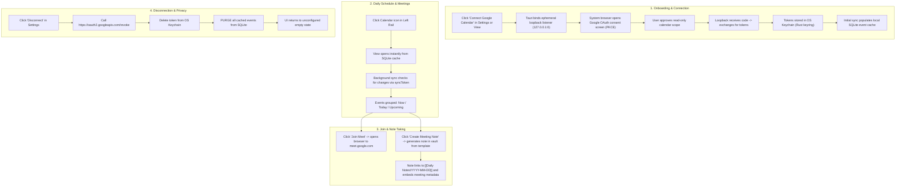

# Google Calendar & Google Meet Integration — Feature & Phased Build Plan

Target: provide seamless, zero-friction access to the user's upcoming Google Calendar events and Google Meet calls directly within DaVinci Notes. Users can glance at their daily schedule, join Google Meet calls with a single click, and generate structured meeting notes prefilled with attendees, agendas, and conference links into their local vault.

Consistent with DaVinci Notes' core principles, the integration is **local-first, privacy-respecting, lightweight, and backend-free**: all network communication occurs strictly between the user's desktop client and Google's official REST endpoints via system browser loopback OAuth and PKCE. Tokens are stored exclusively in the host OS keychain via Rust, and cached events in SQLite are disposable derived data.

Read `AGENTS.md`, `DECISIONS.md` (the ADR index), `PROGRESS.md`, and `PERFORMANCE.md` before every session.

---

## 1. Goals and Non-Goals

### 1.1 Goals
- **Zero-friction onboarding**: One click on "Connect Google Calendar" opens the user's default system browser via an ephemeral local loopback listener with PKCE. Once granted, the browser closes and the app is instantly connected. No API keys, OAuth client secrets, or manual token copying.
- **Dedicated left icon rail entry**: Accessible alongside Files, Search, Graph, Daily Notes, Canvas, and Reminders.
- **Direct Meet access**: Parse meeting links (`hangoutLink` and `conferenceData.entryPoints`) directly from event payloads, rendering a prominent "Join Meet" action.
- **One-click meeting notes**: Create a markdown note in the vault formatted with title, date/time, attendees, Meet link, and note sections, cross-linked to the daily note.
- **Offline-capable & fast**: Events cached locally in SQLite (`vault-index.db`) using incremental delta synchronization (`syncToken`). The view renders instantly from local cache without network blocking.
- **Lightweight (0 SDK overhead)**: Plain `fetch` against Google Calendar REST API v3. Zero dependency on the heavy `googleapis` npm package. All UI and client code is lazy-loaded on demand.
- **Clean security & privacy boundaries**: Tokens stored solely in the OS keychain via Rust `keyring` (macOS Keychain, Windows Credential Manager, Linux Secret Service). Disconnecting revokes tokens at Google and instantly purges the local event cache.

### 1.2 Non-Goals (Explicitly Out of Scope for MVP)
- **Bidirectional event writing / editing**: No creating, editing, rescheduling, or deleting events on Google Calendar from DaVinci Notes. Read-only for MVP.
- **Google Meet REST API integration**: No custom in-app meeting video rendering, recording management, or transcript ingestion. Clicking "Join" opens the system browser to `meet.google.com`.
- **Multi-account support in MVP**: First version supports a single connected Google account.
- **Cloud relay / custom backend**: No intermediary server. Client speaks directly to `googleapis.com`.
- **Mobile implementation in Phase 1-8**: Architecture and shared types support Expo mobile, but mobile UI/auth execution is sequenced for a later phase.

---

## 2. User Flows



---

## 3. Architecture Summary & Architectural Decisions

### 3.1 OAuth Reuse vs. Separate Consent (Decision 1)
- **Reused**:
  - Desktop OAuth infrastructure in Rust: `start_oauth_listener`, `wait_for_oauth_callback`, and `open_external_url` in `src-tauri/src/oauth.rs` are 100% generic loopback/PKCE primitives.
  - Browser PKCE challenge generator (`createPkceProvider` in JS Web Crypto).
- **Not Reused / Strictly Isolated**:
  - **Token Keychain Entry**: Drive tokens live in `com.davinci.notes.drive-oauth`. Calendar tokens MUST live in a dedicated keychain service: `com.davinci.notes.calendar-oauth`.
  - **Separate Consent**: Drive Sync and Calendar MUST NOT be bundled into a single all-or-nothing consent prompt. Users who want note sync shouldn't be asked for calendar access; users who want calendar shouldn't be forced to authorize Drive. Disconnecting one must not affect the other.

### 3.2 OAuth Scopes and Verification Tier (Decision 2)
Google classifies Calendar scopes as follows (verified against Google Identity & Calendar API documentation):
1. `https://www.googleapis.com/auth/calendar.events.readonly` (**Sensitive**, NOT Restricted):
   - Grants read-only access to events on all calendars accessible by the user.
   - Allows `events.list`, `events.get`, `events.instances`.
   - Accesses `primary` calendar via `/calendars/primary/events`.
2. `https://www.googleapis.com/auth/calendar.calendarlist.readonly` (**Sensitive**, NOT Restricted):
   - Grants read-only access to list the user's subscribed calendars (`/users/me/calendarList`).
3. `https://www.googleapis.com/auth/calendar.readonly` (**Sensitive**, NOT Restricted):
   - Broad scope covering metadata, settings, and events.
4. **Verification Impact**:
   - Neither scope is **Restricted** (unlike Gmail or full Drive access which require expensive third-party CASA Tier 2/3 security assessments).
   - In development/testing mode: up to 100 test users can use the integration without public verification (standard "Google hasn't verified this app" bypass).
   - For public release: sensitive scope verification requires privacy policy, terms of service, and a YouTube demo video showing consent and usage.
- **Recommendation**: Request `calendar.events.readonly` + `calendar.calendarlist.readonly`. This adheres to least privilege while allowing users to pick which secondary/work calendars to display.

### 3.3 Google Meet Links via Conference Data (Decision 3)
- Google Calendar API v3 natively provides:
  - `event.hangoutLink`: direct HTTPS URI for the Google Meet room.
  - `event.conferenceData`: full conference metadata, including `entryPoints` (video, phone dial-in, PIN).
- **Decision**: Zero dependency on Google Meet REST API. The Calendar API event payload contains all required video conferencing URLs. Clicking "Join" dispatches `open_external_url` to launch the meeting in the user's default browser.

### 3.4 Data Flow, Caching & SQLite Concurrency (Decision 4)
- **Cache Location**: Ephemeral cache in `vault-index.db` under a new table `google_calendar_events` and sync metadata table `google_calendar_sync_state` (Migration 8).
- **Concurrency & Locking**: Per ADR-0168, all database operations MUST use the universal `withDbLock` promise queue. Transactions are wrapped in `withDbTransaction`.
- **Incremental Sync**:
  - Initial fetch: `events.list` with `calendarId='primary'`, `timeMin=(now - 1 day)`, `singleEvents=true`, `orderBy='startTime'`.
  - The API returns `nextSyncToken`.
  - Subsequent refreshes: pass `syncToken`. Only added, modified, or cancelled events are returned.
  - If `syncToken` expires (HTTP 410 Gone), the engine gracefully falls back to a clean full sync.
- **Offline Policy**: The UI always queries SQLite first. Offline mode displays cached events seamlessly with an "Offline" badge.

### 3.5 App Shell Entry Point (Decision 5)
- **Obsidian-Style Layout Choice**:
  - Left icon rail button (`CalendarBlank` or `CalendarCheck` Phosphor icon).
  - Primary UI: **Main Workspace Leaf / Tab** (`CalendarLeaf.tsx`), mirroring `GlobalGraphLeaf.tsx` and `.canvas` leaves.
  - **Justification against Sidebar / Dialog**:
    - A modal dialog (like `RemindersDialog`) interrupts the workflow and prevents side-by-side note-taking.
    - The right sidebar is note-contextual (backlinks, outline, local graph) and too narrow for an agenda/timeline.
    - A workspace tab allows users to split the editor: meeting agenda on the left, active meeting note on the right!
  - Secondary Quick-Access: An optional compact "Today's Agenda" widget in the Right Sidebar or tray menu can be added in Phase 7.

---

## 4. Settings Section Specification

Location: **Settings -> Integrations -> Google Calendar** (or dedicated tab in `SettingsDialog`).

| Setting | Type | Default | Rationale | Overkill Assessment |
| :--- | :--- | :--- | :--- | :--- |
| **Account Status** | Action / Info | Disconnected | Shows connected email, "Connect" / "Disconnect" button, and last sync timestamp. | **Essential (MVP)** |
| **Visible Calendars** | Multi-select checkboxes | `['primary']` | Allows selecting which calendars (e.g. Work, Personal) to display in the view. | **Essential (MVP)** |
| **Refresh Interval** | Select: 5m, 15m, 30m, Manual | 15 minutes | Balances event freshness with Google API rate limits and battery/CPU usage. | **Essential (MVP)** |
| **Show Declined Events** | Toggle | `false` | Filters out events where `attendee.self == true` and `responseStatus == 'declined'`. | **Essential (MVP)** |
| **Days Ahead to Fetch** | Select: 3, 7, 14 days | 7 days | Limits cache size and initial fetch time. | **Essential (MVP)** |
| **Show Rail Icon** | Toggle | `true` | Allows users who don't use the feature to hide the left icon rail button. | **Essential (MVP)** |
| **Meeting Note Template** | Select / Note Picker | "Default Template" | Choice of vault markdown template for generated meeting notes. | **Essential (MVP)** |
| **Meeting Notes Folder** | Folder Picker | "Meetings" | Folder in the vault where new meeting notes are automatically created. | **Essential (MVP)** |
| *Auto-create note on join* | Toggle | `false` | Automatically creates and opens meeting note when clicking "Join Meet". | *Flagged as Overkill for MVP* (adds unwanted file clutter; explicit button click is better). |
| *Push vault notes to calendar* | Toggle | `false` | Out of scope (violates read-only policy). | *Rejected* |

---

## 5. Architectural Decisions (ADRs) to Produce

The feature will log 5 new ADRs in `docs/adr/` and index them in `DECISIONS.md`:
1. **ADR-0199**: Google Calendar read-only OAuth architecture, scope isolation, and OS keychain separation from Drive sync.
2. **ADR-0200**: Google Meet link detection via Calendar conferenceData and zero-SDK REST client boundary.
3. **ADR-0201**: Calendar event SQLite caching, incremental syncToken lifecycle, and `withDbLock` serialization.
4. **ADR-0202**: Calendar workspace leaf navigation, split-editor ergonomics, and meeting note vault templating.
5. **ADR-0203**: Calendar reminder alerts and menu-bar tray upcoming meeting integration.

---

## 6. Risks and Mitigation

| Risk | Impact | Mitigation Strategy |
| :--- | :--- | :--- |
| **Google OAuth verification delay** | App displays "Unverified app" screen for users outside developer test list. | Use sensitive scopes (`calendar.events.readonly`) rather than restricted scopes. Verification only needed before public production release; test users work immediately. |
| **SQLite write lock contention** | `SQLITE_BUSY` errors during simultaneous vault reindex and calendar sync. | All calendar writes go through universal `withDbLock` and `withDbTransaction` queue with 5000ms `busy_timeout`. Never hold locks across network calls. |
| **Rate limits / Quota exhaustion** | Google API HTTP 403 / 429 quota errors. | Use incremental `syncToken` polling, coarse intervals (15 min), and cache in SQLite. Avoid polling when window is minimized or offline. |
| **Bundle weight bloat** | Slow startup and increased memory footprint. | Strictly ban `googleapis` npm package. Implement small plain `fetch` wrapper in `@app/google-calendar-api`. Dynamic `import()` all calendar components. |
| **Orphaned tokens & privacy leaks** | Stale tokens remaining in keychain or cached meetings lingering after disconnect. | Disconnect flow explicitly calls Google revocation endpoint, wipes keychain entry via Rust, and executes `DELETE FROM google_calendar_events`. |

---

## 7. Phased Build Plan

---

### Phase 0 — Scope Boundary, Scope Evaluation & ADR Foundation
**Objective**: Lock down the technical contract, verify Google OAuth scope definitions against live policies, establish the ADR record, and prevent architectural regressions.

- **Tasks**:
  1. Draft and commit `docs/adr/0199-google-calendar-oauth-architecture-and-scope-isolation.md`.
  2. Register ADR-0199 in `DECISIONS.md`.
  3. Validate environment variable design: ensure `VITE_GOOGLE_CLIENT_ID` is used (with fallback to `VITE_GOOGLE_DRIVE_CLIENT_ID` for backwards compatibility).
  4. Verify that no `apps/*` code is imported into packages.
- **Files/Packages Touched**:
  - `docs/adr/0199-google-calendar-oauth-architecture-and-scope-isolation.md` [NEW]
  - `DECISIONS.md` [MODIFY]
- **Dependencies**: None.
- **New Dependencies & Bundle Cost**: 0 KB.
- **Verification**:
  - `git diff` shows clean markdown documentation.
  - Decision record confirmed aligned with `AGENTS.md` and `PERFORMANCE.md`.
- **ADR Produced**: ADR-0199.
- **Next Session Prompt-Seed**:
  `Read AGENTS.md, DECISIONS.md (ADR-0199), and PERFORMANCE.md. Implement Phase 1: create the lightweight shared package packages/google-calendar-api with TypeScript types, conference link parser, syncToken state machine, and plain fetch REST client with 0 external dependencies.`

---

### Phase 1 — Shared Google Calendar Package & Zero-SDK API Client (`packages/google-calendar-api`)
**Objective**: Create a pure, lightweight TypeScript package that models Google Calendar resources, parses Meet conference links, manages `syncToken` incremental updates, and talks to the Google Calendar v3 REST API without heavy SDKs.

- **Tasks**:
  1. Create `packages/google-calendar-api/` with `package.json`, `tsconfig.json`, `.eslintrc.js`, and `index.ts`.
  2. Define domain types: `CalendarEvent`, `CalendarListItem`, `ConferenceData`, `Attendee`, `SyncTokenState`.
  3. Implement conference link extraction in `parseMeetLink.ts`:
     - Checks `event.hangoutLink`.
     - Inspects `event.conferenceData.entryPoints` for `entryPointType: "video"`.
     - Fallback regexp extraction for `meet.google.com/[a-z]{3}-[a-z]{4}-[a-z]{3}` in `description` or `location`.
  4. Implement `GoogleCalendarClient.ts`:
     - Plain `fetch` wrapper targeting `https://www.googleapis.com/calendar/v3/`.
     - `listCalendars(accessToken: string)`: calls `/users/me/calendarList`.
     - `listEvents(accessToken: string, options)`: calls `/calendars/{calendarId}/events` with `timeMin`, `timeMax`, `singleEvents=true`, `orderBy='startTime'`, `syncToken`.
     - Handles HTTP 401 (token expired), HTTP 410 (syncToken expired -> full re-sync), and HTTP 429/503 (exponential backoff).
  5. Add unit tests with mock responses for pagination, delta sync, deleted events (`status: "cancelled"`), and malformed conference data.
- **Files/Packages Touched**:
  - `packages/google-calendar-api/package.json` [NEW]
  - `packages/google-calendar-api/tsconfig.json` [NEW]
  - `packages/google-calendar-api/.eslintrc.js` [NEW]
  - `packages/google-calendar-api/src/types.ts` [NEW]
  - `packages/google-calendar-api/src/parseMeetLink.ts` [NEW]
  - `packages/google-calendar-api/src/parseMeetLink.test.ts` [NEW]
  - `packages/google-calendar-api/src/calendarClient.ts` [NEW]
  - `packages/google-calendar-api/src/calendarClient.test.ts` [NEW]
  - `packages/google-calendar-api/src/index.ts` [NEW]
  - `pnpm-workspace.yaml` [MODIFY]
  - `tsconfig.json` (root paths) [MODIFY]
- **Dependencies**: Phase 0.
- **New Dependencies & Bundle Cost**: 0 KB runtime dependencies (uses native `fetch` and Web APIs). Test dependencies: `vitest`.
- **Verification**:
  - Unit tests run: `pnpm --filter @app/google-calendar-api test` (100% pass).
  - Bundle size check: confirms zero native or heavy npm packages bundled.
  - ESLint rules pass: all files under 200 lines.
- **ADR Produced**: ADR-0200.
- **Next Session Prompt-Seed**:
  `Read AGENTS.md, DECISIONS.md (ADR-0199, ADR-0200), and PERFORMANCE.md. Implement Phase 2: desktop OAuth loopback and OS keychain token management in apps/desktop/src-tauri and desktop auth adapter.`

---

### Phase 2 — Desktop OAuth Loopback & OS Keychain Storage *(HIGH RISK: AUTH & SECURITY)*
**Objective**: Enable desktop sign-in to Google Calendar via system browser PKCE loopback, storing refresh and access tokens securely in the OS keychain isolated from Drive sync.

- **Tasks**:
  1. In `apps/desktop/src-tauri/src/oauth.rs`:
     - Add `save_calendar_token`, `load_calendar_token`, `clear_calendar_token` using `Entry::new("com.davinci.notes.calendar-oauth", "default")`.
     - Add Tauri command tests and register commands in `lib.rs`.
  2. In `apps/desktop/src/auth/calendarAuth.ts`:
     - Implement PKCE token exchange using loopback listener (`start_oauth_listener`, `wait_for_oauth_callback`).
     - Scopes requested: `https://www.googleapis.com/auth/calendar.events.readonly` + `https://www.googleapis.com/auth/calendar.calendarlist.readonly`.
     - Silent access token refresh when within 60s of expiry.
     - Disconnect flow: calls `https://oauth2.googleapis.com/revoke` and deletes token from keychain.
  3. Create `desktopCalendarTokenStore.ts` interfacing Tauri IPC.
- **Files/Packages Touched**:
  - `apps/desktop/src-tauri/src/oauth.rs` [MODIFY]
  - `apps/desktop/src-tauri/src/lib.rs` [MODIFY]
  - `apps/desktop/src/auth/calendarAuth.ts` [NEW]
  - `apps/desktop/src/auth/calendarAuth.test.ts` [NEW]
  - `apps/desktop/src/auth/desktopCalendarTokenStore.ts` [NEW]
- **Dependencies**: Phase 1.
- **New Dependencies & Bundle Cost**: 0 new packages; uses existing `keyring` Rust crate and browser Web Crypto.
- **Verification**:
  - Interactive loopback verification: launch listener, simulate OAuth callback with matching and mismatching `state`.
  - Security check: verify no token strings are written to `vault-index.db`, localStorage, or console logs.
  - Keyring check: verify token is stored under `com.davinci.notes.calendar-oauth` and deleted upon clear.
- **ADR Produced**: None (covered by ADR-0199).
- **Next Session Prompt-Seed**:
  `Read AGENTS.md, DECISIONS.md (ADR-0168, ADR-0199), and PERFORMANCE.md. Implement Phase 3: SQLite cache tables (Migration 8) in vault-index.db and the background incremental sync engine using withDbLock.`

---

### Phase 3 — SQLite Cache, `syncToken` Incremental Sync & Polling Engine *(HIGH RISK: SQLITE LOCKING)*
**Objective**: Build local-first SQLite caching for events and calendars in `vault-index.db` using incremental `syncToken` polling and strict `withDbLock` concurrency.

- **Tasks**:
  1. Add SQLite Migration 8 in `apps/desktop/src-tauri/src/db.rs`:
     - `google_calendars` table: `id TEXT PRIMARY KEY, summary TEXT, is_primary INTEGER, color TEXT, selected INTEGER`.
     - `google_calendar_events` table: `id TEXT PRIMARY KEY, calendar_id TEXT, title TEXT, start_iso TEXT, end_iso TEXT, is_all_day INTEGER, meet_url TEXT, location TEXT, description TEXT, status TEXT, attendees_json TEXT, updated_at INTEGER`.
     - `google_calendar_sync_state` table: `calendar_id TEXT PRIMARY KEY, sync_token TEXT, last_synced_at INTEGER`.
     - Indices on `start_iso`, `calendar_id`, and `status`.
  2. In `apps/desktop/src/calendar/sqliteCalendarStore.ts`:
     - Implement cached event queries and atomic updates wrapped in `withDbLock` and `withDbTransaction`.
     - Implement cache purge function: `purgeCalendarCache()`.
  3. In `apps/desktop/src/calendar/calendarSyncEngine.ts`:
     - Background sync loop with configurable timer (default 15m).
     - Incremental sync: applies delta changes (inserts, updates, tombstones for `status == 'cancelled'`).
     - Error handling: falls back to full sync on 410 Gone, handles offline state without throwing.
- **Files/Packages Touched**:
  - `apps/desktop/src-tauri/src/db.rs` [MODIFY]
  - `apps/desktop/src/calendar/sqliteCalendarStore.ts` [NEW]
  - `apps/desktop/src/calendar/sqliteCalendarStore.test.ts` [NEW]
  - `apps/desktop/src/calendar/calendarSyncEngine.ts` [NEW]
  - `apps/desktop/src/calendar/calendarSyncEngine.test.ts` [NEW]
- **Dependencies**: Phase 1, Phase 2.
- **New Dependencies & Bundle Cost**: 0 KB.
- **Verification**:
  - Migration verification: fresh DB boots cleanly; upgraded DB applies Migration 8 without data loss.
  - Concurrency test: simulate 50 concurrent note indexing writes while calendar sync runs; verify 0 `SQLITE_BUSY` errors.
  - Offline test: disconnect network; verify queries return cached SQLite events in < 2ms.
- **ADR Produced**: ADR-0201.
- **Next Session Prompt-Seed**:
  `Read AGENTS.md, DECISIONS.md (ADR-0040, ADR-0202), and PERFORMANCE.md. Implement Phase 4: Left rail icon in IconRail, CalendarLeaf workspace tab in EditorArea, and meeting card list UI.`

---

### Phase 4 — UI Shell Integration: Left Rail Icon, Calendar & Meetings View
**Objective**: Introduce the Calendar entry point to the left icon rail and provide a responsive, dark-first workspace leaf displaying the user's agenda, upcoming meetings, and Meet action buttons.

- **Tasks**:
  1. Update `apps/desktop/src/components/IconRail/IconRail.tsx`:
     - Add `CalendarCheck` Phosphor icon with tooltip `"Calendar & Meetings"`.
     - Conditional rendering controlled by `showCalendarRailIcon` setting.
  2. Create `apps/desktop/src/components/CalendarView/`:
     - `CalendarLeaf.tsx`: Main workspace view (lazy-loaded in `EditorArea.tsx`).
     - `DayAgendaView.tsx`: Displays events grouped into "Happening Now", "Later Today", and "Upcoming This Week".
     - `EventCard.tsx`: Displays event title, time chip, calendar badge, attendee count, and Meet button.
     - `MeetJoinButton.tsx`: Primary button with video icon that dispatches `open_external_url` for Google Meet links.
     - `CalendarView.module.scss`: Flat design, 1px border cards, theme token variables, no box shadows.
  3. Add Storybook stories and unit tests for all calendar components.
- **Files/Packages Touched**:
  - `apps/desktop/src/components/IconRail/IconRail.tsx` [MODIFY]
  - `apps/desktop/src/components/IconRail/IconRail.test.tsx` [MODIFY]
  - `apps/desktop/src/components/EditorArea/EditorArea.tsx` [MODIFY]
  - `apps/desktop/src/components/CalendarView/CalendarLeaf.tsx` [NEW]
  - `apps/desktop/src/components/CalendarView/DayAgendaView.tsx` [NEW]
  - `apps/desktop/src/components/CalendarView/EventCard.tsx` [NEW]
  - `apps/desktop/src/components/CalendarView/MeetJoinButton.tsx` [NEW]
  - `apps/desktop/src/components/CalendarView/CalendarView.module.scss` [NEW]
  - `apps/desktop/src/components/CalendarView/CalendarView.stories.tsx` [NEW]
  - `apps/desktop/src/components/CalendarView/CalendarView.test.tsx` [NEW]
  - `apps/desktop/src/components/CalendarView/index.ts` [NEW]
- **Dependencies**: Phase 3.
- **New Dependencies & Bundle Cost**: 0 KB. Uses `@phosphor-icons/react` already present in project.
- **Verification**:
  - Storybook: verify light and dark mode appearance across all variants.
  - Interaction test: clicking "Join Meet" opens URL; events render with correct time formats and badges.
  - Shell test: opening Calendar tab does not lag or disrupt active markdown editor.
- **ADR Produced**: ADR-0202.
- **Next Session Prompt-Seed**:
  `Read AGENTS.md, DECISIONS.md (ADR-0202), and PERFORMANCE.md. Implement Phase 5: One-click meeting note creation from templates with frontmatter, attendee list, Meet links, and bidirectional daily note linking.`

---

### Phase 5 — Meeting Note Creation with Prefilled Markdown Template & Daily Note Linking
**Objective**: Allow users to click "Create Meeting Note" on any event to generate a markdown note with prefilled metadata, linked to the day's daily note.

- **Tasks**:
  1. In `apps/desktop/src/calendar/meetingNoteGenerator.ts`:
     - Format meeting note template with YAML frontmatter:
       ```markdown
       ---
       title: "Project Sync"
       date: 2026-10-20
       time: "10:00 - 11:00"
       calendar_event_id: "google_evt_123"
       meet_url: "https://meet.google.com/abc-defg-hij"
       tags:
         - meeting
       ---

       # Project Sync

       - **Date**: [[Daily Notes/2026-10-20|2026-10-20]] 10:00 - 11:00
       - **Meeting Link**: [Join Google Meet](https://meet.google.com/abc-defg-hij)
       - **Attendees**:
         - Jane Doe (jane@example.com)
         - John Smith (john@example.com)

       ## Agenda

       ## Discussion & Notes

       ## Action Items
       - [ ]
       ```
     - Sanitizes file title to prevent illegal filesystem characters (`/ \ : * ? " < > |`).
     - Idempotency guard: if a note for this `calendar_event_id` already exists in the vault, open it instead of creating a duplicate!
  2. Wire "Create Note" / "Open Note" button on `EventCard.tsx`.
  3. Add daily note cross-linking: appends a reference `[[Meetings/Project Sync]]` under the Daily Note's `## Meetings` section if active.
- **Files/Packages Touched**:
  - `apps/desktop/src/calendar/meetingNoteGenerator.ts` [NEW]
  - `apps/desktop/src/calendar/meetingNoteGenerator.test.ts` [NEW]
  - `apps/desktop/src/components/CalendarView/EventCard.tsx` [MODIFY]
  - `apps/desktop/src/state/useWorkspaceStore.ts` [MODIFY]
- **Dependencies**: Phase 4.
- **New Dependencies & Bundle Cost**: 0 KB.
- **Verification**:
  - Test note creation: file is created on disk, indexed by FTS5, and opened in editor tab.
  - Idempotency check: clicking twice opens existing note without duplicating.
  - Wikilink test: `@app/indexer` correctly resolves `[[Daily Notes/YYYY-MM-DD]]` backlink.
- **ADR Produced**: None (covered by ADR-0202).
- **Next Session Prompt-Seed**:
  `Read AGENTS.md, DECISIONS.md, and PERFORMANCE.md. Implement Phase 6: Settings panel for Google Calendar in SettingsDialog (account connection, calendar toggles, refresh frequency, template folder).`

---

### Phase 6 — Settings Section: Calendar Selection, Refresh Interval & Account Management
**Objective**: Build a dedicated settings panel inside `SettingsDialog` allowing users to connect/disconnect their account, toggle visible calendars, configure refresh cadence, and customize meeting note folders.

- **Tasks**:
  1. Create `apps/desktop/src/components/SettingsDialog/GoogleCalendarSettingsTab.tsx`:
     - Account card: Connected status, account email, "Connect" / "Disconnect" buttons.
     - Calendars checklist: List returned from `listCalendars()` with checkboxes to enable/disable specific calendars.
     - General preferences: Refresh interval dropdown (5m, 15m, 30m, Manual), "Show declined events" toggle, "Days ahead" select, "Show in rail" toggle.
     - Note creation settings: Meeting notes destination folder picker, custom template path.
  2. Add settings persistence via `sqliteSettings.ts` (stored in SQLite `settings` table).
  3. Wire tab into `SettingsDialog.tsx` under a new "Integrations" or "Calendar" tab.
  4. Storybook story + interaction tests.
- **Files/Packages Touched**:
  - `apps/desktop/src/components/SettingsDialog/GoogleCalendarSettingsTab.tsx` [NEW]
  - `apps/desktop/src/components/SettingsDialog/GoogleCalendarSettingsTab.module.scss` [NEW]
  - `apps/desktop/src/components/SettingsDialog/GoogleCalendarSettingsTab.stories.tsx` [NEW]
  - `apps/desktop/src/components/SettingsDialog/GoogleCalendarSettingsTab.test.tsx` [NEW]
  - `apps/desktop/src/components/SettingsDialog/SettingsDialog.tsx` [MODIFY]
- **Dependencies**: Phase 2, Phase 3.
- **New Dependencies & Bundle Cost**: 0 KB.
- **Verification**:
  - UI state reflects live settings from SQLite.
  - Disconnect action triggers confirmation dialog, revokes token, and clears UI immediately.
  - Toggling a calendar hides its events from `CalendarLeaf` on next render.
- **ADR Produced**: None.
- **Next Session Prompt-Seed**:
  `Read AGENTS.md, DECISIONS.md (ADR-0183, ADR-0203), and PERFORMANCE.md. Implement Phase 7: Meeting reminder notifications (starts in 5 minutes) and menu-bar tray upcoming meeting status.`

---

### Phase 7 — Reminders & Menu-Bar Tray Integration for Upcoming Meetings *(MVP vs Follow-on)*
**Objective**: Integrate meeting alerts into the existing desktop reminder scheduler and display upcoming meetings in the macOS/Windows system tray.

- **Tasks**:
  1. In `apps/desktop/src/calendar/calendarReminderBridge.ts`:
     - Inspect events starting within the next 24 hours.
     - Schedule lightweight desktop notifications at `(start - 5 minutes)` and `(start - 0 minutes)`.
     - Clicking notification focuses the app and offers a quick "Join Meet" action.
  2. In `apps/desktop/src-tauri/src/tray.rs` (or menu bridge):
     - Add upcoming meeting item in tray menu: `📅 10:30 AM - Project Sync [Join]`.
     - Clicking "Join" in tray opens Meet link directly in browser without bringing main note editor forward.
- **Files/Packages Touched**:
  - `apps/desktop/src/calendar/calendarReminderBridge.ts` [NEW]
  - `apps/desktop/src/calendar/calendarReminderBridge.test.ts` [NEW]
  - `apps/desktop/src-tauri/src/tray.rs` [MODIFY]
- **Dependencies**: Phase 3, Phase 4.
- **New Dependencies & Bundle Cost**: 0 KB.
- **Verification**:
  - Notification triggers accurately 5 minutes before scheduled start time.
  - Tray menu updates dynamically as meetings begin and end.
- **ADR Produced**: ADR-0203.
- **Next Session Prompt-Seed**:
  `Read AGENTS.md, DECISIONS.md, and PERFORMANCE.md. Implement Phase 8: Hardening, offline resiliency, token revocation recovery, timezone edge cases, and performance/bundle audit.`

---

### Phase 8 — Hardening, Offline Behavior, Token Revocation & Performance Audit
**Objective**: Stress-test error paths, verify offline operation, handle clock and timezone edge cases, and guarantee zero bundle bloat on application startup.

- **Tasks**:
  1. **Failure Modes & Resiliency**:
     - Expired / Revoked token: Gracefully display "Session expired — Reconnect" banner without unhandled crash or toast spam.
     - Offline handling: Clean detection when `fetch` throws `TypeError: Failed to fetch`; maintain read access to SQLite cache.
     - Timezone changes: All event times stored internally as UTC ISO strings; render dynamically in the user's local system timezone.
     - All-day events: Format dates without assuming time component or shifting across midnight boundaries.
     - Recurring events: Verify `singleEvents=true` expands recurrences accurately into individual event instances.
  2. **Performance & Bundle Audit**:
     - Verify dynamic `import()` boundaries: ensure `@app/google-calendar-api` and Calendar view components are NOT included in the main entry chunk (`index.js`).
     - Benchmark memory and startup time: measure app startup with Calendar enabled vs disabled; ensure delta < 5ms.
  3. Closeout documentation: update `PROGRESS.md` and append full session details to `docs/HISTORY.md`.
- **Files/Packages Touched**:
  - `apps/desktop/src/calendar/calendarSyncEngine.ts` [MODIFY]
  - `apps/desktop/src/calendar/calendarHardening.test.ts` [NEW]
  - `PROGRESS.md` [MODIFY]
  - `docs/HISTORY.md` [MODIFY]
- **Dependencies**: Phases 0–7.
- **New Dependencies & Bundle Cost**: 0 KB.
- **Verification**:
  - Run full test suite across workspace: `pnpm test` (0 errors).
  - Run linter across all packages: `pnpm lint` (0 errors).
  - Production build analysis: `pnpm --filter @app/desktop build`, analyze Vite chunk sizes.
- **ADR Produced**: Final closeout ADR indexing all calendar decisions.

---

### Later Phases (Out of Scope for Initial MVP)
1. **Multi-Account Support**: Switch between multiple Google accounts (e.g. personal vs work) with segregated keychain keys and calendar lists.
2. **Mobile App Integration (Expo)**: Wire `@app/google-calendar-api` into Expo mobile using `expo-web-browser` / `expo-auth-session` and `expo-secure-store`.
3. **Calendar Event Two-Way Editing**: Create or edit Google Calendar events directly from markdown syntax or note frontmatter.
