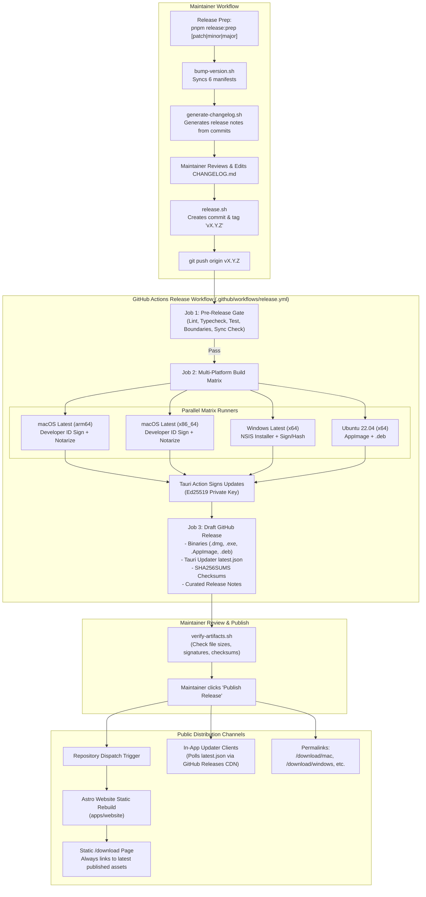
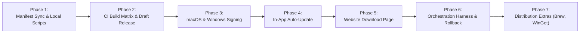

# Release Management, Build Pipeline & Download Distribution — Feature & Phased Implementation Plan

**Target**: Establish an automated, repeatable, and serverless release infrastructure for DaVinci Notes / Sophia:
- Single-command or tag-push orchestration bumping version across desktop manifests, building signed/notarized multi-platform desktop binaries (macOS Apple Silicon & Intel, Windows x64, Linux x64 AppImage and `.deb`), and attaching verified assets and checksums to a draft GitHub Release.
- Zero-backend in-app auto-update via `tauri-plugin-updater` reading cryptographically signed `latest.json` manifests hosted directly on GitHub Releases.
- Lightweight, static Astro `/download` page with client-side OS detection, direct multi-platform download cards, release metadata, checksums, and permalinks (`/download/mac`, `/download/windows`, etc.), keeping the existing website header completely untouched.
- Clean Bash release scripts under `scripts/release/` (`set -euo pipefail`, shellcheck-clean, `--dry-run` support) and an emergency rollback runbook.

In strict alignment with [`AGENTS.md`](file:///Users/ahmedwaanneni/orca/workspaces/davinci-notes/desktop/AGENTS.md), [`DECISIONS.md`](file:///Users/ahmedwaanneni/orca/workspaces/davinci-notes/desktop/DECISIONS.md), and [`PERFORMANCE.md`](file:///Users/ahmedwaanneni/orca/workspaces/davinci-notes/desktop/PERFORMANCE.md):
- **Serverless & Local-First (Zero Owned Backend)**: Per [ADR-0116](file:///Users/ahmedwaanneni/orca/workspaces/davinci-notes/desktop/docs/adr/0116-sync-via-drive-syncthing-no-owned-backend.md), DaVinci Notes operates without a proprietary backend server. Release distribution and auto-update metadata leverage GitHub Releases and static website hosting exclusively.
- **Near-Zero JS Weight on Website**: The `/download` page is statically pre-rendered via Astro (`output: 'static'`). OS detection uses a tiny (< 1.5 KB) inline script with zero framework dependencies.
- **Zero App Runtime Bloat**: Release automation scripts live outside application bundles. In-app update checking is lazy-loaded and executes only when the user navigates to Settings → Updates or on a debounced, background low-frequency interval (24 hours).
- **Security & Cryptographic Integrity**: Releases publish SHA-256 checksums (`SHA256SUMS`). Tauri updater updates require Ed25519 digital signature validation before applying binaries. macOS builds are code-signed with Apple Developer ID and notarized via `notarytool`.
- **Preserve Existing Website Header**: The website navigation header (`SiteNav.astro`) remains completely untouched per standing project constraints.

---

## 1. Decisions Needed from the User (Prior to Production Release)

The following decisions require explicit user confirmation. Recommended defaults are provided for each:

| Decision | Topic | Options | Recommended Default | Rationale |
|---|---|---|---|---|
| **U1** | **Apple Developer Program** | A) Active Apple Developer Account ($99/year)<br>B) Unsigned builds (Gatekeeper bypass) | **A) Active Account for Production** *(with B as Phase 1–2 fallback)* | Required for Apple Developer ID Application signing and notarization. Without this, macOS Sequoia / Sonoma blocks execution with a security warning requiring users to right-click open or run `xattr -cr`. Local smoke builds will run unsigned during initial development. |
| **U2** | **Windows Code Signing** | A) Azure Trusted Signing ($10–20/mo + identity)<br>B) Traditional EV Hardware Token ($400–600/yr)<br>C) Unsigned + SmartScreen reputation | **C) Unsigned for Phase 1–3, moving to A (Azure Trusted Signing)** | Traditional EV tokens require physical USB dongles incompatible with standard cloud CI runners without complex hardware-bridge runners. Azure Trusted Signing is cloud-native and cost-effective. During early alpha/beta releases, unsigned binaries with published SHA-256 checksums are acceptable while building SmartScreen reputation. |
| **U3** | **GitHub Repository Visibility & CI Runners** | A) Public GitHub repo (Free standard GitHub Actions runners)<br>B) Private GitHub repo (Paid Actions minutes) | **A) Public Repository** *(or allocate ~1,500 Actions min/mo for private)* | Building Tauri binaries across macOS (arm64 + x64), Windows, and Linux takes ~12–18 minutes per release matrix run. On public repositories, standard GitHub-hosted runners are free. |
| **U4** | **Release Publishing Approval Gating** | A) Tag push immediately publishes release live<br>B) Tag push generates **Draft Release**; human clicks Publish | **B) Draft Release with Manual Review Gate** | Prevents accidental immediate distribution of broken builds or half-uploaded matrix assets. Gives maintainers a chance to verify checksums and inspect the release notes before live distribution to updater clients. |
| **U5** | **Website Domain & Hosting** | A) Static deployment to Cloudflare Pages / Vercel / GitHub Pages<br>B) Custom domain (e.g., `davinci.md` or `davincinotes.com`) | **A) Cloudflare Pages / GitHub Pages with custom domain** | Free, global CDN edge caching, automatic build triggers via repository dispatch when a new release is published. |

---

## 2. First-Time Setup Checklist (Human-Only Prerequisites)

Before Phase 3 and Phase 4 can be run in production CI, the repository owner must execute these manual setup tasks:

### 2.1 Apple Developer & Notarization Credentials (macOS)
- [ ] Enroll in the [Apple Developer Program](https://developer.apple.com/programs/).
- [ ] In Apple Developer Portal → Certificates, Identifiers & Profiles:
  - Generate a **Developer ID Application** certificate.
  - Export the certificate and private key from macOS Keychain Access as a `.p12` file.
  - Base64 encode the `.p12` file: `base64 -i DeveloperIDApp.p12 | pbcopy`.
  - Save the base64 string as GitHub secret: `APPLE_CERTIFICATE`.
  - Save the `.p12` password as GitHub secret: `APPLE_CERTIFICATE_PASSWORD`.
  - Record the identity string (e.g. `Developer ID Application: Your Name (TEAM_ID)`) as `APPLE_SIGNING_IDENTITY`.
- [ ] In App Store Connect → Users and Access → Integrations → App Store Connect API:
  - Create an API Key with **Developer** access.
  - Download the `.p8` private key file.
  - Save the key content as GitHub secret: `APPLE_API_KEY`.
  - Save the Key ID (e.g., `2X9R42749D`) as `APPLE_API_KEY_ID`.
  - Save the Issuer ID (UUID) as `APPLE_API_ISSUER`.
  - Save your 10-character Team ID as `APPLE_TEAM_ID`.

### 2.2 Tauri Updater Cryptographic Signing Keypair
- [ ] Install Tauri CLI locally: `pnpm --filter @app/desktop add -D @tauri-apps/cli`.
- [ ] Generate an Ed25519 updater keypair:
  ```bash
  pnpm --filter @app/desktop tauri signer generate -w ~/.tauri/davinci_updater.key
  ```
- [ ] Copy the printed **public key** into `apps/desktop/src-tauri/tauri.conf.json` under `plugins.updater.pubkey`.
- [ ] Base64-encode or copy the private key file `~/.tauri/davinci_updater.key` into GitHub secret: `TAURI_SIGNING_PRIVATE_KEY`.
- [ ] Save the key password into GitHub secret: `TAURI_SIGNING_PRIVATE_KEY_PASSWORD`.
- [ ] **SECURE BACKUP**: Store `davinci_updater.key` and its password in a secure, hardware-backed vault (e.g., 1Password / Keepass / offline USB). *Loss of this private key permanently breaks auto-updates for all existing installed users.*

### 2.3 GitHub Repository Configuration & Secrets
- [ ] In GitHub Repo → Settings → Secrets and variables → Actions:
  - Add all required secrets matching the checklist in Section 7.
- [ ] In GitHub Repo → Settings → Environments:
  - Create environment named `production-release`.
  - Configure **Required reviewers** (add maintainer username).
  - Configure **Deployment branches**: Restrict to `v*` tags.
- [ ] In GitHub Repo → Settings → Branches:
  - Ensure tag protection rule protects `v*` from non-admin deletion or force pushes.

---

## 3. Architecture Decisions to Lock (ADR-0242 through ADR-0247)

| ADR | Topic | Locked Recommendation | Rationale & Trade-Offs |
|---|---|---|---|
| **ADR-0242** | **Single Source of Truth Versioning & Changelog** | **Central SemVer script (`bump-version.sh`) synchronizing manifests; Conventional Commits changelog generator (`generate-changelog.sh`).** Changesets evaluated but rejected for desktop app manifests. | Changesets is designed for npm libraries and requires extra metadata files per PR (`.changeset/*.md`). DaVinci Notes already strictly enforces `@commitlint/config-conventional` on every git commit. A lightweight script bumping root `package.json`, `apps/desktop/package.json`, `Cargo.toml`, `tauri.conf.json`, `apps/website/package.json`, and `apps/mobile/app.json` adds 0 KB dependencies and prevents multi-manifest drift with a deterministic check (`check-version-sync.sh`). |
| **ADR-0243** | **Multi-Platform CI Build Matrix & Architecture Splitting** | **GitHub Actions matrix with `tauri-apps/tauri-action` building separate macOS `aarch64` and `x86_64` DMGs (not Universal), Windows x64 NSIS `.exe`, and Linux x64 `.AppImage` + `.deb`.** | Universal macOS binaries bundle two complete native binary copies of both the Tauri Rust engine AND the bundled Syncthing sidecar (~80 MB+ uncompressed). Separate architecture DMGs keep downloads ~45 MB smaller per user. Linux AppImage offers zero-install portability across all distros; `.deb` covers Debian/Ubuntu. Caching Rust crates via `swatinem/rust-cache@v2` cuts runner duration from 25m to ~8m. |
| **ADR-0244** | **Cryptographic Signing, Notarization & Key Management** | **Apple Developer ID + `notarytool` for macOS; Ed25519 Tauri updater signing; SHA-256 integrity manifest (`SHA256SUMS`). Windows starts unsigned with Azure Trusted Signing roadmap.** | Apple Gatekeeper strictly blocks unnotarized binaries on modern macOS. Ed25519 signatures protect in-app updates against tampering or MITM attacks on GitHub Release assets. Azure Trusted Signing avoids physical hardware tokens while providing Microsoft-vetted signing. |
| **ADR-0245** | **Serverless In-App Auto-Update Architecture** | **Tauri v2 updater plugin (`tauri-plugin-updater`) fetching `latest.json` directly from GitHub Releases (`releases/latest/download/latest.json`). Dynamic channel switcher (stable vs beta).** | Eliminates any requirement for a self-hosted update server (like Hazel or Nuts). GitHub Releases serves raw assets over fast CDN. Client-side update checking is fully isolated in an on-demand Settings panel or a debounced background check (24-hour interval) that consumes 0 KB of active memory when idle. |
| **ADR-0246** | **Static Website Download Distribution & Permalinks** | **Static Astro pre-rendering (`output: 'static'`) for `/download`. Zero-dependency inline OS detection script (< 1.5 KB). Build-time GitHub API fetch with webhook rebuild trigger.** | Zero client-side GitHub API rate limit issues. Near-zero JS weight. If build-time fetch fails, static fallback metadata ensures page never breaks. Clean permalinks (`/download/mac`, `/download/windows`, `/download/linux`) route users directly to the latest GitHub Release binaries. Header remains completely untouched. |
| **ADR-0247** | **Release Automation Harness & Rollback Safety** | **Strict, idempotent Bash scripts (`scripts/release/`) with `--dry-run` and verification audits. Documented emergency rollback protocol (`rollback.sh`).** | Ensures reproducibility from maintainer terminal. Rollback script allows immediate retraction of poisoned `latest.json` or unpublishing draft releases before users auto-update. |

---

## 4. Subsystem Architecture & Release Pipeline Flow



---

## 5. Detailed Area Specifications

### Area 1: Versioning & Single Source of Truth

#### 5.1 Manifests in Scope
Six distinct manifest files across the monorepo must maintain strict version parity:
1. Monorepo root: [`package.json`](file:///Users/ahmedwaanneni/orca/workspaces/davinci-notes/desktop/package.json) (`version`)
2. Desktop App: [`apps/desktop/package.json`](file:///Users/ahmedwaanneni/orca/workspaces/davinci-notes/desktop/apps/desktop/package.json) (`version`)
3. Tauri Native Configuration: [`apps/desktop/src-tauri/tauri.conf.json`](file:///Users/ahmedwaanneni/orca/workspaces/davinci-notes/desktop/apps/desktop/src-tauri/tauri.conf.json) (`version`)
4. Rust Crate Manifest: [`apps/desktop/src-tauri/Cargo.toml`](file:///Users/ahmedwaanneni/orca/workspaces/davinci-notes/desktop/apps/desktop/src-tauri/Cargo.toml) (`package.version`)
5. Static Website: [`apps/website/package.json`](file:///Users/ahmedwaanneni/orca/workspaces/davinci-notes/desktop/apps/website/package.json) (`version`)
6. Mobile App: [`apps/mobile/app.json`](file:///Users/ahmedwaanneni/orca/workspaces/davinci-notes/desktop/apps/mobile/app.json) (`expo.version`)

#### 5.2 Tooling Evaluation: Changesets vs Conventional Commits + Scripts
- **Changesets**: Installed in repo root, but currently explicitly configured with `"ignore": ["@app/desktop", "@app/mobile"]`. Changesets requires developers to run `pnpm changeset` for every pull request, creating temporary Markdown files in `.changeset/`. It has native support only for `package.json`, with zero native handling of `Cargo.toml`, `tauri.conf.json`, or Expo `app.json`.
- **Conventional Commits + Shell Harness (Chosen)**: The repo already has `@commitlint/cli` and `@commitlint/config-conventional` enforcing commit formats via Husky `.husky/commit-msg`. A dedicated script (`scripts/release/bump-version.sh`) deterministically updates all 6 manifests in one pass, followed by `scripts/release/check-version-sync.sh` which validates equality in CI.
- **SemVer & Tag Strategy**:
  - Stable releases: `vMAJOR.MINOR.PATCH` (e.g. `v0.2.0`).
  - Pre-releases / Betas: `vMAJOR.MINOR.PATCH-beta.N` (e.g. `v0.2.0-beta.1`).
  - Release Candidates: `vMAJOR.MINOR.PATCH-rc.N`.

---

### Area 2: Changelog & Release Notes Generation

#### 5.3 Automated Extraction from Conventional Commits
[`scripts/release/generate-changelog.sh`](file:///Users/ahmedwaanneni/orca/workspaces/davinci-notes/desktop/scripts/release/generate-changelog.sh) inspects commits between the previous tag and `HEAD` (`git log $PREV_TAG..HEAD --pretty=format:"%s (%h)"`):
- Groups commits into standardized release categories:
  - `feat:` → **Features**
  - `fix:` → **Bug Fixes**
  - `perf:` → **Performance Improvements**
  - `refactor:` → **Refactoring & Polish**
  - `BREAKING CHANGE:` → **Breaking Changes**
  - Excludes `chore:`, `test:`, `docs:` from public release notes unless marked breaking.
- Formats Markdown output into a staging file `RELEASE_NOTES_TMP.md`.
- Prepends the release section to [`CHANGELOG.md`](file:///Users/ahmedwaanneni/orca/workspaces/davinci-notes/desktop/CHANGELOG.md).
- Allows maintainers to manually edit, refine, and enrich notes before tagging.
- The curated text from `RELEASE_NOTES_TMP.md` is piped into the GitHub Release body during release creation.

---

### Area 3: Build Matrix & CI Infrastructure

#### 5.4 GitHub Actions Matrix Strategy (`.github/workflows/release.yml`)
Runs on tag push `v*`:

```yaml
strategy:
  fail-fast: false
  matrix:
    include:
      - platform: 'macos-latest'
        target: 'aarch64-apple-darwin'
        arch_label: 'macOS Apple Silicon'
      - platform: 'macos-latest'
        target: 'x86_64-apple-darwin'
        arch_label: 'macOS Intel'
      - platform: 'windows-latest'
        target: 'x86_64-pc-windows-msvc'
        arch_label: 'Windows x64'
      - platform: 'ubuntu-22.04'
        target: 'x86_64-unknown-linux-gnu'
        arch_label: 'Linux x64'
```

#### 5.5 Architecture & Bundle Size Trade-Offs
- **Universal macOS Binary vs Separate Arch DMGs**:
  - Building a universal macOS binary (`universal-apple-darwin`) bundles two full Mach-O architectures for both the Tauri application and the external Syncthing daemon binary.
  - Separate DMGs (`Sophia-0.2.0-aarch64.dmg` ~48 MB vs Universal DMG ~94 MB) keep downloads lightweight and respect the project's performance constraints.
- **Linux Packages**:
  - `.AppImage`: Portable single-file binary containing bundled WebKit and Syncthing dependencies.
  - `.deb`: Standard Debian/Ubuntu package with desktop shortcut and icon registration.
  - `.rpm` and Snap: Deferred to later phases based on user demand.
- **External Binary (Syncthing) Pre-Build Step**:
  - The matrix step invokes `node apps/desktop/scripts/fetchSyncthing.mjs --target <target-triple>` before running `tauri build`.
  - Ensures `apps/desktop/src-tauri/binaries/syncthing-<target-triple>` is present and verified by SHA-256 before Tauri packaging commences.
- **Build Caching**:
  - `swatinem/rust-cache@v2` scoped to `apps/desktop/src-tauri`.
  - `actions/setup-node@v4` with `cache: 'pnpm'`.
  - Turborepo remote or local cache.

---

### Area 4: Code Signing, Notarization & Key Management

#### 5.6 macOS Developer ID & Notarization Workflow
1. **Signing**: `tauri-action` detects `APPLE_CERTIFICATE` (base64 `.p12`) and imports it into a temporary keychain on the macOS runner (`codesign --force --options runtime --sign "$APPLE_SIGNING_IDENTITY"`).
2. **Entitlements**: Uses hardened runtime entitlements for audio loopback (`cpal`) and keychain access.
3. **Notarization**: `tauri-action` calls Apple `notarytool` with App Store Connect API credentials (`APPLE_API_KEY`, `APPLE_API_KEY_ID`, `APPLE_API_ISSUER`).
4. **Stapling**: Apple notarization ticket is stapled to the `.dmg` and `.app` (`xcrun stapler staple`).
5. **Unsigned Fallback & Gatekeeper Documentation**:
   - If `ENABLE_CODE_SIGNING` is false, builds are packaged unsigned.
   - Documentation in `docs/releasing.md` guides users on Gatekeeper bypass:
     *"Right-click the app in Finder → select Open → click Open in the prompt, or run `xattr -cr /Applications/DaVinci\\ Notes.app`."*

#### 5.7 Windows Authenticode & SmartScreen
- **Phase 1–3**: Unsigned `.exe` installer + standalone portable `.zip`. Releases provide verified SHA-256 hashes. Users see standard "Windows protected your PC" SmartScreen dialog (Click "More info" → "Run anyway").
- **Phase 4 Roadmap**: Integrate Microsoft **Azure Trusted Signing** (formerly Azure Code Signing). Unlike traditional hardware EV tokens requiring physical dongles, Azure Trusted Signing integrates directly with GitHub Actions via `azure/trusted-signing-action` using federated OpenID Connect (OIDC) identity.

#### 5.8 Tauri Updater Cryptographic Signing (Ed25519)
- Tauri v2 updater generates a digital signature for every platform binary using the Ed25519 private key (`TAURI_SIGNING_PRIVATE_KEY`).
- Output: `<binary-filename>.sig` (base64 signature string).
- In `latest.json`, each platform entry includes the download URL and the base64 signature.
- Client validation: Before unzipping or executing any update, `tauri-plugin-updater` computes the signature of the downloaded binary and validates it against `plugins.updater.pubkey` compiled into the app.
- **Rotation & Backup Risk**:
  - If the private key is lost, no subsequent updates can be signed for existing users.
  - The plan specifies an offline encrypted cold backup procedure for `davinci_updater.key`.

#### 5.9 GitHub Secrets Checklist

| Secret Name | Purpose | Required in Phase |
|---|---|---|
| `GITHUB_TOKEN` | Built-in token for draft release creation and asset upload | Phase 2 |
| `TAURI_SIGNING_PRIVATE_KEY` | Ed25519 private key for Tauri updater `latest.json` signatures | Phase 3 |
| `TAURI_SIGNING_PRIVATE_KEY_PASSWORD` | Passphrase for Ed25519 updater private key | Phase 3 |
| `APPLE_CERTIFICATE` | Base64-encoded Developer ID Application `.p12` file | Phase 3 |
| `APPLE_CERTIFICATE_PASSWORD` | Password for the `.p12` certificate file | Phase 3 |
| `APPLE_SIGNING_IDENTITY` | Exact certificate subject name (e.g., `Developer ID Application: ...`) | Phase 3 |
| `APPLE_API_KEY` | Content of App Store Connect API `.p8` key for notarization | Phase 3 |
| `APPLE_API_KEY_ID` | 10-character Key ID from App Store Connect | Phase 3 |
| `APPLE_API_ISSUER` | UUID Issuer ID from App Store Connect | Phase 3 |
| `APPLE_TEAM_ID` | 10-character Apple Developer Team ID | Phase 3 |

---

### Area 5: In-App Auto-Update Architecture

#### 5.10 Tauri Plugin Integration
- Add `tauri-plugin-updater = "2"` to `apps/desktop/src-tauri/Cargo.toml`.
- Add `@tauri-apps/plugin-updater` to `apps/desktop/package.json`.
- Initialize plugin in `apps/desktop/src-tauri/src/lib.rs`:
  ```rust
  tauri::Builder::default()
      .plugin(tauri_plugin_updater::Builder::new().build())
  ```
- Configure endpoint in `apps/desktop/src-tauri/tauri.conf.json`:
  ```json
  "plugins": {
    "updater": {
      "endpoints": [
        "https://github.com/AhmedWanneni/davinci-notes-workspace/releases/latest/download/latest.json"
      ],
      "pubkey": "dW50cnVzdGVkIGNvbW1lbnQ6IG1pbmlzaWduIHB1YmxpYyBrZXk..."
    }
  }
  ```

#### 5.11 `latest.json` Schema (Tauri v2 Format)
```json
{
  "version": "v0.2.0",
  "notes": "Highlights of what is new in v0.2.0...",
  "pub_date": "2026-10-30T12:00:00Z",
  "platforms": {
    "darwin-aarch64": {
      "signature": "MEUCIQD...",
      "url": "https://github.com/AhmedWanneni/davinci-notes-workspace/releases/download/v0.2.0/Sophia_0.2.0_aarch64.app.tar.gz"
    },
    "darwin-x86_64": {
      "signature": "MEQCICX...",
      "url": "https://github.com/AhmedWanneni/davinci-notes-workspace/releases/download/v0.2.0/Sophia_0.2.0_x64.app.tar.gz"
    },
    "windows-x86_64": {
      "signature": "MEQCIC...",
      "url": "https://github.com/AhmedWanneni/davinci-notes-workspace/releases/download/v0.2.0/Sophia_0.2.0_x64-setup.nsis.zip"
    },
    "linux-x86_64": {
      "signature": "MEQCID...",
      "url": "https://github.com/AhmedWanneni/davinci-notes-workspace/releases/download/v0.2.0/sophia_0.2.0_amd64.AppImage.tar.gz"
    }
  }
}
```

#### 5.12 In-App Update UI & User Flow
- UI Location: `Settings → About & Updates` (`UpdateSettingsCard.tsx`).
- "Check for updates" button triggers `check()` from `@tauri-apps/plugin-updater`.
- States:
  - `idle`: "You are using the latest version (v0.1.0)."
  - `checking`: Progress spinner.
  - `available`: "Version 0.2.0 is available." Shows release notes excerpt + "Download and Install" button.
  - `downloading`: Download progress bar (`chunkLength / contentLength`).
  - `ready`: "Update installed. Restart to apply changes." + "Restart Now" button.
  - `error`: Error message + "Download directly from website" link.
- Background check: Debounced check runs 60 seconds after application startup, then every 24 hours. If an update is detected, an unobtrusive badge appears on the Settings icon in the sidebar rail.

---

### Area 6: Website Download Page (`/download`)

#### 5.13 Architecture & Constraints
- Located in `apps/website/src/pages/download/index.astro`.
- **Standing Constraint**: Existing header (`SiteNav.astro`) remains completely untouched.
- Pre-rendered statically with Astro (`output: 'static'`).
- Build-time data fetch: Astro queries `https://api.github.com/repos/AhmedWanneni/davinci-notes-workspace/releases/latest` at build time to embed real download URLs, asset file sizes, and release dates into the static HTML.
- Fallback: If GitHub API fails or is rate-limited during local build, fallback hardcoded release object ensures build succeeds without error.
- Static Rebuild Trigger: GitHub Actions workflow triggers a repository dispatch or Astro build webhook upon publishing any GitHub Release.

#### 5.14 Zero-Dependency Client OS Detection (< 1.5 KB JS)
Inline `<script>` in `apps/website/src/pages/download/index.astro`:
- Checks `navigator.userAgentData?.platform` or `navigator.userAgent`:
  - macOS: checks for `Macintosh` / `MacIntel` / `MacARM` (detects Apple Silicon via WebGL renderer or architecture hints if available).
  - Windows: checks for `Windows`.
  - Linux: checks for `Linux` / `X11`.
- Sets primary download button to point directly to detected OS binary (`.dmg` for Mac, `.exe` for Windows, `.AppImage` for Linux).
- Subtext displays detected platform with quick "Change platform" dropdown/links.

#### 5.15 Stable Permalinks (Zero-Maintenance Routing)
Astro generates clean static redirect pages:
- `/download/mac` → Redirects to latest macOS Apple Silicon `.dmg`.
- `/download/mac-intel` → Redirects to latest macOS Intel `.dmg`.
- `/download/windows` → Redirects to latest Windows `.exe`.
- `/download/linux` → Redirects to latest Linux `.AppImage`.
- `/download/latest.json` → Redirects or proxies updater manifest.

---

### Area 7: Bash Scripts Inventory (`scripts/release/`)

All scripts located in `scripts/release/`. Every script must be executable (`chmod +x`), begin with `#!/usr/bin/env bash`, include `set -euo pipefail`, pass `shellcheck` with zero warnings, and support `--dry-run`.

```
scripts/release/
├── bump-version.sh         # Synchronizes SemVer across all 6 manifests
├── check-version-sync.sh   # Validates version parity across manifests (CI gate)
├── generate-changelog.sh   # Extracts conventional commits into release notes
├── build-local.sh          # Local smoke build of Tauri desktop without signing
├── verify-artifacts.sh     # Validates build outputs, sizes, signatures & hashes
├── release.sh              # Maintainer CLI: orchestrates check → bump → tag → push
└── rollback.sh             # Emergency CLI: unpublishes release or retracts updater
```

#### Detailed Specification of Each Script:

1. **`bump-version.sh`**:
   - **Purpose**: Updates the version string across all 6 manifest files simultaneously.
   - **Inputs**: `$1` target version (`X.Y.Z` or `X.Y.Z-beta.N`), or semver increment (`patch`, `minor`, `major`). Flag `--dry-run`.
   - **Outputs**: Modified manifests in working directory.
   - **Dry-run**: Prints diff of proposed version changes across files without touching disk.

2. **`check-version-sync.sh`**:
   - **Purpose**: Verifies that all 6 manifests agree on the exact same version string. Exits with code 1 and descriptive error if any drift is detected.
   - **Inputs**: None. Flag `--verbose`.
   - **Outputs**: Prints `[OK] All 6 manifests synchronized at vX.Y.Z` or lists differing files.

3. **`generate-changelog.sh`**:
   - **Purpose**: Parses Git commit history from the latest reachable tag to `HEAD`. Categorizes conventional commit prefixes into clean Markdown sections.
   - **Inputs**: `--since <tag>` (optional, defaults to latest tag), `--out <file>` (defaults to stdout or `RELEASE_NOTES_TMP.md`).
   - **Outputs**: Formatted Markdown release notes.

4. **`build-local.sh`**:
   - **Purpose**: Smoke-tests building the desktop application locally on macOS or Linux without needing signing keys or CI secrets.
   - **Inputs**: `--debug` or `--release`.
   - **Outputs**: Local bundle in `apps/desktop/src-tauri/target/release/bundle/`.

5. **`verify-artifacts.sh`**:
   - **Purpose**: Inspects generated artifacts (locally or in CI). Confirms expected files exist, file sizes fall within expected bounds (e.g. DMG between 30 MB and 120 MB), runs `sha256sum`, and generates `SHA256SUMS.txt`.
   - **Inputs**: Path to artifacts directory.
   - **Outputs**: `SHA256SUMS.txt` and validation report.

6. **`release.sh`**:
   - **Purpose**: Interactive/automated maintainer release driver.
   - **Sequence**:
     1. Asserts working tree is clean (`git diff --stat` empty).
     2. Runs `check-version-sync.sh`.
     3. Runs pre-flight quality checks (`pnpm turbo run lint typecheck test`).
     4. Runs `bump-version.sh`.
     5. Runs `generate-changelog.sh` and prompts user to review notes.
     6. Creates git commit `chore(release): vX.Y.Z`.
     7. Creates annotated git tag `vX.Y.Z`.
     8. Prompts maintainer: `Ready to push tag to origin? (y/N)`.
     9. On confirmation, pushes commit and tag to GitHub, triggering CI.

7. **`rollback.sh`**:
   - **Purpose**: Emergency response to a compromised, crashing, or broken release.
   - **Capabilities**:
     - Deletes a broken GitHub Release or changes it back to `draft: true`.
     - Retracts or replaces `latest.json` with the previous known-good version so updater clients do not upgrade.
     - Deletes remote git tag if not yet broadly cloned.

---

### Area 8: Distribution Extras Evaluation

| Channel / Package Manager | User Value | Maintenance Cost | Recommended Phase | Rationale |
|---|---|---|---|---|
| **Direct Web Download (.dmg/.exe/.AppImage)** | **Highest** | Low (Automated in CI) | **Phase 2 & 5** | Primary distribution vehicle for all users. |
| **Homebrew Cask (macOS)** | **High** | Very Low | **Phase 7** | Very popular among Mac developers and note-takers. Can be maintained via a simple automated GitHub Action updating the `cask` formula in a `homebrew-tap` repo or upstream `homebrew-cask`. |
| **WinGet (Windows Package Manager)** | **High** | Low | **Phase 7** | Standard native Windows package manager. Can be automated via `winget-releaser` action on release publish. |
| **Flathub / Flatpak (Linux)** | Medium | Medium | **Phase 8** | Excellent sandboxed Linux distribution; requires Flathub review and runtime compatibility maintenance. |
| **Arch User Repository (AUR)** | Medium | Low | **Phase 8** | High adoption in Linux power-user community. Simple `PKGBUILD` script tracking GitHub Releases. |
| **Scoop (Windows)** | Low | Low | Phase 9 (Deferred) | Secondary to WinGet on modern Windows. |
| **Snapcraft / Snap (Linux)** | Low | High | Phase 9 (Deferred) | Strict confinement causes sandbox friction with local vault files and audio loopback. |
| **Mobile (Expo / EAS Build Coordination)** | **High** | Independent Cadence | **Track in Mobile ADRs** | Mobile builds are submitted to Apple App Store & Google Play via EAS Build. Releases should share the SemVer numbering and release notes highlights, but release cadences are decoupled due to app store review turnaround times (1–3 days). |

---

### Area 9: Security & Supply Chain Hardening

1. **Pinning Actions by Full SHA**:
   All GitHub Actions steps in `.github/workflows/` must pin exact commit SHAs with inline version comments:
   ```yaml
   uses: actions/checkout@11bd71901bbe5b1630ceea73d27597364c9af683 # v4.2.2
   uses: pnpm/action-setup@a3252b78c470c02df07e9d792dbd422115e3cd72 # v4.0.0
   uses: tauri-apps/tauri-action@...
   ```
2. **Least Privilege `GITHUB_TOKEN` Permissions**:
   Workflows specify top-level permissions:
   ```yaml
   permissions:
     contents: write     # Required for creating draft releases and uploading assets
     dispatches: write   # Required for triggering website rebuilds
     id-token: write     # Required for Azure Trusted Signing (if enabled)
   ```
3. **Protected Tags & Environment Review**:
   - Tag protection prevents pushing arbitrary `v*` tags without authorization.
   - The `production-release` environment requires manual sign-off before publishing assets.
4. **Cryptographic Integrity Manifest (`SHA256SUMS`)**:
   - Every release automatically publishes `SHA256SUMS` containing standard UNIX checksum lines for all uploaded binaries.
   - Users can verify downloads locally: `sha256sum -c SHA256SUMS`.

---

### Area 10: Documentation & Runbooks

Deliverable: [`docs/releasing.md`](file:///Users/ahmedwaanneni/orca/workspaces/davinci-notes/desktop/docs/releasing.md):
- Step-by-step instructions for maintainers cutting a standard release.
- Emergency Hotfix procedure: cherry-picking a critical bugfix onto a patch branch and releasing `vX.Y.Z+1`.
- Emergency Rollback procedure: running `rollback.sh` to neutralize a broken release.
- First-time certificate renewal and secret rotation runbook.

---

## 6. Phased Implementation Roadmap

Each phase is independently shippable, scoped, and verified with adversarial tests.



---

### Phase 1: Versioning Single Source of Truth & Local Release Scripts
**Goal**: Unify versioning across all monorepo manifests with robust, idempotent bash scripts and CI verification. No CI matrix or release publishing yet.

- **Deliverables**:
  - `scripts/release/bump-version.sh`: Updates version across all 6 manifests.
  - `scripts/release/check-version-sync.sh`: Verifies 100% version synchronization across manifests.
  - `scripts/release/build-local.sh`: Local smoke build helper for developers.
  - Integration of `check-version-sync.sh` into root `pnpm test` and `.github/workflows/ci.yml`.
  - Architecture Decision Record [ADR-0242](file:///Users/ahmedwaanneni/orca/workspaces/davinci-notes/desktop/docs/adr/0242-release-versioning-and-manifest-synchronization.md).
- **Files Touched**:
  - `scripts/release/bump-version.sh` (new)
  - `scripts/release/check-version-sync.sh` (new)
  - `scripts/release/build-local.sh` (new)
  - `package.json` (add `"check:version-sync": "bash scripts/release/check-version-sync.sh"`)
  - `.github/workflows/ci.yml` (add check step)
  - `docs/adr/0242-release-versioning-and-manifest-synchronization.md` (new)
  - `DECISIONS.md` (index ADR-0242)
- **New Dependencies**: None. (0 KB)
- **Verification Plan (Adversarial Tests)**:
  1. *Version Drift Test*: Deliberately change version in `Cargo.toml` to `0.9.9` while leaving `package.json` at `0.1.0`. Run `bash scripts/release/check-version-sync.sh`. Confirm it exits with code 1 and prints exact file mismatch.
  2. *Idempotent Bump Test*: Run `bash scripts/release/bump-version.sh 0.2.0 --dry-run`. Confirm 0 files modified on disk. Run `bash scripts/release/bump-version.sh 0.2.0`. Verify all 6 manifests updated. Run `bash scripts/release/check-version-sync.sh` and confirm it exits with code 0.
  3. *Shellcheck Cleanliness*: Run `shellcheck scripts/release/*.sh` and confirm zero warnings.

---

### Phase 2: Multi-Platform CI Build Matrix & Draft Release Pipeline
> [!IMPORTANT]
> **HIGH-RISK PHASE (CI Budget & Runner Configuration)**: Ensure runners and caching are configured properly to avoid long hung builds or excessive minutes consumption.

**Goal**: Establish the automated GitHub Actions matrix workflow to build unsigned desktop binaries across macOS (arm64, x64), Windows (x64), and Linux (x64) on tag push, attaching artifacts to a Draft GitHub Release.

- **Deliverables**:
  - `.github/workflows/release.yml`: GitHub Actions release pipeline.
  - Target-specific Syncthing pre-build fetching in CI (`fetchSyncthing.mjs`).
  - `scripts/release/verify-artifacts.sh`: Validates artifact presence, sizes, and calculates `SHA256SUMS`.
  - `scripts/release/generate-changelog.sh`: Generates categorized release notes from conventional commits.
  - Architecture Decision Record [ADR-0243](file:///Users/ahmedwaanneni/orca/workspaces/davinci-notes/desktop/docs/adr/0243-multi-platform-ci-build-matrix.md).
- **Files Touched**:
  - `.github/workflows/release.yml` (new)
  - `scripts/release/verify-artifacts.sh` (new)
  - `scripts/release/generate-changelog.sh` (new)
  - `docs/adr/0243-multi-platform-ci-build-matrix.md` (new)
  - `DECISIONS.md` (index ADR-0243)
- **New Dependencies**: None.
- **Verification Plan (Adversarial Tests)**:
  1. *Syncthing Binary Assertion*: Run CI build step without pre-fetching Syncthing; confirm build fails with clear missing binary error. Re-run with `fetchSyncthing.mjs`; confirm binary correctly identified and bundled.
  2. *Changelog Parsing Test*: Run `generate-changelog.sh` across existing commit history. Verify `feat:`, `fix:`, and `perf:` commits are correctly sorted into Markdown sections.
  3. *Draft Release Assertion*: Push a test tag `v0.1.0-test.1`. Confirm GitHub Actions completes, builds all 4 platform artifacts, creates a **Draft** release (not public), attaches the 4 installers, and terminates cleanly.

---

### Phase 3: Code Signing, Notarization & Cryptographic Keys
> [!CAUTION]
> **HIGH-RISK PHASE (Security & Secrets)**: Secrets handling must be airtight. Must be completed in ONE focused session with all developer accounts and credentials at hand.

**Goal**: Configure Apple Developer ID code signing and App Store Connect notarization for macOS builds, Ed25519 updater signing keypair, and SHA-256 integrity publishing.

- **Deliverables**:
  - Hardened runtime entitlements configuration in `apps/desktop/src-tauri/entitlements.mac.plist`.
  - Apple Developer ID signing & `notarytool` integration in `.github/workflows/release.yml`.
  - Tauri updater signing keypair generation and secure GitHub secret configuration.
  - Checksum generator producing published `SHA256SUMS`.
  - Architecture Decision Record [ADR-0244](file:///Users/ahmedwaanneni/orca/workspaces/davinci-notes/desktop/docs/adr/0244-code-signing-and-notarization-architecture.md).
- **Files Touched**:
  - `apps/desktop/src-tauri/entitlements.mac.plist` (new)
  - `apps/desktop/src-tauri/tauri.conf.json` (add entitlements & updater pubkey)
  - `.github/workflows/release.yml` (add signing and notarization steps)
  - `docs/adr/0244-code-signing-and-notarization-architecture.md` (new)
  - `DECISIONS.md` (index ADR-0244)
- **New Dependencies**: None.
- **Verification Plan (Adversarial Tests)**:
  1. *Gatekeeper Notarization Verification*: Download macOS DMG generated by CI. Run `spctl --assess --type execute --verbose /Volumes/DaVinci\ Notes/DaVinci\ Notes.app`. Confirm output is `accepted` with source `Notarized Developer ID`.
  2. *Tamper Detection Test*: Modify 1 byte of the signed macOS app bundle and re-run `spctl`. Confirm Gatekeeper rejects the binary with `code signature invalid`.
  3. *Checksum Verification Test*: Download release assets and `SHA256SUMS`. Run `sha256sum -c SHA256SUMS`. Confirm 100% OK match across all platform files.

---

### Phase 4: In-App Auto-Update & Tauri Updater Plugin
> [!CAUTION]
> **HIGH-RISK PHASE (Update Brick Risk)**: Any error in updater signature validation or endpoint URL will permanently prevent installed clients from receiving future updates.

**Goal**: Integrate `tauri-plugin-updater` with GitHub Releases `latest.json`, add in-app Settings UI for update checking and installation, and test end-to-end upgrade flow from N-1 to N.

- **Deliverables**:
  - Rust plugin registration for `tauri-plugin-updater` in `apps/desktop/src-tauri/`.
  - TypeScript updater client service in `@app/desktop` (`apps/desktop/src/services/updaterService.ts`).
  - Lazy-loaded `UpdateSettingsCard.tsx` in desktop Settings.
  - Generation of signed `latest.json` in CI release workflow.
  - Architecture Decision Record [ADR-0245](file:///Users/ahmedwaanneni/orca/workspaces/davinci-notes/desktop/docs/adr/0245-in-app-auto-update-architecture.md).
- **Files Touched**:
  - `apps/desktop/src-tauri/Cargo.toml` (add `tauri-plugin-updater`)
  - `apps/desktop/src-tauri/src/lib.rs` (register plugin)
  - `apps/desktop/src-tauri/tauri.conf.json` (configure updater endpoint and pubkey)
  - `apps/desktop/package.json` (add `@tauri-apps/plugin-updater`)
  - `apps/desktop/src/services/updaterService.ts` (new)
  - `apps/desktop/src/components/SettingsDialog/UpdateSettingsCard.tsx` (new)
  - `apps/desktop/src/components/SettingsDialog/UpdateSettingsCard.module.scss` (new)
  - `docs/adr/0245-in-app-auto-update-architecture.md` (new)
  - `DECISIONS.md` (index ADR-0245)
- **New Dependencies**:
  - `tauri-plugin-updater` (Rust crate v2.x, ~50 KB native binary delta)
  - `@tauri-apps/plugin-updater` (JS npm package, ~4 KB gzip, lazy-loaded)
- **Verification Plan (Adversarial Tests)**:
  1. *Bad Signature Test*: Deliberately corrupt the signature string for the macOS binary in `latest.json`. Trigger update check in app. Confirm app reports signature verification failure and refuses to execute the binary.
  2. *Live Upgrade Test (N-1 → N)*: Install version `0.1.0`. Publish `0.2.0` release with valid `latest.json`. Launch `0.1.0`, click "Check for Updates", confirm `0.2.0` detected, click "Download & Install", restart app, and verify app re-opens reporting version `0.2.0`.
  3. *Offline / Network Failure Graceful Recovery*: Trigger update check with WiFi disconnected. Confirm app shows clean offline message without unhandled promise rejection or crashing.

---

### Phase 5: Website Static Download Page (`/download`) & Permalinks
**Goal**: Build a fast, lightweight, static `/download` page in `apps/website`, keeping the header completely untouched, with client-side OS detection and stable download permalinks.

- **Deliverables**:
  - `apps/website/src/pages/download/index.astro`: Pre-rendered static download page.
  - Inline client-side OS detection script (< 1.5 KB unminified, 0 dependencies).
  - Platform cards for macOS (Silicon + Intel), Windows, and Linux.
  - Static redirect pages for permalinks (`/download/mac`, `/download/windows`, `/download/linux`).
  - Architecture Decision Record [ADR-0246](file:///Users/ahmedwaanneni/orca/workspaces/davinci-notes/desktop/docs/adr/0246-static-website-download-architecture.md).
- **Files Touched**:
  - `apps/website/src/pages/download/index.astro` (new)
  - `apps/website/src/pages/download/mac.astro` (new redirect)
  - `apps/website/src/pages/download/windows.astro` (new redirect)
  - `apps/website/src/pages/download/linux.astro` (new redirect)
  - `apps/website/src/styles/download.css` (new)
  - `docs/adr/0246-static-website-download-architecture.md` (new)
  - `DECISIONS.md` (index ADR-0246)
- **New Dependencies**: None. (0 KB)
- **Verification Plan (Adversarial Tests)**:
  1. *Header Integrity Audit*: Verify `SiteNav.astro` is included untouched. Confirm CSS styles from `/download` do not pollute or override `.logseq-nav-header` or its navigation classes.
  2. *OS Detection Simulation*: In Chrome DevTools, spoof `navigator.userAgent` to Windows 11. Confirm the primary download button immediately defaults to Windows `.exe`. Switch user agent to Linux; confirm button switches to `.AppImage`. Switch to iPhone/Android; confirm button displays desktop note with direct download options below.
  3. *Zero-JS Fallback Test*: Disable JavaScript in browser settings. Confirm all download cards (Mac, Windows, Linux) are fully rendered, visible, and functional as static HTML links.
  4. *Astro Build Weight Test*: Run `pnpm --filter @app/website build`. Confirm page bundle size is within strict performance budget.

---

### Phase 6: End-to-End Orchestration CLI, Verification Harness & Rollback Runbook
**Goal**: Provide maintainer CLI orchestrator (`release.sh`), emergency rollback tool (`rollback.sh`), and comprehensive documentation (`docs/releasing.md`).

- **Deliverables**:
  - `scripts/release/release.sh`: Interactive CLI orchestrating pre-flight checks, bump, changelog, commit, tag, and push.
  - `scripts/release/rollback.sh`: Emergency rollback tool.
  - `docs/releasing.md`: Complete maintainer runbook covering release cutting, hotfixes, secret rotation, and rollback.
  - Architecture Decision Record [ADR-0247](file:///Users/ahmedwaanneni/orca/workspaces/davinci-notes/desktop/docs/adr/0247-release-automation-and-emergency-rollback.md).
- **Files Touched**:
  - `scripts/release/release.sh` (new)
  - `scripts/release/rollback.sh` (new)
  - `docs/releasing.md` (new)
  - `docs/adr/0247-release-automation-and-emergency-rollback.md` (new)
  - `DECISIONS.md` (index ADR-0247)
- **New Dependencies**: None.
- **Verification Plan (Adversarial Tests)**:
  1. *Dirty Working Tree Guard*: Modify a file locally without committing. Run `bash scripts/release/release.sh`. Confirm script aborts immediately with "Working tree contains uncommitted changes".
  2. *Failing Tests Pre-Flight Guard*: Introduce a failing test in Vitest. Run `release.sh`. Confirm script halts before creating any git commits or tags.
  3. *Dry-Run Orchestration Test*: Run `bash scripts/release/release.sh --dry-run patch`. Confirm simulated sequence executes without error.

---

### Phase 7: Distribution Extras & Package Managers
**Goal**: Expand distribution surface to community package managers (Homebrew Cask, WinGet) and establish release alignment with the Expo mobile app.

- **Deliverables**:
  - GitHub Actions automated Homebrew Cask updater (updates `davinci-notes.rb` in tap repository).
  - GitHub Actions automated WinGet manifest submission (`winget-releaser`).
  - Mobile version synchronization coordination documentation in `docs/releasing.md`.
- **Files Touched**:
  - `.github/workflows/homebrew-cask.yml` (new)
  - `.github/workflows/winget.yml` (new)
  - `docs/releasing.md` (update with package manager instructions)
- **New Dependencies**: None.
- **Verification Plan (Adversarial Tests)**:
  1. *Brew Cask Audit*: Run `brew audit --cask davinci-notes` against generated cask formula. Confirm 0 syntax errors.
  2. *WinGet Validation*: Run `winget validate --manifest ...` against generated manifest. Confirm schema compliance.

---

## 7. Prompt-per-Phase Skeleton

These prompt stubs are ready to copy-paste into future AI sessions to implement each phase sequentially:

### Phase 1 Prompt Stub
```markdown
/plan-execute # TASK: Implement Release Phase 1 — Versioning Single Source of Truth & Local Scripts

Read AGENTS.md, DECISIONS.md (ADR-0242), and PERFORMANCE.md before starting.
Goal: Create idempotent Bash release scripts under `scripts/release/`:
- `bump-version.sh`: updates version across root package.json, apps/desktop/package.json, apps/desktop/src-tauri/Cargo.toml, apps/desktop/src-tauri/tauri.conf.json, apps/website/package.json, apps/mobile/app.json. Supports --dry-run.
- `check-version-sync.sh`: asserts 100% version equality across all 6 manifests, exiting 1 on drift.
- `build-local.sh`: local smoke build helper.
Add "check:version-sync" to root package.json and wire it into .github/workflows/ci.yml.
Write ADR-0242 and index it in DECISIONS.md.
Rules: set -euo pipefail, shellcheck-clean, one AI change = one commit, under 250 lines per file.
```

### Phase 2 Prompt Stub
```markdown
/plan-execute # TASK: Implement Release Phase 2 — Multi-Platform CI Build Matrix & Draft Release

Read AGENTS.md, DECISIONS.md (ADR-0242, ADR-0243), and PERFORMANCE.md before starting.
Goal: Create `.github/workflows/release.yml` with a multi-platform matrix using `tauri-apps/tauri-action`:
- macOS (arm64, x64), Windows (x64), Linux (x64).
- Target-specific Syncthing pre-fetching via fetchSyncthing.mjs.
- Create `scripts/release/generate-changelog.sh` (conventional commits → Markdown).
- Create `scripts/release/verify-artifacts.sh` (file sizes + SHA256SUMS).
- Output is a draft: true GitHub Release.
Write ADR-0243 and index it in DECISIONS.md.
Rules: Pin Actions by SHA, cache Rust & pnpm, one AI change = one commit.
```

### Phase 3 Prompt Stub
```markdown
/plan-execute # TASK: Implement Release Phase 3 — macOS Code Signing, Notarization & Cryptographic Keys

Read AGENTS.md, DECISIONS.md (ADR-0244), and PERFORMANCE.md before starting.
Goal: Configure Apple Developer ID signing, hardened runtime entitlements, and App Store Connect notarization in `.github/workflows/release.yml`.
Configure Tauri Ed25519 updater signing keypair secrets.
Add `entitlements.mac.plist` with required loopback and keychain entitlements.
Configure `tauri.conf.json` with updater pubkey.
Write ADR-0244 and index it in DECISIONS.md.
Rules: Never expose secrets in plaintext or logs; ensure unsigned fallback works gracefully.
```

### Phase 4 Prompt Stub
```markdown
/plan-execute # TASK: Implement Release Phase 4 — In-App Auto-Update & Tauri Updater Plugin

Read AGENTS.md, DECISIONS.md (ADR-0245), and PERFORMANCE.md before starting.
Goal: Add `tauri-plugin-updater` to desktop Rust backend and `@tauri-apps/plugin-updater` to desktop frontend.
Configure `tauri.conf.json` updater endpoints pointing to GitHub Releases latest.json.
Create `apps/desktop/src/components/SettingsDialog/UpdateSettingsCard.tsx` (lazy-loaded).
Implement check, download progress, and restart-to-apply update flow with error fallback.
Write ADR-0245 and index it in DECISIONS.md.
Rules: Lazy-load updater module (0 KB initial bundle cost); one AI change = one commit.
```

### Phase 5 Prompt Stub
```markdown
/plan-execute # TASK: Implement Release Phase 5 — Static Website Download Page & Permalinks

Read AGENTS.md, DECISIONS.md (ADR-0246), and PERFORMANCE.md before starting.
Goal: Create `apps/website/src/pages/download/index.astro` using BaseLayout.
Standing Constraint: Leave SiteNav.astro (header) completely untouched.
Features:
- Build-time GitHub Releases API fetch with static fallback.
- Inline client-side OS detection (< 1.5 KB JS) setting primary download button.
- Platform download grid (macOS Silicon/Intel, Windows x64, Linux AppImage/deb).
- Static redirect permalinks (/download/mac, /download/windows, etc.).
Write ADR-0246 and index it in DECISIONS.md.
Rules: Near-zero JS weight, no Tailwind, one AI change = one commit.
```

### Phase 6 Prompt Stub
```markdown
/plan-execute # TASK: Implement Release Phase 6 — Release Orchestration CLI & Rollback Runbook

Read AGENTS.md, DECISIONS.md (ADR-0247), and PERFORMANCE.md before starting.
Goal: Create `scripts/release/release.sh` and `scripts/release/rollback.sh`.
`release.sh`: Orchestrates clean check → tests → version bump → changelog → commit → tag → push.
`rollback.sh`: Retracts or unpublishes draft release and reverts latest.json.
Author comprehensive maintainer guide in `docs/releasing.md`.
Write ADR-0247 and index it in DECISIONS.md.
Rules: shellcheck-clean, idempotent, test all failure exit paths, one AI change = one commit.
```

### Phase 7 Prompt Stub
```markdown
/plan-execute # TASK: Implement Release Phase 7 — Distribution Extras (Homebrew & WinGet)

Read AGENTS.md, DECISIONS.md (ADR-0242 through ADR-0247), and PERFORMANCE.md before starting.
Goal: Create GitHub Actions workflows for automated Homebrew Cask and WinGet updates upon release publish.
Document Expo mobile app version coordination in `docs/releasing.md`.
Rules: Pin Actions by SHA, one AI change = one commit.
```
