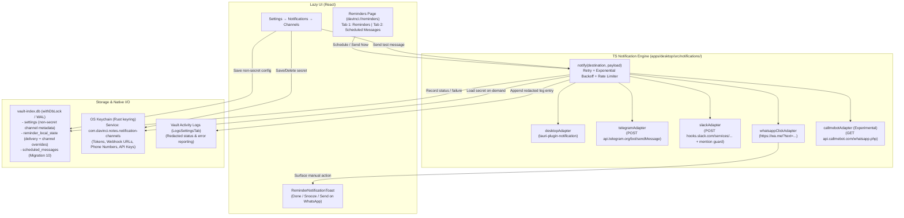

# Reminders Page, Notification Channels & Scheduled Messages — Feature & Phased Implementation Plan

**Target**: Promote Reminders from a modal dialog into a full, lazy-loaded workspace page (`davinci://reminders`) opened from the sidebar icon rail (matching the Bookmarks page pattern), introduce a zero-dependency multi-channel notification system (`Desktop`, `Telegram`, `Slack`, `WhatsApp Click-to-Chat`, and optional experimental `CallMeBot`) backed by the OS keychain, and add a **Scheduled Messages** tab for composing and scheduling one-off or recurring outbound messages.

In strict alignment with [`AGENTS.md`](file:///Users/ahmedwaanneni/orca/workspaces/davinci-notes/desktop/AGENTS.md), [`DECISIONS.md`](file:///Users/ahmedwaanneni/orca/workspaces/davinci-notes/desktop/DECISIONS.md), and [`PERFORMANCE.md`](file:///Users/ahmedwaanneni/orca/workspaces/davinci-notes/desktop/PERFORMANCE.md):
- **Zero Startup Weight**: `RemindersView` (`davinci://reminders`) and `NotificationsSettingsTab` are 100% lazy-loaded via `React.lazy()`. Initial bundle impact is **0 KB**.
- **Zero New Runtime Dependencies**: All channel adapters (`Telegram`, `Slack`, `WhatsApp`, `CallMeBot`) use native Web `fetch` and URL construction (0 KB npm weight). Recurrence and timezone math reuse `@app/indexer` (`parseReminders.ts`, `recurrenceRule.ts`).
- **Universal SQLite Lock Discipline**: Every read and write to `vault-index.db` strictly serializes through `withDbLock` and `withDbTransaction` ([ADR-0168](file:///Users/ahmedwaanneni/orca/workspaces/davinci-notes/desktop/docs/adr/0168-vault-index-write-lock-contention-and-universal-lock-discipline.md)). Network HTTP calls (`fetch`) never execute inside a database lock or transaction.
- **Immutable Migrations**: Migrations 1–9 in [`apps/desktop/src-tauri/src/db.rs`](file:///Users/ahmedwaanneni/orca/workspaces/davinci-notes/desktop/apps/desktop/src-tauri/src/db.rs) and [`packages/indexer/migrations.ts`](file:///Users/ahmedwaanneni/orca/workspaces/davinci-notes/desktop/packages/indexer/migrations.ts) are never edited ([ADR-0035](file:///Users/ahmedwaanneni/orca/workspaces/davinci-notes/desktop/docs/adr/0035-never-edit-applied-migration.md)). Schema additions ship exclusively in **Migration 10**.
- **Rust for I/O Only, Logic in TypeScript**: Per [ADR-0025](file:///Users/ahmedwaanneni/orca/workspaces/davinci-notes/desktop/docs/adr/0025-js-side-indexer-rust-io-only.md) and [ADR-0183](file:///Users/ahmedwaanneni/orca/workspaces/davinci-notes/desktop/docs/adr/0183-rust-reminder-scheduler-and-notifications.md), Rust owns OS keychain storage (`keyring` crate), the background wake timer (`ReminderScheduler`), and native URL opening (`open_external_url`). Channel HTTP dispatch, backoff, mention sanitization, and recurrence advancement stay in TypeScript.
- **Hardware-Backed Secret Isolation**: Bot tokens, Slack webhook URLs, phone numbers, and API keys live exclusively in the OS keychain (`com.davinci.notes.notification-channels`) via Rust commands guarded by `reject_plugin_runner`. Secrets are never written to the vault, SQLite, or logs.

---

## 1. Current State Assessment & Gap Analysis

### 1.1 What Already Exists in the Codebase

1. **Markdown Reminder Parser & Recurrence Engine (`packages/indexer/`)**:
   - [`parseReminders.ts`](file:///Users/ahmedwaanneni/orca/workspaces/davinci-notes/desktop/packages/indexer/parseReminders.ts): Parses checklist items `- [ ] Task (@YYYY-MM-DD[ HH:mm[:ss]][ /<rule>][ <tz>])` into `due_at_utc` and `tz`, defaulting date-only tokens to `09:00:00` local time ([ADR-0182](file:///Users/ahmedwaanneni/orca/workspaces/davinci-notes/desktop/docs/adr/0182-reminder-syntax-and-storage-model.md)).
   - [`recurrenceRule.ts`](file:///Users/ahmedwaanneni/orca/workspaces/davinci-notes/desktop/packages/indexer/recurrenceRule.ts): Parses `/daily`, `/weekly`, `/monthly`, `/yearly`, `/every N days|weeks|months|years`, weekday lists, month-end 31st clamping, leap-year Feb 29 handling, and DST wall-clock preservation ([ADR-0184](file:///Users/ahmedwaanneni/orca/workspaces/davinci-notes/desktop/docs/adr/0184-reminder-recurrence-syntax-and-completion-model.md)).
2. **SQLite Schema (Migrations 6 & 7 in `apps/desktop/src-tauri/src/db.rs`)**:
   - `reminders`: `id`, `note_path`, `line`, `due_at_utc`, `tz`, `text`, `done`.
   - `reminder_local_state`: `reminder_key` (BLAKE3 hash of `note_path|due_at_utc|text`), `note_path`, `due_at_utc`, `text`, `status` (`'notified' | 'snoozed' | 'dismissed' | 'missed'`), `notified_at`, `snooze_until_utc`, `updated_at`.
3. **Rust Background Scheduler (`apps/desktop/src-tauri/src/reminder_scheduler.rs`, `reminder_db.rs`, `reminder_notify.rs`)**:
   - Single Tokio background task that sleeps until `MIN(next_time)` using `tokio::time::sleep` and wakes on `Notify` (`reschedule_reminders` command).
   - Startup `catchup_missed_reminders_db` marks past-due un-notified reminders as `'missed'` and emits `davinci-reminders-missed`.
   - Due reminders emit `davinci-reminders-due` and trigger desktop notifications via `tauri-plugin-notification`.
4. **Modal Dialog & In-App Toast (`apps/desktop/src/components/RemindersDialog/`)**:
   - [`RemindersDialog.tsx`](file:///Users/ahmedwaanneni/orca/workspaces/davinci-notes/desktop/apps/desktop/src/components/RemindersDialog/RemindersDialog.tsx), [`RemindersList.tsx`](file:///Users/ahmedwaanneni/orca/workspaces/davinci-notes/desktop/apps/desktop/src/components/RemindersDialog/RemindersList.tsx), [`ReminderRowItem.tsx`](file:///Users/ahmedwaanneni/orca/workspaces/davinci-notes/desktop/apps/desktop/src/components/RemindersDialog/ReminderRowItem.tsx), [`AddReminderForm.tsx`](file:///Users/ahmedwaanneni/orca/workspaces/davinci-notes/desktop/apps/desktop/src/components/RemindersDialog/AddReminderForm.tsx), and [`ReminderNotificationToast.tsx`](file:///Users/ahmedwaanneni/orca/workspaces/davinci-notes/desktop/apps/desktop/src/components/RemindersDialog/ReminderNotificationToast.tsx).
5. **Bookmarks Page Reference Pattern (`apps/desktop/src/components/BookmarksView/`)**:
   - Virtual tab ID `BOOKMARKS_TAB_ID = "davinci://bookmarks"` routed in [`AppTabs.tsx`](file:///Users/ahmedwaanneni/orca/workspaces/davinci-notes/desktop/apps/desktop/src/components/AppTabs/AppTabs.tsx), [`App.tsx`](file:///Users/ahmedwaanneni/orca/workspaces/davinci-notes/desktop/apps/desktop/src/App.tsx), and [`IconRail.tsx`](file:///Users/ahmedwaanneni/orca/workspaces/davinci-notes/desktop/apps/desktop/src/components/IconRail/IconRail.tsx) (`weight={isBookmarksOpen ? "fill" : "regular"}`), with a two-tab header (`BookmarksHeader.tsx`) and keyboard navigation hook (`useBookmarkKeyboardNav.ts`).

### 1.2 Gaps to Address

1. **Reminders is a Modal Instead of a Workspace Page**:
   - Clicking the Bell icon in `IconRail` currently opens `RemindersDialog` (a small modal) instead of a full `davinci://reminders` tab.
2. **Missing `Done` Group, Edit/Delete Actions & Lock Discipline in `remindersViewQueries.ts`**:
   - [`queryRemindersForView`](file:///Users/ahmedwaanneni/orca/workspaces/davinci-notes/desktop/apps/desktop/src/vault/remindersViewQueries.ts#L82-L135) filters `WHERE r.done = 0` (omitting completed reminders) and calls `db.select` directly without `withDbLock`.
   - `ReminderRowItem` supports Complete and Snooze, but lacks **Edit** (modifying text, date/time, recurrence, or channels in the note) and **Delete** (removing the reminder from the note).
3. **No External Notification Channels or Keychain Namespace**:
   - Only `tauri-plugin-notification` desktop notifications exist. There is no `notify(channel, payload)` interface, no Telegram/Slack/WhatsApp/CallMeBot adapters, no retry/backoff queue, and no `Settings → Notifications → Channels` UI.
   - `open_external_url` in [`oauth.rs`](file:///Users/ahmedwaanneni/orca/workspaces/davinci-notes/desktop/apps/desktop/src-tauri/src/oauth.rs#L33-L37) only allows `accounts.google.com` and `meet.google.com` URLs; it must permit `https://wa.me/` and official documentation URLs for Telegram/Slack/CallMeBot.
4. **No Scheduled Messages Feature**:
   - No storage table, UI tab, composer, or scheduler pipeline exists for standalone scheduled messages with channel/destination routing and repeat rules.

---

## 2. Constraints & Architectural Principles

1. **Desktop Lifecycle & Offline/Asleep Honesty**:
   - The scheduler runs inside the desktop app process. While the window is closed and `keep_in_tray` is enabled ([ADR-0183](file:///Users/ahmedwaanneni/orca/workspaces/davinci-notes/desktop/docs/adr/0183-rust-reminder-scheduler-and-notifications.md)), the scheduler continues running in the background.
   - If the user fully quits the app (`Cmd+Q` / Exit) or the computer is asleep/powered off across a due timestamp, **nothing can send while the app is off**.
   - The UI in both the Scheduled Messages composer and Settings → Notifications explicitly states: *"Scheduled messages and external notifications are sent by DaVinci Notes on this computer. Keep the app running (or minimized to the system tray) so messages fire on time."*
2. **Rust for I/O Only**:
   - Rust handles:
     - Keychain CRUD (`save_notification_secret`, `load_notification_secret`, `clear_notification_secret`) under service `"com.davinci.notes.notification-channels"`.
     - Waking the webview when the next earliest `reminders` or `scheduled_messages` row becomes due (`ReminderScheduler`).
     - Native OS desktop notification fallback and `open_external_url`.
   - TypeScript handles:
     - `notify(channel, payload)` dispatch, adapter HTTP requests, rate limiting, exponential backoff, Slack mention sanitization, recurrence calculation (`advanceRecurringReminder`), and SQLite state updates via `withDbLock`.
3. **Near-Zero Bundle Cost**:
   - **0 new npm dependencies**.
   - `RemindersView` (`apps/desktop/src/components/RemindersView/`) and `NotificationsSettingsTab` are dynamically imported via `React.lazy()`.
4. **Time Zones, DST & Repeat Rules**:
   - Every reminder and scheduled message stores both `due_at_utc` (`YYYY-MM-DDTHH:mm:ss.sssZ`) and the IANA timezone `tz` (e.g. `Europe/London`, `America/New_York`) plus local wall-clock `local_date` (`YYYY-MM-DD`) and `local_time` (`HH:mm`).
   - When a recurring scheduled message advances to its next occurrence, `advanceRecurringReminder(localDate, localTime, recurrenceRule, tz)` computes the next UTC timestamp from the local wall-clock time in `tz`, preserving `09:00` local time across Spring-Forward (clamping non-existent 02:30 local times to the post-transition offset) and Fall-Back DST transitions, month-end 31st clamping, and leap-year Feb 29 rollovers.

---

## 3. Architecture & Data Model

### 3.1 Notification Channels & Keychain Security Architecture



#### Non-Secret Metadata vs. Keychain Secrets
- **SQLite `settings` table (`key = 'notification_channels_config'`)** stores ONLY non-secret metadata:
  ```ts
  export type ChannelKind =
    | "desktop"
    | "telegram"
    | "slack"
    | "whatsapp-click"
    | "whatsapp-callmebot";

  export interface ChannelDestinationMeta {
    id: string;                 // e.g. "desktop-default", "tg-main", "slack-a1b2c3"
    kind: ChannelKind;
    name: string;               // e.g. "Desktop", "Personal Bot", "#team", "My WhatsApp"
    enabled: boolean;
    isDefaultForReminders: boolean;
    status: "connected" | "error" | "unverified";
    lastError?: string | null;
    lastTestedAt?: number | null;
    allowChannelMentions?: boolean; // Slack only, default false
    createdAt: number;
  }
  ```
- **OS Keychain (`com.davinci.notes.notification-channels`)** stores secrets keyed by `account = destination.id`:
  - `telegram`: JSON `{"botToken": "...", "chatId": "..."}`
  - `slack`: JSON `{"webhookUrl": "https://hooks.slack.com/services/..."}`
  - `whatsapp-click`: JSON `{"phoneNumber": "34123456789"}` (E.164 digits without `+`)
  - `whatsapp-callmebot`: JSON `{"phoneNumber": "+34123456789", "apiKey": "..."}`
- **Secret Redaction Guarantee**:
  - `redactSecrets(text)` strips any `https://hooks.slack.com/services/\S+`, `bot\d+:[A-Za-z0-9_-]+`, `apikey=[^&\s]+`, and phone numbers before writing to `last_error`, UI banners, console errors, or `LogsSettingsTab`.
  - Removing a channel destination immediately calls `clear_notification_secret(destinationId)` in Rust, deleting the OS keychain entry before removing the metadata row.

### 3.2 CallMeBot Verification Summary (Verified October 2026)
- **Endpoint**: `GET https://api.callmebot.com/whatsapp.php?phone=<E.164_phone>&text=<url_encoded_text>&apikey=<apikey>`
- **Terms & Constraints**:
  - Strictly for personal self-notifications (sending messages to the user's own WhatsApp number after opting in by messaging the CallMeBot WhatsApp account).
  - Free tier appends a promotional watermark/footer to messages.
  - Soft rate limit of **1 message per 2 seconds** (faster requests risk IP or phone number blocks).
  - Plaintext message content and phone number traverse CallMeBot's third-party servers via URL query parameters.
- **UI Posture**: Off by default, tucked under an **"Experimental / Third-Party"** section in Settings with a prominent `Warning` badge and explicit disclosure that message text passes through `api.callmebot.com`.

### 3.3 SQLite Schema Migration 10 (`vault-index.db`)
Per [ADR-0035](file:///Users/ahmedwaanneni/orca/workspaces/davinci-notes/desktop/docs/adr/0035-never-edit-applied-migration.md), Migrations 1–9 are untouched. **Migration 10** adds:
1. Per-reminder channel override and delivery tracking columns on `reminder_local_state`:
   - `channels_json TEXT` (nullable JSON array of destination IDs; `NULL` means use the user's default reminder channels).
   - `delivery_error TEXT` (nullable last channel failure message for UI surfacing).
2. The `scheduled_messages` table:
   ```sql
   ALTER TABLE reminder_local_state ADD COLUMN channels_json TEXT;
   ALTER TABLE reminder_local_state ADD COLUMN delivery_error TEXT;

   CREATE TABLE IF NOT EXISTS scheduled_messages (
     id TEXT PRIMARY KEY NOT NULL,
     channel_id TEXT NOT NULL,
     channel_kind TEXT NOT NULL,
     recipient_label TEXT NOT NULL,
     message_text TEXT NOT NULL,
     due_at_utc TEXT NOT NULL,
     tz TEXT NOT NULL,
     local_date TEXT NOT NULL,
     local_time TEXT NOT NULL,
     recurrence_rule TEXT,
     status TEXT NOT NULL DEFAULT 'scheduled',
     attempts INTEGER NOT NULL DEFAULT 0,
     last_error TEXT,
     last_sent_at INTEGER,
     created_at INTEGER NOT NULL,
     updated_at INTEGER NOT NULL
   );
   CREATE INDEX IF NOT EXISTS idx_scheduled_messages_status_due
     ON scheduled_messages(status, due_at_utc);
   ```
   - Valid `status` values: `'scheduled'`, `'sending'`, `'sent'`, `'failed'`, `'needs_manual_send'`, `'missed'`, `'cancelled'`.

---

## 4. Design System & UI Specification

All components follow [ADR-0009](file:///Users/ahmedwaanneni/orca/workspaces/davinci-notes/desktop/docs/adr/0009-obsidian-dark-theme-color-baseline.md) and [ADR-0038](file:///Users/ahmedwaanneni/orca/workspaces/davinci-notes/desktop/docs/adr/0038-cube-css-desktop-styling.md): dark-first, flat surfaces, **1px borders (`--color-border-subtle`, `--color-border-default`), zero box-shadows, zero gradients, zero glassmorphism, zero pill badges**, kebab-case SCSS class names, and Phosphor icons (`weight="regular"` default, `"fill"` when active in `IconRail`).

### 4.1 Primitives & Tokens Mapping

| UI Element | `@app/design-system` Primitive / Radix | Design Tokens Used |
|---|---|---|
| Page Header & Segmented Switcher (`Reminders` \| `Scheduled Messages`) | Custom header modeled on [`BookmarksHeader.tsx`](file:///Users/ahmedwaanneni/orca/workspaces/davinci-notes/desktop/apps/desktop/src/components/BookmarksView/BookmarksHeader.tsx) + `Typography` + `Badge` | `--color-bg-primary`, `--color-bg-secondary`, `--color-border-subtle`, `--space-3`, `--space-4` |
| Group Section Headers (`Overdue`, `Today`, `Upcoming`, `Done`) | `Typography` (`size="xs"`, `weight="bold"`, `color="muted"`), `Badge` (`variant="error"` for Overdue, `"default"` otherwise), `Divider` | `--color-text-muted`, `--color-status-error-tint`, `--color-border-subtle` |
| Reminder Row & Scheduled Message Row | `Checkbox` (completion), `Button` (`variant="ghost"` / `"secondary"`, `size="sm"`), `Popover` / `DropdownMenu` (Snooze presets & row actions), `Tooltip`, `Badge` | `--color-bg-primary`, `--color-bg-hover`, `--color-border-subtle`, `--font-mono` (timestamps & `:L<line>` badge) |
| Add / Edit Reminder Inline Form & Scheduled Message Composer | `Input`, `Button`, `Checkbox`, `Radio`, `Toggle`, `Popover`, `Typography` | `--color-bg-secondary`, `--color-border-default`, `--space-2`, `--space-3`, `--radius-sm` (rectangular, not pill) |
| Settings → Notifications → Channels (`NotificationsSettingsTab`) | [`SettingsCard`](file:///Users/ahmedwaanneni/orca/workspaces/davinci-notes/desktop/apps/desktop/src/components/SettingsDialog/SettingsCard.tsx), [`SettingsRow`](file:///Users/ahmedwaanneni/orca/workspaces/davinci-notes/desktop/apps/desktop/src/components/SettingsDialog/SettingsRow.tsx), `Input`, `Button`, `Toggle`, `Badge`, `Dialog` (privacy & setup help) | `--color-bg-secondary`, `--color-border-subtle`, `--color-status-success`, `--color-status-warning`, `--color-status-error` |

### 4.2 Page Layout (`davinci://reminders`)
1. **Top Header (`RemindersHeader.tsx`)**:
   - Left: Page heading `Reminders` + segmented tab switcher with rectangular bordered tabs (`role="tablist"`):
     - **Reminders** (with count badge of active incomplete reminders)
     - **Scheduled Messages** (with count badge of `scheduled` + `needs_manual_send` + `missed` messages)
   - Right:
     - Search filter input (`/` shortcut to focus, matching `BookmarksHeader.tsx`).
     - Primary action button: `+ New Reminder` (on Tab 1) or `+ Schedule Message` (on Tab 2).
     - Secondary icon button (`Gear` icon): `Channel Settings` (opens `SettingsDialog` directly to `initialTab="notifications"`).
2. **Tab 1: Reminders Sub-View (`RemindersSubView.tsx`)**:
   - **Collapsible Status Sections** (in order):
     1. **Overdue** (`WarningCircle` icon, semantic error border accent when non-empty)
     2. **Today** (`CalendarCheck` icon)
     3. **Upcoming** (`CalendarPlus` icon)
     4. **Done** (`CheckCircle` icon, collapsed by default when > 5 items so active reminders stay front-and-center)
   - **Row Actions (`ReminderRow.tsx`)**:
     - Checkbox to complete/uncomplete (calls `markReminderDoneInVault`; rolls recurring reminders forward in-place per ADR-0184).
     - Task title + inline channel destination badges (e.g., `Desktop`, `#team`) + delivery error badge (`Warning` icon with tooltip & "Retry" button if a channel failed).
     - Source note link (`FileText` icon + `NoteName:L14`) that opens the note and reveals the exact line in CodeMirror.
     - Action buttons: `Edit` (`PencilSimple`), `Snooze` (`ClockCountdown` dropdown: `10m`, `1h`, `Tomorrow 09:00`, `Next Monday 09:00`), `Send on WhatsApp` (shown when a WhatsApp click-to-chat destination is attached and due/overdue), and `Delete` (`Trash`).
   - **Empty States**:
     - No reminders in vault: flat bordered card with `Bell` icon, *"No reminders yet"*, brief syntax hint (`- [ ] Task (@YYYY-MM-DD HH:mm)`), and a `+ Add Reminder` button.
     - Search filter with 0 matches: *"No reminders match '<query>'"* + `Clear filter` button.
3. **Tab 2: Scheduled Messages Sub-View (`ScheduledMessagesSubView.tsx`)**:
   - **Honesty Banner / Channel Capability Callout**:
     - When selecting a channel in the composer:
       - `Telegram` / `Slack`: *"Sends automatically at the scheduled time while DaVinci Notes is running."*
       - `WhatsApp (Click-to-Chat)`: *"Manual final step required: WhatsApp does not allow automatic background sending without a business server. At the scheduled time, DaVinci Notes will alert you with a 1-click 'Send on WhatsApp' button that opens WhatsApp with your message prefilled."*
       - `WhatsApp (CallMeBot — Experimental)`: *"Experimental third-party service: sends to your own number via api.callmebot.com."*
   - **Message List**:
     - Filter chips: `All`, `Scheduled`, `Needs Manual Send`, `Missed`, `Failed`, `Sent`.
     - Each row displays: Channel icon + destination/recipient badge, message preview, scheduled timestamp + timezone + recurrence badge (e.g., `Every week on Mon`), status `Badge` (`Scheduled`, `Needs Manual Send`, `Missed`, `Failed`, `Sent`), last error (if failed), and actions:
       - `Send Now` (`PaperPlaneTilt` — dispatches immediately, or opens `wa.me` link for WhatsApp Click-to-Chat and marks `sent`).
       - `Edit` (`PencilSimple`).
       - `Cancel` / `Delete` (`X` / `Trash`).

---

## 5. Phased Implementation Plan

### Phase 1: ADR, Schema Migration 10 & Data Access Layer
**High-Risk: No | Dependencies: 0 new npm packages (0 KB)**

- **Goal**: Record the architectural decisions in ADR-0224, add SQLite Migration 10 (`scheduled_messages` table + `channels_json` and `delivery_error` columns on `reminder_local_state`), and update reminder/scheduled-message SQLite queries to strictly use `withDbLock` and include `Done` reminders.
- **Files & Packages Touched**:
  - `docs/adr/0224-reminders-page-notification-channels-and-scheduled-messages.md` [NEW]
  - `DECISIONS.md` [MODIFY]
  - `apps/desktop/src-tauri/src/db.rs` [MODIFY] (Append Migration 10; never edit Migrations 1–9)
  - `packages/indexer/migrations.ts` [MODIFY] (Append Migration 10 to stay in sync)
  - `apps/desktop/src/vault/remindersViewQueries.ts` [MODIFY] (Wrap queries in `withDbLock`, return `done: ReminderViewItem[]` alongside `missed`, `today`, `upcoming`, and expose `channelsJson` & `deliveryError`)
  - `apps/desktop/src/vault/remindersViewQueries.test.ts` [MODIFY]
  - `apps/desktop/src/reminders/scheduledMessagesStore.ts` [NEW] (SQLite CRUD for `scheduled_messages` guarded by `withDbLock` and `withDbTransaction`)
  - `apps/desktop/src/reminders/scheduledMessagesStore.test.ts` [NEW]
- **ADRs to Read**: ADR-0035, ADR-0036, ADR-0168, ADR-0182, ADR-0183, ADR-0184.
- **ADR to Write**: `docs/adr/0224-reminders-page-notification-channels-and-scheduled-messages.md`.
- **Verification Steps (Adversarial)**:
  1. Run `pnpm --filter @app/desktop test remindersViewQueries` and `scheduledMessagesStore.test.ts` against an in-memory SQLite fixture applying Migrations 1 through 10 sequentially; verify Migration 1–9 strings are byte-for-byte unchanged (`git diff apps/desktop/src-tauri/src/db.rs`).
  2. Insert 3 incomplete reminders (`missed`, `today`, `upcoming`) and 2 completed reminders (`done = 1`); verify `queryRemindersForView` categorizes all 5 accurately and executes inside `withDbLock`.
  3. Concurrency check: trigger 20 parallel `createScheduledMessage` and `queryRemindersForView` calls alongside `persistNotesBatch`; verify `withDbLock` serializes all operations with 0 `SQLITE_BUSY` errors.
- **Commit Boundary**: `feat(reminders): add adr-0224, migration 10, and locked sqlite queries (phase 1)`

---

### Phase 2: Reminders Full Page Shell (`davinci://reminders`), Routing & Edit/Delete Actions
**High-Risk: No | Dependencies: 0 new npm packages (0 KB)**

- **Goal**: Replace the modal `RemindersDialog` navigation with a full lazy-loaded workspace page (`davinci://reminders`) opened from the `IconRail`, Command Palette, and system tray, with grouped `Overdue` / `Today` / `Upcoming` / `Done` sections, search filtering, keyboard navigation, and inline Add, Edit, Complete, Snooze, and Delete reminder actions.
- **Files & Packages Touched**:
  - `apps/desktop/src/reminders/reminderConstants.ts` [NEW] (`export const REMINDERS_TAB_ID = "davinci://reminders"`)
  - `apps/desktop/src/vault/reminderTaskActions.ts` [MODIFY] (Add `editReminderInVault` and `deleteReminderInVault` alongside `markReminderDoneInVault`)
  - `apps/desktop/src/vault/reminderTaskActions.test.ts` [MODIFY]
  - `apps/desktop/src/components/RemindersView/RemindersView.tsx` [NEW]
  - `apps/desktop/src/components/RemindersView/RemindersHeader.tsx` [NEW]
  - `apps/desktop/src/components/RemindersView/RemindersSubView.tsx` [NEW]
  - `apps/desktop/src/components/RemindersView/ReminderRow.tsx` [NEW]
  - `apps/desktop/src/components/RemindersView/ReminderForm.tsx` [NEW] (Supports both Add and Edit modes)
  - `apps/desktop/src/components/RemindersView/useReminderKeyboardNav.ts` [NEW]
  - `apps/desktop/src/components/RemindersView/RemindersView.module.scss` [NEW]
  - `apps/desktop/src/components/RemindersView/RemindersView.stories.tsx` [NEW]
  - `apps/desktop/src/components/RemindersView/RemindersView.test.tsx` [NEW]
  - `apps/desktop/src/components/RemindersView/index.ts` [NEW]
  - `apps/desktop/src/components/AppTabs/AppTabs.tsx` [MODIFY] (Support `REMINDERS_TAB_ID` with `Bell` icon and `"Reminders"` title)
  - `apps/desktop/src/components/IconRail/IconRail.tsx` [MODIFY] (`isRemindersOpen` active state with `weight={isRemindersOpen ? "fill" : "regular"}`)
  - `apps/desktop/src/App.tsx` [MODIFY] (Route `REMINDERS_TAB_ID` to `LazyRemindersView`, wire `onOpenReminders={() => void openNote(REMINDERS_TAB_ID)}` and `davinci-tray-open-reminders`)
- **ADRs to Read**: ADR-0038, ADR-0182, ADR-0184, ADR-0202, ADR-0210, ADR-0214.
- **ADR to Write**: None.
- **Verification Steps (Adversarial)**:
  1. Click the Bell icon in `IconRail`: verify `davinci://reminders` opens as a single deduplicated tab in `AppTabs`, and clicking it again focuses the existing tab rather than opening a duplicate.
  2. Edit a reminder on line 12 of a note that is currently dirty/open in CodeMirror vs. a note closed on disk: verify `editReminderInVault` updates the in-memory buffer and saves cleanly without triggering an external-change conflict banner, and updates `due_at_utc` and `text` in `reminders`.
  3. Delete a reminder: verify the reminder line is removed from the source note, the `reminders` table row disappears, and `reschedule_reminders` wakes the Rust scheduler.
  4. Bundle check: run `pnpm --filter @app/desktop build:web` and confirm `RemindersView` compiles into a separate lazy chunk with 0 bytes added to the entry chunk.
- **Commit Boundary**: `feat(reminders): full reminders page tab, routing, and edit/delete actions (phase 2)`

---

### Phase 3: Notification Channel Interface, OS Keychain Storage & Settings UI
**High-Risk: YES (OS Keychain & Secret Isolation — MUST STAY IN ONE SESSION) | Dependencies: 0 new npm packages (0 KB)**

- **Goal**: Build the Rust OS keychain bridge (`notification_auth.rs`), the `notify(channel, payload)` dispatcher interface with secret redaction and exponential backoff, and `Settings → Notifications → Channels` (`NotificationsSettingsTab.tsx`) with Connect/Remove, destination naming, status indicator, privacy disclosure, and setup instructions.
- **Files & Packages Touched**:
  - `apps/desktop/src-tauri/src/notification_auth.rs` [NEW] (`save_notification_secret`, `load_notification_secret`, `clear_notification_secret` under service `"com.davinci.notes.notification-channels"`, guarded by `reject_plugin_runner`)
  - `apps/desktop/src-tauri/src/oauth.rs` [MODIFY] (Extend `is_allowed_external_url` to allow `https://wa.me/`, `https://core.telegram.org/`, `https://api.slack.com/`, and `https://www.callmebot.com/`)
  - `apps/desktop/src-tauri/src/lib.rs` [MODIFY] (Register `notification_auth` commands)
  - `apps/desktop/src/notifications/channelTypes.ts` [NEW]
  - `apps/desktop/src/notifications/secretRedactor.ts` [NEW]
  - `apps/desktop/src/notifications/secretRedactor.test.ts` [NEW]
  - `apps/desktop/src/notifications/channelConfigStore.ts` [NEW] (Reads/writes non-secret `ChannelDestinationMeta[]` in SQLite `settings` via `withDbLock` + secrets in OS keychain)
  - `apps/desktop/src/notifications/notifyDispatcher.ts` [NEW] (`notify(destination, payload)` with retry/backoff, desktop adapter, and log recording)
  - `apps/desktop/src/notifications/notifyDispatcher.test.ts` [NEW]
  - `apps/desktop/src/components/SettingsDialog/NotificationsSettingsTab.tsx` [NEW]
  - `apps/desktop/src/components/SettingsDialog/NotificationsSettingsTab.module.scss` [NEW]
  - `apps/desktop/src/components/SettingsDialog/NotificationsSettingsTab.stories.tsx` [NEW]
  - `apps/desktop/src/components/SettingsDialog/NotificationsSettingsTab.test.tsx` [NEW]
  - `apps/desktop/src/components/SettingsDialog/SettingsSidebar.tsx` [MODIFY] (Add `"notifications"` item with `Bell` icon under Options)
  - `apps/desktop/src/components/SettingsDialog/SettingsDialog.tsx` [MODIFY] (Mount `LazyNotificationsSettingsTab`)
- **ADRs to Read**: ADR-0120, ADR-0151, ADR-0166, ADR-0168, ADR-0224.
- **ADR to Write**: None.
- **Verification Steps (Adversarial)**:
  1. **Plugin sandbox rejection**: Invoke `save_notification_secret` and `load_notification_secret` from a simulated plugin runner window label (`plugin-runner`); verify Rust `reject_plugin_runner` rejects the call immediately.
  2. **Keychain lifecycle**: Add a channel destination with a secret token, verify `load_notification_secret` retrieves it, then click **Remove** in `NotificationsSettingsTab`; verify `load_notification_secret` returns `None` (`NoEntry`).
  3. **Adversarial vault & SQLite grep**: After configuring channels and triggering a test error, inspect `vault-index.db` (`SELECT * FROM settings`) and grep the entire vault directory and `LogsSettingsTab` output for the token/webhook string; confirm **0 matches** anywhere outside the OS keychain.
- **Commit Boundary**: `feat(notifications): channel interface, keychain storage, and settings ui (phase 3)`

---

### Phase 4: Telegram Bot Adapter, Test Message & Error Handling
**High-Risk: No | Dependencies: 0 new npm packages (0 KB)**

- **Goal**: Implement the automatic Telegram Bot API adapter (`POST https://api.telegram.org/bot<token>/sendMessage`), wire the "Send test message" flow in Settings, and handle network failures, invalid/revoked bot tokens (`401 Unauthorized`), bad `chat_id` (`400 Bad Request: chat not found`), and rate limits (`429 Too Many Requests` with `retry_after`).
- **Files & Packages Touched**:
  - `apps/desktop/src/notifications/adapters/telegramAdapter.ts` [NEW]
  - `apps/desktop/src/notifications/adapters/telegramAdapter.test.ts` [NEW]
  - `apps/desktop/src/notifications/notifyDispatcher.ts` [MODIFY] (Register `telegramAdapter`)
  - `apps/desktop/src/components/SettingsDialog/TelegramChannelModal.tsx` [NEW] (BotFather 3-step setup guide, privacy disclosure, bot token + chat ID inputs, destination name)
  - `apps/desktop/src/components/SettingsDialog/NotificationsSettingsTab.tsx` [MODIFY]
- **ADRs to Read**: ADR-0141, ADR-0224.
- **ADR to Write**: None.
- **Verification Steps (Adversarial)**:
  1. **Invalid / Revoked Bot Token (`HTTP 401`)**: Enter an invalid token (`123456:ABC-INVALID`) and click "Send test message". Verify the adapter does **not** retry 401 responses, marks the destination status as `error` with message *"Telegram rejected the bot token (401 Unauthorized). Check your BotFather token."*, logs a redacted entry on the Logs page, and never exposes the token in the error string.
  2. **Uninitiated Chat / Invalid Chat ID (`HTTP 400`)**: Simulate Telegram returning `400 Bad Request: chat not found` (e.g., user hasn't pressed `/start` with their bot). Verify the UI surfaces *"Chat not found (400). Open your bot in Telegram and send /start first, or verify the Chat ID."*
  3. **Network Offline + Retry Backoff**: Turn off the network (or mock `fetch` network rejection). Trigger a due Telegram notification; verify `notifyDispatcher` retries with exponential backoff (`1s`, `2s`, `4s`), and upon exhaustion records `delivery_error` on the reminder and appends a redacted failure entry to `LogsSettingsTab`.
  4. **Rate Limit (`HTTP 429`)**: Simulate Telegram `429` with `parameters.retry_after = 2`; verify the adapter waits the specified retry window and succeeds on the subsequent attempt.
- **Commit Boundary**: `feat(notifications): telegram bot adapter, setup modal, and error handling (phase 4)`

---

### Phase 5: Slack Incoming Webhook Adapter, Multiple Named Destinations & Mention Safety
**High-Risk: No | Dependencies: 0 new npm packages (0 KB)**

- **Goal**: Implement the Slack Incoming Webhook adapter (`POST` with `{"text": ...}`) supporting multiple named Slack destinations (e.g., `"#team"`, `"My DM"`), per-webhook 1 msg/sec rate-limit queueing, mention sanitization (`@channel`, `@here`, `@everyone`, `<!channel>`, `<!here>`, `<!everyone>`), and workspace error handling.
- **Files & Packages Touched**:
  - `apps/desktop/src/notifications/adapters/slackAdapter.ts` [NEW]
  - `apps/desktop/src/notifications/adapters/slackAdapter.test.ts` [NEW]
  - `apps/desktop/src/notifications/notifyDispatcher.ts` [MODIFY] (Register `slackAdapter` + per-destination 1 req/sec token bucket queue)
  - `apps/desktop/src/components/SettingsDialog/SlackDestinationModal.tsx` [NEW] (Multiple named destinations, Incoming Webhooks setup guide, privacy disclosure, mention safety toggle)
  - `apps/desktop/src/components/SettingsDialog/NotificationsSettingsTab.tsx` [MODIFY]
- **ADRs to Read**: ADR-0224.
- **ADR to Write**: None.
- **Verification Steps (Adversarial)**:
  1. **Mention Safety Verification**: Send a reminder or test message containing `@channel`, `@here`, `@everyone`, `<!channel>`, and `<!here>` with `allowChannelMentions: false` (default). Inspect the outgoing JSON body sent to `fetch` and confirm `<!channel>`/`<!here>` are neutralized to `@\u200Bchannel` / `@\u200Bhere` so Slack does not trigger a workspace-wide alert. Then test with explicit user opt-in (`allowChannelMentions: true`) and verify explicit `@channel` converts to `<!channel>`.
  2. **Multiple Named Destinations**: Configure two Slack destinations (`"#engineering"` and `"My Slack DM"`) with distinct webhook URLs in the keychain. Send a test message to each and verify each posts to its own webhook URL and can be removed independently (deleting only its own keychain entry).
  3. **Revoked Webhook / Admin Restriction (`HTTP 403` / `HTTP 404` / `invalid_token` / `channel_is_archived`)**: Simulate Slack returning `403 Forbidden (action_prohibited)` or `404 Not Found (no_service)`. Verify non-retryable failure handling marks the destination `error` and displays *"Slack webhook revoked, archived, or restricted by workspace admin"* in the UI and Logs page.
  4. **Slack Rate Limit (`1 msg/sec` & `HTTP 429`)**: Dispatch 3 Slack messages simultaneously to the same destination; verify the per-webhook rate limiter spaces requests by $\ge 1000\text{ ms}$ and honors `Retry-After` headers on `HTTP 429`.
- **Commit Boundary**: `feat(notifications): slack webhook adapter, named destinations, and mention guard (phase 5)`

---

### Phase 6: WhatsApp Click-to-Chat Action on Notifications & Reminders
**High-Risk: No | Dependencies: 0 new npm packages (0 KB)**

- **Goal**: Add the WhatsApp Click-to-Chat channel (`https://wa.me/<phone>?text=<encoded>`), clearly labeled as requiring a manual Send click in WhatsApp, and surface a 1-click **"Send on WhatsApp"** action button in `ReminderNotificationToast`, `ReminderRow`, and `ScheduledMessageRow`.
- **Files & Packages Touched**:
  - `apps/desktop/src/notifications/adapters/whatsappClickAdapter.ts` [NEW] (Validates E.164 digits, constructs `https://wa.me/<digits>?text=<encodeURIComponent(text)>`, and invokes `open_external_url`)
  - `apps/desktop/src/notifications/adapters/whatsappClickAdapter.test.ts` [NEW]
  - `apps/desktop/src/components/SettingsDialog/WhatsAppClickModal.tsx` [NEW] (Phone number input with E.164 validation and clear manual-step explanation)
  - `apps/desktop/src/components/RemindersDialog/ReminderNotificationToast.tsx` [MODIFY] (Add `"Send on WhatsApp"` button when a fired reminder has a WhatsApp destination)
  - `apps/desktop/src/components/RemindersDialog/ReminderNotificationToast.test.tsx` [MODIFY]
- **ADRs to Read**: ADR-0224.
- **ADR to Write**: None.
- **Verification Steps (Adversarial)**:
  1. **URL Encoding & Phone Normalization**: Configure phone number `+1 (415) 555-0199` and trigger a reminder with text `"Pay invoice #42 & confirm 100% ✅"`. Verify `buildWhatsAppClickUrl` strips non-digits from the phone number (`14155550199`) and produces `https://wa.me/14155550199?text=Pay%20invoice%20%2342%20%26%20confirm%20100%25%20%E2%9C%85`.
  2. **Toast Action Flow**: Fire a due reminder configured with WhatsApp Click-to-Chat; verify `ReminderNotificationToast` renders the **"Send on WhatsApp"** button with a tooltip stating *"Opens WhatsApp with your message prefilled — press Send in WhatsApp to complete"*, and clicking it calls `open_external_url`.
  3. **Security Check on `open_external_url`**: Pass a malformed or malicious URL (`https://wa.me.evil.com/...` or `javascript:alert(1)`) to `open_external_url`; verify Rust rejects it.
- **Commit Boundary**: `feat(notifications): whatsapp click-to-chat adapter and toast action (phase 6)`

---

### Phase 7: Per-Reminder Channel Picker, Dispatch on Due & Failure Surfacing
**High-Risk: No | Dependencies: 0 new npm packages (0 KB)**

- **Goal**: Add the per-reminder channel picker to `ReminderForm` (defaulting to the user's configured default channels), wire the webview listener for `davinci-reminders-due` to dispatch outbound notifications via `notifyDispatcher`, and surface any delivery failures directly on `ReminderRow` (with a 1-click Retry button) and on `LogsSettingsTab`.
- **Files & Packages Touched**:
  - `apps/desktop/src/reminders/reminderChannelOrchestrator.ts` [NEW] (Listens to `davinci-reminders-due`, resolves per-reminder `channels_json` or default channels, dispatches via `notifyDispatcher`, and writes `delivery_error` to `reminder_local_state` under `withDbLock`)
  - `apps/desktop/src/reminders/reminderChannelOrchestrator.test.ts` [NEW]
  - `apps/desktop/src/components/RemindersView/ChannelPickerField.tsx` [NEW]
  - `apps/desktop/src/components/RemindersView/ReminderForm.tsx` [MODIFY] (Embed `ChannelPickerField`)
  - `apps/desktop/src/components/RemindersView/ReminderRow.tsx` [MODIFY] (Render channel badges, `delivery_error` warning badge, and `Retry` action)
  - `apps/desktop/src/App.tsx` [MODIFY] (Mount `useReminderChannelOrchestrator({ appendLog: log })`)
- **ADRs to Read**: ADR-0168, ADR-0183, ADR-0224.
- **ADR to Write**: None.
- **Verification Steps (Adversarial)**:
  1. Create a reminder overriding channels to `["Desktop", "Slack: #team"]`. Verify `reminder_local_state.channels_json` stores the override without polluting the Markdown task line in the vault note.
  2. Simulate a due reminder where `Desktop` succeeds and `Slack: #team` fails with `503 Service Unavailable`. Verify:
     - Desktop notification still fires (partial failure isolation).
     - `ReminderRow` shows an inline error badge (`Failed on #team: 503 Service Unavailable`) with a **Retry** button.
     - `LogsSettingsTab` records `[notifications] Reminder delivery failed on #team (slack): HTTP 503`.
     - Clicking **Retry** re-dispatches only the failed channel and clears `delivery_error` upon `200 OK`.
- **Commit Boundary**: `feat(reminders): per-reminder channel picker and delivery failure surfacing (phase 7)`

---

### Phase 8: Scheduled Messages Tab UI & Composer
**High-Risk: No | Dependencies: 0 new npm packages (0 KB)**

- **Goal**: Build the **Scheduled Messages** tab on `RemindersView` (`davinci://reminders`), including the message composer (channel & destination selector, recipient field where applicable, message textarea, date/time inputs, recurrence selector, and honest channel capability notice) and the filterable list with status badges (`scheduled`, `sent`, `failed`, `needs_manual_send`, `missed`) and `Edit`, `Cancel`, `Send Now`, and `Send on WhatsApp` actions.
- **Files & Packages Touched**:
  - `apps/desktop/src/components/RemindersView/ScheduledMessagesSubView.tsx` [NEW]
  - `apps/desktop/src/components/RemindersView/ScheduledMessageComposer.tsx` [NEW]
  - `apps/desktop/src/components/RemindersView/ScheduledMessageRow.tsx` [NEW]
  - `apps/desktop/src/components/RemindersView/ScheduledMessages.module.scss` [NEW]
  - `apps/desktop/src/components/RemindersView/ScheduledMessagesSubView.stories.tsx` [NEW]
  - `apps/desktop/src/components/RemindersView/ScheduledMessagesSubView.test.tsx` [NEW]
  - `apps/desktop/src/components/RemindersView/RemindersView.tsx` [MODIFY] (Wire tab switcher between `RemindersSubView` and `ScheduledMessagesSubView`)
- **ADRs to Read**: ADR-0038, ADR-0168, ADR-0184, ADR-0224.
- **ADR to Write**: None.
- **Verification Steps (Adversarial)**:
  1. Select `WhatsApp (Click-to-Chat)` in `ScheduledMessageComposer`: verify the UI displays the manual-send honesty banner and labels the submit button **"Schedule WhatsApp Prompt"** (never promising automatic background WhatsApp sending).
  2. Schedule a message, edit its text and time, then click **Send Now**: verify `notifyDispatcher` sends it immediately and transitions status to `sent` (or `needs_manual_send` → opens `wa.me` for WhatsApp Click-to-Chat).
  3. Click **Cancel** on a scheduled message: verify its status updates to `cancelled` (or is deleted) in SQLite under `withDbLock` and `reschedule_reminders` is invoked.
  4. Verify all new files stay strictly under the 200-line soft cap / 250-line hard cap.
- **Commit Boundary**: `feat(reminders): scheduled messages tab ui, composer, and actions (phase 8)`

---

### Phase 9: Scheduler Integration for Scheduled Messages (Repeat Rules, DST & Missed-While-Offline)
**High-Risk: YES (Rust/TS Scheduler Coordination, Recurrence & Missed-Message Safety — MUST STAY IN ONE SESSION) | Dependencies: 0 new npm packages (0 KB)**

- **Goal**: Extend the Rust scheduler (`reminder_db.rs`, `reminder_scheduler.rs`) and TS orchestrator to wake for due `scheduled_messages`, handle messages that were due while the app was closed/asleep without silently blasting stale messages to external chats, and advance recurring scheduled messages across timezones, DST, month-ends, and leap years.
- **Files & Packages Touched**:
  - `apps/desktop/src-tauri/src/reminder_db.rs` [MODIFY] (Include `scheduled_messages` in `query_earliest_future_due`, add `query_due_scheduled_messages` and `catchup_missed_scheduled_messages_db`)
  - `apps/desktop/src-tauri/src/reminder_scheduler.rs` [MODIFY] (Emit `davinci-scheduled-messages-due` and `davinci-scheduled-messages-missed`)
  - `apps/desktop/src-tauri/src/reminder_tests.rs` [MODIFY] (Rust unit tests for combined earliest due calculation and missed catch-up)
  - `apps/desktop/src/reminders/scheduledMessageOrchestrator.ts` [NEW] (Processes due and missed events, dispatches via `notifyDispatcher`, advances recurring messages via `advanceRecurringReminder`, and transitions WhatsApp click-to-chat messages to `needs_manual_send`)
  - `apps/desktop/src/reminders/scheduledMessageOrchestrator.test.ts` [NEW]
- **ADRs to Read**: ADR-0168, ADR-0183, ADR-0184, ADR-0224.
- **ADR to Write**: None.
- **Verification Steps (Adversarial)**:
  1. **App Closed Across Scheduled Time (Missed-While-Offline Test)**:
     - Insert a `scheduled_messages` row with `due_at_utc` set 2 hours in the past and `status = 'scheduled'`.
     - Run startup catch-up (`catchup_missed_scheduled_messages_db` + `scheduledMessageOrchestrator`).
     - Verify the message is marked `status = 'missed'` (NOT silently sent 2 hours late to Slack/Telegram), a desktop notification alerts the user (*"1 scheduled message was missed while DaVinci Notes was closed"*), and the Scheduled Messages tab highlights the row with **"Send Now"** and **"Skip / Advance"** buttons.
  2. **WhatsApp Click-to-Chat at Scheduled Time**:
     - When a `whatsapp-click` scheduled message becomes due, verify its status transitions to `'needs_manual_send'`, a desktop notification + in-app toast appears with **"Send on WhatsApp"**, and only after the user clicks **"Send on WhatsApp"** does it open `https://wa.me/...` and transition to `'sent'` (or roll forward if recurring).
  3. **DST, Month-End & Leap-Year Recurrence Tests**:
     - Test a daily `09:00` message in `America/New_York` across the March Spring-Forward and November Fall-Back DST boundaries: verify the next `due_at_utc` shifts by 1 UTC hour so local wall-clock time stays `09:00`.
     - Test a `/monthly` message anchored on `2026-01-31`: verify firing advances `local_date` to `2026-02-28`, and firing again advances to `2026-03-31`.
     - Test a `/yearly` message anchored on `2028-02-29`: verify firing advances to `2029-02-28`.
- **Commit Boundary**: `feat(reminders): scheduled messages scheduler, recurrence, and missed handling (phase 9)`

---

### Phase 10: CallMeBot WhatsApp Adapter (Optional, Experimental, Off by Default)
**High-Risk: No | Dependencies: 0 new npm packages (0 KB)**

- **Goal**: Add the optional, experimental CallMeBot WhatsApp adapter (`GET https://api.callmebot.com/whatsapp.php`) behind an explicit experimental toggle in Settings, with a 2-second rate limiter, third-party privacy warning, and redacted URL logging.
- **Files & Packages Touched**:
  - `apps/desktop/src/notifications/adapters/callmebotAdapter.ts` [NEW]
  - `apps/desktop/src/notifications/adapters/callmebotAdapter.test.ts` [NEW]
  - `apps/desktop/src/components/SettingsDialog/CallMeBotModal.tsx` [NEW] (Labeled `"Experimental · Third-Party"`, warns that message text transits `api.callmebot.com` and free tier appends a watermark)
  - `apps/desktop/src/components/SettingsDialog/NotificationsSettingsTab.tsx` [MODIFY]
- **ADRs to Read**: ADR-0224.
- **ADR to Write**: None.
- **Verification Steps (Adversarial)**:
  1. Verify CallMeBot is disabled/hidden until the user expands the **Experimental Channels** section in `NotificationsSettingsTab` and acknowledges the third-party privacy warning.
  2. Dispatch 2 CallMeBot messages back-to-back: verify the adapter enforces the $\ge 2000\text{ ms}$ rate limit between requests.
  3. Trigger a CallMeBot HTTP failure and verify `secretRedactor` strips `apikey=...` and `phone=...` from the logged URL before writing to `last_error` or `LogsSettingsTab`.
- **Commit Boundary**: `feat(notifications): add experimental callmebot whatsapp adapter (phase 10)`

---

### Phase 11: Design-System Compliance, Accessibility, Keyboard Navigation & Closeout
**High-Risk: No | Dependencies: 0 new npm packages (0 KB)**

- **Goal**: Audit all new Reminders page, Scheduled Messages, and Notification Settings components for strict CUBE CSS / token compliance (no raw hex/px, no box-shadows, no gradients, no pill badges, kebab-case classes), full keyboard navigation (`j`/`k` or `ArrowDown`/`ArrowUp`, `Enter` to open note/edit, `x` to complete, `s` to snooze, `n` for new, `/` for search), ARIA roles (`tablist`, `tab`, `tabpanel`, `alert`), Storybook stories, and closeout documentation.
- **Files & Packages Touched**:
  - `apps/desktop/src/components/RemindersView/*.tsx` & `*.module.scss` [MODIFY]
  - `apps/desktop/src/components/RemindersView/RemindersView.stories.tsx` [MODIFY]
  - `apps/desktop/src/components/RemindersView/RemindersView.test.tsx` [MODIFY]
  - `PROGRESS.md` [MODIFY]
  - `docs/HISTORY.md` [MODIFY]
- **ADRs to Read**: ADR-0009, ADR-0010, ADR-0038, ADR-0224.
- **ADR to Write**: None.
- **Verification Steps (Adversarial)**:
  1. Run `pnpm --filter @app/desktop lint` and Stylelint across all `RemindersView` and `SettingsDialog` SCSS files: confirm 0 raw hex/px values, 0 camelCase class names, 0 `box-shadow` declarations, and all files $\le 250$ lines.
  2. Keyboard-only walkthrough test in `RemindersView.test.tsx`: navigate tabs (`Reminders` ↔ `Scheduled Messages`), filter with `/`, move selection with `ArrowDown`/`ArrowUp`, mark a reminder done with `x`, open snooze menu with `s`, and jump to the source note with `Enter`.
  3. Run full test suites (`pnpm --filter @app/desktop test` and `cargo test` in `apps/desktop/src-tauri`) and production build (`pnpm --filter @app/desktop build:web`).
- **Commit Boundary**: `feat(reminders): accessibility, keyboard navigation, and design-system polish (phase 11)`

---

## 6. Open Decisions & Assumptions Requiring Your Input

Nothing will be implemented until you confirm the following design decisions:

> [!IMPORTANT]
> **Decision 1: Slack Mention Safety (`@channel`, `@here`, `@everyone`)**
> When sending a message to a Slack Incoming Webhook, Slack triggers noisy channel-wide notifications if the payload contains `<!channel>`, `<!here>`, `<!everyone>`, or raw `@channel` / `@here` depending on webhook parsing.
> - **Proposed Policy**:
>   1. For **automated Vault Reminders**, always neutralize `@channel`, `@here`, `@everyone`, `<!channel>`, `<!here>`, and `<!everyone>` (inserting a zero-width space `@\u200Bchannel`) so a note task title never accidentally pings an entire Slack channel.
>   2. For **Scheduled Messages**, neutralize `<!channel>` / `<!here>` injection tokens, and only convert literal `@channel` / `@here` into active Slack channel mentions if the user explicitly writes `@channel` / `@here` **and** checks an inline *"Allow @channel / @here mentions"* confirmation checkbox that appears when `@channel` or `@here` is detected in the message body.
> - *Do you approve this two-tier mention safety policy, or should literal `@channel`/`@here` in Scheduled Messages always trigger without a confirmation checkbox?*

> [!IMPORTANT]
> **Decision 2: Telegram Recipients Scope (Personal DM vs. Groups & Channels)**
> A Telegram bot can send messages to the user's personal DM (`chat_id` = positive integer) as well as Telegram groups, supergroups, or channels where the user has added the bot (`chat_id` = negative integer like `-100123456789` or `@channelusername`).
> - **Proposed Policy**: Support **multiple named Telegram destinations** (matching the Slack model), where each destination stores a friendly label (e.g., `"My Telegram DM"`, `"Family Group"`, `"Project Channel"`) and its `chat_id` (allowing both personal DMs and groups/channels where the bot is a member), sharing or specifying the Bot Token in the OS keychain.
> - *Should we allow multiple named Telegram destinations (including groups/channels where the bot is added), or restrict Telegram to a single personal DM `chat_id`?*

> [!IMPORTANT]
> **Decision 3: Scheduled Messages Storage (`vault-index.db` SQLite vs. Vault JSON File) & Multi-Device Sync**
> There are two ways to store Scheduled Messages:
> - **Option A (Recommended — Device-Local SQLite Table `scheduled_messages` in `vault-index.db`, Not Synced)**:
>   - *Pros*: **Zero duplicate-send risk** (two devices will never both fire the same Slack/Telegram message); matches the fact that channel secrets live in the device-local OS keychain and do not sync across devices; atomic state transitions (`scheduled` → `sent` / `failed` / `missed`) under `withDbLock`.
>   - *Cons*: Scheduled messages created on Desktop A do not appear on Desktop B.
> - **Option B (Synced Vault File `.davinci/scheduled-messages.json` with `originDeviceId` Execution Pinning)**:
>   - *Pros*: Scheduled messages are visible across devices.
>   - *Cons*: If two devices are open at the scheduled time, both will send duplicate Slack/Telegram messages unless execution is strictly pinned to `originDeviceId` (and even with pinning, sync lag near the due time can cause race conditions after edits/cancellations).
> - *Do you approve **Option A (Device-Local SQLite in `vault-index.db`)**, or do you want `.davinci/scheduled-messages.json` synced across devices with `originDeviceId` pinning?*

> [!IMPORTANT]
> **Decision 4: Missed-While-Offline Behavior for Scheduled Messages**
> Because the scheduler lives in the desktop app, nothing can send while the app is quit or the computer is asleep.
> - **Proposed Policy**:
>   - **Within a 5-minute grace window** (e.g., brief wake from sleep): send automatically.
>   - **More than 5 minutes overdue on relaunch/wake**: do **not** silently blast a late message to Slack or Telegram. Instead, mark the message `status = 'missed'`, fire a desktop notification (*"N scheduled messages were missed while DaVinci Notes was offline"*), and show **"Send Now"** and **"Skip / Dismiss"** actions on the row in the Scheduled Messages tab.
> - *Do you approve holding missed messages (> 5 min late) for user confirmation (`status = 'missed'`), or should they auto-send late with a `[Missed — originally scheduled for ...]` prefix?*

> [!NOTE]
> **Decision 5: Per-Reminder Channel Override Storage**
> Because reminders live inside Markdown tasks (`- [ ] Task (@2026-10-28 09:00)`), we propose storing per-reminder channel overrides in `reminder_local_state.channels_json` (keyed by `reminder_key`) rather than inventing new Markdown syntax inside the note. If left untouched, reminders use the user's default channels from Settings.
> - *Do you confirm keeping per-reminder channel overrides in `reminder_local_state` so Markdown notes remain clean?*

> [!NOTE]
> **Decision 6: CallMeBot Experimental Adapter (Phase 10)**
> CallMeBot (`api.callmebot.com/whatsapp.php`) is free for personal self-messaging (~1 msg / 2s rate limit, appends a promotional footer on the free tier, and routes plaintext message query params through their server). We have isolated it in **Phase 10** as optional, experimental, and off by default with a clear privacy warning.
> - *Confirm whether to keep Phase 10 in the queue or drop CallMeBot in favor of WhatsApp Click-to-Chat only.*
