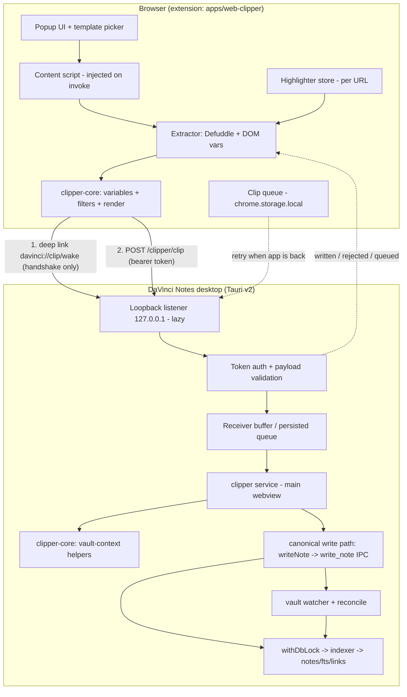

# DaVinci Notes — Web Clipper Feature Plan

Status: **Completed** — all 9 phases (Phases 0–8) implemented, verified, and shipped.
All related ADRs: ADR-0173 through ADR-0180 finalized and `Accepted`.
Standing constraints read for this plan: `AGENTS.md`, `DECISIONS.md`,
`PERFORMANCE.md`, `PROGRESS.md`, and the feature-relevant ADRs (vault/file I/O,
attachments, tags, properties/frontmatter, Tauri shell, sync, capture).

Reference for behavior: Obsidian Web Clipper documentation
(<https://help.obsidian.md/web-clipper>) and its open-source repo
(<https://github.com/obsidianmd/obsidian-clipper>) — cited inline as
"Obsidian docs" / "obsidian-clipper". Facts about its internals are only stated
where they are documented publicly or visible in its repo; nothing about its
private internals is assumed.

---

## 1. Goals / Non-goals

### Goals

- One click in the browser saves the current page — or the highlighted parts,
  or the selection — as a durable `.md` file in the vault, with metadata as YAML
  frontmatter properties.
- Works when DaVinci Notes is **open** (immediate write) and when it is
  **closed** (queued in the extension, delivered on a later launch).
- Output is **plain Markdown readable without our app** (ADR-0004), written
  through the app's existing vault write path so the file watcher, indexer,
  backlinks, tags, and (future) sync all pick it up.
- Templates, variables, filters, auto-apply rules, import/export — adapted from
  the documented reference behavior, not copied wholesale.
- A highlighter that persists per-URL in the extension and is included in the
  clip.
- No clipped content ever leaves the user's machine. No remote server anywhere
  in the path.

### Non-goals (v1)

- Reader view, Interpreter/AI prompt variables, and template logic (`if`/`for`)
  — documented reference features, deliberately deferred.
- Remote template directory / cross-browser settings sync.
- Safari. Chrome/Edge/Brave/Arc first (Chromium MV3), Firefox second, Safari
  later.
- Server-side anything. No owned backend (ADR-0116).
- Writing to the vault directly from the extension (ADR-0177).
- Mobile. The clipper targets the desktop app; mobile capture is out of scope.
- Re-inventing attachments: image download/offline (Phase 6) must reuse the
  existing Attachments model (ADR-0109/0110/0112/0113/0115).

---

## 2. Assumptions (stated, not hidden)

- **A1.** The clipper is an *optional* feature; when it is off, the desktop app
  must add zero idle CPU/RAM and no bound port (PERFORMANCE.md rule 9).
- **A2.** Only one vault can be open in the desktop app at a time
  (`VaultState` holds a single root). "Multi-vault" therefore means the user can
  configure several vaults in the extension, but a clip is only ever written
  into the vault that is currently open (see open decision O4).
- **A3.** The extension cannot read the app's keychain or files, so any shared
  secret (per-install token) must be paired through a user-visible step or a
  mediated handshake (ADR-0173).
- **A4.** Extension bundles are not part of the desktop initial bundle and are
  not subject to the desktop entry-size budget; they are still subject to the
  "inject nothing until invoked" rule (ADR-0175 / PERFORMANCE.md rule 4).
- **A5.** Defuddle is MIT and the library the reference clipper uses; its
  license and current status are verified in ADR-0174, but its exact
  sub-bundle composition must be re-verified in Phase 0 (open decision O2).

---

## 3. Architecture

Two independently deployable pieces plus one shared pure-TS package:

- `apps/web-clipper` — the browser extension (MV3), Chromium first.
- `packages/clipper-core` — pure TypeScript: shared types, payload schema,
  template engine, variables, filters, safe filename rules. No DOM, no Tauri,
  no React.
- Desktop app — a **clipper receiver** (Rust listener + validation + a JS
  service that uses the canonical vault write path).



**Trust boundary:** everything the extension sends is hostile input. The
desktop receiver validates, never trusts `folder`/`noteName`, and always writes
through `resolve_in_vault` + the canonical write path. The extension injects
nothing into pages until the user invokes it (except a light, lazy highlighter
restore — Phase 5).

---

## 4. Payload schema (draft, v1)

Transport envelope (HTTP, ADR-0173):

```
POST http://127.0.0.1:<port>/clipper/clip
  Authorization: Bearer <per-install token>
  Content-Type:  application/json
  Origin:        chrome-extension://<extension-id>   (rejected if not loopback-extension)
  Host:          127.0.0.1:<port>                    (rejected otherwise)
  body <= 2 MiB  (413 above the cap)
```

Body (`ClipPayload`):

```ts
interface ClipPayload {
  version: 1;
  clipId: string;                 // uuid v4 — idempotency key, echoed in the ack
  capturedAt: string;             // ISO 8601
  mode: "full" | "selection" | "highlights";
  templateId: string;
  behavior:
    | "create" | "append-bottom" | "append-top"
    | "prepend" | "daily-append" | "daily-prepend";
  target: {
    vaultId?: string;             // unknown/absent => currently open vault
    folder: string;               // UNTRUSTED, re-validated in Rust
    noteName: string;             // UNTRUSTED, re-validated in Rust
  };
  source: {                       // page metadata (all UNTRUSTED)
    url: string; title: string; site?: string; domain?: string;
    author?: string; published?: string; description?: string;
    image?: string; favicon?: string; language?: string; wordCount?: number;
  };
  properties: Record<string, string | string[] | number>; // rendered values
  tags: string[];                 // default ["clippings"]
  body: string;                   // rendered Markdown, already sanitized
  contentHash: string;            // hash of normalized body — dedupe input
  highlights?: Array<{ text: string; selector?: string; createdAt: string }>;
  attachments?: Array<{ sourceUrl: string; suggestedName: string; alt?: string }>;
}
```

Ack:

```ts
interface ClipAck {
  clipId: string;
  status: "written" | "queued" | "rejected";
  path?: string;                  // vault-relative, when written
  error?: "unauthorized" | "too-large" | "invalid-path" | "vault-not-open"
        | "duplicate" | "invalid-payload" | "app-busy";
}
```

The extension only removes a queued clip after a `written`/`duplicate` ack for
its `clipId` (ADR-0178).

---

## 5. Phase plan

Conventions for every phase:

- **One phase = one AI session = one commit**, single concern (AGENTS.md).
- Every new dependency states its size cost (PERFORMANCE.md rule 1).
- Every component ships `.module.scss` + Storybook story + test in the same PR;
  no raw hex/px outside tokens; kebab-case class names; depth = borders.
- Phases marked **HIGH-RISK / ATOMIC** must be implemented and verified in **one
  session** and must not be split across sessions or commits.

### Phase 0 — ADRs + transport spike (HIGH-RISK / ATOMIC)

**Scope.** Lock the transport and library choices (ADR-0173 … ADR-0178), then
prove exactly one clip round-trips end to end with a throwaway payload — no
templates, no extraction, no UI. This spike is the risk burn-down for the whole
feature.

- Decide transport (ADR-0173). Recommendation: deep link as a *handshake/wake*
  only + loopback HTTP for the payload + per-install token.
- Verify deep-link plugin compatibility: Tauri docs state the deep-link plugin
  requires Rust ≥ 1.90, while `apps/desktop/src-tauri/Cargo.toml` pins
  `rust-version = "1.77.2"`. Also verify that macOS cannot register schemes at
  runtime (must be in `tauri.conf.json`) and that desktop deep links only fire
  for an installed/bundled app.
- Spike: extension sends a hard-coded `ClipPayload` with a fixed note name; the
  desktop validates it and writes it as a plain `.md` through the existing
  write path. Measure idle cost with the clipper disabled vs enabled.

**Files / packages touched.**
`apps/desktop/src-tauri/src/clipper_server.rs` (spike listener);
`apps/desktop/src-tauri/src/clipper_auth.rs` (token compare);
`apps/desktop/src-tauri/tauri.conf.json` (scheme);
`apps/desktop/src-tauri/src/lib.rs` (register);
`apps/desktop/src-tauri/capabilities/*`; `packages/clipper-core/` (payload types,
empty barrel); `apps/web-clipper/` (throwaway spike).
**Do not** touch vault write code in this phase beyond calling it.

**Dependencies added.** `tauri-plugin-deep-link` + `tauri-plugin-single-instance`
(Rust crates; measure binary delta as in ADR-0152/Phase-1 tray precedent).
Extension build tooling only (WXT/Vite) — dev-time, ships nothing.

**Adversarial verification (each must be run and the actual result reported).**
1. `POST /clipper/clip` with **no** `Authorization` header → expect `401`, no
   file written, no error detail leaked.
2. `POST` with a **wrong** token → `401`; confirm comparison is constant-time and
   the response time does not vary measurably with token similarity.
3. `POST` with `Origin: https://evil.example` → rejected; `Host: localhost:<port>`
   and `Host: 127.0.0.1.evil` → rejected.
4. Curl from a non-loopback interface (`curl --interface <lan-ip>`) → connection
   refused (listener bound to `127.0.0.1` only).
5. Trigger `davinci://clip/wake` from a **web page** (`<a href>`/`location=`) →
   confirm the handshake carries no payload and cannot cause a write.
6. Measure: idle CPU% and RSS of the desktop process with the clipper **enabled
   but idle** for 60 s; report the delta vs disabled.

### Phase 1 — `packages/clipper-core`: template engine, variables, filters + tests

**Scope.** Pure-TS package: payload/type model, variable resolver interfaces,
filter registry, template parser/renderer, `safe_name`, note-name format
resolution, daily-note date resolution. No DOM, no network, no `eval`.
Templates are **data only** (ADR-0176).

- Starter templates: Article, Recipe, Movie/Reference, Paper (Phase 4 wires UI;
  Phase 1 ships them as JSON fixtures + tests).
- Minimal v1 filter set: `date`, `upper`, `lower`, `title`, `capitalize`, `trim`,
  `replace`, `safe_name`, `join`, `split`, `first`, `last`, `slice`, `list`,
  `table`, `wikilink`, `image`, `link`, `blockquote`, `markdown`.
- Explicitly deferred: `map`, `template`, `object`, `merge`, `nth`, `unique`,
  `html_to_json`, `callout`, `footnote`, `fragment_link`, `calc`,
  `number_format`, `round`, `date_modify`, `duration`, and template logic.

**Files / packages touched.** `packages/clipper-core/**`,
`packages/clipper-core/package.json`, `tsconfig.json` (path alias),
`.eslintrc.js` (boundaries element `clipper-core`).

**Dependencies added.** Prefer **zero**. Frontmatter *emission* is string
templating; if YAML *parse* is needed, reuse `@app/indexer`'s `yaml` (~25 KB gzip,
already in the tree, ADR-0022) rather than a second YAML lib.

**Adversarial verification.**
1. Feed a template with `{{title|replace:"/.*/g":"x"}}` and a variable named
   `constructor`/`__proto__`/`prototype` → assert no prototype pollution, no
   property access outside the declared variable map, no execution.
2. Feed a template containing `{{"1+1"}}`, `{{import(...)}}`, and
   `${process.env}` → assert these are treated as literal text or an explicit
   "unknown variable" result — never evaluated.
3. `safe_name` on `../../etc/x`, `CON.md`, `aux`, `nul`, a 300-char name, a name
   of only dots, and an emoji-only name → assert a deterministic per-OS-safe
   result (Windows reserved names, macOS `:`, Linux `/`) with no separator.
4. Property value injection: a title containing `\n---\n` and a body containing
   a closing `---` → assert frontmatter cannot be broken out of (escaping rule).
5. Render 2,000 variables × 200 template lines → assert the render is bounded and
   does not block for an unbounded time (measure and report ms).

### Phase 2 — Extension scaffold + extraction → Markdown + popup (design system)

**Scope.** `apps/web-clipper` (WXT, MV3, Chromium first) + the popup UI in the
design system. Extraction via Defuddle on invoke only. No transport yet: output
goes to a preview and a local download.

- Popup: template picker, editable title/folder/properties, preview, and an
  "Add to DaVinci Notes" button (disabled until Phase 3).
- Content script injected **only on user invocation** (action click / context
  menu / hotkey) — nothing runs at page load except the lazy highlighter restore
  (Phase 5).
- Extraction modes: full page, selection only, highlights only.

**Files / packages touched.** `apps/web-clipper/**`,
`apps/web-clipper/src/components/{Popup,TemplatePicker,ClipPreview}` (+ scss +
stories + tests), `packages/clipper-core` (consumed),
`packages/design-system` (tokens only; no new tokens unless approved),
`.eslintrc.js`, `pnpm-workspace.yaml` (already `apps/*`).

**Dependencies added.** `defuddle` (~86.4 KB gzip core bundle — ADR-0174),
`webextension-polyfill` (Firefox second), `@wxt-dev/...` dev tooling. DOMPurify
is already used by `@app/sanitize`; reuse the allowlist decision (ADR-0089/0090)
for any HTML that is rendered in the popup — app clip content is Markdown, not
HTML.

**Adversarial verification.**
1. Clip a page whose `<title>`/`<meta og:*>` contain `<script>alert(1)</script>`
   and `` → assert the popup shows literal text, no script runs,
   no HTML is injected into the popup DOM.
2. Confirm the injected content script is absent from a normal page load (inspect
   `chrome://extensions` → "content scripts" and a clean-profile page). Assert
   **no** requests fire on page load (DevTools network on a never-invoked page).
3. Confirm Defuddle is called with `useAsync:false` and assert **zero** network
   requests leave the extension during a clip (its async extractors can call the
   FxTwitter third-party API — must never be reachable).
4. Clip a page with 4,000 DOM nodes and a 1.5 MB article; report extraction time
   and that the browser stays responsive (no long task > 50 ms).
5. Clip a page that does not exist / a `chrome://` page / a PDF → assert a clear
   error state, no crash, no partial file.

### Phase 3 — Desktop receiver: transport, auth, validation, vault write (HIGH-RISK / ATOMIC)

**Scope.** The real receiver. Lazy loopback listener (starts only when the
clipper is enabled), pairing, token auth, strict validation of every hostile
field, size cap, and the write through the **canonical** path (ADR-0177). One
session, one commit.

- Rust: `clipper_server.rs` (listener + routes), `clipper_auth.rs` (token
  generation/rotation/constant-time compare, stored in OS keychain per ADR-0120
  pattern), `clipper_validate.rs` (path/name/size/behavior validation).
- JS: `apps/desktop/src/clipper/clipperService.ts` listens for the
  `clipper:clip-received` event and calls the canonical helpers
  (`createNoteInVault`, new `appendToNoteInVault`) — no second write path.
- Settings section: "Web Clipper" enable toggle + pairing (show/copy token,
  rotate, revoke).

**Files / packages touched.** `apps/desktop/src-tauri/src/{clipper_server,
clipper_auth,clipper_validate}.rs`, `lib.rs`, `state.rs`, `capabilities/*`;
`apps/desktop/src/clipper/**` (service + `appendToNoteInVault.ts`);
`apps/desktop/src/vault/index.ts`; Settings components + stories + tests;
`packages/clipper-core` (validation helpers shared with the receiver).

**Dependencies added.** Rust: reuse `serde_json` + `std::net` (no new crate if
the OAuth `TcpListener` pattern is reused, mirroring `oauth.rs`); optionally a
tiny HTTP parser already implied by `oauth.rs`. Extension side: none new.

**DB concurrency requirement (verbatim, applies to this phase because indexing
is triggered by the write):**

> Any step that touches vault-index.db must follow the standing withDbLock/WAL concurrency rules.

**Adversarial verification (each run, actual result reported).**
1. Send a clip with `target.noteName = "../../etc/x"` → expect rejection
   (`invalid-path`), **no file created anywhere**, and the error surfaced to the
   extension. Repeat with `"/etc/passwd"`, `"C:\\Windows\\x"`, `"..\\..\\x"`,
   `"a/../../b.md"`, `"CON.md"`, `".hidden"`, a name with a NUL byte, and a
   500-char name — report each actual outcome.
2. Send `target.folder = ""`, `"."`, `"seg/../../.."`, `"\"` and a folder that
   escapes via a symlink → all rejected or safely created **inside** the vault.
3. Send a **5 MiB** payload → expect `413`, connection closed, no partial write,
   and no memory spike beyond the cap (measure RSS).
4. Send a malformed/truncated JSON body and a body with a huge `properties` map
   (10,000 keys) → expect `400`/`413`, no panic, no crash of the listener thread.
5. Send a body claiming `behavior:"append-bottom"` for a note that does not exist
   → assert a documented outcome (create vs reject) and that the existing file is
   never truncated.
6. Concurrency: fire 20 simultaneous clips (from a loop) → assert 20 distinct
   files (or deterministic collision suffixes), zero interleaved/partial files,
   and no `SQLITE_BUSY`; report the max lock-hold time.
7. `target.noteName` colliding with an existing file 3 times → assert numeric
   suffixes (`Note.md`, `Note 1.md`, `Note 2.md`, ADR-0110 pattern), never an
   overwrite.
8. Confirm the write appears in the file tree, indexer, backlinks, and tags
   without an app restart.
9. Token rotation revokes the old token immediately; a clip with the old token →
   `401`.
10. Confirm zero idle cost when the clipper is **disabled** (no bound port via
    `lsof -iTCP -sTCP:LISTEN -P | grep davinci`, no listener thread).

### Phase 4 — Templates UI/settings, auto-apply rules, import/export

**Scope.** Full template management in extension settings: create/edit/duplicate/
delete, behavior, note-name format, target folder, vault, properties list, body,
tags; auto-apply by URL prefix / regex / Schema.org type; import/export JSON;
starter templates (Article, Recipe, Movie/Reference, Paper); settings export.

**Files / packages touched.** `apps/web-clipper/src/settings/**`,
`apps/web-clipper/src/templates/**`, `apps/web-clipper/src/components/**`,
`packages/clipper-core` (rule matching + template validation, pure).

**Dependencies added.** Prefer none. Date formatting in filters uses a small
hand-rolled formatter or is deferred; `dayjs` (~7 KB gzip) is the reference
library and is acceptable **only** if the hand-rolled `date` filter proves
insufficient — decide in Phase 1 and record the size.

**Adversarial verification.**
1. Import a template JSON with `"target": {"folder": "../../.."}` and with a
   body containing `{{` + unbalanced template syntax → assert validation errors
   are shown and the template is not saved/used.
2. Import a 5 MB template file and a file that is valid JSON but an array/object
   of the wrong shape → rejected with a clear message.
3. A regex auto-apply rule with catastrophic backtracking (`/(a+)+$/`) → assert
   the matching is bounded (length-capped input + time cap) and cannot hang the
   popup.
4. Two templates with overlapping rules + one Schema.org rule → assert the
   documented "first match wins; list order matters" behavior deterministically.
5. Export → import round-trip → assert byte-identical template semantics.

### Phase 5 — Highlighter

**Scope.** Highlight text/blocks on a page, persist per URL in
`chrome.storage.local`, restore on revisit, include as `==highlight==` or
blockquotes per template. The restore is the only thing that may run without an
explicit user invocation and must be light and lazy (PERFORMANCE.md rule 4).

**Files / packages touched.** `apps/web-clipper/src/highlighter/**`,
`packages/clipper-core` (highlight → markdown/blockquote rendering), popup
highlighter toggle, options.

**Dependencies added.** Prefer none (Selection + Range APIs are native).

**Adversarial verification.**
1. Restore highlights on a page with 5,000 highlightable nodes and 200 stored
   highlights; measure injection time and confirm it is deferred until idle, does
   not block first paint, and adds no cost on pages with **zero** highlights.
2. A stored highlight whose anchored text no longer exists / DOM changed → assert
   graceful skip, no console error storm, no crash.
3. Clip with `mode:"highlights"` where a highlight text contains `==`, `]]`,
   `|`, and a newline → assert output cannot break wikilinks/tables/highlight
   syntax.
4. Confirm highlight storage never exceeds a bounded size and is evicted
   oldest-first when it does; report the cap.

### Phase 6 — Attachments download / offline images (reuse Attachments)

**Scope.** Optional per-template: download images into the vault attachments
folder and rewrite links so clips read offline. **Must reuse** the Attachments
feature (ADR-0109/0110/0112/0113/0115) — no parallel mechanism. The desktop does
the fetch+write (extension never writes to the vault).

**Phase placement flag (explicit decision requested, O3).** This is recommended as
a **later phase (6), not Phase 1**, because it multiplies the security surface
(SSRF, redirects, MIME sniffing, disk usage, failure semantics) before the core
round-trip is proven. If the owner wants offline clips in v1, say so and Phase 6
moves earlier — but then Phase 3 must land first regardless.

**Files / packages touched.** `packages/attachments` (reuse
`attachmentWriter`/`resolveAttachmentFolder`), new
`apps/desktop/src/clipper/clipperAttachments.ts`, Rust fetch (reuse the existing
native HTTP client pattern from `plugin_network.rs`: HTTP(S) only, redirect cap,
1 MiB body cap — raise only with a documented decision), templates UI toggle.

**Dependencies added.** None (reuse reqwest already in Cargo.toml and the
existing attachment writer).

**DB concurrency requirement (verbatim, applies if indexing/binary writes touch
`vault-index.db`):**

> Any step that touches vault-index.db must follow the standing withDbLock/WAL concurrency rules.

**Adversarial verification.**
1. Image URL pointing at `http://169.254.169.254/…`, `http://127.0.0.1:…`,
   `file:///etc/passwd`, and a LAN IP → all rejected (no SSRF); report each.
2. Image URL that 302-redirects to `file:///` or to 169.254.x → redirect chain
   capped and rejected.
3. An HTML response served as `image/png` → rejected by content check.
4. Same image name twice → `image.png`, `image 1.png` (ADR-0110); a name with
   `/` → rejected (ADR-0110).
5. 200 images totalling 500 MB on one clip → assert a documented cap and a
   partial-success report, no unbounded disk use.
6. Offline readability: pull the network, reopen the note → images render from
   the vault.

### Phase 7 — Closed-app queue, hotkeys, context menu, multi-vault (HIGH-RISK / ATOMIC)

**Scope.** Queue clips when the app is closed and drain on next launch with
dedupe (ADR-0178); keyboard shortcuts (open clipper, quick-clip with default
template, toggle highlighter); context-menu entries; multi-vault target
selection. One session, one commit.

**Files / packages touched.** `apps/web-clipper/src/queue/**`,
`apps/web-clipper/src/background.ts` (service worker: install/startup drain),
`packages/clipper-core` (queue record schema), desktop
`apps/desktop/src-tauri/src/clipper_queue.rs` (post-launch drain coordination +
recent-clipId store), `apps/desktop/src/clipper/**`.

**Dependencies added.** None preferred; a uuid source is native
(`crypto.randomUUID`).

**DB concurrency requirement (verbatim, applies because draining writes notes
that are indexed):**

> Any step that touches vault-index.db must follow the standing withDbLock/WAL concurrency rules.

**Adversarial verification.**
1. Clip with the app **closed**, then launch it → assert delivery, exactly one
   file, no duplicate, and the queue entry removed only after the ack.
2. Deliver the same `clipId` twice (replay) → assert the second is a no-op
   (`duplicate`) and no second file is created.
3. Kill the app mid-write, then relaunch → assert no partial/empty note remains
   and the queue entry is retried, not silently dropped.
4. Fill the queue to its cap (report the cap) → assert oldest-first eviction with
   a visible count in the popup, and no silent data loss without a warning.
5. `vaultId` that is not the open vault → documented outcome (`vault-not-open`),
   clip retained in the queue, not written into the wrong vault.
6. Confirm **no** continuous polling: assert no `setInterval` drain, and that
   drain fires only on browser startup, popup open, explicit user action, or a
   successful wake handshake (PERFORMANCE.md rule 9).
7. Hotkey/context-menu triggers in a page with a restrictive CSP and on a
   `chrome://` page → assert clear failure, no hang.

### Phase 8 — Packaging, store listings, docs, hardening pass

**Scope.** Build/sign/zip for Chrome, Edge, Firefox; store listings + privacy
copy; user docs; a full adversarial hardening pass re-running every Phase 3/6/7
attack; `PERFORMANCE.md` review (rule 52: revisit at every major feature).

**Files / packages touched.** `apps/web-clipper/wxt.config.*`, release CI,
`docs/` (clipper docs), `DECISIONS.md` (finalize Proposed → Accepted),
`PROGRESS.md` / `docs/HISTORY.md`.

**Dependencies added.** None new (packaging tooling only).

**Adversarial verification.**
1. Re-run the complete Phase 3 + 6 + 7 attack matrix against the packaged build
   (not just dev).
2. Confirm minimal permissions: `activeTab`, `storage`, `scripting` only, and
   that the install screen shows no broad host permissions; assert host
   permissions are requested only when required (and document where).
3. Verify the shipped extension bundle contains no `eval`/`new Function` and no
   remote-code path (grep the built output).
4. Verify the desktop release binary delta from the clipper crates is measured
   and recorded (ADR-0152 precedent) — not asserted.

---

## 6. High-risk phases that must stay in one session

| Phase | Why atomic | Rule |
|---|---|---|
| 0 — ADRs + transport spike | Sets the trust boundary and the only cross-boundary protocol | One session, one commit |
| 3 — Desktop receiver | Auth + hostile-input validation + canonical write; cannot be half-landed | One session, one commit |
| 7 — Queue, hotkeys, multi-vault | Idempotency + drain + vault targeting; partial landing risks duplicate/lost clips | One session, one commit |

Phases 6 is **medium-high** (SSRF/disk risk) — keep it in one session too.

## 7. Suggested phase order

0 → 1 → 2 → 3 → 4 → 5 → 6 → 7 → 8 (the task's order). Dependency notes:
- Phase 2 can start before Phase 3 only because it has no transport; they may
  share the payload types from Phase 1.
- Phase 4 depends on Phase 1 (engine) and Phase 2 (UI shell).
- Phase 5 is independent of 3 after Phase 2.
- Phase 6 must land **after** Phase 3 (it needs the write path) regardless of
  when it is scheduled.

## 8. Performance summary (PERFORMANCE.md)

- Extension injects nothing until invoked; the only always-on-lazy piece is the
  highlighter restore (Phase 5), which is deferred to idle and no-ops on pages
  with no stored highlights.
- Desktop-idle cost is **zero when the clipper is disabled** (no port, no thread).
  When enabled but idle, the listener is a blocked `accept()` — measure and record
  the delta (Phase 0/3).
- Every dependency's size is recorded: `defuddle` ~86.4 KB gzip, `turndown`
  ~4.1 KB gzip (+`turndown-plugin-gfm` ~0.95 KB) and
  `@mozilla/readability` ~11.2 KB gzip as the alternative (ADR-0174).
- No continuous polling anywhere (rule 9); the queue drains on events, not timers.
- Debounce/batch: clip writes are user-initiated (no per-keystroke path); any
  preview re-render on property edits is debounced.

## 9. SQLite requirement reused in DB-touching phases

Phases 3, 6 (if it indexes), and 7 carry this verbatim:

> Any step that touches vault-index.db must follow the standing withDbLock/WAL concurrency rules.

## 10. Decisions needing owner input

- **O1 (transport).** Confirm the recommended hybrid (deep link handshake +
  loopback + per-install token) over deep-link-only, loopback-only, or Native
  Messaging (ADR-0173).
- **O2 (extraction lib).** Confirm Defuddle (~86 KB gzip) over
  Readability+Turndown (~16 KB gzip) — accepting more code for reference-parity
  output quality. Re-verify Defuddle's license/bundle composition in Phase 0.
- **O3 (attachments placement).** Confirm image/offline download stays in Phase 6
  (later), not v1.
- **O4 (multi-vault semantics).** Confirm the v1 rule "clip into the currently
  open vault; reject otherwise" versus switching which vault is open.
- **O5 (pairing UX).** Confirm "copy token from Settings into the extension" vs
  the nonce handshake pairing window (ADR-0173 describes both).
- **O6 (queue bounds).** Confirm queue cap (proposed: 200 clips / 5 MB / 30 days,
  oldest-first eviction, visible count).
- **O7 (token storage).** Confirm the per-install token lives in the OS keychain
  (ADR-0120 pattern) rather than a plain config file.
- **O8 (Reader/Interpreter/logic).** Confirm these stay out of all 9 phases.

## 11. Risks

| Risk | Impact | Mitigation |
|---|---|---|
| Deep-link plugin needs Rust ≥ 1.90 vs pinned 1.77.2 | Blocks the recommended transport | Verify in Phase 0; if blocked, loopback-only + manual pairing is the fallback (ADR-0173) |
| macOS deep links are install-time only / can't be tested unbundled | Spike can't be run in dev | Phase 0 bundles a test build; document the runbook; native verification is owner-local |
| Defuddle is "very much a work in progress" | Extraction regressions | Pin the version, keep the lib behind `clipper-core`, add extraction fixtures per release |
| Defuddle async extractors call third-party APIs | Violates "never send content remotely" | Force `useAsync:false`; assert zero network on clip (Phase 2) |
| Loopback endpoint is a local attack surface | Unauthorized local writes | Loopback-only bind, token auth, Origin/Host checks, size cap, constant-time compare (Phase 3) |
| Path traversal via `noteName`/`folder` | Arbitrary file write | Never trust the extension; re-validate in Rust via `resolve_in_vault`; adversarial tests with actual results |
| Duplicate clips on retry | Vault litter | `clipId` + `contentHash` dedupe; ack-before-delete |
| Extension build tooling adds a second bundler | Monorepo complexity | WXT uses Vite (same as desktop); dev-only, ships nothing (ADR-0175) |
| Native GUI/security verification is owner-local | Agent can't self-verify | Every phase separates "agent implements + explains the runbook" from "owner runs and reports" (per standing constraint) |

## 12. Recommended first phase prompt

**Run Phase 0** — "Web Clipper Phase 0: ADRs + transport spike (HIGH-RISK,
single session)". It is the only phase that can invalidate the architecture, it
forces the deep-link/Rust-version check, and it produces the one-clip
round-trip proof everything else depends on. Do **not** start with the extension
UI: building a popup against an unproven transport is the most likely way to
waste a session.
