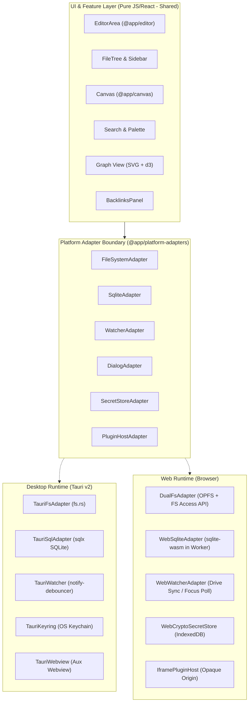
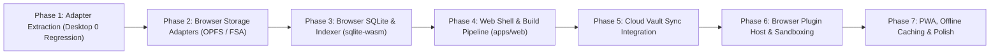

# DaVinci Notes — Web (Browser) Version Feature & Implementation Plan

> Target: Enable users to open DaVinci Notes directly in any modern desktop or mobile browser and seamlessly work with their vault: browse the file tree, create, open, and edit plain `.md` files, follow wikilinks and view backlinks, execute instant full-text searches with FTS5, navigate tags, view interactive graph connections, and manipulate infinite canvas boards. The web version maintains 100% visual and interactive fidelity with the desktop application, preserves plain Markdown files as the sole source of truth, introduces zero required server infrastructure, and strictly complies with `PERFORMANCE.md`, `AGENTS.md`, and `DECISIONS.md`.

---

## 1. Executive Summary & Architectural Overview

DaVinci Notes is built as an offline-first, local-first note-taking system. Its core domain packages (`@app/core-types`, `@app/editor`, `@app/indexer`, `@app/canvas`, `@app/design-system`, `@app/attachments`, `@app/sanitize`, `@app/sync-client`, `@app/plugin-api`, `@app/plugin-runtime`, `@app/theme-api`) are already 100% pure TypeScript/JavaScript and execute in any standard modern web browser environment.

However, the desktop application (`apps/desktop`) currently exhibits direct coupling to Tauri v2 runtime APIs (`@tauri-apps/api`, `@tauri-apps/plugin-fs`, `@tauri-apps/plugin-sql`, `@tauri-apps/plugin-dialog`) across 49 source files and 18 test files.

To bring DaVinci Notes to the web while preserving desktop stability and zero-regression guarantees, this plan introduces a formal **Platform Adapter Layer** (`@app/platform-adapters`) enforced by `eslint-plugin-boundaries`. The web application (`apps/web`) reuses the existing design system, editor, canvas, and indexer logic, backed by browser-native storage and worker-based SQLite.



---

## 2. Evaluation of Candidate Approaches

We evaluated three architectural approaches for the web version. None are chosen silently; the table and detailed sections below analyze tradeoffs across every operational dimension.

### 2.1 Comparative Analysis Matrix

| Evaluation Dimension | Approach A: File System Access API (Chromium Direct) | Approach B: OPFS + Cloud Sync (Drive Manifest Diff) | Approach C: Self-Hosted Server Mode (Rust Server + Web Client) |
|---|---|---|---|
| **Primary Mechanism** | Browser accesses local disk folder via `showDirectoryPicker()`. Real `.md` files on host filesystem. | Vault stored in browser Origin Private File System (`navigator.storage.getDirectory()`), synced via Google Drive. | Local/remote Rust binary reuses `src-tauri` I/O, serving web frontend over HTTP/WebSocket. |
| **Browser Support: Chrome / Edge** | **Full**: Desktop Chrome 86+, Edge 86+. | **Full**: Chrome 102+, Edge 102+ (desktop & Android). | **Full**: All Chromium browsers on all platforms. |
| **Browser Support: Firefox** | **None**: Mozilla opposes folder write access for privacy/fingerprint reasons. | **Full**: Firefox 111+ (desktop & Android) supports OPFS & SyncAccessHandle. | **Full**: Standard HTTP/WebSocket works in all Firefox versions. |
| **Browser Support: Safari (macOS & iOS)** | **None**: WebKit opposes persistent folder write access; iOS has 0 directory picker support. | **Full**: Safari 15.2+ (macOS, iPadOS, iOS) supports OPFS and Dedicated Worker handles. | **Full**: Works universally across Safari on macOS, iOS, iPadOS. |
| **Read / Write Mechanism** | Direct `FileSystemFileHandle.createWritable()` to local disk. | `FileSystemFileHandle.createWritable()` or `createSyncAccessHandle()` inside OPFS. | REST/WebSocket RPC to Rust server; server writes host disk using `tokio::fs`. |
| **External Change Detection** | **Degraded**: `FileSystemObserver` is experimental. Requires debounced polling or focus-change check. | **Scoped/Reliable**: No external OS apps access OPFS; external changes arrive solely via Drive sync pulls. | **Native**: Rust server runs `notify-debouncer-full` on disk; pushes change events over WebSocket. |
| **SQLite / FTS5 Index Engine** | `sqlite-wasm` in Dedicated Web Worker backed by OPFS. Index in OPFS, notes in picked folder. | `sqlite-wasm` in Dedicated Web Worker backed by OPFS. Both index and notes reside in OPFS. | Server-side SQLite (`sqlx` / `rusqlite`) over WebSocket; zero client WASM overhead. |
| **Security & Sandbox Model** | Folder access permission prompted per origin; Chromium re-prompts on page reload/session restart. | Origin-sandboxed; zero reload prompts; cannot escape origin to touch host files. | Network attack surface; requires loopback binding, auth tokens, TLS, CORS/CSRF guards. |
| **Conflict Handling** | Guarded by save-time append/conflict copy (ADR-0170). Concurrent edits with desktop app may race. | Native integration with `@app/sync-client` 3-way merge (node-diff3, ADR-0122) and conflict copies. | Server handles file locking; concurrent edits race at the filesystem level. |
| **Fit with ADR-0116 (No Owned Backend)** | **100% compliant**: Zero backend, zero server hosting or credentials. | **100% compliant**: Client speaks directly to user's Google Drive via OAuth PKCE. | **Direct Conflict**: Introduces a server process, daemon lifecycle, and network endpoints. |
| **Fit with ADR-0004 (Notes as Plain Files)** | **100% compliant**: Real `.md` files directly visible in local file explorer. | **Compliant via Export/Sync**: Stored as files in OPFS; synced as real files to desktop or zip export. | **100% compliant**: Real `.md` files directly visible on host server disk. |

---

### 2.2 Deep Dive on Approaches

#### Approach A: Browser-Only with File System Access API
- **Pros**: Zero onboarding barrier for desktop Chrome/Edge users. The user clicks "Open Vault", selects their existing Obsidian/DaVinci folder, and immediately reads/edits real `.md` files without syncing or copying data.
- **Cons**: Completely excludes Safari (macOS/iOS) and Firefox users. Onboarding breaks entirely on mobile devices (iOS forbids directory picker APIs). Re-permission dialogs on page reload introduce continuous user friction.

#### Approach B: Browser-Only with OPFS + Google Drive Sync
- **Pros**: Truly universal cross-browser and cross-platform compatibility (Chrome, Edge, Safari, Firefox, iOS, iPadOS, Android). Operates entirely within standard origin sandbox limits with zero permission re-prompts on reload. Reuses the exact manifest-diff sync engine and conflict resolution policies established in ADR-0116, ADR-0119, and ADR-0122.
- **Cons**: Initial vault setup requires connecting Google Drive or importing notes/zip; files in OPFS are not directly browsable in the operating system Finder/Explorer without using the app's export function.

#### Approach C: Optional Self-Hosted Server Mode
- **Pros**: Zero WASM overhead; instant startup; native file watcher via Rust `notify`; runs on headless home servers/NAS (Synology, Raspberry Pi, Unraid).
- **Cons**: Directly conflicts with ADR-0116's core principle ("no owned backend, server deployment, database, WebSocket relay"). Requires users to manage server daemons, port forwarding, authentication, and reverse proxies.

---

### 2.3 Recommended Approach: Unified Dual-Engine Web Architecture (Hybrid A + B)

We recommend a **Dual-Engine Web Architecture** combining Approach A and Approach B under a single unified `FileSystemAdapter` interface:

1. **Direct Vault Mode (Approach A)**: When running in Chromium on desktop, the user can select "Open Local Folder" to bind directly to a local directory on disk.
2. **Cloud/Sandboxed Vault Mode (Approach B)**: On Safari, Firefox, iOS, or when the user prefers cloud synchronization, the user selects "Create Web Vault" or "Connect Google Drive". The vault is stored in OPFS and synchronized via `@app/sync-client`.
3. **Approach C (Self-Hosted Server)** is deferred to a future phase and documented as an optional standalone binary, avoiding any immediate conflict with ADR-0116.

This delivers the best possible outcome: **zero friction for Chromium desktop users** and **100% platform reach across Safari, Firefox, and mobile devices**.

---

## 3. Required Pre-Phase Technical Analysis

### 3.1 Platform-Coupling Audit

Every `@tauri-apps/*` import and `invoke()` call across `apps/` and `packages/` was audited.

#### Audit Summary Metrics
- **Source files touching Tauri**: 49 files in `apps/desktop/src/`
- **Test files touching Tauri**: 18 files in `apps/desktop/src/`
- **Package / configuration files**: 2 files (`apps/desktop/package.json`, `apps/desktop/vite.config.ts`)
- **Tauri references in `packages/*`**: **0 files (100% clean)**
- **Tauri references in `apps/mobile/*`**: **0 files (100% clean)**
- **Total `@tauri-apps/*` import occurrences**: 75 lines across 57 files
- **Total `invoke()` calls in frontend source**: 52 call sites across 25 files

#### Detailed Coupling Inventory Table

| Source File in `apps/desktop/src/` | Primary Tauri Responsibility / Calls | Needs Platform Adapter? | Adaptation Strategy for Web |
|---|---|---|---|
| `App.tsx` | Event listeners (`vault-changed`, `davinci-reminders-missed`) | Yes (`PlatformWatcher`) | `PlatformWatcher.onChanged` via Drive sync or focus poll |
| `ai/desktopAISecretStore.ts` | OS Keychain AI keys (`save_ai_key`, `clear_ai_key`) | Yes (`SecretStoreAdapter`) | Web Crypto API + encrypted IndexedDB store |
| `calendar/calendarTokenStore.ts` | OS Keychain calendar tokens (`save_calendar_token`) | Yes (`SecretStoreAdapter`) | Web Crypto API + encrypted IndexedDB store |
| `calendar/desktopCalendarAuth.ts` | Loopback OAuth server & `open_external_url` | Yes (`ExternalUrlAdapter`) | Standard OAuth 2.0 PKCE popup / redirect flow |
| `components/AppSidebar/AppSidebarHeader.tsx` | Window dragging (`getCurrentWindow().startDragging`) | Yes (`WindowControlsAdapter`)| No-op on web (browser tabs own drag regions) |
| `components/AppTabs/AppTabs.tsx` | Window dragging (`getCurrentWindow().startDragging`) | Yes (`WindowControlsAdapter`)| No-op on web (browser tabs own drag regions) |
| `components/CalendarView/CalendarLeaf.tsx` | External link opening (`open_external_url`) | Yes (`ExternalUrlAdapter`) | `window.open(url, '_blank', 'noopener,noreferrer')` |
| `components/EditorArea/insertLocalImage.ts` | Dialog picker & file reader (`plugin-dialog`, `plugin-fs`) | Yes (`DialogAdapter` + `FileSystemAdapter`) | Standard `<input type="file" accept="image/*">` |
| `components/EditorArea/useEditorMediaHandlers.ts` | Asset asset conversion (`convertFileSrc`) | Yes (`FileSystemAdapter`) | Blob URLs (`URL.createObjectURL(blob)`) |
| `components/FileTree/confirmTreeDelete.ts` | Native confirmation modal (`plugin-dialog` `confirm`) | Yes (`DialogAdapter`) | In-DOM accessible modal dialog |
| `components/FileTree/runTreeRename.ts` | Native alert message (`plugin-dialog` `message`) | Yes (`DialogAdapter`) | In-DOM accessible alert / toast |
| `components/GitRemoteSetupPanel/GitRemoteSetupPanel.tsx` | System git validation (`validate_git_remote`) | No (Desktop-only) | Disabled in web build with explanatory badge |
| `components/QuickCapture/QuickCapture.tsx` | System capture window IPC & global shortcuts | No (Desktop-only) | In-tab modal shortcut (`Mod+Shift+C`) |
| `components/QuickCapture/QuickCaptureDestination.tsx` | Capture folder queries (`list_vault_folders_for_capture`) | No (Desktop-only) | Managed via standard vault tree helper |
| `components/QuickCapture/useCaptureTheme.ts` | Theme synchronization across native windows | No (Desktop-only) | Web uses single-window React state |
| `components/RemindersDialog/ReminderNotificationToast.tsx`| Event listener (`davinci-reminders-missed`) | Yes (`NotificationAdapter`) | Web Notifications API + in-app toast banner |
| `components/SettingsDialog/CaptureSettingsSection.tsx`| Global shortcut configuration | No (Desktop-only) | Tab hidden in web settings dialog |
| `components/SettingsDialog/GeneralSettingsTab.tsx`| System tray persistence (`set_keep_in_tray`) | No (Desktop-only) | Setting hidden in web settings dialog |
| `components/SettingsDialog/TrayClickSettingsRow.tsx` | Tray click behavior (`set_tray_click_action`) | No (Desktop-only) | Setting hidden in web settings dialog |
| `components/SyncthingPanel/syncthingCommands.ts` | Syncthing daemon loopback REST commands | No (Desktop-only) | Syncthing tab disabled (browser cannot bind loopback) |
| `components/WindowControls/WindowControls.tsx` | Window minimize, maximize, close (`getCurrentWindow`) | Yes (`WindowControlsAdapter`)| Component returns `null` in web runtime |
| `git/GitRemoteConfig.ts` | Git remote configuration in SQLite | No (Desktop-only) | Git features hidden in web |
| `git/createLocalGitVersion.ts` | System Git commit invoke (`create_local_git_version`) | No (Desktop-only) | Git features hidden in web |
| `git/desktopGitPatStore.ts` | OS Keychain PAT storage (`save_git_pat`) | No (Desktop-only) | Git features hidden in web |
| `git/initializeLocalGitRepository.ts` | System Git init invoke | No (Desktop-only) | Git features hidden in web |
| `git/localGitHistory.ts` | System Git log and restore commands | No (Desktop-only) | Git features hidden in web |
| `plugins/PluginNetworkRpcHost.ts` | Plugin network proxy via Rust | Yes (`PluginHostAdapter`) | Controlled `fetch` proxy subject to CORS and manifest |
| `plugins/installPluginArchive.ts` | Plugin unzipping and writing via `plugin-fs` | Yes (`FileSystemAdapter`) | In-browser JSZip extraction to OPFS |
| `plugins/pluginRpcHost.ts` | Plugin IPC with secondary Tauri Webview | Yes (`PluginHostAdapter`) | Sandboxed `<iframe>` with `postMessage` protocol |
| `state/createEditorSettings.ts` | Editor settings storage from SQLite `settings` | Yes (`SqliteAdapter`) | Stored in SQLite via `WebSqliteAdapter` |
| `state/usePluginStore.ts` | Webview lifecycle (`ensure_plugin_webview`) | Yes (`PluginHostAdapter`) | Lazy iframe creation in DOM |
| `sync/desktopDriveAuth.ts` | Desktop loopback OAuth & OS Keychain | Yes (`SecretStoreAdapter`) | Browser OAuth PKCE popup/redirect + IndexedDB keys |
| `sync/desktopManifestSource.ts` | Rust BLAKE3 streaming hash commands | Yes (`ManifestSourceAdapter`)| WebAssembly BLAKE3 worker (`@noble/hashes`) |
| `themes/desktopThemeAdapter.ts` | Theme reload broadcast across windows | Yes (`ThemeAdapter`) | `BroadcastChannel("davinci-themes")` |
| `themes/installThemeArchive.ts` | Theme unzipping and writing via `plugin-fs` | Yes (`FileSystemAdapter`) | In-browser JSZip extraction to OPFS |
| `vault/pickVaultFolder.ts` | Native directory picker (`plugin-dialog` `open`) | Yes (`DialogAdapter`) | `window.showDirectoryPicker()` or OPFS modal |
| `vault/recentVaultsRegistry.ts` | Recent vaults list stored via Rust | Yes (`VaultRegistryAdapter`)| `localStorage` / IndexedDB directory handles |
| `vault/reminderSnoozeActions.ts` | Rust reminder snooze invoke | Yes (`RemindersAdapter`) | Updates SQLite `reminder_local_state` via Worker |
| `vault/remindersViewQueries.ts` | SQLite queries for reminder list | Yes (`SqliteAdapter`) | Executed via `WebSqliteAdapter` in Worker |
| `vault/settingsCommands.ts` | SQLite `settings` table CRUD operations | Yes (`SqliteAdapter`) | Executed via `WebSqliteAdapter` in Worker |
| `vault/sqliteFtsIndex.ts` | SQLite FTS5 search queries & row deletion | Yes (`SqliteAdapter`) | Executed via `WebSqliteAdapter` (FTS5 enabled) |
| `vault/sqliteGraphIndex.ts` | SQLite link and node graph queries | Yes (`SqliteAdapter`) | Executed via `WebSqliteAdapter` in Worker |
| `vault/sqliteIndex.ts` | SQLite connection, PRAGMA, `withDbLock` queue | Yes (`SqliteAdapter`) | `WebSqliteAdapter` with Web Locks concurrency |
| `vault/sqliteNoteQueries.ts` | Backlink queries and note metadata | Yes (`SqliteAdapter`) | Executed via `WebSqliteAdapter` in Worker |
| `vault/sqliteReminderIndex.ts` | SQLite reminder sync and re-scheduling | Yes (`RemindersAdapter` + `SqliteAdapter`) | Executed via `WebSqliteAdapter` + Worker timer |
| `vault/vaultCommands.ts` | File CRUD (`rename`, `delete`, `create`, `watcher`) | Yes (`FileSystemAdapter` + `WatcherAdapter`)| DualFsAdapter (File System Access or OPFS) |
| `vault/writeAttachment.ts` | Attachment directory creation and writes (`plugin-fs`) | Yes (`FileSystemAdapter`) | DualFsAdapter satisfies `AttachmentFileSystem` |
| `window/useTrayMenuActions.ts` | Native system tray menu synchronization | No (Desktop-only) | Disabled in web (no system tray in browser) |
| `window/useWindowFullscreen.ts` | Native window fullscreen toggle | Yes (`WindowControlsAdapter`)| `document.fullscreenElement` / `requestFullscreen()` |

---

### 3.2 Platform Adapter Layer Design

To prevent architecture erosion, we define an explicit interface package: `packages/platform-adapters`.

#### 3.2.1 Core Interface Contracts

```typescript
// packages/platform-adapters/src/types.ts

export interface VaultFileEntry {
  path: string;
  name: string;
  kind: "file" | "directory";
  size?: number;
  mtime?: number;
}

export interface FileSystemAdapter {
  readTextFile(path: string): Promise<string>;
  writeTextFile(path: string, content: string): Promise<void>;
  readBinaryFile(path: string): Promise<Uint8Array>;
  writeBinaryFile(path: string, data: Uint8Array): Promise<void>;
  deleteFile(path: string): Promise<void>;
  renameFile(fromPath: string, toPath: string): Promise<void>;
  createFolder(path: string): Promise<void>;
  deleteFolder(path: string): Promise<void>;
  renameFolder(fromPath: string, toPath: string): Promise<void>;
  listEntries(folderPath?: string): Promise<VaultFileEntry[]>;
  exists(path: string): Promise<boolean>;
  stat(path: string): Promise<{ size: number; mtime: number }>;
}

export interface WatcherAdapter {
  start(onChange: (changedPaths: string[]) => void): Promise<() => void>;
  stop(): Promise<void>;
  setPaused(paused: boolean): Promise<void>;
}

export interface SqliteAdapter {
  execute(sql: string, params?: unknown[]): Promise<{ rowsAffected: number; lastInsertId?: number }>;
  select<T>(sql: string, params?: unknown[]): Promise<T[]>;
  withTransaction<T>(fn: () => Promise<T>): Promise<T>;
  close(): Promise<void>;
}

export interface DialogAdapter {
  pickVaultFolder(): Promise<{ path: string; name: string } | null>;
  pickImageFile(): Promise<{ name: string; data: Uint8Array } | null>;
  confirm(options: { title?: string; message: string; okLabel?: string; cancelLabel?: string }): Promise<boolean>;
  alert(message: string, title?: string): Promise<void>;
}

export interface SecretStoreAdapter {
  getSecret(key: string): Promise<string | null>;
  setSecret(key: string, value: string): Promise<void>;
  clearSecret(key: string): Promise<void>;
}

export interface WindowControlsAdapter {
  readonly supported: boolean;
  minimize(): Promise<void>;
  maximize(): Promise<void>;
  toggleFullscreen(): Promise<void>;
  close(): Promise<void>;
  startDragging(): void;
}

export interface ExternalUrlAdapter {
  openUrl(url: string): Promise<void>;
}

export interface NotificationAdapter {
  requestPermission(): Promise<NotificationPermission>;
  showNotification(title: string, options?: { body?: string; tag?: string; icon?: string }): void;
}
```

#### 3.2.2 Enforcement via `eslint-plugin-boundaries`

The `.eslintrc.js` file is updated to register `platform-adapters` and forbid UI components or feature stores from importing `@tauri-apps/*` or browser storage directly:

```javascript
// .eslintrc.js additions
{
  type: "platform-adapters",
  pattern: "packages/platform-adapters/**/*",
  mode: "full"
},
// In rules["boundaries/element-types"]:
{
  from: "app-desktop",
  allow: [/* ..., */ "platform-adapters"]
},
{
  from: "app-web",
  allow: [/* ..., */ "platform-adapters"]
}
// Disallow @tauri-apps/* anywhere outside packages/platform-adapters/src/tauri/**/*
```

---

### 3.3 Feature Parity Table

| Feature | Desktop Implementation | Web Implementation | Status | Degradation / Adaptation Rationale |
|---|---|---|---|---|
| **Editor** | CodeMirror 6 + Markdown extensions | CodeMirror 6 + Markdown extensions | **Works as-is** | Pure JS in `@app/editor`. Zero platform dependencies. |
| **File Tree** | `@tanstack/react-virtual` + native watcher | `@tanstack/react-virtual` + polling/sync | **Needs adapter** | Consumes `FileSystemAdapter` and `DialogAdapter`. |
| **Vault Watcher** | OS inotify/FSEvents via `notify-debouncer` | Focus poll (Mode A) or Drive Sync poll (Mode B) | **Degraded in web** | Browser has no kernel filesystem events. Re-checks on tab focus and 5s debounced idle interval. |
| **Quick Switcher** | In-memory note titles + `fuzzysort` | In-memory note titles + `fuzzysort` | **Works as-is** | Pure client-side fuzzy search. |
| **Backlinks** | `queryBacklinkSources` in SQLite | `queryBacklinkSources` via Worker SQLite | **Needs adapter** | Delegates to `SqliteAdapter`. |
| **Graph View** | SVG + `d3-force` (lazy chunk) | SVG + `d3-force` (lazy chunk) | **Needs adapter** | Loads edge/node data via `SqliteAdapter`. |
| **Canvas** | JSON Canvas 1.0 via `@app/canvas` | JSON Canvas 1.0 via `@app/canvas` | **Needs adapter** | Lazy-loaded; attachments rendered via blob URLs. |
| **Tags View** | TagIndex in memory + SQLite queries | TagIndex in memory + Worker SQLite | **Works as-is** | Identical tag decomposition and indexing. |
| **Search** | SQLite FTS5 with bm25 ranking | `sqlite-wasm` FTS5 with bm25 ranking | **Needs adapter** | Identical SQL queries executed in Worker. |
| **Sync (Drive)** | Loopback OAuth + Rust BLAKE3 hash | OAuth PKCE popup + WASM BLAKE3 worker | **Needs adapter** | Reuses `@app/sync-client` manifest diffing. |
| **Attachments** | Drop/paste saved via `plugin-fs` | Drop/paste saved via `FileSystemAdapter` | **Needs adapter** | Satisfies existing `AttachmentFileSystem`. |
| **Vim Mode** | `@replit/codemirror-vim` (lazy) | `@replit/codemirror-vim` (lazy) | **Works as-is** | Dynamic import identical to desktop. |
| **Reminders** | Background Tokio task waking in tray | Tab-bounded scheduler + Notifications API | **Degraded in web** | Reminders only trigger while tab is open. Past-due reminders caught up on tab activation. |
| **Plugins** | Auxiliary Tauri Webview + Rust RPC | Sandboxed `<iframe>` (`allow-scripts`) | **Degraded in web** | Strict opaque-origin RPC; `shell` execution disabled. Network requests subject to CORS. |
| **Themes** | CSS injected + Tauri window event | CSS injected + `BroadcastChannel` | **Works as-is** | Token styling is pure CUBE CSS. |
| **H1 ↔ Filename Sync** | Canonical `renameNoteInVault` | Canonical `renameNoteInVault` | **Needs adapter** | Uses `FileSystemAdapter.renameFile`. |
| **Local Git History** | System `git` CLI via Rust process | Disabled | **Desktop-only** | Browser sandbox cannot invoke host `git` CLI. |
| **Quick Capture** | Global hotkey + borderless window | In-tab modal (`Mod+Shift+C`) | **Desktop-only** | Global OS hotkeys require native OS shell. |
| **System Tray** | OS status bar menu with meeting chips | Disabled | **Desktop-only** | Web platform does not provide system trays. |
| **Syncthing Integration**| Local REST loopback IPC | Disabled | **Desktop-only** | Browser Private Network Access restrictions block loopback daemons. |

---

### 3.4 Performance Budget & Lazy-Loading Plan

DaVinci Notes' primary competitive advantage is being lightweight and fast. The web build must stay strictly within the rules of `PERFORMANCE.md`.

#### 3.4.1 Estimated Dependency Weight

| Package / Module | Uncompressed | Gzip / Brotli | Loading Strategy |
|---|---|---|---|
| **`@sqlite.org/sqlite-wasm`** | ~1,150 KB | ~380 KB | **Dedicated Worker chunk** (never on main thread; does not block first paint). |
| **`@noble/hashes` (BLAKE3)** | ~35 KB | ~11 KB | **Worker chunk** (loaded only during Drive sync pass). |
| **`@app/canvas` + `@xyflow`** | ~520 KB | ~165 KB | **Lazy chunk** (loaded only when opening `.canvas` files). |
| **`d3-force` + Graph View** | ~140 KB | ~45 KB | **Lazy chunk** (loaded only when Graph tab is clicked). |
| **`@replit/codemirror-vim`** | ~180 KB | ~58 KB | **Lazy chunk** (loaded only if `editor.vimMode` is enabled). |
| **`mermaid`** | ~850 KB | ~240 KB | **Lazy chunk** (loaded only on first mermaid codeblock). |
| **`katex`** | ~320 KB | ~115 KB | **Lazy chunk** (loaded only on first math formula). |
| **`pdfjs-dist`** | ~400 KB | ~120 KB | **Lazy chunk** (loaded only on first PDF embed). |
| **`jszip`** | ~95 KB | ~28 KB | **Lazy chunk** (loaded only when exporting/importing vault). |

#### 3.4.2 Web Performance Budget

- **Initial Entry JS**: **<= 210 KB gzipped** (React 19, CodeMirror 6 core, TanStack Virtual, Design System tokens, shell layout).
- **Initial Entry CSS**: **<= 28 KB gzipped** (CUBE CSS design tokens and core app layout).
- **Time to First Paint (FP)**: **< 350 ms** on standard broadband.
- **Time to Interactive (TTI)**: **< 600 ms** (file tree interactive; active note open).
- **SQLite Worker Ready**: Background initialization completes in **< 400 ms** without stuttering the main UI thread.
- **CI Enforcement**: `size-limit` step in GitHub Actions failing if `apps/web` initial bundle exceeds 238 KB (10% safety margin).

---

### 3.5 Security Review

1. **Browser Plugin Sandboxing**:
   - In desktop, ADR-0166 isolates plugins in an auxiliary Tauri webview.
   - In the web version, plugins execute inside an isolated `<iframe>` configured with:
     ```html
     <iframe sandbox="allow-scripts" src="about:blank"></iframe>
     ```
   - **Crucial Rule**: The sandbox attribute intentionally omits `allow-same-origin`. This forces the iframe into an opaque unique origin (`null`). A plugin can NEVER read host `localStorage`, `sessionStorage`, `IndexedDB`, OPFS, or cookies.
   - All communication passes through `window.postMessage` with an immutable serializable protocol (ADR-0167). The `shell` permission is completely rejected.
2. **Content Security Policy (CSP)**:
   The web server and HTML headers enforce a strict CSP:
   ```http
   Content-Security-Policy: default-src 'self'; script-src 'self' 'wasm-unsafe-eval'; style-src 'self' 'unsafe-inline'; img-src 'self' blob: data: https:; font-src 'self' data:; connect-src 'self' https://www.googleapis.com https://oauth2.googleapis.com; frame-src 'self' blob:; object-src 'none'; base-uri 'self';
   ```
   *Note*: `'wasm-unsafe-eval'` enables high-performance WebAssembly compilation for `sqlite-wasm` and BLAKE3 without permitting arbitrary string `eval()`.
3. **Arbitrary Vault Content & Embeds**:
   - Vault markdown notes can contain raw HTML. All HTML rendering is pre-filtered by `@app/sanitize` (DOMPurify with constrained tag/attribute allowlists, ADR-0089/0090).
   - Iframe embeds (YouTube, tweets) enforce strict sandboxes (`allow-scripts`, no `allow-same-origin`) with click-to-load facades (ADR-0098, ADR-0105).
4. **File System Access API Permission Persistence**:
   - Chromium persists directory handles in IndexedDB, but resets read/write permissions upon session termination.
   - On page load, `handle.queryPermission({ mode: 'readwrite' })` is checked. If it returns `"prompt"`, the UI displays a clean banner: *"Click to reconnect vault folder"*. A single user click calls `handle.requestPermission({ mode: 'readwrite' })`.
   - If the user declines, the vault opens in safe read-only mode.

---

### 3.6 SQLite Concurrency & Multi-Tab Synchronization

ADR-0168 mandates universal `withDbLock` serialization across all SQLite reads and writes to eliminate contention stalls.

In the browser, OPFS `SyncAccessHandle` has an operating system constraint: **only one worker thread may hold an active lock on an OPFS file at any time**. If a user opens DaVinci Notes in two browser tabs, the second tab will throw an immediate access error (`NoModificationAllowedError`).

#### Concurrency Resolution Strategy
1. **Web Locks API (`navigator.locks`)**:
   Tabs coordinate via the standard Web Locks API:
   ```typescript
   navigator.locks.request("davinci-vault-index-db", { mode: "exclusive" }, async (lock) => {
     // Leader tab owns the SQLite Worker and OPFS handle
     await runSqliteWorker();
   });
   ```
2. **Dedicated Worker + Query Forwarding**:
   - The **Leader Tab** holds the exclusive lock, spawns the SQLite Dedicated Worker, and initializes `vault-index.db` in OPFS.
   - **Passive Tabs** detect that the database lock is held and route queries to the Leader Tab via a `BroadcastChannel("davinci-sqlite-bus")`.
   - If the Leader Tab is closed, another tab instantly acquires the Web Lock, boots its worker, and continues without data loss.
3. **Queue Discipline**:
   All queries inside the worker continue to execute through the proven `withDbLock` promise queue, preserving batch removals (50-item batches) and transaction atomicity (`withDbTransaction`).

---

## 4. Phased Implementation Plan

Each phase represents **one single, focused AI session** resulting in **one commit**, adhering strictly to file line caps (<250 lines) and single-concern boundaries.



---

### Phase 1: Platform Adapter Architecture & Desktop Extraction [HIGH RISK]

> **Goal**: Extract platform interfaces into `packages/platform-adapters`. Implement the Tauri desktop adapters in `apps/desktop`. Reroute all 49 coupled desktop source files through the new adapters with **zero behavioral regression**. Update ESLint boundary rules to prohibit `@tauri-apps/*` anywhere in desktop feature/UI modules. This phase ships and passes 100% of desktop tests before any web code is written.

- **Files Touched**:
  - `packages/platform-adapters/package.json` (new package)
  - `packages/platform-adapters/src/index.ts`
  - `packages/platform-adapters/src/types.ts`
  - `packages/platform-adapters/src/tauri/tauriFileSystem.ts`
  - `packages/platform-adapters/src/tauri/tauriSqlite.ts`
  - `packages/platform-adapters/src/tauri/tauriWatcher.ts`
  - `packages/platform-adapters/src/tauri/tauriDialog.ts`
  - `packages/platform-adapters/src/tauri/tauriSecretStore.ts`
  - `packages/platform-adapters/src/tauri/tauriWindowControls.ts`
  - `apps/desktop/src/*` (re-point imports to `@app/platform-adapters`)
  - `.eslintrc.js` (add boundaries configuration)
- **New Dependencies**: None (internal architecture extraction).
- **Explicit Adversarial Verification**:
  1. Run `pnpm lint`: verify 0 warnings and 0 errors. Construct a test import of `@tauri-apps/api/core` inside `apps/desktop/src/components/FileTree/FileTree.tsx`; verify ESLint fails with a boundary violation error.
  2. Run `pnpm test` across the monorepo: verify all 89 test files and 302+ tests pass with zero regressions.
  3. Execute `pnpm build:web && cargo check --manifest-path apps/desktop/src-tauri/Cargo.toml`: verify compilation succeeds cleanly.
  4. Launch desktop app: execute full CRUD cycle (create note, rename note, edit note, delete note, insert attachment); verify SQLite index and watcher function identically to baseline.

---

### Phase 2: Browser File System & Storage Adapters (OPFS & File System Access)

> **Goal**: Implement browser-native implementations of `FileSystemAdapter`, `WatcherAdapter`, and `DialogAdapter` in `packages/platform-adapters/src/web/`, supporting both Approach A (`FileSystemAccessAdapter`) and Approach B (`OpfsFileSystemAdapter`).

- **Files Touched**:
  - `packages/platform-adapters/src/web/fileSystemAccessAdapter.ts`
  - `packages/platform-adapters/src/web/opfsFileSystemAdapter.ts`
  - `packages/platform-adapters/src/web/webWatcherAdapter.ts`
  - `packages/platform-adapters/src/web/webDialogAdapter.ts`
  - `packages/platform-adapters/src/web/webVaultRegistry.ts`
  - `packages/platform-adapters/test/fileSystemAdapters.test.ts`
- **New Dependencies**: None (uses standard browser APIs: `FileSystemDirectoryHandle`, `navigator.storage`).
- **Explicit Adversarial Verification**:
  1. In a Vitest browser/jsdom fixture, instantiate `OpfsFileSystemAdapter`: create a folder structure 5 levels deep (`a/b/c/d/e`), write a 500 KB markdown file into the leaf, read it back; verify byte-for-byte equality.
  2. Attempt to write an invalid filename containing forbidden characters (`../`, `\0`, `:`); verify adapter throws a normalized `AttachmentWriteError` / validation error.
  3. Test folder rename: rename `a/b` to `a/b-renamed`; verify all nested files are accessible under the new path and removed from the old path.
  4. Test watcher debouncing: trigger 10 rapid simulated writes within 100 ms; verify `onChanged` callback fires exactly once after the 400 ms quiet window.

---

### Phase 3: Browser SQLite Indexer & Search Engine (sqlite-wasm + OPFS Worker) [HIGH RISK]

> **Goal**: Implement `WebSqliteAdapter` using `@sqlite.org/sqlite-wasm` inside a Dedicated Web Worker backed by OPFS. Run all 8 versioned migrations sequentially. Implement universal `withDbLock` queueing and multi-tab concurrency via `navigator.locks`. Wire full-text search (FTS5) and graph queries.

- **Files Touched**:
  - `packages/platform-adapters/src/web/sqliteWorker.ts`
  - `packages/platform-adapters/src/web/webSqliteAdapter.ts`
  - `packages/platform-adapters/src/web/tabLockCoordinator.ts`
  - `packages/indexer/src/migrations.ts` (export schema migrations 1–8 as pure SQL strings)
  - `packages/platform-adapters/test/webSqlite.test.ts`
- **New Dependencies**: `@sqlite.org/sqlite-wasm` (~380 KB gzip, isolated inside worker chunk).
- **Explicit Adversarial Verification**:
  1. Migration Integrity: Boot an empty database in the worker; run migrations 1 through 8; inspect SQLite catalog `sqlite_master`; verify `notes`, `links`, `settings`, `notes_fts`, `embedding_chunks`, `reminders`, `reminder_local_state`, and `google_calendars` tables all exist with expected schema.
  2. Universal Lock Discipline: Fire 25 concurrent `execute` and `select` calls simultaneously without `await`; verify all 25 resolve in sequence without any `SQLITE_BUSY` or `database is locked` errors.
  3. FTS5 Search Verification: Insert 100 notes with varied markdown bodies; execute an operator query `tag:#project "urgent meeting" -archive`; verify bm25 ranking matches identical desktop SQLite output.
  4. Multi-Tab Lock Simulation: Simulate two tabs attempting to acquire `davinci-vault-index-db`; verify the second tab cleanly queues behind the first or connects via query proxy without crashing.

---

### Phase 4: Web Application Shell & Build Pipeline (`apps/web`)

> **Goal**: Establish the standalone web application package `apps/web/` using Vite + React 19 + CUBE CSS design tokens. Wire the shared UI components (`EditorArea`, `FileTree`, `AppTabs`, `BacklinksPanel`, `SearchModal`, `GraphView`, `Canvas`) to `@app/platform-adapters`. Enforce lazy-load boundaries for Canvas, Graph, Vim, and SQLite.

- **Files Touched**:
  - `apps/web/package.json`
  - `apps/web/vite.config.ts`
  - `apps/web/index.html`
  - `apps/web/src/main.tsx`
  - `apps/web/src/App.tsx`
  - `apps/web/src/components/Onboarding/VaultChooserModal.tsx`
  - `pnpm-workspace.yaml`
  - `.eslintrc.js`
- **New Dependencies**: Zero new runtime UI libraries.
- **Explicit Adversarial Verification**:
  1. Bundle Size Audit: Run `pnpm --filter @app/web build`. Inspect `dist/` asset sizes:
     - Initial entry JS bundle must be **<= 210 KB gzipped**.
     - Initial CSS must be **<= 28 KB gzipped**.
     - Verify `@xyflow/react`, `d3-force`, and `@sqlite.org/sqlite-wasm` appear ONLY in dynamically imported chunks, not in the initial vendor chunk.
  2. Performance Audit: Run Lighthouse in headless Chrome: First Contentful Paint must be **< 400 ms**; Total Blocking Time **< 50 ms**.
  3. UI Verification: Open `apps/web` in a clean browser profile; select "Open Demo / Web Vault"; verify file tree loads, active note opens, Live Preview formats headers/bold/wikilinks, and switching tabs updates instantly.

---

### Phase 5: Cloud Vault Sync Integration (Google Drive + OPFS) [HIGH RISK]

> **Goal**: Adapt `@app/sync-client` for browser execution. Implement web OAuth 2.0 PKCE flow (via popup/redirect). Implement WebAssembly BLAKE3 manifest hashing. Wire opportunistic sync triggers and conflict resolution (diff3 merge, conflict copies).

- **Files Touched**:
  - `packages/sync-client/src/web/webDriveAuth.ts`
  - `packages/sync-client/src/web/blake3Worker.ts`
  - `packages/sync-client/src/web/webSyncOrchestrator.ts`
  - `packages/platform-adapters/src/web/webSecretStore.ts`
  - `apps/web/src/components/Settings/WebSyncSettingsTab.tsx`
- **New Dependencies**: `@noble/hashes` (~11 KB gzip) for Web BLAKE3 hashing.
- **Explicit Adversarial Verification**:
  1. Hash Parity Test: Generate BLAKE3 hashes for 10 test files (including empty, 1 MB binary, and unicode markdown) using both the web WASM hasher and the desktop Rust `manifest.rs` hasher; verify 100% identical hex digest strings.
  2. Concurrent 3-Way Merge Test:
     - Create a note with 20 lines.
     - Simulate remote Drive update modifying Line 2.
     - Simultaneously edit Line 18 in local OPFS.
     - Trigger sync; verify `node-diff3` executes clean 3-way merge containing both changes without conflict markers.
  3. Hard Conflict Test:
     - Simultaneously modify Line 5 both remotely and locally with conflicting text.
     - Trigger sync; verify local note retains user's edit and a non-destructive conflict file (`Note (Web Conflict 2026-10-22).md`) is generated and indexed.

---

### Phase 6: Browser Plugin Host & Sandboxing [HIGH RISK]

> **Goal**: Implement the browser plugin execution environment using an isolated `<iframe>` (`sandbox="allow-scripts"`, opaque origin) with serializable JSON RPC matching ADR-0166/ADR-0167. Enforce deny-by-default capabilities: disable `shell` execution, route approved `network` requests, and mediate DOM views.

- **Files Touched**:
  - `packages/plugin-runtime/src/web/IframePluginHost.ts`
  - `packages/plugin-runtime/src/web/iframeBootstrap.ts`
  - `packages/plugin-runtime/src/web/webPluginRpc.ts`
  - `apps/web/src/plugins/WebPluginManager.ts`
  - `packages/plugin-runtime/test/iframeSandbox.test.ts`
- **New Dependencies**: None.
- **Explicit Adversarial Verification**:
  1. Sandbox Containment Attack: Load a test plugin containing `window.parent.document.cookie`, `localStorage.getItem("davinci")`, and `indexedDB.databases()`; verify all throw `DOMException: Blocked a frame with origin "null"` and fail completely.
  2. Network Capability Check: Attempt `fetch("https://example.com")` from a plugin without `network` permission in its manifest; verify the host RPC drops the message with an explicit `PermissionDeniedError`.
  3. Declarative View Rendering: Register a sample plugin providing a status-bar leaf; verify the host renders the declarative component without allowing direct DOM insertion from the plugin iframe.

---

### Phase 7: Web Polish, Feature Degradations, PWA & Offline Readiness

> **Goal**: Implement graceful degradation UI banners (system tray not supported, local git disabled with explanation, reminders tab-bounded heads-up). Add Service Worker for offline asset caching (PWA installable app shell). Add vault export/backup (download vault as `.zip`).

- **Files Touched**:
  - `apps/web/public/sw.js` (Service Worker cache-first for static assets)
  - `apps/web/public/manifest.webmanifest` (PWA metadata and icons)
  - `apps/web/src/components/DegradationBanners/FeatureNoticeBanner.tsx`
  - `apps/web/src/vault/exportVaultZip.ts`
  - `apps/web/src/vault/importVaultZip.ts`
- **New Dependencies**: `jszip` (~28 KB gzip, dynamically imported on export/import).
- **Explicit Adversarial Verification**:
  1. Offline Navigation Test: Load `apps/web`; open Network tab in DevTools and toggle "Offline"; reload the page; verify the application boots from Service Worker cache and all local OPFS notes open and edit seamlessly.
  2. Vault Zip Roundtrip Test: In an OPFS vault with 50 notes, 5 canvas files, and 10 image attachments, trigger "Export Vault as Zip"; unpack the generated zip in a clean folder; verify directory hierarchy and file contents match 1:1.
  3. Feature Degradation Notice: Open Settings -> Git; verify an informative banner explains *"Git version history is available in the desktop application"*, disabling inputs cleanly without throwing unhandled exceptions.

---

## 5. Decisions Needed from the Owner (Open Questions)

The following trade-offs and product questions require guidance from the project owner. Recommended defaults are stated based on existing architecture:

1. **Google OAuth Client ID for Web**:
   - *Context*: Google OAuth Web Applications require configured authorized JavaScript origins (`https://notes.davinci.app` or `http://localhost:5173`) and redirect URIs. Desktop uses loopback redirect.
   - *Question*: Should the web version ship with a default public Client ID configured for the official hosted domain, or allow users to input their own custom Client ID in Settings (mirroring ADR-0199/calendar settings)?
   - *Assumption*: Support both: a preconfigured Client ID for the official web domain, with an optional custom Client ID override in Settings for self-hosters.
2. **File System Access API vs. OPFS Default**:
   - *Context*: On Chrome/Edge desktop, both local folder access and OPFS are supported.
   - *Question*: When a user visits the web app for the first time on Chromium desktop, which storage option should be the primary call-to-action on the onboarding screen?
   - *Assumption*: Present "Open Local Folder" as primary on Chromium desktop (zero setup, instant local file access); present "Create Web Vault / Connect Drive" on Safari/Firefox/Mobile.
3. **PWA Installation Posture**:
   - *Context*: A Web App Manifest and Service Worker enable "Install DaVinci Notes" in the browser address bar.
   - *Question*: Should DaVinci Notes actively promote PWA installation (with an in-app prompt), or remain an unobtrusive browser tab?
   - *Assumption*: Provide an unobtrusive "Install App" button in Settings / About, avoiding intrusive banner prompts.
4. **Self-Hosted Server Mode Priority**:
   - *Context*: Approach C (Rust server binary) is requested as an option by some self-hosting users, but requires maintenance of a daemon and network security model.
   - *Question*: Should self-hosted server mode be placed on the immediate roadmap after Phase 7, or deferred until mobile sync stabilization is complete?
   - *Assumption*: Defer Approach C until the core browser web version (Phases 1–7) is fully shipped and dogfooded.

---

## 6. Draft Architecture Decision Records (ADR Proposals)

*(Note: In accordance with project instructions, these are proposals recorded here for review; no files have been created in `docs/adr/` yet).*

### Draft ADR-A: Platform Adapter Layer and Boundary Enforcement
- **Context**: The desktop application directly imports Tauri runtime APIs across 49 files, preventing code sharing with the web application and Expo mobile shell.
- **Decision**: Introduce `@app/platform-adapters` defining pure TypeScript interfaces for filesystem, SQLite, watcher, dialogs, secret storage, and window controls. Enforce via `eslint-plugin-boundaries` that feature components and state stores import only from this adapter layer.
- **Supersedes**: Clarifies and amends ADR-0025 (vault indexing logic remains in JS, while Rust/Tauri I/O is encapsulated behind `PlatformAdapter` rather than called directly from UI code).

### Draft ADR-B: Hybrid Browser Vault Storage Architecture (File System Access & OPFS)
- **Context**: Browser support for direct local directory access is bifurcated: Chromium supports the File System Access API, while Safari and Firefox support only the Origin Private File System (OPFS).
- **Decision**: Implement a Dual-Engine `FileSystemAdapter`: Chromium desktop defaults to direct folder picking (preserving plain `.md` files on disk), while Safari, Firefox, and mobile browsers use OPFS coupled with Google Drive sync (`@app/sync-client`).
- **Supersedes**: Extends ADR-0004 (notes remain plain files, either directly on disk or inside OPFS).

### Draft ADR-C: Client-Side SQLite Indexing via sqlite-wasm and Web Locks
- **Context**: SQLite with FTS5 is required for DaVinci's search, backlinks, and graph index (ADR-0005, ADR-0080, ADR-0168). In the browser, OPFS `SyncAccessHandle` can only be held by one worker thread at a time.
- **Decision**: Run official `@sqlite.org/sqlite-wasm` inside a Dedicated Web Worker. Coordinate multi-tab access using the Web Locks API (`navigator.locks`) and a broadcast query proxy. Enforce the universal `withDbLock` promise queue for all queries.
- **Supersedes**: Extends ADR-0005 and ADR-0168 to the web platform.

### Draft ADR-D: Browser Plugin Sandboxing via Opaque-Origin Iframe RPC
- **Context**: ADR-0166 established that plugins must execute outside the main webview with enforceable capability boundaries. In a web browser, auxiliary webviews do not exist.
- **Decision**: Host plugins inside a sandboxed `<iframe>` with `sandbox="allow-scripts"` (strictly omitting `allow-same-origin`). This grants the plugin an opaque origin (`null`), blocking access to host storage. Communication occurs via a serializable postMessage JSON-RPC protocol; `shell` execution is disallowed.
- **Supersedes**: Extends ADR-0166 and ADR-0167 to the browser web platform.
